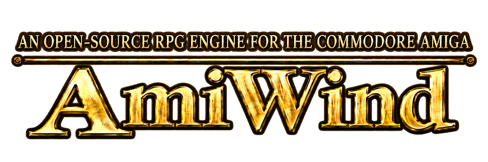
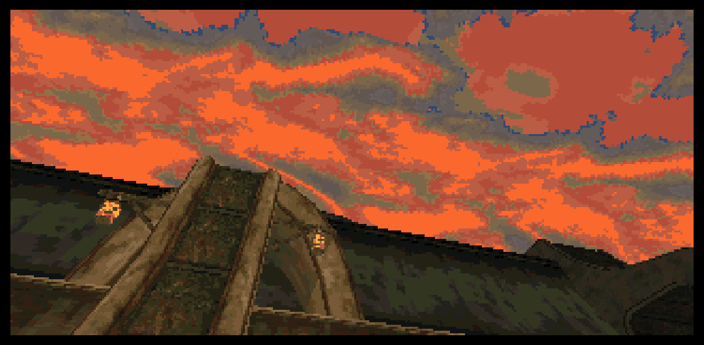

<p align="center">
  
</p>

# AmiWind

_Last updated with AmiWind v0.0.63-dev4 (9 November 2026)._

An unofficial, experimental RPG engine and enthusiast project bringing Morrowind
to the Commodore Amiga, featuring CHIM: an AmiQuake-based engine and an asset
conversion pipeline that builds the game from your own legally obtained copy of
Morrowind, and, in time, a base for your own Amiga RPG adventures.

Like community projects such as
[OpenMW](https://openmw.org), [MGE XE](https://github.com/Hrnchamd/MGE-XE) and
[MWSE](https://github.com/MWSE/MWSE), AmiWind ships with no game data or proprietary assets.

*Not affiliated with or endorsed by Bethesda Softworks or ZeniMax. Please support the original creators: buy Morrowind.*

<p align="center">
  
</p>

<p align="center">Not painted backdrops: every frame is rendered in real time by the engine.</p>

More in the [gallery](docs/GALLERY.md).

## Where AmiWind stands (9 November 2026)

In development: **v0.0.63-dev4**, the fourth snapshot of v0.0.63
([dev4 notes](docs/releases/notes/RELEASE-v0.0.63-dev4.md)): 27 more functions of the original's scripting carried out
(460 of 504, with the console's own commands callable from scripts; 605 of the 1,207 scripts running), and a builder
whose worker pools stay busy, whose world key no longer rebuilds for a change to the actor model reader, and which
reads the dialogue and voice tables and the actor ground check from its unit cache. Its changes are checked by tests,
not yet in play.

Before it, **v0.0.63-dev3** ([dev3 notes](docs/releases/notes/RELEASE-v0.0.63-dev3.md)) brought creatures that walk,
run and attack again wherever they are met, 66 more functions of the original's scripting, and a builder that reuses
every earlier run at once and shows its plan before any stage runs.
Before that, **v0.0.63-dev2** ([dev2 notes](docs/releases/notes/RELEASE-v0.0.63-dev2.md)) brought characters that fight
each other, allies, guards and followers that take sides, an opening closer to the original, the original game's
console commands, fire pits and scripted turning objects kept in saves, and a builder that runs its risky stages first.
Before that, **v0.0.63-dev1** ([dev1 notes](docs/releases/notes/RELEASE-v0.0.63-dev1.md)) brought a builder that keeps every finished unit the moment it
comes back, actor models that share their repeated shape data in the image (78.4 MB less on the v0.0.62 payload),
599 of the game's 1,207 scripts running, breath and drowning under water, god mode against every damage, creatures
that stand on the ground and attack on sight, the best-attack option and the original's hit chance and hit cone, and
drops on uneven room floors.

The newest release is **v0.0.62: Stick To The Script**, the scripts, crime and alchemy release: alchemy as in
the original, the creatures placed in rooms, 588 of the game's 1,207 scripts running (the
[tracker of the game's scripts](docs/MWSCRIPT_FEATURES.md)), the census office running its own scripts, dialogue choices
as rows to pick, guards who arrest for crimes with the fine and the jail of the original, persuasion and dialogue links
that work, a room that fails to load recovered instead of locking the game, a New Game that resets the game state, a
double-click in the inventory, character models reduced with measured seams, and debug commands for gold, load and
level, running on CHIM Engine v0.2.2 and needing 32 MB of Fast RAM
([release notes](docs/releases/notes/RELEASE-v0.0.62.md)). It was cut from what was to be the third snapshot; the
second snapshot, dev2, was not delivered and its work ships in it. The one before it, **v0.0.61: Keep Your Lantern
Lit**, was the combat, magic and light release: casting with a spell-effect system, weapons and shields of every type in
their stances, enchanted items that cast, one set of stats for every person and creature, an inventory limited only by
carry weight, carriable lights that take their flame with them, theft that witnesses report, a fuller dialogue and loot
window, the first slice of an in-game recorder, and a faster game
([release notes](docs/releases/notes/RELEASE-v0.0.61.md)). Before it, **v0.0.60: Work With What
You've Got**, made beds and the two rank raises work again, levelled container contents show their items, the bodies of
the dead can be searched, and the residents read small per-area tables
([release notes](docs/releases/notes/RELEASE-v0.0.60.md)). Before that, **v0.0.59: Assembling The Bits And
Pieces, Once Again**, gave every item its own world model, a world that keeps what you change across rooms and saved
games, the player's body and hands assembled from parts, the container strip, the original's journal view, and resting
and waiting by the original's rules ([release notes](docs/releases/notes/RELEASE-v0.0.59.md)). The project's own builds have had every exterior cell of Vvardenfell on CHIM since v0.0.43 (a build from the
repository does so only from v0.0.47, when the cell list became part of the repository and the default): 1,409
cells, counting the 61 in the town frames (1,348 are one-cell region frames; 1,292 land cells, 98 sea-floor cells
and 19 open-sea cells), with no classic region maps left outdoors. What these numbers count:
[the counting table](docs/chim/CELL_TRACKER.md#what-we-count); every cell: the
[CHIM Progress Tracker](docs/chim/PROGRESS_TRACKER.md). Since v0.0.48 every interior of the base game but two (the
prison and the census office) is built as a CHIM room, with the people the game places in them. Solstheim is not
converted.

v0.0.62 shipped as what was to be its third snapshot with the final version number; its first snapshot
([dev1 notes](docs/releases/notes/RELEASE-v0.0.62-dev1.md)) added alchemy, the creatures placed in rooms, the scripts of
a new game and the falling mage, and its second ([dev2 notes](docs/releases/notes/RELEASE-v0.0.62-dev2.md)) was not
delivered. v0.0.61 shipped as its third snapshot with the final version number
([release notes](docs/releases/notes/RELEASE-v0.0.61.md)).

What comes next is in the [roadmap](docs/ROADMAP.md). Still to come after v0.0.62: the rest of the crime system
(pickpocketing, picking owned locks), enchanting and spellmaking, more of the game's scripts (44 of the original's 504 script functions are not carried
out yet), per-area data tables for
containers, doors, items, activators and creatures, outdoor items that can be picked up, dropped lights with their
flame, the Constant Effect items of non-player characters, summoned creatures that fight for the player, and the in-game
check of the pieces not yet seen in play. Items that are in no version's list yet stay in the backlog until they are
scheduled.

### What v0.0.62 changed

Alchemy as in the original (the window, potions, ingredients); the creatures placed in tombs, caves and other rooms;
588 of 1,207 game scripts running, among them the census office's own scripts, items that are carried or kept in
containers, HitOnMe, PlayBink and weather changes; dialogue choices as rows to pick, links that stay clickable, thin
scroll bars and persuasion that works; guards who arrest for theft, assault, murder and trespass, with the fine, resisting
arrest and jail, and pursuers saved in games; a failed room load that brings the player back and a New Game that resets
every state; the player's torch, the use key and the container and class windows reworked; a double-click in the
inventory; character bodies reduced with measured seams; summoned creatures; and debug commands for gold, the carrying
limit, the level and the stats. Known limits: the Heart Chamber may not load at 32 MB Fast RAM, pickpocketing and owned
locks are not done, 619 scripts do not run yet, and the new fixes were checked by tests, not yet in play. Full list:
[v0.0.62 release notes](docs/releases/notes/RELEASE-v0.0.62.md).

### What v0.0.61 changed

Player casting with a spell-effect system of 143 effects kept in saves; weapons and shields of every type in their
stances, first-person bow, crossbow and thrown stances, two styles of weapon sway and creatures that resist normal
weapons; enchanted items that cast (Cast When Strikes, Cast When Used, Constant Effect) and the class starting spells;
every person and creature carrying the full stats of its record; an inventory with no fixed number of kinds, only carry
weight; carriable lights that take their flame with them, held candles, candlesticks and lanterns drawn and lit as
themselves; witnessed theft with a bounty; dialogue notices, keys and a fuller loot window; first-person arms in their
own view, the armour rating and swimming in the worn clothes; and the first slice of an in-game recorder. Where it is faster:
Seyda Neen waits 31 to 49 % less for the disk, and containers, the inventory and place loads much faster with hundreds of kinds carried.
Known limits: a dropped light gets no flame, a Shield effect does not soften blows yet, and the full crime system,
alchemy, enchanting and spellmaking are v0.0.62. Full list: [v0.0.61 release notes](docs/releases/notes/RELEASE-v0.0.61.md).

### What v0.0.60 changed

The scripts stage is rebuilt whenever the script compiler changes, so placed beds open the rest window and the two
rank raises happen again (v0.0.59 shipped scripts of an older compiler). Containers whose contents are levelled lists
roll their items by the original's rules and keep them across saves, and a dead actor under the crosshair reads "E:
Search" and opens what it carried in the container strip. The walking residents and the residents built from parts take
their data from small tables per area, kept in memory. [The game feature tracker](docs/GAME_FEATURES.md) lists 48
systems of the base game; `dbg kill` kills the actor picked with a red crosshair, and the game shows its own message
when an essential character dies (both checked by tests, not yet in game). The builder warns early about size growth and
output names, and the reuse check is faster. Known limits: the first frame in Seyda Neen takes about a second, the
residents' walking steps can cost 200 to 800 ms on some frames (the new tables are not yet measured in game), and
casting waits for v0.0.61. Full list: [v0.0.60 release notes](docs/releases/notes/RELEASE-v0.0.60.md).

### What v0.0.59 changed

World items: 880 item models in one shared table, a model table of 512 entries per map, the game's own items placed
from it and taken, and [an index of the items you can pick up](docs/ITEMS_INDEX.md). The world change list keeps what
you change across rooms and saves, with respawn and saves that survive a change of game data. The player's body and
arms are built from parts and kept in memory, so arriving in Seyda Neen takes about a second instead of 12 to 15.
Containers open in a strip with Take All, the journal is the original's dated view, resting and waiting follow the
original, conversations open at once again, and the mouse cursor is the original's. Builds rebuild less, and the
disk images are padded to whole IDE cylinders. Known limits: containers with levelled contents open empty, bodies
cannot be looted yet, the residents' walking steps can cost up to 800 ms on some frames, and casting waits for
v0.0.60. Full list: [v0.0.59 release notes](docs/releases/notes/RELEASE-v0.0.59.md).

### What v0.0.58 changed

Dialogue: topic names in an answer are links; Admire, Intimidate, Taunt and Bribe work with the original's rules;
Travel, Training, Spells, Barter, Repair, Spellmaking and Enchanting open from the conversation; answers run their
scripts (choices, faction reactions); the greeting is picked at talk time; the journal's topic pages open the
dialogue. Character creation has a scrolled class list, the birthsign page, the install's class questions, a class of
your own and the review sheet. Aiming at something shows a box (name, weight and value for an item), placed items can
be taken, books and letters are read in place, and Left Ctrl sneaks. Creatures make their own sounds and the combat
sounds are on by default. The cliff racer is drawn whole, an NTSC machine starts, the presets show only the drawn
picture, and the AmiWind Toolkit's build monitor shows progress, gates and tests with their cores. The game's scripts
run, and a played character creation, a stolen item kept through a save and the debug restart from the main menu were
checked in game; the filled text macros in books and the journal, taking a free item, the aim box on doors, the
Fargoth greeting, your own footsteps, the creature sound test, the class questions with the install's data, a class of
your own and the class list are not yet checked in game. Known limits: the back-room table of the Census and Excise Office is
not drawn, casting waits for v0.0.59, dialogue texts still fill the player's name at run time (action-key macros show
the action's word, not the bound key), and the aim box measures the reach to an item's origin. Full list:
[v0.0.58 release notes](docs/releases/notes/RELEASE-v0.0.58.md).

### What v0.0.57 changed

Talk (E) opens the dialogue window: the greeting, the topics, and the game's own answers chosen by the original's
rule, with the blue disposition bar and answers that follow the game as it goes. People and creatures wander and idle
by their own records, walk and run by the distance they cover, and turn on the
player within their fight distance; cliff racers fly and attack, fish swim, every resident animates, and creatures
attack with their own moves. Guards light their torches at night. 957 of the game's 1,207 scripts run whole, using
scripted objects works, and saves keep the player's standing and the characters' orders. The fog starts at 300, the sky
fades into it, large interiors fade into fog, and the heaviest models are lighter. `dbg tp` opens a list of the 82
named places, and the race page shows each race's stats. Full list:
[v0.0.57 release notes](docs/releases/notes/RELEASE-v0.0.57.md).

### What v0.0.56 changed

A Raspberry Pi 4 starts straight into AmiWind from a USB stick, and `tools/pi_image/make_pi_image.sh` makes such a
stick from your own Kickstart and your own AmiWind image; on a Pi 4 the game is playable, about 10 to 50 frames a
second by scene. `dbg fps on` shows the frame rate without the debug HUD, and new teleports reach Khuul and the Vivec
Arena Pit. Full list: [v0.0.56 release notes](docs/releases/notes/RELEASE-v0.0.56.md).

### What v0.0.55 changed

Nearer Red Mountain the sky, the light on the land and, at half strength, the fog turn toward the game's own Blight
weather before the mountain's region begins (Ald'ruhn keeps its own weather), the clouds speed up toward Blight's and
the crater sky is darker still (`aw_redmountain`, on by default). The builder reads the machine's memory when there is
no container, retries a worker lost to memory with fewer units at once instead of failing, and watches the build disk
like the memory; the Toolkit's build monitor shows RAM, the disk, a memory curve and every warning of a build. The
garbage collector (`tools/build_gc.py`) now ages out the runs of old release series, and every build warns before its
disk is full and names it. The docs have folders and a generated index. Full list:
[v0.0.55 release notes](docs/releases/notes/RELEASE-v0.0.55.md).

### What v0.0.54 changed

Humanoid characters choose every animation by what they are doing (standing, walking, running, fighting, casting,
dying) by OpenMW's rules, and their hair is kept whole instead of being cut to a budget. All 3,437 NPCs and creatures
of Morrowind, Tribunal and Bloodmoon have one record each, from the game data (stats, behaviour, items, spells), kept
in saved games; the experimental scripts read and change them, and 715 of the game's 1,207 scripts now run whole.
Silt striders, boats, gondolas and guild guides travel again with the original destinations and prices. Spells can
show the game's own effect textures as sprites and particles (experimental, off by default). 34 of the 35 entrances
whose converted collision kept the use key out of reach can be used. Weather and smoke follow the game's tables,
interiors have their fog, outdoor creatures come from the levelled lists, and the interface has a crosshair, a
hide-HUD key and the player's arrow on the map. NPC Gallery v2.0 shows the game's own characters, and an engine
change no longer rebuilds the CHIM world.

### Memory: 32 MB of Fast RAM is the safe minimum (23 October 2026)

The base game's main pieces are finally coming together:
- every interior of the base game on its way in as a CHIM room;
- the people and creatures standing where the game places them;
- every NPC speaking with its own voice.

The good news: the whole thing still takes a reasonable amount of disk space. The sad part: some of it would need
far too much squeezing to fit a 16 MB expansion. Everything runs so smoothly with 32 MB that 32 MB is the default
from here on. On today's accelerator cards that is rarely a problem: many of them carry well over 32 MB of Fast
RAM, and AmiWind puts the extra to use. Most of the island can still be explored with 16 MB: of the base game's 1,134 interiors, the 16
biggest ask for 32 MB at the door (and 5 region frames at their border), and the rest open as before.

For now the game requires **32 MB of Fast RAM, the safe minimum**, which should be enough for the entire game. More
RAM is used automatically (a larger game heap, CHIM's caches and reading ahead). 16 MB still starts, with a warning
at boot and a warning box for a few seconds before the AmiWind logo (from v0.0.52), but parts of the game will run
incorrectly or not at all. The emulator presets and the launcher start with 32 MB. Why, with the measured
numbers: [why 32 MB](docs/REAL_HARDWARE.md#why-32-mb-of-fast-ram).

### What v0.0.53 changed

The doors of a region frame work after you walk into it across a frame border: before, the engine read only the door
table of the frame the game started in, and 830 of the 1,102 exterior entrances were dead once walked into. Every
build now runs the engine's own door code over all 1,102 entrances (the prompt, the use key, the way back out, and
the wall between the player and the door), and the count of usable entrances may only go up; 1,102 of 1,102 work after
a walk over a frame border. A stricter check, which also traces the wall between the player and the door in the world's own collision, counts
1,067 usable, 31 more than before the release's doorway slack; the 35 left (Daedric shrine steps the player slides
off, raised trapdoors, a few Dwemer and hut doors) move to v0.0.54. The four
dancers of the base game who have a dance of their own (Desele's House of Earthly Delights in Suran among them) now
dance it, from the shared animation table. A Halloween scene on the animation stage (the game's own skeletons, the
Suran dancers and Dagoth Ur dancing to a beat, filmed by a camera director) is also the standard benchmark: `aw bench
halloween` (the aliases `aw halloweenbench` and `dbg halloween bench`) plays the same 600 frames on every machine and
prints one line to copy. In v0.0.53 the scene and the benchmark need a build with the cast (`--miniwind-halloween`);
from v0.0.54 every full-world build carries the cast (about 1 MB, loaded only when the scene starts), so the
benchmark works in the release images ([HALLOWEEN.md](docs/HALLOWEEN.md)). A build can carry one track of your own for the scene (the custom OST slot); public builds
ship no song. Builds check the free disk space first and stop
before their first stage when it is short, the GitHub checks run in parallel jobs, a version-only change no longer
rebuilds the CHIM world, and a maintainer's deferral to a version stops counting at that version.

### What v0.0.52 changed

Every character moves by one shared skeleton and one shared action table, as in the original game, instead of frames
baked one character at a time ([modular NPCs](docs/MODULAR_NPCS.md#getting-npc-movement-right)): the base game's
2,612 placed characters take 512 MB of models instead of 3,222 MB, and each can walk, run, swim, fight with every
weapon, cast, block, dodge, fall and die, with weapons, shields and the guards' torches on the hand bones. On a slow
68040 a town frame draws as fast as with baked characters. Dagoth Ur, his whole original model, and the Heart of
Lorkhan are in Akulakhan's Chamber for the first time, and the chamber loads on 32 MB, also coming from a town. A full
memory no longer stops the machine with a Software Failure, and a WARNING box says so when there is less than 32 MB.

Earlier releases: the [release notes](docs/releases/notes/RELEASE-v0.0.54.md) link back through every version, and the sections the
front page used to carry are kept in [earlier README sections](docs/README_ARCHIVE.md).

### What works, and the honest limits

- **The whole main island is in.** All of Vvardenfell's outdoors, 1,409 exterior cells, is converted and streamed
  as you walk; visit the towns and cities of the main island, such as Seyda Neen, Balmora, Vivec and many others.
- **Every interior of the base game is in.** 1,132 of the 1,134 are CHIM rooms; the two where the opening sequence
  runs (the prison ship and the census office) stay classic room maps on purpose until rooms have object state. The
  people and creatures the game places in a room stand in it with their full set of animations and their own voices.
- **Every door leads in and back out.** All 3,133 load doors and markers of the base game resolve through one door
  table; the build fails if one does not ([door graph](docs/chim/DOOR_GRAPH.md)). Since v0.0.53 the build also runs
  the engine's own door code over all 1,102 exterior entrances, also after a walk across a frame border, and its
  count of usable entrances may only go up.
- **Play:** create your character through the opening sequence; the inventory (no limit on the kinds of item, only
  carry weight, with the armour rating and a preview that follows what you wear), the journal and the map; saving and
  loading, with what you change in the world staying changed; melee combat with the original's rules (damage, armour,
  block, knockdown, knockout, fatigue, death), creatures that walk, run and attack with their own animations, and
  weapons and shields of every type in first and third person;
  casting spells, with the original's chance, cost and effects, and enchanted items that cast; talking to people
  (topics, choices, disposition, persuasion and the services); containers and the bodies of the dead opened in a strip;
  crimes seen by a witness bring the guards, with the arrest, the fine and jail; alchemy (making and drinking
  potions); a torch, a candle, a candlestick or a lantern in the hand
  to explore Vvardenfell at night and underground; mushrooms to pick indoors and out; the original movement speeds;
  weather by region, and music streamed from disk; travel by silt strider, boat, gondola and guild guide.
- **Not yet:** most quests and other game logic that depends on scripts the game does not run yet (588 of the 1,207
  scripts run in v0.0.62, 599 in v0.0.63-dev1, 605 from v0.0.63-dev2 to v0.0.63-dev4, and 8 more the game's own opening code
  carries, with 460 of the original's 504 script functions carried out; [the MWScript tracker](docs/MWSCRIPT_FEATURES.md)), pickpocketing and picking owned locks, trespass,
  making your own enchantments, the
  shot of a bow or a thrown weapon, schedules by the time of day and most of the scripted AI packages, and Dagoth Ur's
  fight and voice. The jail markers are in the door table for the jail system to come. The Unmarked Shipwreck's upper
  trapdoor still keeps the use key out of reach ([v0.0.55 release notes](docs/releases/notes/RELEASE-v0.0.55.md#known-in-this-build)).
  [The game feature tracker](docs/GAME_FEATURES.md) lists every system of the base game with its state.
- The reference target is an A1200 with AGA, a 68040 with FPU, 2 MiB Chip and 32 MiB Fast RAM (the safe minimum;
  16 MiB starts with a warning); development and
  every performance figure so far come from emulators and are relative. The first real-hardware figures, from testers
  in October 2026: about 0.2 frames per second on an A4000 with a 68060 at 100 MHz (an earlier build), and about 0.6
  to 0.7 on an A3000 with a 68060 at 80 MHz through RTG (a tester's own modified build): not playable yet. The game
  aims at today's accelerated 68k Amigas, with a classic 68060 as the floor. See [AmiWind on real hardware](docs/REAL_HARDWARE.md) and [AmiWind on the 68060](docs/68060.md).
- Crossing from one outdoor cell to the next is streamed; walking into or out of a town is still a level change
  ([cell crossings](docs/chim/CELL_CROSSINGS.md)).
- The known problems are listed in [the bug register](docs/BUGS.md) and under "Known in this build" in each
  release's notes.

## Build it from your own Morrowind

**Original Morrowind game files are required. You must provide your own copy**, and you need your own licensed
Amiga Kickstart 3.1 ROM to run the result. The repository includes neither. AmiWind recommends the GOG GOTY edition
(the best tested; the Steam GOTY edition is a supported fallback with bitmap fonts). More: [About AmiWind](docs/ABOUT.md).

On Ubuntu/Debian (or Ubuntu under WSL), compile with:

```sh
./build.sh --autoinstall
```

and, with FS-UAE installed, build and run in one go:

```sh
./build.sh --autoinstall --autorun-fs-uae \
  --kickstart-file "/path/to/your/kickstart-3.1-a1200.rom"
```

`--autoinstall --plan` shows the setup steps without installing anything. On Windows start with
`.\setup-windows.cmd -Plan` (experimental; [Windows setup guide](docs/WINDOWS_BUILD.md)). A normal build includes
everything the release ships; the default builder is CHIM. The recorded v0.0.31 Seyda Neen maps
(`--seyda-recorded DIR`) are optional and NOT RECOMMENDED since v0.0.31: by default Seyda Neen is converted from
your data ([which Seyda Neen is in my build](docs/LINUX_BUILD.md#which-seyda-neen-is-in-my-build)). For a quick
test image of one spot see [MiniWind: the test ground](docs/MINIWIND.md), the
[build type reference](docs/MINIWIND_PLAYTESTER.md) and the [CHIM build guide](docs/chim/build_guide/README.md).

Everything else about building, the build speed options, the FPU support library and running the image in FS-UAE or
WinUAE: [Building and playing](docs/BUILDING_AND_PLAYING.md), the [Linux build guide](docs/LINUX_BUILD.md) and the
[FS-UAE launcher](docs/FS-UAE-LAUNCHER.md). The newest emulator presets are
[`AmiWind-v0.0.63-dev4-FS-UAE.fs-uae`](resources/emulators/AmiWind-v0.0.63-dev4-FS-UAE.fs-uae) and
[`AmiWind-v0.0.63-dev4-WinUAE.uae`](resources/emulators/AmiWind-v0.0.63-dev4-WinUAE.uae) (for the v0.0.62 release:
[`AmiWind-v0.0.62-FS-UAE.fs-uae`](resources/emulators/AmiWind-v0.0.62-FS-UAE.fs-uae) and
[`AmiWind-v0.0.62-WinUAE.uae`](resources/emulators/AmiWind-v0.0.62-WinUAE.uae)); all start with 32 MB of
Fast RAM.

## Where to read more

- Every document, by topic: [the documentation index](docs/README.md) · every release with its notes:
  [releases](docs/releases/README.md)
- Project: [FAQ](docs/FAQ.md) · [Gallery](docs/GALLERY.md) · [Project state](docs/PROJECT_STATE.md) ·
  [Roadmap](docs/ROADMAP.md) · [Changelog](docs/CHANGELOG.md) · [Open bug reports](docs/BUGS.md)
- How it works: [Architecture](docs/ARCHITECTURE.md) · [Actor placement](docs/ACTOR_PLACEMENT.md) · [CHIM](docs/chim/README.md) ·
  [CHIM progress tracker](docs/chim/PROGRESS_TRACKER.md) · [CHIM progress map (colours)](docs/chim/CHIM_PROGRESS_MAP.md) · [Asset coverage](docs/ASSET_COVERAGE.md) · [Game features](docs/GAME_FEATURES.md)
- Building: [Building and playing](docs/BUILDING_AND_PLAYING.md) · [Build dependencies](docs/BUILD_DEPENDENCIES.md) ·
  [Release workflow](docs/RELEASE_WORKFLOW.md) · [Hosted CI jobs](docs/CI.md)
- Development: [Repository layout](docs/REPOSITORY_LAYOUT.md) · [Project rules](docs/PROJECT_RULES.md) (including the
  required Linux and Windows compatibility) · [Polycount Inspector](docs/POLYCOUNT_INSPECTOR.md) ·
  [Earlier README sections](docs/README_ARCHIVE.md)
- Licences and credits: [About AmiWind](docs/ABOUT.md) · [Licensing and credits](docs/LICENSING_AND_CREDITS.md)

## About

Created by **FlyingFathead a.k.a. Horstator**. Thanks to: **ChaosWhisperer**.
**Official project repository:** [FlyingFathead/amiwind](https://github.com/FlyingFathead/amiwind).

AmiWind runs on the CHIM engine, built on GPLv2 code from **id Software's Quake** (John Carmack and the id team) and
its Amiga port **AmiQuake** (Peter McGavin, NovaCoder, Stephen Leary). The CHIM builder that converts your own
Morrowind files is GPLv3 ([LICENSE](LICENSE)). The public source package holds no Quake or Morrowind game data, ROMs
or compiled AmiWind executable; game images you build yourself are private build outputs. Copyrights stay with their
holders; the full statement is in [About AmiWind](docs/ABOUT.md).

> Massive thanks to everyone in the Amiga community who have been willing to
> share code and ideas to make this dream come true to a beloved platform.
> *May the wind be on your back!*

---

<p align="center"><i>AmiWind is brought to you by <a href="https://github.com/FlyingFathead/">FlyingFathead</a></i></p>
