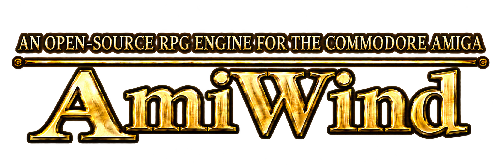

<p align="center">
  
</p>

# AmiWind

_Last updated with AmiWind v0.0.68-dev4 (21 November 2026)._

An unofficial, experimental RPG engine and enthusiast project bringing Morrowind
to the Commodore Amiga, featuring CHIM: an AmiQuake-based engine and an asset
conversion pipeline that builds the game from your own legally obtained copy of
Morrowind, and, in time, a base for your own Amiga RPG adventures.

Like community projects such as
[OpenMW](https://openmw.org), [MGE XE](https://github.com/Hrnchamd/MGE-XE) and
[MWSE](https://github.com/MWSE/MWSE), AmiWind ships with no game data or proprietary assets.

*Not affiliated with or endorsed by Bethesda Softworks or ZeniMax. Please support the original creators: buy Morrowind.*

<p align="center">
  
</p>

<p align="center">Not painted backdrops: every frame is rendered in real time by the engine.</p>

More in the [gallery](docs/GALLERY.md).

## Where AmiWind stands (19 November 2026)

The newest release is **v0.0.67: Tribunal Introduced**. It introduces Tribunal, the first expansion, into the game:
Tribunal's additions to Vvardenfell are in the build, and Mournhold can be reached from Ebonheart through the
characters' own dialogue and walked from the palace to the Plaza (shown in the emulator on a development build of this
release). Its quests and much of its play are not ready yet, and Solstheim is not in the game. It runs on CHIM Engine v0.2.2 and needs
32 MB of Fast RAM.

**New**

- Mournhold's five districts are a build module of their own, with their containers, items, doors and people placed in
  source (still to be seen in play), and the scripts of the expansions' placed objects run.
- Every race and sex has its own first-person hands, and the held light is in the left hand again.
- The inventory shows one action per kind of item and casts scrolls.
- A place that cannot be loaded names its error and leaves you where you were.
- The confirmed look book checks every look the maintainer confirmed on each development build.

**Fixed**

- The game no longer stops on a loading screen in busy places such as Vivec and the Bitter Coast.
- Autosaves are written again on every map change, and wild creatures are back outdoors (measured in the emulator; the
  entries stay open until a played game shows them).
- Spell effects show the original's shell, creatures move and fight as in the original, and most errors in play send
  you back instead of ending the game.

**Builder and tools**

- A build reuses earlier builds by default, checks for problems in its first minutes, and a failed build writes one
  failure page.

Several fixes are made in source and covered by tests, and are still to be seen in play. Every change, with the detail:
the [changelog](docs/CHANGELOG.md#v0067-tribunal-introduced-19-november-2026) and the
[v0.0.67 release notes](docs/releases/notes/RELEASE-v0.0.67.md), which link the notes of the three development
snapshots. Known problems: the notes' "Known in this build" and [the bug tracker](docs/BUGS.md).

**In development: v0.0.68-dev4** (21 November 2026), the fourth snapshot of the next version. The invisible walls of
the game are solid boxes now, the Ghostfence's glow is in behind a switch, and more of the original's console commands
work; none of it is seen in play yet
([v0.0.68-dev4 notes](docs/releases/notes/RELEASE-v0.0.68-dev4.md)). The snapshot before it brought Solstheim's first 135
open terrain cells into the build, reached only by a debug teleport for now, and outdoor pieces that scripts take or
switch off stay hidden, however many ([dev3](docs/releases/notes/RELEASE-v0.0.68-dev3.md)). Before it came the hands
mended (a light and a weapon held together, third-person fists, readied magic through doors) and the moving water of
Old Mournhold's levers, seen working in play ([dev2](docs/releases/notes/RELEASE-v0.0.68-dev2.md);
[dev1](docs/releases/notes/RELEASE-v0.0.68-dev1.md)).

The release before it, **v0.0.66: Forward It Is**, took the game forward on the road to the expansions: people and
creatures cast spells and shoot bows, the dead stay dead, a fuller map, a save that keeps every change, and an opening
that holds its controls as the original does ([v0.0.66 notes](docs/releases/notes/RELEASE-v0.0.66.md)).

## What already works

- **Vvardenfell, whole.** All 1,408 exterior cells of the main island (1,292 land and 116 sea) on CHIM, streamed as you walk, and 1,121 of its
  1,123 interiors as CHIM rooms (the prison ship and the census office are room maps of their own, counted as ready), with the people and
  creatures the game places in them ([CHIM progress tracker](docs/chim/PROGRESS_TRACKER.md),
  [the map's colours](docs/chim/CHIM_PROGRESS_MAP.md)). Every load door of the base game leads in and back out.
- **Play:** character creation through the opening; the inventory, the journal and the map; saving and loading, with what
  you change staying changed; combat and casting by the original's rules; talking and the services; crime
  with witnesses, guards, fines and jail; alchemy; containers and bodies to search (a locked container does not open
  yet); torches and lanterns for the night and the caves; weather, music and travel by silt strider, boat, gondola and
  guild guide.
- **Levelling:** a full rest opens the original's level-up box with its attribute multipliers; the raised values stay
  through a save and a load.
- **Resting:** a 12-hour rest in the wilderness at level 40 brought the attack of the Dark Brotherhood, with its wake
  message on screen, and the debug command for it works; a wilderness rest that is cut short brings a creature of the
  region's list at the right hour (seen in the emulator on the release image).
- **Tribunal, the first steps:** Tribunal's additions to Vvardenfell are in the build, and Mournhold is reached from
  Ebonheart through the characters' own dialogue and back again; its five districts can be walked, slowly (8 to 16
  frames a second in the emulator). A new game starts the city in peace (the Plaza's fabricants, the two Gaenors and
  the Hall of Ministry's rats stay out of it), the Great Bazaar's teleport arrival puts the player on the street, Godsreach's
  gate to the Plaza opens, and a fight is not carried into the next place, in Vvardenfell and in Mournhold.
- **The game's scripts:** of the 1,074 scripts the original uses, 927 run and 9 more are carried by AmiWind's own code,
  235 of Tribunal's 236 among them ([the MWScript tracker](docs/MWSCRIPT_FEATURES.md)).
- **Hardware:** the reference target is an A1200 with AGA, a 68040 with FPU, 2 MiB Chip and 32 MiB Fast RAM (16 MiB
  starts with a warning, but parts of the game run wrongly or not at all). The figures so far come from emulators and
  the Raspberry Pi 4B ([real hardware](docs/REAL_HARDWARE.md)).

## What comes next

What is not working yet, and what is in work:

- **Tribunal in play:** Mournhold's quests and most of its play are still to be seen in play; the two water levers of
  Old Mournhold work in play. The districts' frame
  rate, the Plaza's view from its arrival point and Godsreach's canal are open in the bug tracker.
- **Bloodmoon:** Solstheim is not playable yet. Its first 135 open terrain cells are in the build and are reached only by
  a debug teleport; no door or journey leads there, and nothing of it has been seen in play.
- **Resting:** the wilderness creature came too often in one session, because every start of the game replays the same
  random numbers; this is fixed in source for the next build and still to be seen in play, as is a person or creature
  that a script keeps out of the world and that a debug teleport inside the loaded map drew again. The Dark Brotherhood
  was seen at level 40 only; other levels are still being checked.
- **Persuasion and skills:** persuasion in dialogue does nothing yet (open, cause not known); that skills rise with use
  is repaired and its in-game check is pending.
- **The base game:** the end of the main quest in the Heart Chamber; pickpocketing, picking owned locks and locks on
  doors and containers; making your own enchantments; schedules by the time of day; the shores still run in saw-tooth steps.
- **Hardware:** real 68060 machines are not playable yet ([the 68060](docs/68060.md)).

Every system of the base game with its state: [game features](docs/GAME_FEATURES.md). Known problems:
[the bug tracker](docs/BUGS.md).

**Then v0.0.68** (in development, [dev4](docs/releases/notes/RELEASE-v0.0.68-dev4.md) is out) continues with the
expansions' finished content: Tribunal's Mournhold with its quests and Bloodmoon's Solstheim, with their scripts; a
build that fits a 32 GB machine; then the rest of the open plan. The order of record is the [roadmap](docs/ROADMAP.md);
no dates are promised.

## Build it from your own Morrowind

**Original Morrowind game files are required. You must provide your own copy**, and you need your own licensed
Amiga Kickstart 3.1 ROM to run the result. The repository includes neither. AmiWind recommends the GOG GOTY edition
(the best tested; the Steam GOTY edition is a supported fallback with bitmap fonts). More: [About AmiWind](docs/ABOUT.md).

On Ubuntu/Debian (or Ubuntu under WSL), compile with:

```sh
./build.sh --autoinstall
```

and, with FS-UAE installed, build and run in one go:

```sh
./build.sh --autoinstall --autorun-fs-uae \
  --kickstart-file "/path/to/your/kickstart-3.1-a1200.rom"
```

`--autoinstall --plan` shows the setup steps without installing anything. On Windows start with
`.\setup-windows.cmd -Plan` (experimental; [Windows setup guide](docs/WINDOWS_BUILD.md)). A normal build includes
everything the release ships, Tribunal and Bloodmoon read by default where you own them (`--no-dlc` for the base game
alone). The recorded v0.0.31 Seyda Neen maps (`--seyda-recorded DIR`) are optional and NOT RECOMMENDED since v0.0.31
([which Seyda Neen is in my build](docs/LINUX_BUILD.md#which-seyda-neen-is-in-my-build)). For a quick test image of one
spot: [MiniWind: the test ground](docs/MINIWIND.md) and the [build type reference](docs/MINIWIND_PLAYTESTER.md).

**If a build fails, send the file `logs/BUILD-REPORT-<run>.txt`** from the build workspace (`out/` by default; the
build prints where it is): one file with what failed and every setting, kept on your computer until you send it
([when a build fails](docs/LINUX_BUILD.md#when-a-build-fails)). **A build that stopped, out of memory included, is
never started over:** do not delete the build folder, run the same command again from the same folder, and the
finished work is taken back; the build's last lines say what to change first
([the build stopped or ran out of memory: what now?](docs/LINUX_BUILD.md#the-build-stopped-or-ran-out-of-memory-what-now)).

The emulator presets of this version are
[`AmiWind-v0.0.68-dev4-FS-UAE.fs-uae`](resources/emulators/AmiWind-v0.0.68-dev4-FS-UAE.fs-uae) and
[`AmiWind-v0.0.68-dev4-WinUAE.uae`](resources/emulators/AmiWind-v0.0.68-dev4-WinUAE.uae); both start with 32 MB of Fast
RAM, the requirement. The presets of earlier versions are beside them in [resources/emulators](resources/emulators/). Everything
else about building and playing: [Building and playing](docs/BUILDING_AND_PLAYING.md), the
[Linux build guide](docs/LINUX_BUILD.md) and the [FS-UAE launcher](docs/FS-UAE-LAUNCHER.md).

## Where to read more

- Every document, by topic: [the documentation index](docs/README.md) · every release with its notes:
  [releases](docs/releases/README.md) · the history of every version: [changelog](docs/CHANGELOG.md)
- Project: [FAQ](docs/FAQ.md) · [Gallery](docs/GALLERY.md) · [Project state](docs/PROJECT_STATE.md) ·
  [Roadmap](docs/ROADMAP.md) · [Open bug reports](docs/BUGS.md)
- How it works: [Architecture](docs/ARCHITECTURE.md) · [CHIM](docs/chim/README.md) ·
  [CHIM progress tracker](docs/chim/PROGRESS_TRACKER.md) · [Game features](docs/GAME_FEATURES.md)
- Building: [Building and playing](docs/BUILDING_AND_PLAYING.md) · [Build dependencies](docs/BUILD_DEPENDENCIES.md) ·
  [Release workflow](docs/RELEASE_WORKFLOW.md)
- Development: [Repository layout](docs/REPOSITORY_LAYOUT.md) · [Project rules](docs/PROJECT_RULES.md) ·
  [Earlier README sections](docs/README_ARCHIVE.md)
- Licences and credits: [About AmiWind](docs/ABOUT.md) · [Licensing and credits](docs/LICENSING_AND_CREDITS.md)

## About

Created by **FlyingFathead a.k.a. Horstator**. Thanks to: **ChaosWhisperer**.
**Official project repository:** [FlyingFathead/amiwind](https://github.com/FlyingFathead/amiwind).

AmiWind runs on the CHIM engine, built on GPLv2 code from **id Software's Quake** (John Carmack and the id team) and
its Amiga port **AmiQuake** (Peter McGavin, NovaCoder, Stephen Leary). The CHIM builder that converts your own
Morrowind files is GPLv3 ([LICENSE](LICENSE)). The public source package holds no Quake or Morrowind game data, ROMs
or compiled AmiWind executable; game images you build yourself are private build outputs. Copyrights stay with their
holders; the full statement is in [About AmiWind](docs/ABOUT.md).

> Massive thanks to everyone in the Amiga community who have been willing to
> share code and ideas to make this dream come true to a beloved platform.
> *May the wind be on your back!*

---

<p align="center"><i>AmiWind is brought to you by <a href="https://github.com/FlyingFathead/">FlyingFathead</a></i></p>
