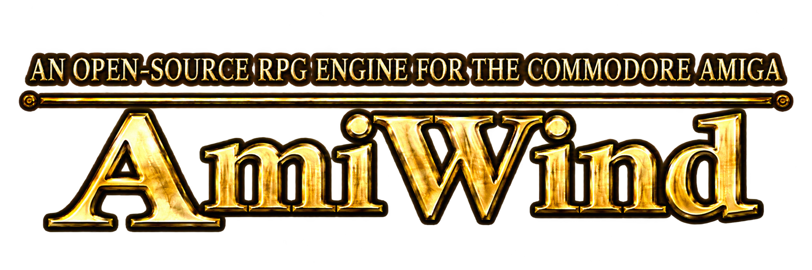
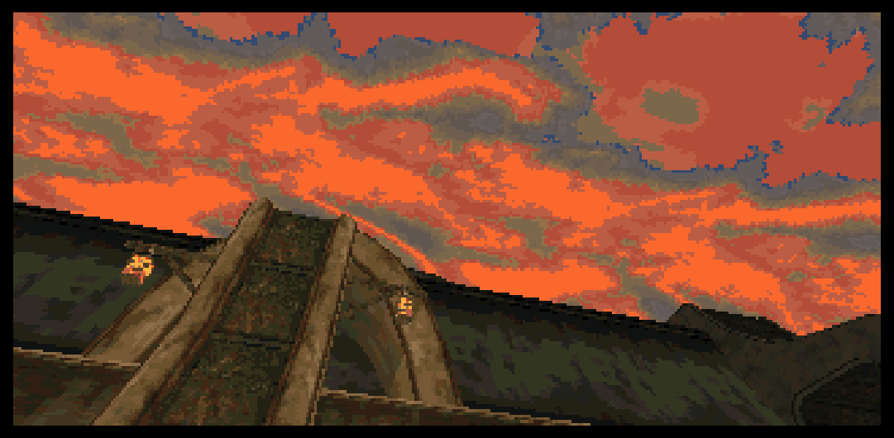

<p align="center">
  
</p>

# AmiWind

_Last updated with AmiWind v0.0.55-dev1 (28 October 2026)._

An unofficial, experimental RPG engine and enthusiast project bringing Morrowind
to the Commodore Amiga, featuring CHIM: an AmiQuake-based engine and an asset
conversion pipeline that builds the game from your own legally obtained copy of
Morrowind, and, in time, a base for your own Amiga RPG adventures.

Like community projects such as
[OpenMW](https://openmw.org), [MGE XE](https://github.com/Hrnchamd/MGE-XE) and
[MWSE](https://github.com/MWSE/MWSE), AmiWind ships with no game data or proprietary assets.

*Not affiliated with or endorsed by Bethesda Softworks or ZeniMax. Please support the original creators: buy Morrowind.*

<p align="center">
  
</p>

<p align="center">Not painted backdrops: every frame is rendered in real time by the engine.</p>

More in the [gallery](docs/GALLERY.md).

## Where AmiWind stands (28 October 2026)

The newest release is **v0.0.54: Hair, Movement, Magic And More**: characters move by what they are doing and keep
their hair whole, every NPC and creature has its own record of stats, items and spells from the game data, travel
services are back, spells can show the game's own effects (experimental, off by default), and 34 more entrances can be used, running
on CHIM Engine v0.2.2 ([release notes](docs/releases/notes/RELEASE-v0.0.54.md)). The project's own builds have had every exterior cell of Vvardenfell on CHIM since v0.0.43 (a build from the
repository does so only from v0.0.47, when the cell list became part of the repository and the default): 1,409
cells, counting the 61 in the town frames (1,348 are one-cell region frames; 1,292 land cells, 98 sea-floor cells
and 19 open-sea cells), with no classic region maps left outdoors. What these numbers count:
[the counting table](docs/chim/CELL_TRACKER.md#what-we-count); every cell: the
[CHIM Progress Tracker](docs/chim/PROGRESS_TRACKER.md). Since v0.0.48 every interior of the base game but two (the
prison and the census office) is built as a CHIM room, with the people the game places in them. Solstheim is not
converted.

The development line is at **v0.0.55-dev1** (28 October 2026), a builder fix first: a build on a machine that runs
short of memory, with or without a container, now slows down and says so instead of crawling for hours and then
failing, and the Toolkit's build monitor shows the memory beside the cores
([dev1 notes](docs/releases/notes/RELEASE-v0.0.55-dev1.md)).

What comes next is in the [roadmap](docs/ROADMAP.md): in v0.0.55, characters that wander, idle and attack on sight by
their own records, creatures on skeletons of their own, Dagoth Ur's fight and voice, full-detail heads where rooms
have room, one arena mode merged from the arena minigame and the combat playground, and the rooms that still load in
on arrival.

### What v0.0.54 changed

Humanoid characters choose every animation by what they are doing (standing, walking, running, fighting, casting,
dying) by OpenMW's rules, and their hair is kept whole instead of being cut to a budget. All 3,437 NPCs and creatures
of Morrowind, Tribunal and Bloodmoon have one record each, from the game data (stats, behaviour, items, spells), kept
in saved games; the experimental scripts read and change them, and 715 of the game's 1,207 scripts now run whole.
Silt striders, boats, gondolas and guild guides travel again with the original destinations and prices. Spells can
show the game's own effect textures as sprites and particles (experimental, off by default). 34 of the 35 entrances
whose converted collision kept the use key out of reach can be used. Weather and smoke follow the game's tables,
interiors have their fog, outdoor creatures come from the levelled lists, and the interface has a crosshair, a
hide-HUD key and the player's arrow on the map. NPC Gallery v2.0 shows the game's own characters, and an engine
change no longer rebuilds the CHIM world.

### Memory: 32 MB of Fast RAM is the safe minimum (23 October 2026)

The base game's main pieces are finally coming together:
- every interior of the base game on its way in as a CHIM room;
- the people and creatures standing where the game places them;
- every NPC speaking with its own voice.

The good news: the whole thing still takes a reasonable amount of disk space. The sad part: some of it would need
far too much squeezing to fit a 16 MB expansion. Everything runs so smoothly with 32 MB that 32 MB is the default
from here on. On today's accelerator cards that is rarely a problem: many of them carry well over 32 MB of Fast
RAM, and AmiWind puts the extra to use. Most of the island can still be explored with 16 MB: of the base game's 1,134 interiors, the 16
biggest ask for 32 MB at the door (and 5 region frames at their border), and the rest open as before.

For now the game requires **32 MB of Fast RAM, the safe minimum**, which should be enough for the entire game. More
RAM is used automatically (a larger game heap, CHIM's caches and reading ahead). 16 MB still starts, with a warning
at boot and a warning box for a few seconds before the AmiWind logo (from v0.0.52), but parts of the game will run
incorrectly or not at all. The emulator presets and the launcher start with 32 MB. Why, with the measured
numbers: [why 32 MB](docs/REAL_HARDWARE.md#why-32-mb-of-fast-ram).

### What v0.0.53 changed

The doors of a region frame work after you walk into it across a frame border: before, the engine read only the door
table of the frame the game started in, and 830 of the 1,102 exterior entrances were dead once walked into. Every
build now runs the engine's own door code over all 1,102 entrances (the prompt, the use key, the way back out, and
the wall between the player and the door), and the count of usable entrances may only go up; 1,102 of 1,102 work after
a walk over a frame border. A stricter check, which also traces the wall between the player and the door in the world's own collision, counts
1,067 usable, 31 more than before the release's doorway slack; the 35 left (Daedric shrine steps the player slides
off, raised trapdoors, a few Dwemer and hut doors) move to v0.0.54. The four
dancers of the base game who have a dance of their own (Desele's House of Earthly Delights in Suran among them) now
dance it, from the shared animation table. A Halloween scene on the animation stage (the game's own skeletons, the
Suran dancers and Dagoth Ur dancing to a beat, filmed by a camera director) is also the standard benchmark: `aw bench
halloween` (the aliases `aw halloweenbench` and `dbg halloween bench`) plays the same 600 frames on every machine and
prints one line to copy. In v0.0.53 the scene and the benchmark need a build with the cast (`--miniwind-halloween`);
from v0.0.54 every full-world build carries the cast (about 1 MB, loaded only when the scene starts), so the
benchmark works in the release images ([HALLOWEEN.md](docs/HALLOWEEN.md)). A build can carry one track of your own for the scene (the custom OST slot); public builds
ship no song. Builds check the free disk space first and stop
before their first stage when it is short, the GitHub checks run in parallel jobs, a version-only change no longer
rebuilds the CHIM world, and a maintainer's deferral to a version stops counting at that version.

### What v0.0.52 changed

Every character moves by one shared skeleton and one shared action table, as in the original game, instead of frames
baked one character at a time ([modular NPCs](docs/MODULAR_NPCS.md#getting-npc-movement-right)): the base game's
2,612 placed characters take 512 MB of models instead of 3,222 MB, and each can walk, run, swim, fight with every
weapon, cast, block, dodge, fall and die, with weapons, shields and the guards' torches on the hand bones. On a slow
68040 a town frame draws as fast as with baked characters. Dagoth Ur, his whole original model, and the Heart of
Lorkhan are in Akulakhan's Chamber for the first time, and the chamber loads on 32 MB, also coming from a town. A full
memory no longer stops the machine with a Software Failure, and a WARNING box says so when there is less than 32 MB.

Earlier releases: the [release notes](docs/releases/notes/RELEASE-v0.0.54.md) link back through every version, and the sections the
front page used to carry are kept in [earlier README sections](docs/README_ARCHIVE.md).

### What works, and the honest limits

- **The whole main island is in.** All of Vvardenfell's outdoors, 1,409 exterior cells, is converted and streamed
  as you walk; visit the towns and cities of the main island, such as Seyda Neen, Balmora, Vivec and many others.
- **Every interior of the base game is in.** 1,132 of the 1,134 are CHIM rooms; the two where the opening sequence
  runs (the prison ship and the census office) stay classic room maps on purpose until rooms have object state. The
  people and creatures the game places in a room stand in it with their full set of animations and their own voices.
- **Every door leads in and back out.** All 3,133 load doors and markers of the base game resolve through one door
  table; the build fails if one does not ([door graph](docs/chim/DOOR_GRAPH.md)). Since v0.0.53 the build also runs
  the engine's own door code over all 1,102 exterior entrances, also after a walk across a frame border, and its
  count of usable entrances may only go up.
- **Play:** create your character through the opening sequence; the inventory, the journal and the map; saving and
  loading, with what you pick up staying picked after a save and a load; basic hand-to-hand combat (damage, armour,
  block, knockdown, knockout, fatigue, death); a torch in hand to explore Vvardenfell at night and underground;
  mushrooms to pick indoors and out; the original movement speeds; weather by region, and music streamed from disk;
  travel by silt strider, boat, gondola and guild guide.
- **Not yet:** quests, dialogue, most services, schedules, weapon and magic combat and most other game logic are
  unfinished, and items and containers in rooms are not live objects yet; the jail markers are in the door table for
  the jail system to come. Characters do not wander by their records yet, nobody attacks on sight yet, and Dagoth Ur
  does not fight or speak yet; the Unmarked Shipwreck's upper trapdoor still keeps the use key out of reach
  ([v0.0.54 release notes](docs/releases/notes/RELEASE-v0.0.54.md#known-in-this-build)).
- The reference target is an A1200 with AGA, a 68040 with FPU, 2 MiB Chip and 32 MiB Fast RAM (the safe minimum;
  16 MiB starts with a warning); development and
  every performance figure so far come from emulators and are relative. The first real-hardware figures, from testers
  in October 2026: about 0.2 frames per second on an A4000 with a 68060 at 100 MHz (an earlier build), and about 0.6
  to 0.7 on an A3000 with a 68060 at 80 MHz through RTG (a tester's own modified build): not playable yet. The game
  aims at today's accelerated 68k Amigas, with a classic 68060 as the floor. See [AmiWind on real hardware](docs/REAL_HARDWARE.md) and [AmiWind on the 68060](docs/68060.md).
- Crossing from one outdoor cell to the next is streamed; walking into or out of a town is still a level change
  ([cell crossings](docs/chim/CELL_CROSSINGS.md)).
- The known problems are listed in [the bug register](docs/BUGS.md) and under "Known in this build" in each
  release's notes.

## Build it from your own Morrowind

**Original Morrowind game files are required. You must provide your own copy**, and you need your own licensed
Amiga Kickstart 3.1 ROM to run the result. The repository includes neither. AmiWind recommends the GOG GOTY edition
(the best tested; the Steam GOTY edition is a supported fallback with bitmap fonts). More: [About AmiWind](docs/ABOUT.md).

On Ubuntu/Debian (or Ubuntu under WSL), compile with:

```sh
./build.sh --autoinstall
```

and, with FS-UAE installed, build and run in one go:

```sh
./build.sh --autoinstall --autorun-fs-uae \
  --kickstart-file "/path/to/your/kickstart-3.1-a1200.rom"
```

`--autoinstall --plan` shows the setup steps without installing anything. On Windows start with
`.\setup-windows.cmd -Plan` (experimental; [Windows setup guide](docs/WINDOWS_BUILD.md)). A normal build includes
everything the release ships; the default builder is CHIM. The recorded v0.0.31 Seyda Neen maps
(`--seyda-recorded DIR`) are optional and NOT RECOMMENDED since v0.0.31: by default Seyda Neen is converted from
your data ([which Seyda Neen is in my build](docs/LINUX_BUILD.md#which-seyda-neen-is-in-my-build)). For a quick
test image of one spot see [MiniWind: the test ground](docs/MINIWIND.md), the
[build type reference](docs/MINIWIND_PLAYTESTER.md) and the [CHIM build guide](docs/chim/build_guide/README.md).

Everything else about building, the build speed options, the FPU support library and running the image in FS-UAE or
WinUAE: [Building and playing](docs/BUILDING_AND_PLAYING.md), the [Linux build guide](docs/LINUX_BUILD.md) and the
[FS-UAE launcher](docs/FS-UAE-LAUNCHER.md). The newest emulator presets are
[`AmiWind-v0.0.52-FS-UAE.fs-uae`](resources/emulators/AmiWind-v0.0.52-FS-UAE.fs-uae) and
[`AmiWind-v0.0.52-WinUAE.uae`](resources/emulators/AmiWind-v0.0.52-WinUAE.uae).

## Where to read more

- Every document, by topic: [the documentation index](docs/README.md) · every release with its notes:
  [releases](docs/releases/README.md)
- Project: [FAQ](docs/FAQ.md) · [Gallery](docs/GALLERY.md) · [Project state](docs/PROJECT_STATE.md) ·
  [Roadmap](docs/ROADMAP.md) · [Changelog](docs/CHANGELOG.md) · [Open bug reports](docs/BUGS.md)
- How it works: [Architecture](docs/ARCHITECTURE.md) · [Actor placement](docs/ACTOR_PLACEMENT.md) · [CHIM](docs/chim/README.md) ·
  [CHIM progress tracker](docs/chim/PROGRESS_TRACKER.md) · [CHIM progress map (colours)](docs/chim/CHIM_PROGRESS_MAP.md) · [Asset coverage](docs/ASSET_COVERAGE.md)
- Building: [Building and playing](docs/BUILDING_AND_PLAYING.md) · [Build dependencies](docs/BUILD_DEPENDENCIES.md) ·
  [Release workflow](docs/RELEASE_WORKFLOW.md) · [Hosted CI jobs](docs/CI.md)
- Development: [Repository layout](docs/REPOSITORY_LAYOUT.md) · [Project rules](docs/PROJECT_RULES.md) (including the
  required Linux and Windows compatibility) · [Polycount Inspector](docs/POLYCOUNT_INSPECTOR.md) ·
  [Earlier README sections](docs/README_ARCHIVE.md)
- Licences and credits: [About AmiWind](docs/ABOUT.md) · [Licensing and credits](docs/LICENSING_AND_CREDITS.md)

## About

Created by **FlyingFathead a.k.a. Horstator**. Thanks to: **ChaosWhisperer**.
**Official project repository:** [FlyingFathead/amiwind](https://github.com/FlyingFathead/amiwind).

AmiWind runs on the CHIM engine, built on GPLv2 code from **id Software's Quake** (John Carmack and the id team) and
its Amiga port **AmiQuake** (Peter McGavin, NovaCoder, Stephen Leary). The CHIM builder that converts your own
Morrowind files is GPLv3 ([LICENSE](LICENSE)). The public source package holds no Quake or Morrowind game data, ROMs
or compiled AmiWind executable; game images you build yourself are private build outputs. Copyrights stay with their
holders; the full statement is in [About AmiWind](docs/ABOUT.md).

> Massive thanks to everyone in the Amiga community who have been willing to
> share code and ideas to make this dream come true to a beloved platform.
> *May the wind be on your back!*

---

<p align="center"><i>AmiWind is brought to you by <a href="https://github.com/FlyingFathead/">FlyingFathead</a></i></p>
