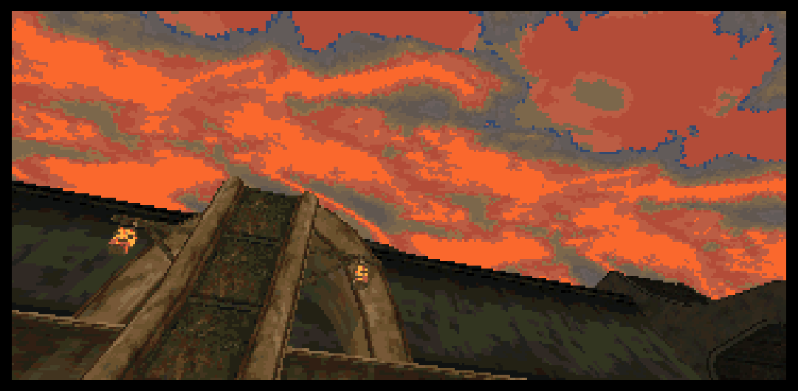

<p align="center">
  
</p>

# AmiWind

_Last updated with AmiWind v0.0.69-dev4 (25 November 2026)._

An unofficial, experimental RPG engine and enthusiast project bringing Morrowind
to the Commodore Amiga, featuring CHIM: an AmiQuake-based engine and an asset
conversion pipeline that builds the game from your own legally obtained copy of
Morrowind, and, in time, a base for your own Amiga RPG adventures.

Like community projects such as
[OpenMW](https://openmw.org), [MGE XE](https://github.com/Hrnchamd/MGE-XE) and
[MWSE](https://github.com/MWSE/MWSE), AmiWind ships with no game data or proprietary assets.

*Not affiliated with or endorsed by Bethesda Softworks or ZeniMax. Please support the original creators: buy Morrowind.*

<p align="center">
  
</p>

<p align="center">Not painted backdrops: every frame is rendered in real time by the engine.</p>

More in the [gallery](docs/GALLERY.md).

## Where AmiWind stands

The framework of the Game of the Year edition is in the game, both expansions included: **Tribunal** with the city of
**Mournhold**, and **Bloodmoon** with the island of **Solstheim**, beside the whole of Vvardenfell. From your own copy of
Morrowind, Tribunal and Bloodmoon, AmiWind builds the three game files into one game for the Amiga. You can walk
Vvardenfell, take the road from Ebonheart into Tribunal's Mournhold, and cross the sea to Bloodmoon's Solstheim, with
their people, creatures, doors and scripts around you. It runs on CHIM Engine v0.2.2 with 32 MB of Fast RAM.

**The newest release is v0.0.68: Solstheim Is Here**, which brings Bloodmoon's island into the game, so that both
expansions are now in it: all 153 of
Solstheim's cells are built, one open sea joins it to Vvardenfell as in the original, its quest and underwater entrances
can be used, and the werewolves fight and change as in the original. Fights no longer stutter when blows land,
Solstheim's weathers have their own look, the world map spans both islands, and the talk window is laid out as the
original's, with the disposition bar, the speaker's services and the name on the title bar. The detail: the
[v0.0.68 release notes](docs/releases/notes/RELEASE-v0.0.68.md), with its twelve development snapshots in the
[changelog](docs/CHANGELOG.md). The release before it, **v0.0.67: Tribunal Introduced**, brought Tribunal and Mournhold
into the game ([its notes](docs/releases/notes/RELEASE-v0.0.67.md)).

The snapshot in development is **v0.0.69-dev4**, the fourth of v0.0.69: the box shown when a load runs out of memory
names the place instead of the map file ([its notes](docs/releases/notes/RELEASE-v0.0.69-dev4.md)). The ones before it:
[v0.0.69-dev3](docs/releases/notes/RELEASE-v0.0.69-dev3.md) plays story videos to their end,
[v0.0.69-dev2](docs/releases/notes/RELEASE-v0.0.69-dev2.md) finds a usable screen mode on more graphics card setups, and
[v0.0.69-dev1](docs/releases/notes/RELEASE-v0.0.69-dev1.md) shows a place on the world map as soon as any of its own
cells is explored. The emulator presets are
[`AmiWind-v0.0.69-dev4-FS-UAE.fs-uae`](resources/emulators/AmiWind-v0.0.69-dev4-FS-UAE.fs-uae) and
[`AmiWind-v0.0.69-dev4-WinUAE.uae`](resources/emulators/AmiWind-v0.0.69-dev4-WinUAE.uae), both with 32 MB of Fast RAM.

## What already works

- **Vvardenfell.** All 1,409 exterior cells of the main island on CHIM (1,292 land and 117 sea), streamed as you walk;
  the tracker counts 1,390 of them as ready by its own rule, the cells with terrain data (land and flat seabed), so the
  two figures are two groupings of the same island ([what the tracker counts](docs/chim/CELL_TRACKER.md#what-we-count)).
  The open sea built around and between the islands adds sea cells of its own, which the tracker counts too (1,029 sea
  cells by Vvardenfell, 79 by Solstheim).
  1,121 of its
  1,123 interiors as CHIM rooms (the prison ship and the census office are room maps of our own, in the game all the same), with the
  people and creatures the game places in them ([CHIM progress tracker](docs/chim/PROGRESS_TRACKER.md),
  [the map's colours](docs/chim/CHIM_PROGRESS_MAP.md)). Every load door
  of the base game leads in and back out.
- **Every room of the three game files is in the game:** 1,134 of 1,134 interiors of Morrowind, 96 of 96 of Tribunal and
  98 of 98 of Bloodmoon, with the exterior cells of all three, and every load door leading in and back out except the few
  that are one-way in the original.
- **Tribunal, Mournhold:** its five districts and all of its rooms are in the game, reached from Ebonheart as
  in the original and walked from the palace to the Plaza, together with Tribunal's additions to Vvardenfell. Of its 236
  scripts, 235 run.
- **Bloodmoon, Solstheim:** all 153 of its cells (land and sea) and all of its rooms are built, one open sea joins it to
  Vvardenfell, so you can take the boat from Khuul or swim across, its quest and underwater entrances can be used, and its
  werewolves, its weathers and its ice are in. Of Bloodmoon's 310 scripts, 309 run.
- **Play:** character creation through the opening; the inventory, the journal and the map; saving and loading, with what
  you change staying changed; combat and casting by the original's rules; talking, persuasion and the services; crime with
  witnesses, guards, fines and jail; alchemy; containers and bodies to search; torches and lanterns; weather, music and
  travel by silt strider, boat, gondola and guild guide; levelling and resting as in the original
  ([game features](docs/GAME_FEATURES.md)).
- **Dialogue, the journal and the quests:** the clickable topic words in conversation; the journal with dated entries
  and the quest book, its indexes kept by the dialogue and the scripts so that quests progress, the entry of the ending
  each quest reaches, quests moving under the finished ones (success and failure alike), a restart entry that reopens a
  quest, and dates read as in the original; the topic pages of the journal carry working links.
- **The game's scripts:** of the 1,074 scripts the original uses, 1,063 run and 9 more are carried by AmiWind's own code
  ([the MWScript tracker](docs/MWSCRIPT_FEATURES.md)).
- **Hardware:** the target is an A1200-class machine with AGA, a 68040 with FPU, 2 MiB Chip and 32 MiB Fast RAM, in
  emulators with JIT; accelerators such as the PiStorm are a route to real hardware. The figures so far come from
  emulators and the Raspberry Pi 4B ([real hardware](docs/REAL_HARDWARE.md)).

## What comes next

With the framework in place, the next work is playing it through:

- **Quests:** playing Tribunal's and Bloodmoon's quests through from start to finish.
- **Talking:** conversation with the creatures that have lines, and the Companion Share entry.
- **The journal's dated quest entries:** they carry no link spans yet, and the topic list has no letter index yet.
- **Solstheim on the world map:** each of its sites with a marker of its own.
- **Frame rate:** the heaviest places, Mournhold's districts above all, which run at 8 to 16 frames a second in the
  emulator.
- **The base game's last parts:** the end of the main quest in the Heart Chamber, pickpocketing, picking owned locks and
  locks on doors and containers, making your own enchantments, schedules by the time of day, and smoother shores.

**v0.0.69** carries the expansions on to their finished content, and the rest of the open plan follows. The order of record is the [roadmap](docs/ROADMAP.md); no dates are promised. Every system with
its state: [game features](docs/GAME_FEATURES.md). Known problems: [the bug tracker](docs/BUGS.md).

## Build it from your own Morrowind

**Original Morrowind game files are required. You must provide your own copy**, and you need your own licensed
Amiga Kickstart 3.1 ROM to run the result. The repository includes neither. AmiWind recommends the GOG GOTY edition
(the best tested; the Steam GOTY edition is a supported fallback with bitmap fonts). More: [About AmiWind](docs/ABOUT.md).

On Ubuntu/Debian (or Ubuntu under WSL), compile with:

```sh
./build.sh --autoinstall
```

and, with FS-UAE installed, build and run in one go:

```sh
./build.sh --autoinstall --autorun-fs-uae \
  --kickstart-file "/path/to/your/kickstart-3.1-a1200.rom"
```

`--autoinstall --plan` shows the setup steps without installing anything. On Windows start with
`.\setup-windows.cmd -Plan` (experimental; [Windows setup guide](docs/WINDOWS_BUILD.md)). A normal build includes
everything the release ships, Tribunal and Bloodmoon read by default where you own them (`--no-dlc` for the base game
alone). The recorded v0.0.31 Seyda Neen maps (`--seyda-recorded DIR`) are optional and NOT RECOMMENDED since v0.0.31
([which Seyda Neen is in my build](docs/LINUX_BUILD.md#which-seyda-neen-is-in-my-build)). For a quick test image of one
spot: [MiniWind: the test ground](docs/MINIWIND.md) and the [build type reference](docs/MINIWIND_PLAYTESTER.md).

**If a build fails, send the file `logs/BUILD-REPORT-<run>.txt`** from the build workspace (`out/` by default; the
build prints where it is): one file with what failed and every setting, kept on your computer until you send it
([when a build fails](docs/LINUX_BUILD.md#when-a-build-fails)). **A build that stopped, out of memory included, is
never started over:** do not delete the build folder, run the same command again from the same folder, and the
finished work is taken back; the build's last lines say what to change first
([the build stopped or ran out of memory: what now?](docs/LINUX_BUILD.md#the-build-stopped-or-ran-out-of-memory-what-now)).

The emulator presets of this version are
[`AmiWind-v0.0.68-FS-UAE.fs-uae`](resources/emulators/AmiWind-v0.0.68-FS-UAE.fs-uae) and
[`AmiWind-v0.0.68-WinUAE.uae`](resources/emulators/AmiWind-v0.0.68-WinUAE.uae); both start with 32 MB of Fast
RAM, the requirement. The presets of earlier versions are beside them in [resources/emulators](resources/emulators/). Everything
else about building and playing: [Building and playing](docs/BUILDING_AND_PLAYING.md), the
[Linux build guide](docs/LINUX_BUILD.md) and the [FS-UAE launcher](docs/FS-UAE-LAUNCHER.md).

## Where to read more

- Every document, by topic: [the documentation index](docs/README.md) · every release with its notes:
  [releases](docs/releases/README.md) · the history of every version: [changelog](docs/CHANGELOG.md)
- Project: [FAQ](docs/FAQ.md) · [Gallery](docs/GALLERY.md) · [Project state](docs/PROJECT_STATE.md) ·
  [Roadmap](docs/ROADMAP.md) · [Open bug reports](docs/BUGS.md)
- How it works: [Architecture](docs/ARCHITECTURE.md) · [CHIM](docs/chim/README.md) ·
  [CHIM progress tracker](docs/chim/PROGRESS_TRACKER.md) · [Game features](docs/GAME_FEATURES.md)
- Building: [Building and playing](docs/BUILDING_AND_PLAYING.md) · [Build dependencies](docs/BUILD_DEPENDENCIES.md) ·
  [Release workflow](docs/RELEASE_WORKFLOW.md)
- Development: [Repository layout](docs/REPOSITORY_LAYOUT.md) · [Project rules](docs/PROJECT_RULES.md) ·
  [Earlier README sections](docs/README_ARCHIVE.md)
- Licences and credits: [About AmiWind](docs/ABOUT.md) · [Licensing and credits](docs/LICENSING_AND_CREDITS.md)

## About

Created by **FlyingFathead a.k.a. Horstator**.
**Official project repository:** [FlyingFathead/amiwind](https://github.com/FlyingFathead/amiwind).

Thanks to: **ChaosWhisperer**, and to the people of the SAKU (Finnish Amiga Users Group) community, especially
**tohtoris** and **jvaltane**, for beta testing and tips on hardware implementation, and **jtsiren** for positive
feedback.

AmiWind runs on the CHIM engine, built on GPLv2 code from **id Software's Quake** (John Carmack and the id team) and
its Amiga port **AmiQuake** (Peter McGavin, NovaCoder, Stephen Leary). The CHIM builder that converts your own
Morrowind files is GPLv3 ([LICENSE](LICENSE)). The public source package holds no Quake or Morrowind game data, ROMs
or compiled AmiWind executable; game images you build yourself are private build outputs. Copyrights stay with their
holders; the full statement is in [About AmiWind](docs/ABOUT.md).

> Massive thanks to everyone in the Amiga community who have been willing to
> share code and ideas to make this dream come true to a beloved platform.
> *May the wind be on your back!*

---

<p align="center"><i>AmiWind is brought to you by <a href="https://github.com/FlyingFathead/">FlyingFathead</a></i></p>
