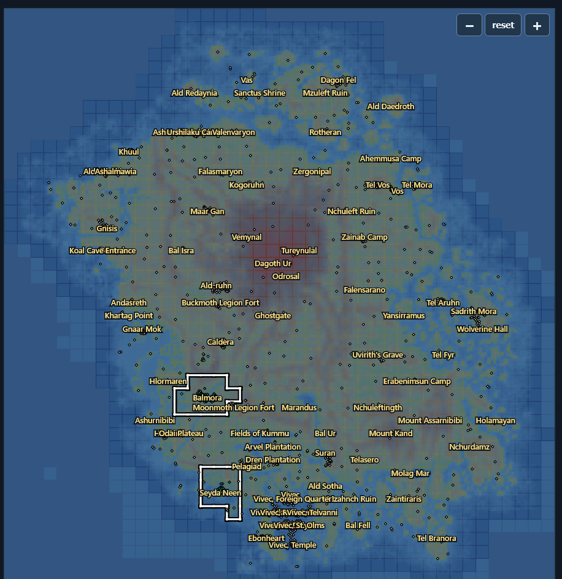
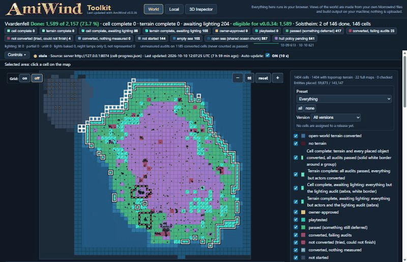
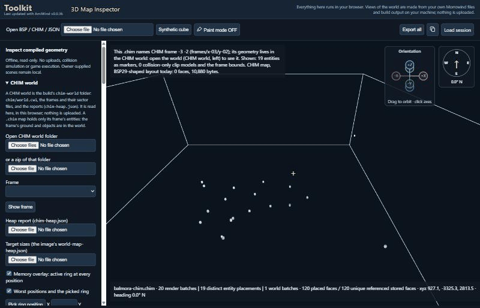
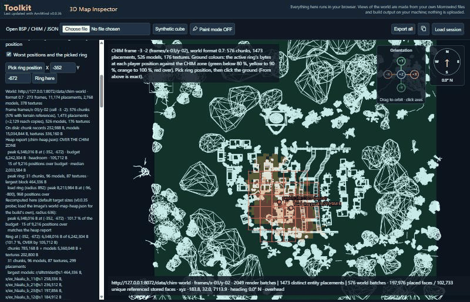
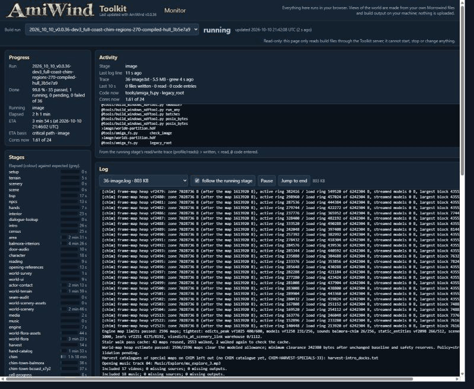

# AmiWind Toolkit

Current controls are documented below. The Toolkit header currently names
v0.0.38, its last update; that label is independent of the game release.
Screenshots in this guide are historical and do not supply current coverage totals.

<!-- contents start -->
## Contents

- [v0.0.38 controls](#v0038-controls)
- [Starting it](#starting-it)
- [Your data](#your-data)
- [The tabs](#the-tabs)
  - [World](#world)
  - [Local](#local)
  - [3D Inspector](#3d-inspector)
- [Map metrics layer](#map-metrics-layer)
  - [Making the layer](#making-the-layer)
  - [Reading it](#reading-it)
- [CHIM Progress Tracker](#chim-progress-tracker)
  - [Making the data](#making-the-data)
  - [Showing it](#showing-it)
  - [One Toolkit, your data loaded locally](#one-toolkit-your-data-loaded-locally)
  - [Track your own build](#track-your-own-build)
- [Monitor](#monitor)
- [Mesh Compare](#mesh-compare)
- [Using it for development](#using-it-for-development)
- [Other parts](#other-parts)

<!-- contents end -->

The AmiWind Toolkit is the browser workbench for anyone developing AmiWind: it
shows how much of Morrowind's world has been converted to the Amiga, what is
missing and where, and lets you open any built map in 3D to see its actual
polygons. It runs entirely on your machine; nothing is uploaded.

The public viewer contains no preloaded game world. Its views use your own
Morrowind files and AmiWind build output. Documentation includes selected
historical screenshots; those are illustrations, not distributable game data.

The header line "Last updated with AmiWind v..." names the AmiWind release
containing the latest Toolkit changes. The release check requires an update
when Toolkit files change. Final v0.0.39 updates the documentation and verified
RC1 inclusion data, with Toolkit metadata version 0.1.3; inspection controls
remain those introduced in v0.0.38. This label is not native gameplay acceptance.

## v0.0.38 controls

The [Toolkit README](../amiwind-toolkit/README.md#v0038-inspection-controls)
describes Names on/off, per-panel Copy JSON, textured heatmaps and direct
CHIM archive links. Names default to on and remember your choice. These
controls are included in the public source and operate on your own data.

## Starting it

Either way opens [`amiwind-toolkit/index.html`](../amiwind-toolkit/index.html).

**With your data preloaded (recommended).** A tiny read-only server, bound to
this machine only, serves the Toolkit and your files so everything loads at
once and the Local view opens maps without picking a folder:

```bash
python3 tools/toolkit_serve.py --data DIR --maps MAPS_DIR --open
```

`DIR` holds `world-progress.json` and the local layers listed below; `MAPS_DIR`
is a build's `id1/maps` folder. Add `--metrics FILE` for the
[Map metrics layer](#map-metrics-layer) and `--progress DIR` for the
[CHIM Progress Tracker](#chim-progress-tracker). Without `--open`, browse to the address it
prints (default `http://127.0.0.1:8031/`). Python standard library only.

**Straight from disk.** Open `amiwind-toolkit/index.html` in a desktop browser
and pick the files with the **Status**, **Island (local)** and **Maps folder
(local)** buttons. Browsers do not let a page opened from disk read other files
by itself, so each one has to be chosen.

## Your data

1. **Status.** Every image build writes `world-progress.json` (counts and status
   only, no names) next to `entity-tracker.json`.
2. **Island (local)**, optional, made from your own `Morrowind.esm`:

   ```bash
   python3 tools/world_progress_background.py --esm /path/to/Morrowind.esm --out island.png
   python3 tools/world_progress_background.py --esm /path/to/Morrowind.esm --out island-world.png --style world
   python3 tools/world_progress_background.py --esm /path/to/Morrowind.esm --out island-cells.json --style cells
   ```

   `island.png` is the topographic view, `island-world.png` the look of the
   game's own World map, and `island-cells.json` the Local level: each cell's
   terrain, its original placements, and the place and region names.
3. **Maps folder (local).** A build's `id1/maps`, for the 3D Inspector: Quake maps (`.bsp`) and
   CHIM maps (`.chim`); where a map has both, the `.chim` is used, as the engine does.

## The tabs

### World



Historical interface and data; these totals are not current coverage. See the
[dated coverage guide](chim/CHIM_PROGRESS_MAP.md) for separate audit, native and package records.



Historical interface and data; these totals are not current coverage. See the
[dated coverage guide](chim/CHIM_PROGRESS_MAP.md) for separate audit, native and package records.

Vvardenfell's exterior cells, one square per cell, north up.

- **Bottom layer** (‹ dropdown ›): the topomap (terrain converted for the whole
  island; the basis every other layer sits on) or the game's own World map look.
- **Layers**: topomap, heatmap of original entities, share of entities placed,
  full town/area maps (white border, black outline), content missing, interiors,
  named places, points of interest (interior entrances: green converted, white
  not converted), owner-checked cells, cell grid. More switches behind the
  cog (Options).
- **Map metrics** (only when a metrics layer is loaded): the estimated heap and
  BSP limits of every exterior cell; see [Map metrics layer](#map-metrics-layer).
- **Grid: on | off** at the map's top left switches the cell grid, in step with
  the Cell grid layer.
- **Zoom**: − / reset / + at the top right, the mouse wheel, or drag to pan.
- **Keys**: while the map is active (clicked, or under the mouse), the arrow
  keys or WASD pan it: up/W north, down/S south, left/A west, right/D east.
- **Hover**: the tooltip gives the cell's place and region, its map, entities
  placed against the original, interiors converted and named places. Over an
  interior-entrance marker the marker turns gold and the tooltip starts with
  "Highlighted: <name>".
- **Click** a cell: the Selected-area bar names it ("Selected area: Balmora
  (West Gash Region) · cell -3, -2 ...") and **Local view** opens it.
- **Copy state (JSON)**: the Toolkit version, the loaded data, the layers and
  the selection, ready to paste into a bug report or a message.

### Local

One cell up close: its terrain, its named places and every original placement
(filled = placed, red ring = not placed), counted by kind (statics, doors,
lights, containers, NPCs and more), and the list of places in the cell with
whether each interior is converted. **Map** lists the built maps that cover the
cell; **Show in 3D** opens the chosen one in the 3D Inspector tab.

### 3D Inspector

The compiled geometry of a built map: from above, fly view or orbit, with
wireframe or solid display, optional textures with your own palette, polygon
heatmap, collision preview, a compass and orientation gizmo, face selection and
markup for planning, and session export. Until a map is loaded it says so under
the crosshair. Open a map with **Show in 3D** in Local, or with **Open BSP /
CHIM / JSON** in the inspector itself. A Quake map (`.bsp`) shows its polygons;
a CHIM map (`.chim`) shows its entities and names the CHIM frame that holds its
geometry; **Open CHIM world** shows a frame of a build's CHIM world with the
memory each player position needs
([CHIM maps and CHIM worlds](POLYCOUNT_INSPECTOR.md#chim-maps-and-chim-worlds)).





Fly with WASD (E/Q up and down); the **Speed** slider (0.05x to 4x, scaled to the
size of the loaded map) sets the pace, Shift flies 4x faster and Ctrl or Alt 4x
slower.

The inspector also works on its own:
[`amiwind-toolkit/map-inspector.html`](../amiwind-toolkit/map-inspector.html),
[details](POLYCOUNT_INSPECTOR.md).

#### Sub-cell cuts and the divider

The **Sub-cell cuts** panel shows where a map is, or would be, divided: region
borders and section cuts are drawn as translucent coloured rectangles standing
through the map, in the perspective and the From above views, with a label on
each. Hover one for its name and position. **Show cuts and region borders**
turns them all off; **Show coverage** turns off the dashed coverage outlines.

- **Load cut overlay JSON** draws an overlay written by
  `tools/region_cuts.py` (or exported by the divider). For a town region map:

  ```bash
  python3 tools/region_cuts.py town --config config/balmora.json --map bm019 --out bm019-cuts.json
  python3 tools/region_cuts.py town --config config/seyda-bounded-regions.json --map sn012 --out sn012-cuts.json
  python3 tools/region_cuts.py plan --plan section-plan.json --out room-cuts.json
  ```

  A town overlay holds the map's own core (solid) and coverage (dashed) plus
  the cores of every region that reaches into it, so the borders you see are
  the sub-cell cuts that pass through that map. A section plan overlay holds
  each section's coverage box and each portal as a plane at its split.
- **The divider** adds cuts by hand: **Add X cut** (a plane of constant X) or
  **Add Y cut**. Move a cut with the position box or slider, or drag it in
  **From above**; drag its end squares to shorten it. Undo and Redo cover every
  cut change. The panel lists, for every section between the cuts, its faces,
  the placements inside it and straddling it, lightmap bytes and an estimated
  heap share against the 11,534,336-byte map budget (an estimate, with its
  method printed under the numbers).
- **Export cut overlay JSON** saves the cuts and sections as an overlay;
  **Export section plan JSON** writes them in the format of
  `tools/prepare_interior_sections.py` (2 to 8 sections, one portal per shared
  cut), with the fields only a build can supply marked `PENDING`. **Import
  cuts** reads either file back. Nothing is installed or changed in any map.

Interiors are divided at doorways and corridors first
([interior sections](INTERIOR_SECTIONS.md)); the divider is where you try those
cuts against the actual polygons before writing the plan. Format and method:
[sub-cell cuts](POLYCOUNT_INSPECTOR.md#build-020-sub-cell-cuts-and-divider).

## Map metrics layer

The Map metrics layer shows, for every exterior cell, how close the maps
covering it come to the engine's limits: the estimated map heap against the
11,534,336-byte budget, and faces, texinfo, nodes, clipnodes, marksurfaces,
vertexes, edicts, inline brush models, static flames and lights against
theirs. It is an estimate made from your own game data, before anything is
converted, so you can see where the world will not fit and plan the sub-cell
cuts there.

### Making the layer

1. Run the builder's world estimate on your own Morrowind data files. It writes
   `metrics.json` and `metrics.csv`, one row per proposed map: every exterior
   sub-cell region (its core cells, set and counts) and every interior cell,
   each with `cur_*` columns (what the converters convert today) and `evr_*`
   columns (every placed object converted, actors as edicts).
2. Serve it with the Toolkit. The server converts the table when it starts:

   ```bash
   python3 tools/toolkit_serve.py --data DIR --maps MAPS_DIR --metrics metrics.json --open
   ```

   Or convert it once into the smaller layer file and serve that:

   ```bash
   python3 tools/world_metrics.py metrics.json --out world-metrics.json
   python3 tools/toolkit_serve.py --data DIR --metrics world-metrics.json
   ```

   Opened from disk, pick `world-metrics.json` with **Metrics (local)**.

The layer file (format `aw-world-metrics-1`) holds, per exterior cell, the
worst value of each metric among the regions whose core lies in the cell, its
ratio to the limit and the region it comes from, plus the cell's region list;
every region's values; every interior's values; and summary counts. Optional
columns missing from the table are left empty. It holds names and numbers from
your game data: keep it with your own files. Without `--metrics` the server
serves no layer and the World Map shows no Map metrics bar.

### Reading it

- **Map metrics** switches the layer; it widens the map to Solstheim.
- **Metric**: heap, faces, texinfo, nodes, clipnodes, marksurfaces, vertexes,
  edicts, inline models, static flames or lights.
- **Current content | Everything**: today's converters, or every placed object.
- **Texinfo limit**: 32,767 today or 65,535 planned.
- **Colours** (value / limit, as on the world heat map chart): the palest blue
  is up to 50 %, then one darker blue per 10 % up to 100 %; red is over the
  limit. Bloodmoon (Solstheim) cells have a dark outline. Town labels come
  from your local `island-cells.json`.
- The bar and the side panel count the cells that hold at least one region
  over the limit, and the cells with objects.
- **Hover** a cell: its coordinates and name, the worst value, its share of
  the limit and the region it comes from.
- **Click** a cell: the panel under the map lists every sub-cell region with
  its core in the cell, with all its numbers; the region that sets the cell's
  value is outlined for each metric. **3D** opens a region in the 3D Inspector
  when a map of that name is in your maps folder; the built maps covering the
  cell are listed with their own **3D** buttons.
- **Interiors table**: every interior (the Tribunal set is interiors only),
  filtered by set, by name and by "over any engine limit" (lights excluded) or
  "over the selected metric's limit", sorted by any column.
- **Copy state (JSON)** includes the layer, metric, content, counts and the
  clicked cell.

The limits are the engine's own: `AMIWIND_HEAP_MB` (the map heap budget),
`MAX_MAP_FACES`, `MAX_MAP_NODES`, `MAX_MAP_VERTS`, `MAX_MAP_MARKSURFACES`, the
clipnode count check (65,520), `MAX_EDICTS` (600), the inline model budget
(220), `STATIC_FLAME_MAX` (128) and `MAX_DLIGHTS` (32, as if every light were
a dynamic light). `tests/test_world_metrics.py` checks them against the
sources.

## CHIM Progress Tracker

The CHIM Progress Tracker drives and shows the whole-island conversion to CHIM, cell by cell: one record per
exterior cell, the interiors reached from it, what is converted, what each audit found, what the legacy converters had
mapped there before, and the order to convert the rest in. It is built on the data the Toolkit already has (the
World progress table for the legacy mapping quality, the Map metrics layer for risk and cost) and adds the CHIM side.

A headline sits at the top of the Toolkit page, on every tab: **Done: N of 1,292 (percent)** for Vvardenfell with the
completion levels beside it, and Solstheim reported separately. A cell counts as passed only when it is converted **and
every audit that was measured passed**. Audits that were not measured are
counted apart ("unmeasured audits on N converted cells") and are never counted as passed. Under the headline are the
breakdown (owner-approved, playtested, audits passed, converted with failing audits, converted with nothing measured,
not started) and a history line (passed cells per day). Click a number to highlight those cells on the map.

### Making the data

The data is derived from your own Morrowind files and your own build output, so it lives in a private folder, never in
the repository. `tools/cell_progress.py` is the only writer of that folder:

```bash
python3 tools/cell_progress.py ingest --out DIR \
    --progress world-progress.json --metrics world-metrics.json --cells island-cells.json \
    --bugs docs/bugs/bugs.json --ledger build-ledger.jsonl --areas config/cell-progress-areas.json \
    --chim-run balmora=BUILD_FOLDER --chim-run seyda=OTHER_BUILD_FOLDER \
    --data-files "Morrowind/Data Files" --png
```

- `--chim-run NAME=PATH`: a folder written by `chim_build --validate --stats` (its `chim-receipt.json`,
  `chim-validate.json`, `chim-stairs.json`, `chim-heap.json`, `chim-zone-walk.json`, `chim-stats.json`; every report is
  optional). Which cells a build converted comes from the chunks the frame owns placements in. The digest of each run is
  kept in `DIR/runs`, so later ingests need no access to the build folders. `--run-label` and `--run-commit` record a
  label and the source commit.
- `--data-files` parses your game files once into `DIR/mesh-census.json`: per exterior cell the references by type, the
  unique meshes, the doors and where they lead; per interior cell its counts and doors. Without it the tracker still
  works, without contents, mesh numbers and interiors.
- The command remembers its inputs (`DIR/sources.json`). Run it again after every build; it is idempotent: the same
  inputs give the same files. Anything it cannot measure is `not_measured`, never a guess.

Other commands, all of them go through the same ingester:

```bash
python3 tools/cell_progress.py result --out DIR --file RESULT.json    # per-cell stats, audits, errors from the conversion job
python3 tools/cell_progress.py record --out DIR --mechanism seam_tears --build NAME --status passed --cells "-3,-2 -3,-1"
python3 tools/cell_progress.py owner  --out DIR --status playtested --cells "-3,-2"    # or approved
python3 tools/cell_progress.py export --out DIR --csv cells.csv --json cells.json
python3 tools/cell_progress.py status --out DIR
python3 tools/cell_progress.py render-md --out DIR    # writes docs/chim/CELL_TRACKER.md (generated, compact, public)
python3 tools/cell_progress.py check-md               # header, private content and policy section of the committed page
```

`render-md` writes the public page [docs/chim/CELL_TRACKER.md](chim/CELL_TRACKER.md): the headline ("Done: N of 1,292"),
totals, a table per ring, failures by mechanism class, objects by type and an import policy generated from the code's own
constants. Re-run it after every ingest; the page is never edited by hand. `check-md` (and the test suite) fails when the
committed page lacks its generated header, mentions a private path, or has an import policy that no longer matches the code.

Completion levels (map fill, headline and totals): **Terrain complete** = all audits pass and every placed object except
actors is converted (bright green); **Cell complete** = terrain complete and every actor converted too (the same bright
green plus a solid white border around a run of such cells; the legacy full town/area map border is dashed amber).

**Lighting** (`tools/cell_lighting.py`): a cell is only complete when it is lit like the original, so both completion
levels also need the lighting audit to say **lit**. The audit compares the original light placements of the cell (from
`--data-files`: by class, with and without a mesh, with their lightstyles) with what the CHIM build lit: how each light
reaches the frame (baked into the lightmaps, only through the night lamp table, or not at all) and how many terrain and
model surfaces carry real light data. Status **lit** (every light baked, every surface lit), **partial**, **unlit** or
**not measured**. A build that does not report its lighting figures (`stats.lighting`: `mode`, `terrain_faces`,
`terrain_lit`, `model_faces`, `model_lit`, `baked`) is read as lighting mode `lamps` (constant terrain light, models
without lightmaps, night lamp table), and the cell panel says so. Colour by **Lighting** shows it on the map; the
headline and the generated page carry an island-wide lighting line. Lights deferred for want of a light path (lights
without a mesh) are judged by this audit, not by the Lights category.

A cell the conversion job found to hold nothing but terrain and water is sent with `"status": "empty"`: it gets its own
status and chip, **empty sea**, and is never counted as passed or converted. A converted cell whose only problem is hull-chain depth is sent with
`"policy_pending": true`: status **hull policy pending**, counted neither as passed nor as failing.

A result file (`aw-cell-result-1`) carries per cell: `converted`, `errors`, `audits` (mechanism, status, detail) and a
`stats` block (records, meshes new/reused, faces before/after, textures, bytes, chunks, hull, memory, vis, time). Every
field is optional. The audit mechanisms are the ones listed in `MECHANISMS` in the tool: format validation, stair walk,
memory fit (zone ring and heap), seam tears, hull bevels and chain length, sky-bank texels, hidden faces, far-terrain
coverage, sprite shape, actor grounding and doors/interior links. An audit result measured on another build than the
cell's current one is shown as stale and counts as not measured.

### Showing it

```bash
python3 tools/toolkit_serve.py --data DIR --maps MAPS_DIR --metrics world-metrics.json --progress DIR --open
```

`--progress` takes the folder the ingester writes (or its `cell-progress.json`). The file is read again on every
request: run `cell_progress.py` after a build and reload the page (or press **Reload progress**, or return to the window);
the server does not need a restart. Without `--progress`, or when you open the pages from disk, use **Import progress**
and pick `cell-progress.json`.

The **CHIM Progress Tracker** layer has its own bar and is exclusive with Map metrics (both colour cells); every older
layer stays selectable.

- **Colour by**: CHIM status; spiral ring; scout risk (the estimator's share of the tightest engine limit); legacy mapping
  quality (grade A full town/area map with 80 % or more of the entities placed, B full map, C terrain with some entities
  placed, D terrain only, E no terrain); lighting (lit, partial, unlit); open bugs linked to the cell; last build time; or
  any single audit.
- **Show**: all cells, any failing audit, any audit not measured, or one mechanism failing or not measured; the other
  cells fade.
- **Sweep order**: the **spiral** goes from the coast inwards, ring by ring (ring 1 touches the sea; sea-only cells that
  hold something are ring 0 and come first; Solstheim is its own island), always stepping to the nearest unvisited cell
  of the ring so the converted area stays contiguous. The **risk** list (scout list) goes riskiest first. Ring numbers are
  drawn in the cells when zoomed in, the next 25 cells of the chosen order are outlined, and the 25 riskiest cells are
  marked with a diamond. Both lists, 300 cells each, are also written to `next.json`.
- **Find a cell or interior**: one search box finds a cell or interior by in-game name, region, coordinates, cell ID,
  our map name or door reference number, and jumps to it on the map.
- **Hover** a cell for its status, ring and rank, risk, legacy grade and failing audits. **Click** it for the record:
  contents; the stats (records by type, unique meshes new and reused, faces before and after, textures, bytes CHIM against
  legacy, chunks, clipnodes and hull depth, zone ring and frame heap, vis, conversion time, errors; fields nobody has
  measured say "not measured"); the legacy mapping quality; every audit with its detail and build; the build provenance
  (build, source commit, CHIM version, world format); the linked bugs; and **the interiors reached from the cell**.
- **Interiors reached from a cell** are found from the door destinations in your game files: the interior cells whose
  doors stand in the exterior cell, with a door inside an interior leading deeper shown indented under it (loops are
  not followed twice, depth is capped at 8). Each row gives the in-game name, the cell ID, our map name where one
  exists, the door's reference number, object and position, the status ("not started" for CHIM, legacy converted or not),
  the contents counts and the linked bug IDs. Click a row for the interior's own page.
- **Overview** (nothing selected): the next ten cells of the chosen order, the audits over all converted cells, totals
  per island and ring, the CHIM builds read, and the **mesh-first view**: the store-once reuse curve (cumulative unique
  meshes against cells converted, in the spiral and risk orders, compared with every cell converting its own meshes) and the
  numbers behind it.
- **Export CSV** and **Export JSON** write the cells shown (after the filter): status, audits and every numeric stat.

**Seeing the whole island.** The map canvas is sized to the window, so the whole island (Vvardenfell and Solstheim, or what
the loaded data covers) is visible at once: the **fit** button (next to **-**, **reset** and **+**) returns to that view, and
it is the view on first load. You can zoom out further, down to a fifth of the fitted size, and in up to 16 times; zoomed out,
the map sits centred in its frame. Cell-name labels hide when a cell is smaller than 16 pixels on the screen, so a far-out view
stays clean. The rows of controls (files, layers, map metrics, the CHIM bar) fold away behind the **Controls** button, which is
closed by default in a window shorter than 900 pixels; your choice, and the last zoom and position you left, are remembered in
your browser (local storage; the page works without it). The legend wraps beside the map on a wide window and below it on a
narrow one.

**The store-once mesh chart.** At the bottom of the overview the chart answers one question: what does storing every mesh
once save? Its title says it in words, computed from the data (for example "Store-once: 1,777 mesh conversions instead of
38,790 (22x fewer)"). Panel (a) counts meshes converted as cells are converted in sweep order, with store-once against every
cell converting its own meshes, on a log scale so both lines fit; the ring labels sit above the plot, staggered. Panel (b)
compares the two sweep orders by the distinct meshes each has met so far: the spiral order grows one contiguous playable area
from the coast inwards, and the risk order meets the most distinct meshes first, so a bug in a mesh shows up early. The legend
sits below each panel, never over the lines. `cell_progress.py ingest --png` writes the same chart as a picture
(`mesh-curve.png`).

**One header.** Every Toolkit page opened on its own carries the same header as the index page: the AmiWind logo, "Toolkit"
with "Last updated with AmiWind vX" under it, and the page's own name next to it. Inside the Toolkit's tabs only the index
header shows. The standalone 3D inspector export carries the header too, without the logo picture.

The **legend** has a checkbox on every row (an unticked row dims its cells), **all** and **none** buttons, a **Preset**
pull-down (everything, eligible for the next release, awaiting lighting, problems only, not started, lighting, release
content; a hand tick switches it to Custom) and a **Version** pull-down with a summary line per release. Your choices are
remembered in the browser. The full explanation, every status and the owner's release commands are in the
[CHIM Progress Tracker guide](chim/PROGRESS_TRACKER.md); the live figures are on the generated
[CHIM cell tracker](chim/CELL_TRACKER.md).

### One Toolkit, your data loaded locally

There is one Toolkit. The public repository carries all of its code and none of the game-derived data: the map layers made
from your Morrowind files, the tracker data of your conversion runs and your build outputs stay on your machine and are
loaded into the same pages with `--data`, `--metrics`, `--progress` or `--build`, or with the import buttons in the page.
Nothing in the pages needs a different copy for different data; what you see differs only by the data you load.

### Track your own build

You do not need the project's data to use the tracker: your own build produces it.

1. **The builder writes it.** A CHIM build (the default builder) runs the cell ingest over its own CHIM world and your own
   Morrowind data in its own stage, `cell-progress`, right after the `chim` stage, and leaves
   `BUILD/toolkit/cell-progress.json` in the build folder. It is on by default and never fails the build;
   `--no-cell-progress` turns it off. Nothing private is involved: it reads only your build and your game files.
2. **Look at it.**

   ```bash
   python3 tools/toolkit_serve.py --build BUILD_FOLDER --open
   ```

   `--build` finds `toolkit/cell-progress.json` in the build folder (and the World Map layers if the folder holds them) and
   serves it on 127.0.0.1 only. Without a server, open the Toolkit's World Map page from disk and use **Import progress** on
   `BUILD/toolkit/cell-progress.json`.
3. **Compare with the project.** Each release publishes a reference file, `docs/chim/cell-progress-reference.json`: cell IDs,
   names as in the public docs, statuses, lighting state, release and each audit's result, plus a few size figures, and
   nothing else (no assets, no textures, no game text). `toolkit_serve.py` serves the repository copy automatically (or give
   `--reference FILE`); from disk, use **Compare with** and pick the file. The **Compare with the project reference** colouring
   then shows each of your cells as the same, better or worse than the project's, so you can see how far your build is.
   `cell_progress.py publish` writes the file; `check-reference` and the test suite scan it for anything private.

#### Live build tracker

A guided build can show its progress on the map while it runs: the cells that have been converted, the current stage, the
cells done out of the total and a rough time left. At the start of a guided CHIM build the builder asks once, in plain words:

- **[F]ile (the default): no server.** The builder keeps a small page and a data file in `BUILD/toolkit/live/` and prints the
  `file:` address of the page. You open it from disk; it loads its data with a script tag, which browsers allow from disk
  (reading files with fetch is what they block), and refreshes the data itself every 10 seconds without reloading, so your
  zoom and selection stay. Nothing listens on your computer. This is the default because it is the least machinery: no
  process, no port.
- **[S]erver:** starts a small local web server (`tools/toolkit_serve.py --build`, Python standard library only) bound to
  127.0.0.1 only, on a free port. It prints `Track the build on the map: http://127.0.0.1:PORT/` when it is up and again in
  the final summary. It is read-only on your build data, runs at low priority, serves only this machine and stops when the
  build ends (or when you press Enter with `--keep-tracker`, or Ctrl+C cancels the build and stops it).
- **[N]o.**

Either way nothing leaves your computer. The flags: `--live-tracker file|server` starts it without asking (it is off in
non-guided builds unless you give the flag), `--no-live-tracker` turns the offer off, `--keep-tracker` leaves the server up
after the build until you press Enter. The map page has a **status strip** in the bar directly above the map (visible even when the controls are folded), in every
mode: a state dot with its word, **Source** (the live build folder, the server address, the project reference or the imported
file), **Last updated** (the data's own timestamp, with an "N s ago" that ticks every second) and an **Auto-update** switch
showing its interval. The dot is green when the data was updated within two intervals ("live"), amber when it is older
("stale", or still waiting for the first data), grey when auto-update is off or the build is finished ("final"), and red when
the last load failed. Under it a status line gives the stage, the cells done out of the total and a rough time left from the
finished stages; the switch unticks itself when the build finishes. Files are written
atomically, so the page never reads half a file, and a tracker problem is one printed warning, never a failed build. It works
the same on Linux, macOS and Windows hosts.

`tests/test_cell_progress.py` and `tests/test_live_tracker.py` check the schema, the orders, the audit and "not measured"
handling, idempotence, results, the interiors tree, the serving, the legend filter, the release field, the reference file,
the build-side ingest and the live tracker's prompt, files and server lifecycle, on synthetic data only.

## Monitor



The **Monitor** tab (`amiwind-toolkit/monitor.html`) follows a build as it runs, in any browser, phones included:

- **Progress:** status, percent done, stages passed, running, pending and failed, elapsed time, the ETA with its basis
  (critical path or history) and the cores in use now, from the run's `build-progress.json`;
- **Activity:** what the running stage is doing even when its log is silent, from its read/write trace
  (`profile/reads/NN-stage.txt`: files written, files read, code entered): the files written and read and the code
  entries of the last 10 seconds, the code it is in now, the last entries, how long ago the trace and the log last
  grew (more than a minute is marked) and the cores in use;
- **Stages:** each stage's elapsed time against its expected time;
- **Log:** the live log, read in byte ranges as it grows: the running stage's log by default (it follows the stage
  that is running), any other stage log (for example the CHIM stage's per-frame stair gate lines) or a master
  builder's console log; **Pause** stops reading, scrolling up keeps your place;
- **Stage timeline** (under the log): one time axis from the build's start, each stage a bar from its start to its
  end (reused stages as thin marks, the running stage growing to a "now" line, failed stages red), stages that ran
  at the same time on rows of their own so the parallelism shows; hover or tap a bar for its start, end, duration
  and jobs. Live from the run's `build-state.json`; for a finished run with a `build-profile.json` it also draws the
  cores over time ([Build Timeline](BUILD_PROFILE.md)). Under each stage bar are its **sections**: the profiler's
  section timer where the stage has one, and sections derived from the stage's trace, named by the files they wrote
  (for example `vf*.chim x30`) and then by the code they entered, timed by the modification times of those files
  (marked "derived from trace (approximate)"; module loads and pool start-up are never used as names). Sections under 4
  cores for over a minute are hatched red with their names shown. The **cores line** turns red, with a faint red fill,
  wherever the build stays under 2.5 cores for 30 s or more (both values can be changed above the chart); the live
  "Cores now" readout turns red the same way. Hover shows a cursor across every row with the time, the cores, the stage
  and sections running then; click or tap a red stretch to select it (highlighted, with a list of what ran in it),
  arrows step to the next or previous stretch, Esc clears. Wheel zooms the time axis, drag pans, **Reset zoom** shows
  the whole run, and **Fullscreen** fills the screen (a maximised panel where the browser has no fullscreen);
- **Recent builds and gates:** the newest master builder results, when the server is given them.
- **Build run:** the run list is read again every 15 seconds and with **Refresh**, keeping your choice; runs that
  appeared after the page opened are marked "new", and **follow latest** switches to the newest running build.

Start it with the Toolkit server:

```bash
python3 tools/toolkit_serve.py --builds BUILDS_DIR [--results DIR] [--console-logs DIR] --open
```

`BUILDS_DIR` is the folder holding your build runs. **Docker builds** (`tools/run_docker.py`,
[Docker builder](DOCKER_BUILD.md#watch-a-build-in-the-monitor)) keep their runs in a Docker volume; read them
with one option:

```bash
python3 tools/toolkit_serve.py --monitor-docker amiwind-docker-builds --open
```

`--monitor-docker VOLUME[:PATH]` (default PATH `build`) starts one throwaway reader container (image
`amiwind-builder:local`, or `--monitor-image IMAGE`) with the volume and the reader mounted read-only, a read-only
root, no network, no capabilities, an unprivileged user and half a core; it is removed when the server stops.
For any other place, `--builds-command CMD` takes a command of your own that runs
`tools/monitor_read.py --root builds=DIR --serve` there.

**From a phone.** The server listens on 127.0.0.1 (this machine only) unless you start it with `--bind ADDRESS`,
for example this machine's LAN address; then anyone on that network can read what it serves (the Toolkit, your data,
your build logs), so only do it on a network you trust. It prints a warning when it does, and refuses an every-interface address: it always listens on the one address you name.

Read-only by construction:

- the `/monitor/` endpoints answer GET only; nothing runs a command, starts, stops or writes anything;
- every request names a run and a log (or a stage trace) by a strict name pattern, checked by the server and again by the reader, and
  must resolve inside the builds folder (no `..`, no path separators, no symbolic links); logs are read in capped byte
  ranges; `build-state.json` is summarised (stage names, status, times), never sent whole;
- with `--monitor-docker` or `--builds-command` the command is fixed when the server starts; a page's request
  reaches it only as a JSON document on its input (`tools/monitor_read.py` refuses any request it does not know),
  never as part of a command;
- the server is bound to this machine (127.0.0.1) unless you choose `--bind`, as for the rest of the Toolkit.

`tests/test_toolkit_monitor.py` checks the reader, the endpoints, traversal and bad input being refused, log offsets,
the fixed command and the page on a sample run folder.

## Mesh Compare

The **Mesh Compare** tab (`amiwind-toolkit/mesh-compare.html`) shows two Wavefront `.OBJ` files side by side,
**A** on the left and **B** on the right, for example a Morrowind mesh as the game has it and the same mesh as the
converter makes it:

- open each one with its file picker (the file is read in your browser), or pick it from the server's list;
- both views share one camera and move like the [3D Inspector](#3d-inspector): drag to orbit, middle-drag to move
  closer or farther, right-drag or Shift-drag to pan, the wheel to zoom, WASD and E/Q to fly with the same **Speed**
  slider (Shift 4x faster, Ctrl or Alt 4x slower);
- **Wireframe** draws each polygon's edges over the solid faces, **Reset view** fits both meshes again;
- under each view: its faces and vertices (and the triangles drawn). Back faces are drawn darker red, so a face that
  points the wrong way or a hole shows at once.

The OBJ files come from `tools/mesh_export.py`, which runs the builder's own mesh path, never a second
implementation:

```bash
python3 tools/mesh_export.py meshes/x/ex_hlaalu_b_01.nif --data-files "DATA_FILES" --methods original,current --out DIR
```

- `original`: the NIF's triangles as the converter reads them;
- `current`: the converter as shipped: the mesh's reduction profile (the town, scenery group, open world or interior
  path that reduces it; `--space` picks one) and the converter's face list;
- `merge`, `meshopt+merge`: the candidate mesh methods, when the checkout has them (`tools/mesh_methods.py`).

Coordinates are Quake units (Morrowind units x 0.25) and every face is counter-clockwise seen from its front. The
output is deterministic: the same mesh and code give byte-identical files, and `NAME.export.json` records each
file's faces, vertices and SHA-256 and the profile used. The `.mtl` file names materials and texture file names
only. The OBJ files are made from your own game files: keep them to yourself.

With the Toolkit server, the page lists the exports of a folder and can make new ones:

```bash
python3 tools/toolkit_serve.py --mesh-cache DIR [--mesh-data-files "DATA_FILES" [--mesh-docker IMAGE]] --open
```

`--mesh-cache DIR` serves the exports in `DIR` (`/mesh/list.json`, `/mesh/file/NAME.obj`, GET only, plain file
names inside `DIR` only). With `--mesh-data-files`, typing a mesh name (`meshes/.../NAME.nif`) and **Export to the
list** runs `tools/mesh_export.py` into `DIR` (in the server's Python, which then needs numpy, or with
`--mesh-docker IMAGE` in a throwaway container of an image you already have: no network, read-only root, Data Files
and repository mounted read-only); a mesh already exported is answered from `DIR`. Mesh names and methods are checked
against fixed patterns before anything runs. `tests/test_mesh_compare.py` checks the export's determinism, the
endpoints refusing anything outside `DIR` and the page on a synthetic cube.

Later (not yet in the page): a deviation heat map between A and B, saved camera presets, an overlay of both meshes in
one view and a statistics table.

## Using it for development

- **Find what is missing.** In World, turn on *Content missing* or the
  *Heatmap*; zoom in on the hot spots; hover for placed-against-original counts;
  open the cell in Local to see exactly which placements are not placed.
- **Check a converter change.** Rebuild, load the new `world-progress.json`
  (and maps folder), compare the cell counts and look at the map in 3D. The
  entity tracker gives the reason for every placement that is not placed
  ([trackers](trackers/README.md)).
- **Report a bug precisely.** Select the cell, press *Copy state (JSON)* and
  paste it into the report together with the in-game position.
- **Find what will not fit.** Load the Map metrics layer, pick a metric and
  *Everything*; click a red cell to see which sub-cell region is over and by
  how much, then plan its cuts in the 3D Inspector's divider.
- **Plan optimisation.** Open a heavy map in the 3D Inspector, use the polygon
  heatmap and face markup to find what to simplify; see the
  [Map Optimization Toolkit](AMIWIND_MAP_OPTIMIZATION_TOOLKIT.md).
- **Plan lighting.** [Light sources](LIGHT_SOURCES.md) counts every original
  lamp, candle, torch and fire per cell (`tools/light_sources.py census`).

## Other parts

| Part | What it is | Where |
| --- | --- | --- |
| Trackers | Entity tracker (original against placed, with reasons) and world progress table, written by every image build; POI checklist. | [trackers](trackers/README.md), [world progress](trackers/WORLD_PROGRESS.md) |
| Map optimisation | Map inspection, conversion and verification tools for reducing compiled-world costs. | [Map Optimization Toolkit](AMIWIND_MAP_OPTIMIZATION_TOOLKIT.md) |
| Console commands | Every `dbg` command in the game's own catalogue. | [console commands](AMIWIND_CONSOLE_COMMANDS.md) |

The private Game world map background can be preloaded with
`tools/toolkit_serve.py --data PRIVATE_MAP_DIRECTORY --progress TRACKER_DIRECTORY`.
Keep `island-world.png` and matching `island-world.json` in the data directory;
choose **Bottom layer > Game world map**. The tracker directory is independent.
A PNG alone has no geographic bounds. See
[owner-supplied reference background](ORIGINAL_MAP_DATA.md#load-an-owner-supplied-reference-background)
for sidecar format, local file selection and acceptance limits. Keep game-derived
backgrounds outside public source and source exports.
