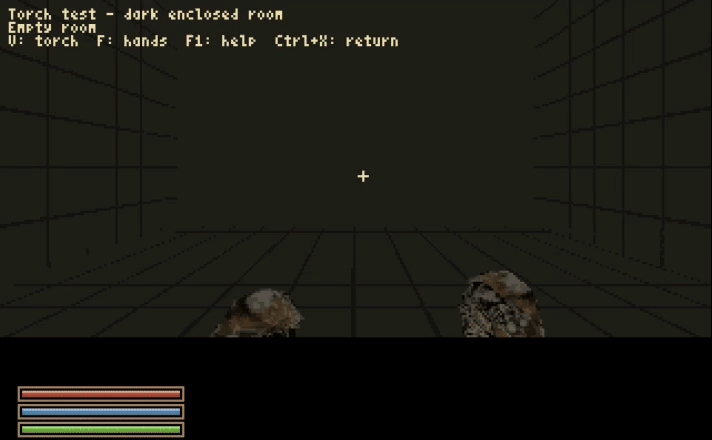

# Changelog

_Last updated with AmiWind v0.0.55 (29 October 2026)._

<!-- contents start -->
## Contents

- [v0.0.55: Sky Is Turning Red (Among Other Things), 29 October 2026](#v0055-sky-is-turning-red-among-other-things-29-october-2026)
- [v0.0.54: Hair, Movement, Magic And More, 28 October 2026](#v0054-hair-movement-magic-and-more-28-october-2026)
- [v0.0.53: Super Freak Halloween Update, 27 October 2026](#v0053-super-freak-halloween-update-27-october-2026)
- [v0.0.52: Skeletons Of Society, Vvardenfell Edition, 26 October 2026](#v0052-skeletons-of-society-vvardenfell-edition-26-october-2026)
- [v0.0.51: Let There Be More Inner Light, 25 October 2026](#v0051-let-there-be-more-inner-light-25-october-2026)
- [v0.0.50: The Doors: Riders On The CHIM, 24 October 2026](#v0050-the-doors-riders-on-the-chim-24-october-2026)
- [v0.0.49: Build Turnaround, 24 October 2026](#v0049-build-turnaround-24-october-2026)
- [v0.0.48: Inner CHIM & Actors On Stage, 24 October 2026](#v0048-inner-chim--actors-on-stage-24-october-2026)
- [v0.0.47: CHIM: The More, The Merrier, 21 October 2026](#v0047-chim-the-more-the-merrier-21-october-2026)
- [v0.0.46: Red Mountain Getting Red: A Whole Heap Of Fixes, 20 October 2026](#v0046-red-mountain-getting-red-a-whole-heap-of-fixes-20-october-2026)
- [v0.0.45: CHIM Streaming Improved, Guard Torches Are Back, 20 October 2026](#v0045-chim-streaming-improved-guard-torches-are-back-20-october-2026)
- [v0.0.44: By Azura's Trees!, 19 October 2026](#v0044-by-azuras-trees-19-october-2026)
- [v0.0.43: Let There Be CHIM: Vvardenfell's Outdoors, All of It, 19 October 2026](#v0043-let-there-be-chim-vvardenfells-outdoors-all-of-it-19-october-2026)
- [v0.0.42: Things Are Starting To Look Pretty Khuul, 17 October 2026](#v0042-things-are-starting-to-look-pretty-khuul-17-october-2026)
- [v0.0.41 candidate - visibility aprons, 15 October 2026](#v0041-candidate---visibility-aprons-15-october-2026)
- [v0.0.41 candidate - window support, 15 October 2026](#v0041-candidate---window-support-15-october-2026)
- [v0.0.41 candidate - lava coverage, 15 October 2026](#v0041-candidate---lava-coverage-15-october-2026)
- [Compiled apron selection, 15 October 2026](#compiled-apron-selection-15-october-2026)
- [Paired boundary validation, 15 October 2026](#paired-boundary-validation-15-october-2026)
- [v0.0.40 - owner apron policy, 15 October 2026](#v0040---owner-apron-policy-15-october-2026)
- [v0.0.40 - original kelp ownership, 15 October 2026](#v0040---original-kelp-ownership-15-october-2026)
- [v0.0.40 - retain authored boundary collision, 15 October 2026](#v0040---retain-authored-boundary-collision-15-october-2026)
- [v0.0.40 - sub-cell scenery apron parity, 15 October 2026](#v0040---sub-cell-scenery-apron-parity-15-october-2026)
- [v0.0.40 - coastal scenery apron guard, 15 October 2026](#v0040---coastal-scenery-apron-guard-15-october-2026)
- [v0.0.40 - regional scenery apron repair, 15 October 2026](#v0040---regional-scenery-apron-repair-15-october-2026)
- [v0.0.40 - combined conversion and static seam finding, 15 October 2026](#v0040---combined-conversion-and-static-seam-finding-15-october-2026)
- [v0.0.40 - final-version source preparation, 15 October 2026](#v0040---final-version-source-preparation-15-october-2026)
- [v0.0.40-dev2 - ring plan and public images, 15 October 2026](#v0040-dev2---ring-plan-and-public-images-15-october-2026)
- [v0.0.40-dev2 - boundary ownership source repair, 15 October 2026](#v0040-dev2---boundary-ownership-source-repair-15-october-2026)
- [v0.0.40-dev2 - combined-world ownership failure, 15 October 2026](#v0040-dev2---combined-world-ownership-failure-15-october-2026)
- [v0.0.40-dev2 - combined-world validation pending, 15 October 2026](#v0040-dev2---combined-world-validation-pending-15-october-2026)
- [v0.0.40-dev2 - original ground reference check, 15 October 2026](#v0040-dev2---original-ground-reference-check-15-october-2026)
- [v0.0.40-dev2 - original terrain detail and diagonals, 15 October 2026](#v0040-dev2---original-terrain-detail-and-diagonals-15-october-2026)
- [v0.0.40-dev2 - complete source carrier and contact findings, 15 October 2026](#v0040-dev2---complete-source-carrier-and-contact-findings-15-october-2026)
- [v0.0.40-dev2 - NPC model cache dependencies, 15 October 2026](#v0040-dev2---npc-model-cache-dependencies-15-october-2026)
- [v0.0.40-dev2 - source carrier voice prerequisite, 15 October 2026](#v0040-dev2---source-carrier-voice-prerequisite-15-october-2026)
- [v0.0.40-dev2 - full Seyda conversion, 15 October 2026](#v0040-dev2---full-seyda-conversion-15-october-2026)
- [v0.0.40-dev2 - carrier blocker and portable metadata, 15 October 2026](#v0040-dev2---carrier-blocker-and-portable-metadata-15-october-2026)
- [v0.0.40-dev2 - authored stair collision and source accounting, 15 October 2026](#v0040-dev2---authored-stair-collision-and-source-accounting-15-october-2026)
- [v0.0.40-dev2 - source-only carrier and stair finding, 15 October 2026](#v0040-dev2---source-only-carrier-and-stair-finding-15-october-2026)
- [v0.0.40-dev2 - original-cell tracker accounting, 15 October 2026](#v0040-dev2---original-cell-tracker-accounting-15-october-2026)
- [v0.0.40-dev2 - shared exterior carrier, 15 October 2026](#v0040-dev2---shared-exterior-carrier-15-october-2026)
- [v0.0.40-dev2 - expanded ocean floor, 15 October 2026](#v0040-dev2---expanded-ocean-floor-15-october-2026)
- [v0.0.40-dev2 - conversion palette and gate records, 15 October 2026](#v0040-dev2---conversion-palette-and-gate-records-15-october-2026)
- [v0.0.40-dev2 - original-cell town boundaries, 15 October 2026](#v0040-dev2---original-cell-town-boundaries-15-october-2026)
- [v0.0.40-dev2 - Toolkit label, 15 October 2026](#v0040-dev2---toolkit-label-15-october-2026)
- [v0.0.40-dev2 - ocean routing candidate, 15 October 2026](#v0040-dev2---ocean-routing-candidate-15-october-2026)
- [v0.0.40-dev2 - unreleased animation correction, 15 October 2026](#v0040-dev2---unreleased-animation-correction-15-october-2026)
- [v0.0.40-dev2 - unreleased inventory follow-up, 14 October 2026](#v0040-dev2---unreleased-inventory-follow-up-14-october-2026)
- [v0.0.40-dev1 - diagnostic follow-up, 14 October 2026](#v0040-dev1---diagnostic-follow-up-14-october-2026)
- [v0.0.39 continuation - renewed gameplay findings, 14 October 2026](#v0039-continuation---renewed-gameplay-findings-14-october-2026)
- [v0.0.39 - final source package, 14 October 2026](#v0039---final-source-package-14-october-2026)
- [v0.0.39-rc2 - candidate repairs and open findings, 13 October 2026](#v0039-rc2---candidate-repairs-and-open-findings-13-october-2026)
  - [Post-pin package and shipment evidence, 14 October 2026](#post-pin-package-and-shipment-evidence-14-october-2026)
- [v0.0.39: Cell By Cell, Piece By Piece - final preparation, 13 October 2026](#v0039-cell-by-cell-piece-by-piece---final-preparation-13-october-2026)
- [v0.0.39-rc1: Cell By Cell, Piece By Piece - in preparation, 13 October 2026](#v0039-rc1-cell-by-cell-piece-by-piece---in-preparation-13-october-2026)
  - [Saves and death UI](#saves-and-death-ui)
  - [Exact RC1 package and scoped native evidence, 13 October 2026](#exact-rc1-package-and-scoped-native-evidence-13-october-2026)
  - [Third-person animation, controls and sound](#third-person-animation-controls-and-sound)
  - [Exterior ownership and compact images](#exterior-ownership-and-compact-images)
  - [CHIM progress and release records](#chim-progress-and-release-records)
  - [Findings and work still open](#findings-and-work-still-open)
- [v0.0.38: Lava Is All You Need (And A Hint Of Tel Uvirith)](#v0038-lava-is-all-you-need-and-a-hint-of-tel-uvirith)
- [v0.0.37: Proofreading the Cantons](#v0037-proofreading-the-cantons)
- [v0.0.36: 36 Lessons of Vivec's Cantons (And Vvardenfell Shorelines)](#v0036-36-lessons-of-vivecs-cantons-and-vvardenfell-shorelines)
- [v0.0.35: CHIMporting It All: Gathering Up The Loose Branches From The Seashore](#v0035-chimporting-it-all-gathering-up-the-loose-branches-from-the-seashore)
- [v0.0.34: CHIM: Tightening the Bolts](#v0034-chim-tightening-the-bolts)
- [v0.0.33: Towards CHIM: Replacing the Engine Block](#v0033-towards-chim-replacing-the-engine-block)
- [v0.0.32: Last Stop on the Old Line: Window-Shopping in Vivec](#v0032-last-stop-on-the-old-line-window-shopping-in-vivec)
- [v0.0.31: Lamps, Lanterns and Loading](#v0031-lamps-lanterns-and-loading)
- [v0.0.31-dev6: Lamps, Lanterns and Loading](#v0031-dev6-lamps-lanterns-and-loading)
- [v0.0.31-dev5: Lamps, Lanterns and Loading](#v0031-dev5-lamps-lanterns-and-loading)
- [v0.0.31-dev4: Revisiting Seyda Neen](#v0031-dev4-revisiting-seyda-neen)
- [v0.0.31-dev3: Revisiting Seyda Neen](#v0031-dev3-revisiting-seyda-neen)
- [v0.0.31-dev2: Revisiting Seyda Neen](#v0031-dev2-revisiting-seyda-neen)
- [v0.0.31-dev1: Revisiting Seyda Neen](#v0031-dev1-revisiting-seyda-neen)
- [v0.0.30: The Temple](#v0030-the-temple)
- [v0.0.30-rc1: The Temple](#v0030-rc1-the-temple)
- [v0.0.30-dev5: The Temple](#v0030-dev5-the-temple)
- [v0.0.30-dev4: The Temple](#v0030-dev4-the-temple)
- [v0.0.30-dev3: The Temple](#v0030-dev3-the-temple)
- [v0.0.29-rc2: Let There Be (Just a Bit More) Light](#v0029-rc2-let-there-be-just-a-bit-more-light)
- [0.0.28 — Trees and Grass, Day and Night — in preparation, 4 October 2026](#0028-â-trees-and-grass-day-and-night-â-in-preparation-4-october-2026)
- [0.0.28-rc1 — Trees and Grass, Day and Night — candidate, 4 October 2026](#0028-rc1-â-trees-and-grass-day-and-night-â-candidate-4-october-2026)
- [0.0.27 — Rocks, Mushrooms, and Then Some — 3 October 2026](#0027-â-rocks-mushrooms-and-then-some-â-3-october-2026)
- [0.0.26](#0026)
- [0.0.26-rc1](#0026-rc1)
- [0.0.25](#0025)
- [0.0.25-rc10](#0025-rc10)
- [v0.0.25-rc9](#v0025-rc9)
- [v0.0.25-rc8](#v0025-rc8)
- [v0.0.25-rc7](#v0025-rc7)
- [v0.0.25-rc6 — 1 October 2026](#v0025-rc6-â-1-october-2026)
- [v0.0.25-rc5 — 1 October 2026](#v0025-rc5-â-1-october-2026)
- [v0.0.25-rc4 — 1 October 2026](#v0025-rc4-â-1-october-2026)
- [v0.0.25-rc3 — 1 October 2026](#v0025-rc3-â-1-october-2026)
- [v0.0.25-rc2 — 1 October 2026](#v0025-rc2-â-1-october-2026)
- [v0.0.25-rc1 — 1 October 2026](#v0025-rc1-â-1-october-2026)
- [v0.0.25-dev1 — 1 October 2026](#v0025-dev1-â-1-october-2026)
- [v0.0.24 - Welcome to Balmora (and Vvardenfell!) - 1 October 2026](#v0024---welcome-to-balmora-and-vvardenfell---1-october-2026)
- [v0.0.24-rc4 — 1 October 2026](#v0024-rc4-â-1-october-2026)
- [v0.0.24-rc3 — 1 October 2026](#v0024-rc3-â-1-october-2026)
- [v0.0.24-rc2 — 1 October 2026](#v0024-rc2-â-1-october-2026)
- [v0.0.24-rc1 — 30 September 2026](#v0024-rc1-â-30-september-2026)
- [v0.0.24-dev4 — 30 September 2026](#v0024-dev4-â-30-september-2026)
- [v0.0.24-dev3 — 30 September 2026](#v0024-dev3-â-30-september-2026)
- [v0.0.24-dev2 — 30 September 2026](#v0024-dev2-â-30-september-2026)
- [v0.0.24-dev1 — 30 September 2026](#v0024-dev1-â-30-september-2026)
- [v0.0.23-dev4 — 29 September 2026](#v0023-dev4-â-29-september-2026)
- [0.0.23-dev2 — 29 September 2026](#0023-dev2-â-29-september-2026)
- [v0.0.23-dev1 - parallel builds, 29 September 2026](#v0023-dev1---parallel-builds-29-september-2026)
- [v0.0.22 - normal public source release, 29 September 2026](#v0022---normal-public-source-release-29-september-2026)
- [v0.0.21-dev8 - reconciled boot/launcher and paper-font sources, 29 September 2026](#v0021-dev8---reconciled-bootlauncher-and-paper-font-sources-29-september-2026)
- [v0.0.21-dev7 - visible five-second preflight and dry-run boot order, 29 September 2026](#v0021-dev7---visible-five-second-preflight-and-dry-run-boot-order-29-september-2026)
- [v0.0.21-dev6 - versioned boot/environment preflight, 29 September 2026](#v0021-dev6---versioned-bootenvironment-preflight-29-september-2026)
- [v0.0.21-dev5 — GOG TTF preference and Steam font fallback, 28 September 2026](#v0021-dev5-â-gog-ttf-preference-and-steam-font-fallback-28-september-2026)
- [v0.0.21-dev4 — evening world-mapping checkpoint, 28 September 2026](#v0021-dev4-â-evening-world-mapping-checkpoint-28-september-2026)
- [v0.0.21-dev3 — opening maintenance and interaction hints, 28 September 2026](#v0021-dev3-â-opening-maintenance-and-interaction-hints-28-september-2026)
- [v0.0.21-dev2 — opening barrier correction, 28 September 2026](#v0021-dev2-â-opening-barrier-correction-28-september-2026)
- [Portable launcher helper — 28 September 2026](#portable-launcher-helper-â-28-september-2026)
- [v0.0.20 — 28 September 2026](#v0020-â-28-september-2026)
- [v0.0.19 — 28 September 2026](#v0019-â-28-september-2026)
- [v0.0.18-dev5 — 28 September 2026](#v0018-dev5-â-28-september-2026)
- [v0.0.18-dev4 — 28 September 2026](#v0018-dev4-â-28-september-2026)
- [v0.0.18-dev3 — 28 September 2026](#v0018-dev3-â-28-september-2026)
- [v0.0.18-dev2 — 28 September 2026](#v0018-dev2-â-28-september-2026)
- [v0.0.18-dev1 — 28 September 2026](#v0018-dev1-â-28-september-2026)
- [v0.0.17 — 28 September 2026](#v0017-â-28-september-2026)
- [v0.0.16](#v0016)
- [0.12.1.dev1 / runtime source still v0.0.15-dev2](#0121dev1--runtime-source-still-v0015-dev2)
- [0.12.0.dev2 / runtime v0.0.15-dev2](#0120dev2--runtime-v0015-dev2)
- [0.12.0.dev1 / runtime v0.0.15-dev1](#0120dev1--runtime-v0015-dev1)
- [0.11.0.dev1 / runtime v0.0.14-dev1](#0110dev1--runtime-v0014-dev1)
- [0.10.0.dev1 / runtime v0.0.13-dev1](#0100dev1--runtime-v0013-dev1)
- [0.9.0.dev2 / runtime v0.0.12-dev2](#090dev2--runtime-v0012-dev2)
- [0.9.0.dev1 / runtime v0.0.12-dev1](#090dev1--runtime-v0012-dev1)
- [0.8.3.dev4 / runtime v0.0.11-dev4](#083dev4--runtime-v0011-dev4)
- [0.8.3.dev3 / runtime v0.0.11-dev3](#083dev3--runtime-v0011-dev3)
- [Development source 0.8.3.dev1 / runtime v0.0.11-dev1](#development-source-083dev1--runtime-v0011-dev1)
- [Runtime v0.0.10 / source 0.8.2 — 27 September 2026](#runtime-v0010--source-082-â-27-september-2026)
- [Runtime v0.0.9 / source 0.8.1 — 27 September 2026](#runtime-v009--source-081-â-27-september-2026)
- [Runtime v0.0.8 / source 0.8.0 — 27 September 2026](#runtime-v008--source-080-â-27-september-2026)
- [Changelog](#changelog-1)
- [0.7.0 source / AmiWind v0.0.6 checkpoint-005](#070-source--amiwind-v006-checkpoint-005)
- [0.6.0 source / demo v0.0.5 checkpoint-004](#060-source--demo-v005-checkpoint-004)
- [0.5.0 source / demo v0.0.4 checkpoint-003](#050-source--demo-v004-checkpoint-003)
- [0.4.0 source / demo v0.0.3 checkpoint-002](#040-source--demo-v003-checkpoint-002)
- [0.3.0 source / opening and terrain walk v0.0.2](#030-source--opening-and-terrain-walk-v002)
- [0.2.0 source / opening v0.0.1](#020-source--opening-v001)
- [0.1.3 — 27 September 2026](#013-â-27-september-2026)
- [0.1.2 — 27 September 2026](#012-â-27-september-2026)
- [0.1.1 — 27 September 2026](#011-â-27-september-2026)
- [0.1.0 — 27 September 2026](#010-â-27-september-2026)
  - [rc6 image recovery follow-up](#rc6-image-recovery-follow-up)
- [Validation finding — 14 October 2026, v0.0.40-dev1](#validation-finding-â-14-october-2026-v0040-dev1)
- [CHIM source candidate - 14 October 2026, v0.0.40-dev1](#chim-source-candidate---14-october-2026-v0040-dev1)

<!-- contents end -->

## v0.0.55: Sky Is Turning Red (Among Other Things), 29 October 2026

- Nearer Red Mountain the sky, the land's light and, at half strength, the fog pull toward the game's Blight weather
  before the mountain's region begins; the clouds speed up toward Blight's and the crater sky is darker
  (`aw_redmountain`, on by default; Ald'ruhn keeps its own weather) ([RED-MOUNTAIN-MENACE-54](BUGS.md)).
- Builds survive memory pressure on any machine: the guards read the machine's memory without a container, a worker
  lost to memory is retried with fewer units at once, the CHIM stage's early checks run under the same limits
  ([BUILD-GUARD-BLIND-NO-CGROUP-55](BUGS.md), [BUILD-OOM-DEGRADE-NOT-DIE-54](BUGS.md)).
- The Toolkit's build monitor shows RAM, the build disk, a memory curve and a warnings row; a reload keeps the tab,
  and a magnifier opens a build from Recent builds and gates.
- The garbage collector ages out the runs of release series older than the newest three, and every build warns at
  80 % disk fill and while the disk runs low ([BUILD-CACHE-NO-RETENTION-55](BUGS.md)).
- The docs have folders and a generated index; DemoWind (`dbg demowind`) shows cheap effects with their cost.
- Released without the build from scratch of the line, which moves to v0.0.56
  ([release notes](releases/notes/RELEASE-v0.0.55.md)).

## v0.0.54: Hair, Movement, Magic And More, 28 October 2026

- Humanoid characters choose every animation group by their state (standing, walking, running, fighting, casting,
  dying) by OpenMW's rules; the first-person hands play their own clips.
- Hair is kept whole instead of being cut to a budget, the player's body has hair, and the heads beside whole hair
  keep 136 to 178 triangles ([NPC-HEAD-STARVED-WHOLE-HAIR-54](bugs/NPC-HEAD-STARVED-WHOLE-HAIR-54.md)).
- One record per character: all 3,437 NPCs and creatures with their stats, behaviour, items and spells from the game
  data, autocalculated by the original rules, kept in saved games ([ACTOR_STATE.md](ACTOR_STATE.md)).
- The experimental scripts (`dbg mwscript on`) read and change those records, start and stop combat and ask a
  character's current package (wander, travel, follow): 715 of 1,207 scripts run whole (390 in v0.0.53); the commonest test compiles to one
  instruction, 9 % smaller scripts, 31 to 44 % fewer instructions a frame ([MWSCRIPT_BYTECODE.md](MWSCRIPT_BYTECODE.md)).
- Travel services again: every caravaner, shipmaster, gondolier and Mages Guild guide, with the original
  destinations and prices ([TRAVEL-SERVICES-CHIM-51](BUGS.md)).
- Magic effects as sprites and particles from the game's own textures, experimental and off by default
  ([MAGIC_EFFECTS.md](MAGIC_EFFECTS.md)).
- 34 of the 35 entrances the converted collision still kept out of reach can be used: a standing-room rule for the
  Redoran guard towers and the Daedric shrine entries, exact plate bevels, and the original ground around doors in a
  dip; the Unmarked Shipwreck's upper trapdoor stays listed
  ([DOOR-USE-COLLISION-FILLED-53](bugs/DOOR-USE-COLLISION-FILLED-53.md)).
- Weather and smoke from the game's tables, fog indoors, levelled creatures outdoors, more creature animations.
- Interface: a crosshair, a hide-HUD key, a locked-door notice, the player's arrow on the map, console history.
- NPC Gallery v2.0 shows the game's own characters, nothing baked for it ([CHARACTER_MODEL_GALLERY.md](CHARACTER_MODEL_GALLERY.md));
  `dbg sweep` names what an area's entities miss ([AMIWIND_CONSOLE_COMMANDS.md](AMIWIND_CONSOLE_COMMANDS.md)).
- No rust-red speckle on dark ground at night ([NIGHT-RUST-31](bugs/NIGHT-RUST-31.md)); owned mushrooms indoors can
  be picked as theft ([HARVEST-INTERIOR-PICK-47](bugs/HARVEST-INTERIOR-PICK-47.md)).
- The Vivec Arena Pit draws about 29 % faster (its upper ring 27.5 to 18.0 ms a frame); the first-person hand driver runs in C; the Suran dancers' hair is whole at the back.
- The Halloween cast is in every full-world build, so `aw bench halloween` works in release images.
- An engine change, or a builder change the world does not use, no longer rebuilds the CHIM world. The release image
  is the v0.0.54-dev2 world with the version changed.

## v0.0.53: Super Freak Halloween Update, 27 October 2026

- Doors work after a walk across a frame border: the engine read only the start frame's door bank, so 830 of the 1,102
  exterior entrances were dead once walked into; a script's Activate on a load door uses the current frame too
  ([DOOR-BANK-STREAMED-FRAME-51](bugs/DOOR-BANK-STREAMED-FRAME-51.md)).
- Every build runs the door check: the engine's own door code over all 1,102 entrances (prompt, use key, the way back,
  the wall between the player and the door), 1,102 of 1,102 working after a walk over a frame border; the count may
  only go up ([DOOR-ENTRANCE-AUDIT-51](BUGS.md)). `dbg door roulette [SEED]` loads one random room at its own start.
- A doorway slack lets the use ray meet the entrance's own doorway collision up to 16 units before the door: the
  stricter wall-traced check counts 1,067 entrances usable, up 31; the 35 left (24 Daedric shrines, 7 raised
  trapdoors, 2 Dwemer doors, a Redoran hut door, the Unmarked Shipwreck's upper trapdoor) move to v0.0.54
  ([DOOR-USE-BLOCKED-53](BUGS.md), [DOOR-USE-COLLISION-FILLED-53](BUGS.md)).
- The four characters of the base game with an animation file of their own, among them Desele's dancers in Suran,
  dance it from the shared table ([DANCER-OWN-ANIM-IGNORED-53](BUGS.md)).
- The Halloween scene: the game's skeletons, the Suran dancers and Dagoth Ur dancing on the animation stage to a beat,
  with a camera director; `aw bench halloween` (aliases `aw halloweenbench`, `dbg halloween bench`) is the standard
  benchmark, the same 600 frames on every machine ([HALLOWEEN-SCENE-53](BUGS.md), [HALLOWEEN.md](HALLOWEEN.md)). Both
  need a build with the cast (`--miniwind-halloween`); the cast joins the default build in a follow-up.
- The custom OST slot: one track of your own packed into your image only, played by `aw music custom play`/`stop`
  while the game's playlist waits; public builds ship no song ([CUSTOM-OST-SLOT-53](BUGS.md)).
- Builds check the free disk first: the last known good footprint plus 30 %, never below 35 GiB, again before each
  stage; changing the settings rebuilds nothing ([BUILD-DISK-NEED-UNKNOWN-52](BUGS.md)).
- The GitHub checks run in parallel jobs with the tools cached and the suite in six shards
  ([CI-SOURCE-JOB-TIMEOUT-52](BUGS.md)).
- A version-only change after a development build refuses no stage record, so it rebuilds only the engine and the
  image ([BUILD-STAGE-READS-UNFINGERPRINTED-48](BUGS.md)); a maintainer deferral to a version stops counting at that
  version ([REGISTER-DEFERRAL-EXPIRES-53](BUGS.md)).

## v0.0.52: Skeletons Of Society, Vvardenfell Edition, 26 October 2026

- Every character moves by one shared skeleton and one shared action table, as in the original game: each resident,
  guard and actor is one model in its rest pose, and about 140 action groups on a 29-bone figure at 8 frames a second
  serve everyone, in two tables (the common one with the women's walk and idles, and the beast races'). 512 MB of
  character models for the base game's 2,612 placed characters against 3,222 MB baked; the 97 that never fitted the
  baked budget fit now. Baked characters stay a build option (`--npc-anim-type 1`).
- A character is posed only when its frame changes, shares its pose with the others of its model on that frame, keeps
  up to 32 posed frames where Fast RAM allows, and is culled by the box of its own pose: at Balmora's arrival on the
  slow 68040 preset a frame takes 1,261 ms against 1,272 ms baked; eight characters changing action every frame cost
  +5.6 % ([SKEL-RUNTIME-COST-52](BUGS.md)).
- Weapons, shields and the guards' torches ride the hand bones; guards hold their torches up at night again.
- Dagoth Ur (his whole 2,254-triangle model) stands in the Facility Cavern and in Akulakhan's Chamber, and the Heart
  of Lorkhan hangs where the game puts it; they do not fight or speak yet.
- Akulakhan's Chamber loads on 32 MB, also coming from a town: memory that can be made again is given back first and
  the room's bank grows in 64 KiB steps (after Balmora: 3,456 KiB, 804 KiB of the zone free)
  ([CHIM-ROOM-HEART-CHAMBER-LOAD-50](bugs/CHIM-ROOM-HEART-CHAMBER-LOAD-50.md)).
- Every engine allocation asks for its memory first, so a full memory no longer ends in a Software Failure; a WARNING
  box under 32 MB of Fast RAM shows before the logo for five seconds.
- Balmora's canal banks without dents; coloured light in the rooms; the music fed through loads.
- Builds: the reuse checks found three ways to reuse stale or foreign outputs, all fixed; every build stops before its
  first stage with less than 35 GiB free.

## v0.0.51: Let There Be More Inner Light, 25 October 2026

- Akulakhan's Chamber, the game's final room, loads on 32 MB: the engine's first automatic CHIM cache bank needs
  4 MiB instead of 8 MiB beyond the system margin, so 32 MB gets a 7 MiB bank; Seyda Neen, Balmora and Vivec load on
  32 MB with no "zone full" retry. A place the build marks for 32 MB is refused at its door when a start took no
  cache bank ([CHIM-AUTO-BANK-CLIFF-51](bugs/CHIM-AUTO-BANK-CLIFF-51.md),
  [CHIM-ROOM-HEART-CHAMBER-LOAD-50](bugs/CHIM-ROOM-HEART-CHAMBER-LOAD-50.md)).
- Every interior is baked with its cell's sunlight, a directional light from the original's fixed interior direction,
  which the bake had always left out; 322 of 1,335 interior cells have at least twice as much of it as ambient light.
  The interior brightness default goes back from 1.2 to 1.0; the prison ship keeps its judged light
  ([INTERIOR-SUNLIGHT-UNBAKED-51](bugs/INTERIOR-SUNLIGHT-UNBAKED-51.md)).
- The CHIM world's reads go in small slices with the music fed between them; every load prints a "Loading audio"
  line naming the step where the music waited longest, the intro movie left out ([AUDIO-LOAD-29](bugs/AUDIO-LOAD-29.md)).
- The game's scripts (experimental, `dbg mwscript on`): `Enable`, `Disable`, `GetDisabled`, `Lock`, `Unlock`,
  `GetLocked`, `OnActivate` and `Activate` on doors, `MessageBox` with buttons and `GetButtonPressed`.
- Seyda Neen's fires no longer print "'aw_flame_light' is not a field" on every load.
- Builds: an engine source edit or a helper added to a shared module no longer rebuilds the CHIM world; key reads no
  longer mark a stage as changed; a change of the key rules fails the tests until the key form is raised; the CHIM
  world's checks take 94 s instead of 116 s; the engine smoke fails a 32 MB run with a "zone full" wait.
- The bug register lists open bugs seen in three releases or more with their reason and a "Waiting on" column,
  refuses a near-duplicate title, and its files warn above 75 % of the text limit and fail above 95 %.

## v0.0.50: The Doors: Riders On The CHIM, 24 October 2026

- Every entrance of the game leads into its interior, and every way out leads back. One door table for the whole
  world, built from the game's own door records, resolves every load door and every marker where an arrest takes the
  player: a town frame holds what lies inside its box (Seyda Neen, Balmora, Vivec), the CHIM region frame of the cell
  the rest, a room its own doors. Every door bank of the image is written from it, and the image no longer builds when
  a door does not resolve ([CHIM-REGION-DOORS-NO-ROOMS-48](bugs/CHIM-REGION-DOORS-NO-ROOMS-48.md),
  [door graph](chim/DOOR_GRAPH.md#rooms-by-batch-in-the-builder)).
- The v0.0.49 image had 106 of the base game's 3,133 load doors and markers unlinked: 85 ways out of rooms around
  Vivec and Ebonheart (the builder had checked each town's map by its own name and so dropped every town on CHIM), 10
  entrances in cells inside the old town frames (Pelagiad's houses, the Abaesen-Pulu Egg Mine, Assemanu, the Andrano
  Ancestral Tomb, the Akimaes and Nimawia Grottos, the Remote Shipwreck), 5 jail markers and the opening's census
  office and prison ship doors, which the opening scene keeps as it wrote them.
- `dbg tp heartchamber` (Akulakhan's Chamber); named places in `config/teleport-names.txt`.
- The Toolkit Monitor keeps "follow latest" and "follow the running stage" in the browser, on when nothing is saved
  (Toolkit 0.1.12).
- A version change rebuilds only the engine and the image: the v0.0.50-dev2 build (only the version changed) reused
  40 of 43 stages, the CHIM world from the cache
  ([BUILD-VERSION-GETATTR-TRACE-49](bugs/BUILD-VERSION-GETATTR-TRACE-49.md)); the build's reuse check no longer calls
  the tracker data's rebuild unexpected.
- The hardware page leads with the machines AmiWind aims at; hardware 3D through Warp3D is a research item. The actor
  sizes, the game's scripts, object state in rooms, Bloodmoon and the Morrowind-style UI work move to v0.0.51.

## v0.0.49: Build Turnaround, 24 October 2026

- A version change rebuilds only what shows the version (the engine, the image, the tracker data); the CHIM world no
  longer keys on it, kept by a gate test over every stage of the builder (BUILD-CHIM-KEY-VERSION-48). This release's
  final was built from the v0.0.49-dev1 build's caches with only the version changed (39 of 43 stages reused); the
  CHIM world was built once more because of a trace the first form of the fix left (BUILD-VERSION-GETATTR-TRACE-49,
  repaired for v0.0.50).
- Release candidates and finals reuse the caches like development builds; `--release-from-scratch` and `--clean`
  build from scratch.
- The front page, the progress tracker and twelve guides describe the current game (v0.0.48 presets, 32 MB of Fast
  RAM, the interiors on CHIM); the second real-hardware figure (A3000, 68060 at 80 MHz, RTG on the tester's own modified build) and the timedemo
  steps.

## v0.0.48: Inner CHIM & Actors On Stage, 24 October 2026

- The interiors go on CHIM: the builder plans all 1,134 interiors of the base game as CHIM rooms and converts 1,132,
  their models and textures stored once in the CHIM room store ([the interior store](chim/INTERIOR_STORE.md)); the
  prison and the census office stay classic room maps for now. Rooms with water or lava are converted too, and the
  plants in the rooms can be picked.
- The actors the game places in the rooms stand there with their full animation kit (2,359 room residents in the
  v0.0.48-dev2 build), grounded when the game is built by a six-step rule: the intended floor, a walkable surface,
  the actor's fit, the resting height, the baked position, and a refusal of any ambiguous placement
  ([actor placement](ACTOR_PLACEMENT.md)). Every NPC greets with its own voice.
- 32 MB of Fast RAM is the safe minimum and the presets' default; the 16 interiors and 5 region frames that need
  more than 16 MB are marked when the game is built and say so at the door
  ([RAM-REQUIREMENT-32MB-48](bugs/RAM-REQUIREMENT-32MB-48.md)).
- CHIM 0.2.2 with the [CHIM compatibility table](chim/README.md#compatibility): each CHIM version names the oldest
  version whose worlds and caches it reads; 0.2.2 reads everything 0.2.1 built, and the version label no longer
  counts in the builder's stage keys.
- Build fixes: stages key on what they really read, the CHIM stage no longer recomputes every frame's visibility,
  pools get units large enough for every core, the CHIM and room stages no longer starve each other of memory, and a
  boot payload over one partition moves the interior store, the actor models and maps to the world volume.
- New tool `tools/bug_lookup.py`: searches the bug register and its archives by id, words, state, family, CHIM part,
  severity, version, persisting or a named file.
- The Stats window (P), a Magic window placeholder (O), the original movement speeds, burning campfires and the
  original's sound markers.
- Next: the next version starts with build turnaround, a final rebuilt from its candidate's caches in minutes
  ([roadmap: build turnaround first](ROADMAP.md#build-turnaround-first-24-october-2026)).
- Details: [the v0.0.48 release notes](releases/notes/RELEASE-v0.0.48.md).

## v0.0.47: CHIM: The More, The Merrier, 21 October 2026

- The CHIM cell list is now in the repository (`config/chim-cells.json`) and the default: a plain build puts every
  exterior cell on CHIM. Since v0.0.36 the list the project's own builds used was not in the repository, and builds
  from the repository made the old region maps ([BUILD-CHIM-CELLS-PRIVATE-LIST-47](bugs/BUILD-CHIM-CELLS-PRIVATE-LIST-47.md)).
- Crossing a frame border outdoors is no longer a level change; creatures and people appear outside the towns, and
  the game's setting for the actor table is switched on whenever the image ships it, which was missing before
  ([CHIM-ACTOR-TABLE-OFF-IN-GAME-47](bugs/CHIM-ACTOR-TABLE-OFF-IN-GAME-47.md)). The switches of the second
  development snapshot are on by default.
- Mushrooms in converted interiors can be picked ([HARVEST-INTERIOR-PICK-47](bugs/HARVEST-INTERIOR-PICK-47.md)).
- The builder keeps `--jobs` at full width while memory is below 96 %: the memory guard no longer cuts workers it
  cannot free. A from-scratch build's CHIM stage had run on 1 of 24 cores for an hour
  ([BUILD-SCHEDULER-MEMORY-STARVED-42](bugs/BUILD-SCHEDULER-MEMORY-STARVED-42.md)).
- New builder options `--clean` (a clean start) and `--public-defaults` (only the repository's own defaults, old
  methods refused).
- Terrain generated from the game's heights, shared files and skins stored once, no stair walk by default.
- Details: [the v0.0.47 release notes](releases/notes/RELEASE-v0.0.47.md).

## v0.0.46: Red Mountain Getting Red: A Whole Heap Of Fixes, 20 October 2026

- Every region chooses its weather as the original game does; Red Mountain draws its blight sky
  ([SKY-REDMOUNTAIN-BLUE-44](bugs/SKY-REDMOUNTAIN-BLUE-44.md)).
- The Ebonheart dragon statue stands on its pedestal again, the torch shows in third person, the Vivec dock
  walkways hold the player up, and the Dreamers greet you.
- Collision pieces keep only the surface you walk on exactly, so every frame fits its memory again
  ([CHIM-HULL-SURFACE-HEAP-46](bugs/CHIM-HULL-SURFACE-HEAP-46.md)).
- Rebuilds reuse more: stair walks are keyed by the data they walk, and the build's finish time is printed in UTC and
  local time.
- Details: [the v0.0.46 release notes](releases/notes/RELEASE-v0.0.46.md).

## v0.0.45: CHIM Streaming Improved, Guard Torches Are Back, 20 October 2026

- Frames around the player are read ahead into spare Fast RAM; on a 128 MiB setup a crossing takes about a third of
  the v0.0.44 time ([CROSSING_BASELINE](performance/CROSSING_BASELINE.md)).
- The engine sizes its heap from the free Fast RAM; a 16 MiB machine keeps the built 11 MiB
  ([ENGINE-HEAP-FIXED-SIZE-43](bugs/ENGINE-HEAP-FIXED-SIZE-43.md)).
- Guards in the streets carry their torches at night again: 19 guard types instead of 13
  ([GUARD-TORCH-CHIM-FRAMES-44](bugs/GUARD-TORCH-CHIM-FRAMES-44.md)).
- The CHIM stage runs its serial sections on the worker pool, and a change to the scheduler no longer rebuilds
  every stage.
- Details: [the v0.0.45 release notes](releases/notes/RELEASE-v0.0.45.md).

## v0.0.44: By Azura's Trees!, 19 October 2026

- The Bitter Coast trees are 16 to 42 % lighter again, every trunk keeping at least 90 % of its height, so both
  Bitter Coast areas fit in memory ([CHIM-BITTERCOAST-HEAP-SHAPEGUARD-43](bugs/CHIM-BITTERCOAST-HEAP-SHAPEGUARD-43.md)).
- The player body is built again for every race, and guard torch models are built again
  ([NPC-HEAD-DECIMATION-33](bugs/NPC-HEAD-DECIMATION-33.md)).
- Interior plant sprites reach every room type ([INTERIOR-MORAG-TONG-FPS-43](bugs/INTERIOR-MORAG-TONG-FPS-43.md)).
- The CHIM tracker counts what each build puts on CHIM: 1,292 land cells and 117 sea cells
  ([TRACKER-CHIM-COUNT-STALE-44](bugs/TRACKER-CHIM-COUNT-STALE-44.md)).
- Details: [the v0.0.44 release notes](releases/notes/RELEASE-v0.0.44.md).

## v0.0.43: Let There Be CHIM: Vvardenfell's Outdoors, All of It, 19 October 2026

- Every exterior cell of Vvardenfell is on CHIM; the 227 cells left classic in v0.0.42 joined in three batches,
  lightest first.
- The 98 sea floor cells are taken as flat seabed, and fourteen open-sea cells join as ocean cells.
- Three meshes whose collision did not match their visible steps are fixed
  ([CHIM-STAIR-STEPS-SOLID-43](bugs/CHIM-STAIR-STEPS-SOLID-43.md)); two tree meshes no longer keep 14 cells off CHIM.
- Red Mountain's summit no longer meets a solid sky ceiling, editor markers are no longer drawn or solid, and
  interior plants and trees are sprites by default.
- The build checks a pooled stage against the memory it needs before it starts, the image step's frame maps run on
  all cores, and the playtest is smaller.
- Details: [the v0.0.43 release notes](releases/notes/RELEASE-v0.0.43.md).

## v0.0.42: Things Are Starting To Look Pretty Khuul, 17 October 2026

- 1,168 of the island's 1,395 exterior cells on CHIM (776 in v0.0.42-dev1), the light cells of the CHIMport by
  weight.
- The clouds are back: the cloud sky is converted for whatever palette the build has, and a stand-in sky stops the
  build ([SKY-FLAT-PALETTE-DRIFT-41](bugs/SKY-FLAT-PALETTE-DRIFT-41.md)).
- No more popping buildings where streaming memory ran full
  ([CHIM-ZONE-RELEASE-FLICKER-42](bugs/CHIM-ZONE-RELEASE-FLICKER-42.md)).
- Vivec's giant mushrooms are closed again, doors in CHIM region cells show their entrance, and 141 Vivec rooms are
  converted.
- The inventory starts to take its original shape: title bar, item icons from the game's own art, the character as a
  still picture.
- Details: [the v0.0.42 release notes](releases/notes/RELEASE-v0.0.42.md).

[CHIM-CELL-FEATURE-LIST-INCOMPLETE-38](bugs/CHIM-CELL-FEATURE-LIST-INCOMPLETE-38.md) — 15 October 2026, v0.0.41-dev1: full-build preparation rejected five explicitly selected ocean routing cells absent from the original CELL/LAND inventory, before legacy compilation. The source checklist now records additional ocean routing cells separately and allows their absence only before routing rows are appended. Final classification/stage verification still requires every row and CHIM routing flags; undeclared or unselected missing cells are rejected. All 98 targeted checks across five modules pass, including three new ocean checklist regressions. Exact production conversion, native ocean behavior, image/package and delivery checks remain pending; coverage states are unchanged.

[CHIM-FRAME-STATIC-SEAM-40](bugs/CHIM-FRAME-STATIC-SEAM-40.md) — 15 October 2026, v0.0.41-dev1: whole-world metadata binding failed because tutorial barrel reference 172851 lacked its original CELL, while the original audit records [-2,-9]. A narrow source correction restores only that missing field before capture, rejecting nonempty wrong cells and every other identity/transform mismatch. Fifty focused Seyda/ownership checks pass, including three new semantic regressions. The preceding 4,247-test full-suite pass remains historical; the repaired world is pending. The prepared Linux source kit is held and undelivered. Native, image/package and playtest acceptance remain pending; coverage states are unchanged.

[CHIM-FRAME-STATIC-SEAM-40](bugs/CHIM-FRAME-STATIC-SEAM-40.md) — 15 October 2026, v0.0.41-dev1 image integration follow-up: added Seyda dependency numbers and model digests are checked against the world-index-bound source manifest before source-carrier static parity includes them. Frames without supplements retain prior behavior. The focused ownership/apron module now passes 33 checks, including five new semantic regressions and missing/rebound-model rejection. The issue remains OPEN; exact world rebuild, held-boundary/native and image/package checks remain pending.

[CHIM-FRAME-STATIC-SEAM-40](bugs/CHIM-FRAME-STATIC-SEAM-40.md) — 15 October 2026, v0.0.41-dev1: a source repair supplements only missing Seyda apron dependencies using the included original-cell owner's exact compiled mesh and textures, preserving original identity and unique ownership while translating frame-local origins. It targets rock reference 251397 and shell reference 461804; 32 focused ownership/apron checks pass. The rebuilt world and held boundary/native checks remain pending. Separately, independent normal interior/actor/UI conversion completed 2,451 files with unchanged source and inputs; it is not image, native or package acceptance. CHIM coverage states are unchanged. Earlier full-suite and world results remain bound to their preceding source; changed apron acceptance is pending.

[CHIM-FRAME-STATIC-SEAM-40](bugs/CHIM-FRAME-STATIC-SEAM-40.md) — 15 October 2026, v0.0.41-dev1: exact source validation completed 4,242 tests (4,236 passed, three Windows-only skips and three Census expected failures), with zero failures/errors; the matching engine compiled. The completed 369-frame world passed structural/source, modeled heap, host zone-walk and scoped stair gates. Of 547 boundary comparisons, 544 measured agreement and three remain held (237, 241, 242). Of 36 sampled models, 22 have matching face counts and unique face correspondence; 14 differ in collision-only versus visual representation and require payload/sprite/native review. These measurements do not establish visual severity or universal equivalence. Native captures, independent interior conversion, image assembly/readback and package acceptance remain pending; coverage states are unchanged. Stair evidence retains 15,348 advisory findings despite zero blocking failures.

15 October 2026 — The preceding v0.0.41 source snapshot completed 4,242 tests: 4,236 passed, zero failures/errors, three Windows-only skips and three exact Census expected failures; source was unchanged. This does not validate the subsequent v0.0.41-dev1 version alignment or establish image/native/package acceptance.

15 October 2026: active preparation now targets v0.0.41-dev1. The planned final release title is **v0.0.41: Collisions And Boundaries**. Earlier source snapshots, checks and findings retain their recorded version identities; they do not establish acceptance of this development candidate. Matching source validation, completed image assembly/readback, native checks, packaging and delivery remain separate gates. See the [current development candidate](releases/notes/RELEASE-v0.0.41-dev1.md).

[BUILD-INVENTORY-PALETTE-41](bugs/BUILD-INVENTORY-PALETTE-41.md) — 15 October 2026, v0.0.41 source candidate: image assembly prepares inventory before the sky palette pass, which rejected current AWIC icons and AWI2/AWST metadata as unknown images. The source repair validates each inventory format at its exact path, remaps only icon pixels and preserves metadata bytes. Scoped evidence contains 15 passing palette checks and 2 passing inventory-asset checks on matching unchanged source. Actual image assembly, native verification, packaging and shipment remain pending.

[CHIM-FRAME-STATIC-SEAM-40](bugs/CHIM-FRAME-STATIC-SEAM-40.md) — 15 October 2026, v0.0.41 source candidate: the 941 world stopped at the unchanged ownership guard because ten explicitly deferred Seyda references reappeared through a named-town apron. The candidate applies the existing exact owner dispositions to named and regional neighbours alike. All ten original deferred IDs are verified and 38 focused checks pass. Fresh affected-world conversion and renewed boundary/memory checks remain pending; no coverage, native, package or maintainer acceptance is promoted.

15 October 2026, v0.0.41: Toolkit own version advances to 0.1.4 for the placed-model heap mirror correction; its header names AmiWind v0.0.41. See [CHIM-MODEL-ARENA-RESERVE-41](bugs/CHIM-MODEL-ARENA-RESERVE-41.md).

[CHIM-MODEL-ARENA-RESERVE-41](bugs/CHIM-MODEL-ARENA-RESERVE-41.md) — 15 October 2026: exact allocation and predecessor-world checks remain separately recorded. The later 941 world stopped at its ownership guard because named aprons bypassed ten existing deferred-owner dispositions. The source-only disposition repair passes 38 focused checks; fresh world, boundary/model review and native/package acceptance remain pending.

[CHIM-MODEL-ARENA-RESERVE-41](bugs/CHIM-MODEL-ARENA-RESERVE-41.md) — 15 October 2026: exact allocation and predecessor-world checks remain separately recorded. The later 941 world stopped at its ownership guard because named aprons bypassed ten existing deferred-owner dispositions. The source-only disposition repair passes 38 focused checks; fresh world, boundary/model review and native/package acceptance remain pending.

[CHIM-RECIPE-APRON-SCOPE-41](bugs/CHIM-RECIPE-APRON-SCOPE-41.md) — 15 October 2026, v0.0.41 candidate: recipe repair converted all four affected frames with structural PASS. Three still failed the unchanged memory gate (peaks 6,957,632; 6,939,952; 6,644,768 bytes for (10,0), (10,1), (9,2)); (11,0) passed at 5,875,568 bytes. The separate placed-model reserve repair passes all four on identical world bytes. A complete successor world and recipe/model/sprite equivalence and native checks remain pending.

15 October 2026: exact-source validation completed 4,231 tests: 4,225 passed, three Windows-only skips and three tracked Census expected failures. The 71 focused tests and original-data readback across nine frame positions passed, consistently hiding 33 of 158 original references at stronghold state 6 while preserving unknown scripts. All 243 player resources are reusable after exact producer, input and file verification. Complete combined-world conversion, native comparison, packaging and shipment remain pending; coverage counts are unchanged.

## v0.0.41 candidate - visibility aprons, 15 October 2026

[CHIM-VISIBILITY-APRON-SCOPE-41](bugs/CHIM-VISIBILITY-APRON-SCOPE-41.md) - The combined world stopped at Tel Uvirith, original cell (10, 1), because
its approved fixed stronghold snapshot required a source radius of zero.
Regional frames now audit neighbouring cells for separate aprons. The repair
keeps visibility snapshots bound to each original cell across all frames that
audit it. Unknown scripts and unaudited references remain visible. Runtime
quest progression is still deferred; complete conversion and native/package
acceptance remain pending. Coverage counts are unchanged.

## v0.0.41 candidate - window support, 15 October 2026

[CHIM-WINDOW-TOWER-SUPPORT-41](bugs/CHIM-WINDOW-TOWER-SUPPORT-41.md) - The combined v0.0.41 world build stopped while mounting four Nordic windows
from original cell (7, 22) into the adjacent frame apron. Their supporting
thatched tower was present, but the facade search accepted only model names
containing "house". Exact source triangles support all four windows under the
existing distance and outward-normal checks.

The candidate recognizes the original thatched-tower model in both local and
neighbouring facade searches. It keeps original reference ownership, geometry,
collision, mounting range and clearance. Arbitrary props are still rejected.
The failing build is preserved; complete conversion, native comparison and
fresh package readback remain pending. Coverage counts are not promoted.

15 October 2026, v0.0.41 candidate: 50 focused lava/polygon/terrain checks
and 47 emulator preset/launcher checks pass. Both original failing chunks pass
coverage against the unchanged cached geometry. Full combined-world, exact
source suite, native, package and shipment checks remain pending.

## v0.0.41 candidate - lava coverage, 15 October 2026

[CHIM-LAVA-DUPLICATE-VERTEX-40](bugs/CHIM-LAVA-DUPLICATE-VERTEX-40.md) - The v0.0.40 combined-world build stopped on two chunks in cell (2, -2).
Readback of the exact cached units found five affected coverage samples:
each has one lava surface and lava contents (-5) at the required depth.
A tiny edge collapses to identical adjacent vertices when the chunk is
translated into float32 frame coordinates. The polygon test mistook this
zero-length edge for a boundary through every sample.

The v0.0.41 candidate skips only exactly identical adjacent XY vertices.
It preserves edge ambiguity, outside rejection and empty/degenerate rejection;
no geometry, collision, pool height, tolerance or engine format is changed.
Full-world validation, native checks, fresh package readback and delivery
remain separate and pending. No coverage count is promoted.

## Compiled apron selection, 15 October 2026

CHIM-FRAME-STATIC-SEAM-40 — The full combined conversion found a conservative
source box overlapping an apron although the compiled rock footprint ends
0.83 game units outside it. The selection now records and excludes only external
references whose compiled pieces all miss that apron. Owned originals, reaching
pieces and missing-piece failures remain protected. The original reference and
compiled boxes remain in the source receipt. All 68 focused checks pass.
The preceding source passed 4,218 tests: 4,212 passed, three Windows checks
skipped and three tracked Census cases were expected failures. The later source
requires its own full suite and combined validation. Native, package and shipment
acceptance remain pending; no converted or accepted coverage count is promoted.

[Canonical report](bugs/CHIM-FRAME-STATIC-SEAM-40.md).

## Paired boundary validation, 15 October 2026

CHIM-FRAME-STATIC-SEAM-40 — The latest v0.0.40 paired conversion passes structural, heap, zone-walk and
stair validation. The 3,836 tested steps and ramps pass; 610 advisory results
remain recorded. Across 2,816 paired positions, full-static support states agree
and the maximum supported-height difference is 0.000077 game units. Terrain,
water and common standing-hull controls agree. The complete 369-frame successor
is being built from the same converter source; its acceptance remains pending.
The exact source full suite is running. Native gameplay, other boundary segments,
fresh package readback and shipment remain separate unfinished gates.

[Canonical report](bugs/CHIM-FRAME-STATIC-SEAM-40.md).

This is the maintained history of implemented changes, grouped by version.
Entries link to issue reports; current issue status belongs only in the
[bug register](BUGS.md#fix-index). Candidate implementation, automated checks,
native verification, packaging and shipment are separate claims. Update this
file with each change under the [release workflow](RELEASE_WORKFLOW.md#mandatory-change-records).

## v0.0.40 - owner apron policy, 15 October 2026

The source owner check found twelve additional references in the sampled
regional apron: four placements of the fourth kelp mesh, four objects already
deferred by Seyda, and four nonsolid grasses represented by existing sprites.
The successor retains all four original kelp models. Regional aprons now honor
the included town's exact declared deferrals; nonsolid grasses retain the same
hash-verified sprite bytes and original transforms instead of duplicate meshes.
Unrecorded missing owners, changed original identities and corrupt sprite assets
still fail. The existing ownership validator is unchanged. Forty-seven focused
checks pass, including serialized ownership and sprite corruption controls.

The earlier authored-collision source passed 4,213 tests: 4,207 passed, three
Windows-only checks skipped, and three tracked Census expected failures. This
does not certify the later source. Combined conversion, native seams, gameplay,
fresh packaging and delivery remain pending; no coverage acceptance is promoted.

[Canonical report](bugs/CHIM-FRAME-STATIC-SEAM-40.md).

## v0.0.40 - original kelp ownership, 15 October 2026

CHIM-FRAME-STATIC-SEAM-40: Authored collision removes support-state mismatches
at2,816compiled boundary samples. The combined gate finds omitted original
kelp; the successor retains three source meshes and verifies their parity
against the original scenery index.43focusedchecks pass. Stair-gate memory
failure is preserved; full combined/native/package acceptance remains pending.
[Report](bugs/CHIM-FRAME-STATIC-SEAM-40.md).

## v0.0.40 - retain authored boundary collision, 15 October 2026

CHIM-FRAME-STATIC-SEAM-40: Compiled apron repair reduces mismatches477to69;
remaining rock disagreement comes from an authored collision shape omitted
by the Seyda carrier. A CHIM-only supplement verifies original source and
visible geometry hashes, preserves the carrier and retains the original
collision. Nineteen focused checks pass; compiled/native/package acceptance
remains pending. [Report](bugs/CHIM-FRAME-STATIC-SEAM-40.md).

## v0.0.40 - sub-cell scenery apron parity, 15 October 2026

CHIM-FRAME-STATIC-SEAM-40: Sub-cell coverage now retains the explicit scenery
apron without enlarging logical cores. 75 focused checks pass, including the
exact coverage union. Compiled, native and package verification remain pending.
[Report](bugs/CHIM-FRAME-STATIC-SEAM-40.md).

## v0.0.40 - coastal scenery apron guard, 15 October 2026

CHIM-FRAME-STATIC-SEAM-40: The expanded scenery survey permits heightless
ocean neighbors while rejecting missing owned-cell terrain. 74 focused checks
pass; compiled successor, native and package acceptance remain pending.
[Report](bugs/CHIM-FRAME-STATIC-SEAM-40.md).

## v0.0.40 - regional scenery apron repair, 15 October 2026

CHIM-FRAME-STATIC-SEAM-40: Proposed source repair retains adjacent scenery
dependencies without enlarging owned cells. 73 focused checks pass; compiled
paired readback, native and package acceptance remain pending.
[Report](bugs/CHIM-FRAME-STATIC-SEAM-40.md).

## v0.0.40 - combined conversion and static seam finding, 15 October 2026

- Combined conversion and its structural, heap, zone-walk and stair gates pass.
  Boundary ownership repair is structurally verified; model/sprite equivalence
  remains pending. [Ownership](bugs/CHIM-FRAME-DEPENDENCY-OWNERSHIP-40.md).
- Paired collision readback finds missing or differing scenery support at the
  southern Seyda crossing. Five boundary segments agree; one fails and 541
  remain unmeasured. Native and package acceptance remain held.
  [Static seam](bugs/CHIM-FRAME-STATIC-SEAM-40.md).
- Terrain/water agree across the six measured boundaries; this limited result
  does not close [terrain](bugs/CHIM-TERRAIN-DIAGONAL-40.md) or
  [actor contact](bugs/CHIM-SEYDA-ACTOR-CONTACT-33.md).

## v0.0.40 - final-version source preparation, 15 October 2026

Prepare the v0.0.39-to-v0.0.40 Linux source update against published main
`751e1efa6b28e7fc58453fc81c73100715b88195`. The version, emulator presets,
previous-release guard and complete whitespace baseline advance together.
The unchanged Toolkit retains version 0.1.3 and its v0.0.39 update labels
([baseline correction](bugs/BUILD-TOOLKIT-VERSION-40.md)).
CHIM remains 0.2.0. The README title and original AmiWind screenshots are
included; original-game reference screenshots remain excluded
([public image selection](bugs/PUBLIC-REFERENCE-SCREENSHOT-40.md)).

The README links the final-version preparation notes.
The [release notes](releases/notes/RELEASE-v0.0.40.md) retain unresolved actor contact,
combined-world/native seams and gameplay checks. New exact-source validation
is required; this preparation does not promote coverage or shipment.

## v0.0.40-dev2 - ring plan and public images, 15 October 2026

- Introduce AmiWind as an experimental RPG engine and enthusiast project
  featuring CHIM, and clarify that the source distribution ships with no game
  data or proprietary assets. Retain the related community-project links.

- The main README now shows original AmiWind v0.0.40-dev1 views of Grytewake
  (-7,-6) and Shunned Shipwreck (-10,1), both in ring 2. Their dated captions
  preserve the build and photo-mode scope. These observations do not promote
  dev2 native, collision or package coverage; see
  [PUBLIC-REFERENCE-SCREENSHOT-40](bugs/PUBLIC-REFERENCE-SCREENSHOT-40.md).

- Name the upcoming release **v0.0.40: Rings 0, 1 and 2 of Vvardenfell in Full CHIM**.
  The plan covers all 5 ring 0, 171 ring 1 and 160 ring 2 cells within 369
  frames and 435 spatial core cells. Planning does not establish inclusion:
  complete-world, native seam and package checks remain required.
- Refresh the CHIM reference and map to 15 October, 06:48 UTC: 1,275 of 1,292
  audit milestones, 1,191 converted cells, 1,176 passed and 15 converted failures.
  Conversion, native, packaging and shipment records are unchanged.
  See [tracker freshness](bugs/DOCS-CHIM-PROGRESS-STALE-38.md) and
  [feature accounting](bugs/CHIM-CELL-FEATURE-LIST-INCOMPLETE-38.md).
- Source 1a551532 passes the full suite: 4,207 run, 4,201 passed, three Windows
  skips and three tracked Census expected failures. The repaired combined world
  is rebuilding; [boundary ownership](bugs/CHIM-FRAME-DEPENDENCY-OWNERSHIP-40.md)
  remains open until its affected gates pass.
- Remove a historical OpenMW reference screenshot from the current public source
  selection and comparison page. Retain the AmiWind screenshots. The negative
  export regression and fresh source ZIP readback pass; sealed archives and
  published history remain unchanged. See
  [public reference screenshot](bugs/PUBLIC-REFERENCE-SCREENSHOT-40.md).

## v0.0.40-dev2 - boundary ownership source repair, 15 October 2026

- Preserve boundary scenery while distinguishing one original owner from frame
  dependencies. Source snapshots precede mounting and visual offsets. New
  metadata binds every compiled piece, its pose, render/collision payload and
  world index; conflicting owners, changed originals and missing pieces fail.
- 37 focused checks pass. Catalogue review covers all 369 frames: 25,802 owners
  and 141 dependencies. Combined-world readback, representation checks, seams,
  native gameplay and packaging remain pending. Coverage counts are unchanged.
  [Boundary ownership](bugs/CHIM-FRAME-DEPENDENCY-OWNERSHIP-40.md).

## v0.0.40-dev2 - combined-world ownership failure, 15 October 2026

- World generation completes; six frames fail ownership validation. All 36
  repeated original references have one logical owner plus a boundary
  dependency. Binary equivalence, corrected validation, seams and packaging
  remain pending. [Boundary ownership](bugs/CHIM-FRAME-DEPENDENCY-OWNERSHIP-40.md).
- Source and individual-cell evidence retain their scope; no additional
  native-checked, packaged or shipped ring coverage is established.

## v0.0.40-dev2 - combined-world validation pending, 15 October 2026

- Combined-world preparation stopped before validation. The source terrain
  checks remain scoped evidence; no additional cell coverage, repaired actor
  contact or seamless traversal is accepted from this incomplete output.
  [Terrain diagonals](bugs/CHIM-TERRAIN-DIAGONAL-40.md),
  [actor contact](bugs/CHIM-SEYDA-ACTOR-CONTACT-33.md).

## v0.0.40-dev2 - original ground reference check, 15 October 2026

- The terrain candidate completes 4,191 automated checks: 4,185 passes, three
  Windows-only skips and three tracked Census expected failures, with no
  unexpected failure or error. Native and package checks remain separate.
- Original-game reference rays use a different triangle phase from rendering
  and contact enumeration. This explains their height disagreement without
  changing the repaired terrain. Shared source edges agree; rebuilt collision
  and normal cell crossings still require verification.
  [Terrain diagonals](bugs/CHIM-TERRAIN-DIAGONAL-40.md).
- Both original actors are present and report ground contact while their
  positions settle or drift. The dreamer's whole-sole constraint remains open;
  no actor is omitted and no terrain or contact tolerance is changed to pass it.
  [Actor contact](bugs/CHIM-SEYDA-ACTOR-CONTACT-33.md).

## v0.0.40-dev2 - original terrain detail and diagonals, 15 October 2026

- Original-spacing terrain now uses the OpenMW 0.48 diamond pattern, including
  the existing fine port patch and translated lava samplers. Coarse/adaptive
  approximation remains unchanged.
  [CHIM-TERRAIN-DIAGONAL-40](bugs/CHIM-TERRAIN-DIAGONAL-40.md).
- Restored original LAND samples at two measured Seyda terrain distortions,
  using the existing shared-edge subdivision. Source checks preserve affected
  boundaries; 5,724 other tiles are unchanged and 84 triangles are added.
  Nels' source contact becomes feasible; the dreamer still fails the unchanged
  whole-sole constraints throughout the existing search range.
  [CHIM-SEYDA-ACTOR-CONTACT-33](bugs/CHIM-SEYDA-ACTOR-CONTACT-33.md).
- These are source changes with focused and original-data checks. New complete
  validation, compiled collision, matched native seams and packaging are pending.
  No cell coverage, shipment or playtest acceptance is promoted.

## v0.0.40-dev2 - complete source carrier and contact findings, 15 October 2026

- The corrected source-only Seyda build completes with resident models,
  animations, voices, original reference bindings and palettes independently
  verified. Tarhiel retains all 64 moving poses within the existing byte limit.
  [Voice prerequisite](bugs/BUILD-SEYDA-CARRIER-VOICE-DIR-40.md),
  [resident geometry](bugs/NPC-BAKE-VERTEX-32.md).
- Integration with the expanded CHIM frame matches all 1,390 scenery references.
  Grounding reports 13 supported placements, Nels blocked and one dreamer with
  unresolved mesh contact. Their authored positions are retained. Final
  frame-map contact also rejects both actors after its bounded refit. Original
  terrain distortion is identified; repair, matched native checks and packaging
  remain pending.
  [CHIM-SEYDA-ACTOR-CONTACT-33](bugs/CHIM-SEYDA-ACTOR-CONTACT-33.md).
- The corrected source completes 4,181 tests with no unexpected failures or
  errors; three Windows-only skips and three tracked Census expected failures
  remain. [Cache key](bugs/BUILD-NPC-BAKE-CACHE-KEY-40.md),
  [portable receipts](bugs/CHIM-SEYDA-RECEIPT-TEXT-40.md).
- Original LAND comparison locates two interior terrain distortions caused by
  coarse sampling. A local refinement proposal, triangle topology and shared
  cell/chunk edges are under review; the actor contact issue remains open.
  [CHIM-SEYDA-ACTOR-CONTACT-33](bugs/CHIM-SEYDA-ACTOR-CONTACT-33.md).
- The current-source player conversion and independent serialized readback pass
  for all 20 appearances and all body/torch/swim/inventory companions: 243 files,
  100 models. Argonian male sampling retains 122 frames and the existing gait
  counts. This does not establish native animation or gameplay acceptance.
  [PLAYER-MOVEMENT-FRAME-SKIP-39](bugs/PLAYER-MOVEMENT-FRAME-SKIP-39.md).
- Source comparison also identifies a fixed-versus-alternating terrain
  diagonal mismatch against OpenMW 0.48. Coordinate, triangle and shared-edge
  checks are required before integrating a terrain repair.
  [CHIM-TERRAIN-DIAGONAL-40](bugs/CHIM-TERRAIN-DIAGONAL-40.md).
- This is unreleased build evidence. It does not establish complete playable
  rings 0, 1 and 2 or acceptance of the gameplay repairs.

## v0.0.40-dev2 - NPC model cache dependencies, 15 October 2026

- Added the two new shell-fallback helpers to the resident-model cache key.
  The full source suite caught their omission; the existing import-coverage
  guard is unchanged and key-mutation checks now cover both helpers.
  [BUILD-NPC-BAKE-CACHE-KEY-40](bugs/BUILD-NPC-BAKE-CACHE-KEY-40.md).
  Both cache and voice-directory repairs pass 112 integrated checks without
  skips; complete corrected-candidate validation remains pending.

## v0.0.40-dev2 - source carrier voice prerequisite, 15 October 2026

- The original-data carrier progressed past the Tarhiel geometry-budget failure,
  then stopped because resident voice output relied on a directory created by
  the skipped prototype-NPC stage. The failure is preserved; a narrow directory
  repair and actual-write regression pass integrated checks. A fresh complete
  actor build remains pending.
  [BUILD-SEYDA-CARRIER-VOICE-DIR-40](bugs/BUILD-SEYDA-CARRIER-VOICE-DIR-40.md).
- The six town overlap cells retain offline conversion evidence. Native seams,
  complete carrier output and package inclusion remain pending.

## v0.0.40-dev2 - full Seyda conversion, 15 October 2026

The expanded Seyda CHIM frame now passes its complete offline geometry and
stair checks at source a4a475b. Sixteen original core cells and twenty apron
cells remain separate; 2,982 owned references, 103 dependencies and 1,461 deferred
references are accounted for. The four Seyda and two Vivec ring-2 town overlaps
have original-cell conversion evidence. Runtime placement, seams, actor build
and package checks remain required; 29 zone chunk loads without room are retained.
[Stairs](bugs/CHIM-SEYDA-EXPANDED-STAIRS-40.md),
[ownership](bugs/CHIM-TRACKER-APRON-40.md).

## v0.0.40-dev2 - carrier blocker and portable metadata, 15 October 2026

- Original-data Seyda resident conversion exposes an alias vertex-budget failure
  for Tarhiel (original identifier agronian guy); the complete carrier is blocked.
  The overflow-only repair keeps every robe component under unchanged shell
  guards and retains all 64 samples within the existing 512 KiB cap. Forty-nine
  isolated tests, 52 integrated checks and one original-data geometry candidate
  pass; full carrier
  and native verification remain pending. [NPC-BAKE-VERTEX-32](bugs/NPC-BAKE-VERTEX-32.md).
- The three new ownership/carrier receipt writers now explicitly use UTF-8 and
  LF. Twenty-four affected checks pass and original-data metadata bytes match
  exactly on Linux. A new complete source suite is pending.
  [CHIM-SEYDA-RECEIPT-TEXT-40](bugs/CHIM-SEYDA-RECEIPT-TEXT-40.md).

## v0.0.40-dev2 - authored stair collision and source accounting, 15 October 2026

Two measured Imperial stair models now use their original authored collision;
stale exports without those packets are rejected. Visible geometry is preserved
and the bounded producer trial passes the 15 former probes with unchanged
stepping and lateral-sampling rules. Fresh full Seyda conversion now passes
3,724 walked stair probes with zero blocking failures and 532 advisory. Native
verification remains pending. [Collision repair](bugs/COLLISION-STAIR-SLOPE-32.md).

The direct Seyda source now records original core references, external dependencies
and deferred/non-static types with exact audit bindings. It refuses incomplete
audits instead of presenting missing references as zero. Fourteen focused checks
and an original-data sidecar pass; this does not promote runtime or package
coverage. [Source accounting](bugs/CHIM-TRACKER-APRON-40.md).

## v0.0.40-dev2 - source-only carrier and stair finding, 15 October 2026

Added an optional canonical source-only entity/model-bound carrier for Seyda CHIM
that avoids compiling complete legacy town terrain. Original identities, transforms
and activation boxes remain checked; 47 isolated tests pass, original-data execution
and native/package verification are pending.
[Carrier](bugs/BUILD-LEGACY-TOWN-MAPS-SHIPPED-36.md).

Expanded Seyda geometry passes structure, active-heap and zone checks but fails
15 stair probes at two original references. The failed candidate is retained;
supported-start follow-up isolates an additional 57.50-degree collision support
face that blocks the centre route. Original surface/native comparison is pending.
[Stair gate](bugs/CHIM-SEYDA-EXPANDED-STAIRS-40.md).

## v0.0.40-dev2 - original-cell tracker accounting, 15 October 2026

The tracker now separates declared town cores from terrain aprons and shared
reference dependencies. Original types and deferred references retain distinct
counts; whole-frame resource metrics stay at run scope. Nine behavioral tests
pass. Canonical ingestion now records the actual 36-core/28-apron Vivec
conversion, with original types and deferred references retained. Frame metrics
are no longer repeated as per-cell totals. Native checks and packaging remain
pending; the global converted and shipped counts do not change.
[CHIM-TRACKER-APRON-40](bugs/CHIM-TRACKER-APRON-40.md).

BUILD-SEYDA-HULL2-32: 15 October 2026, v0.0.40-dev2: the corrected ocean
seal removes the earlier degenerate-floor failure; actual whole-town compilation
then exceeds BSP29 node/leaf limits. Preserve the failed output and engine limits.
[Build blocker](bugs/BUILD-SEYDA-HULL2-32.md).

TEST-TOWN-BOUNDS-40: 15 October 2026, v0.0.40-dev2: full suite ran 4,129 tests
with three new record failures, three platform skips and three expected failures.
Record the palette option in history/classification and regenerate the tracker
page instead of appending prose to generated content. The original failed gate
is preserved. [Gate records](bugs/TEST-TOWN-BOUNDS-40.md).

CHIM-CELL-FEATURE-LIST-INCOMPLETE-38: 15 October 2026, v0.0.40-dev2:
expanded Vivec conversion passed structural, active-heap, allocator and stair
gates (12,828 steps/ramps; zero failures; 1,464 advisory). Ownership readback
and canonical tracker ingestion are complete for this offline conversion.
Seyda carrier, native seams and package inclusion remain pending.
[Report](bugs/CHIM-CELL-FEATURE-LIST-INCOMPLETE-38.md).

## v0.0.40-dev2 - shared exterior carrier, 15 October 2026

15 October 2026 source follow-up: the fresh Seyda gameplay carrier uses shared
original intro placement and validated hand timing. The full intro retains its
default ten-actor path; the carrier selects exterior roles with original IDs,
headings and grounding. It checks conversion/UI/runtime palette compatibility
before cloning, then uses the existing exterior population and opening scripts.
It rebuilds no unrelated interiors or movie. Seventeen focused checks pass;
actual carrier conversion, original-reference parity, native seams and packaging
remain pending. No converted or playable cell count is increased.
[Coverage](bugs/CHIM-CELL-FEATURE-LIST-INCOMPLETE-38.md).

## v0.0.40-dev2 - expanded ocean floor, 15 October 2026

[BUILD-SEYDA-OCEAN-FLOOR-40](bugs/BUILD-SEYDA-OCEAN-FLOOR-40.md): lower the hidden BSP seal when original
seabed reaches the previous fixed floor. Original surface heights and water
level are preserved. Eighteen affected checks pass; actual compilation and
native seam checks are pending. The failed expanded build remains recorded.

## v0.0.40-dev2 - conversion palette and gate records, 15 October 2026

The later complete suite exposed three option-record/generated-page failures.
The corrected records now pass 168 affected checks; three JavaScript checks
were skipped because Node.js was unavailable. A complete new-source gate
remains pending; the failed full-suite receipt is preserved.

- [BUILD-DIAGNOSTIC-PALETTE-38](bugs/BUILD-DIAGNOSTIC-PALETTE-38.md): an
  optional exact conversion palette preserves compatible asset indices when
  expanded scenery changes sampled colours. Input validation precedes output;
  the stage cache includes palette bytes. Six focused checks pass; converted
  carrier, native and package compatibility remain pending.
- [TEST-TOWN-BOUNDS-40](bugs/TEST-TOWN-BOUNDS-40.md): recovery fixtures now
  follow current town bounds, and the coordinate audit drops one obsolete
  generated-table constant. The original full suite failed with one failure
  and eight errors. All 19 affected checks now pass; renewed full-suite
  validation remains pending.

## v0.0.40-dev2 - original-cell town boundaries, 15 October 2026

Expanded actual Seyda/Vivec source selection to the approved original cells,
with separate terrain aprons, stable frame origins and reference ownership
records. Handoff metadata now distinguishes the owned core from its apron,
and the generated engine town table matches the new boundaries. Eighty
combined town/reporting tests pass with unchanged filesystem/path limits.
Actual town conversion, memory and native seam checks remain pending.
[Coverage](bugs/CHIM-CELL-FEATURE-LIST-INCOMPLETE-38.md).

Terrain-only CHIM worlds now report an absent largest model without crashing.
Geometry validation remains intact; ten statistics regressions pass. The same
five converted ocean frames also pass structural, statistics, memory and
allocator gates. Their runtime routing, native seams and packaging are pending.
[Reporting repair](bugs/CHIM-EMPTY-MODEL-REPORT-40.md).

## v0.0.40-dev2 - Toolkit label, 15 October 2026

Updated the Toolkit release label to v0.0.40; the existing Git-aware release
check now passes. This is release metadata, not a gameplay change.
[Report](bugs/BUILD-TOOLKIT-VERSION-40.md).

## v0.0.40-dev2 - ocean routing candidate, 15 October 2026

Explicit ocean selections now use shared terrain references and ordinary world
routing rows, with original-master admission and deferred-reference accounting.
Legacy ocean BSP compilation is excluded; 100 focused integration checks pass.
All five selected cells are converted and their offline geometry/reporting
gates pass; native checks and packaging remain pending. Four original
leveled-creature references remain deferred; packaged coverage is unchanged.
[Coverage and required original-cell town boundaries](bugs/CHIM-CELL-FEATURE-LIST-INCOMPLETE-38.md).

- BUILD-PLAYER-BODY-BUDGET-FALLBACK-39 — 15 October 2026, v0.0.40-dev2:
  continue past reduced animation fits to seek full action sampling under
  unchanged geometry and memory guards. The canonical Argonian diagnostic
  fits122 frames; production and native verification remain pending.
  [Report](bugs/BUILD-PLAYER-BODY-BUDGET-FALLBACK-39.md).

v0.0.40-dev2 candidate preparation, 15 October 2026: the animation correction
passes 115 shared converter checks. Regenerated assets, full release gates and
shipment remain pending. [Candidate notes](releases/notes/RELEASE-v0.0.40-dev2.md).

## v0.0.40-dev2 - unreleased animation correction, 15 October 2026

- Corrected offline transfer of simplified actor vertices: their offsets now
  follow limb rotation and scale instead of remaining fixed in space. Two
  failing rotation cases now pass with seven additional focused controls.
  Rebuilt original assets and native appearance verification remain pending;
  the reported leg and gait problems are still open.
  [Animation transfer](bugs/NPC-ANIMATION-OFFSET-40.md).

## v0.0.40-dev2 - unreleased inventory follow-up, 14 October 2026

- Recorded original-game Nord gait controls and corrected diagnostic labels:
  remote coordinates measure the camera eye, and the daynight field reports
  the midday override. Camera-height, head and travelled-position differences
  remain; no gait-quality acceptance is claimed.
  [Gait](bugs/PLAYER-MOVEMENT-FRAME-SKIP-39.md),
  [ready movement](bugs/PLAYER-READY-MOVEMENT-39.md).

- Added scoped male Nord walk/run observations with fists lowered and drawn.
  Changing poses and movement are recorded; smoothness and original parity
  remain unverified. Terrain allocation retries remain open without changing
  cell coverage. [Gait](bugs/PLAYER-MOVEMENT-FRAME-SKIP-39.md),
  [ready movement](bugs/PLAYER-READY-MOVEMENT-39.md),
  [streaming](bugs/CHIM-CHUNK-LOAD-FAIL-33.md).

- Further combat testing: Khajiit female can move with fists drawn and perform
  observed stationary/strafe punches in a scoped diagnostic. The reported
  failure remains open; damage, gait quality and original parity are separate.
  Seyda still logs a model allocation retry, without any coverage promotion.
  [Attack](bugs/PLAYER-PUNCH-THIRDPERSON-39.md),
  [movement](bugs/PLAYER-READY-MOVEMENT-39.md),
  [streaming](bugs/CHIM-CHUNK-LOAD-FAIL-33.md).

- Opening comparison: original Morrowind and the candidate enable fists when
  the identification papers are taken, before the hall guard. Reading alone
  reveals the weapon slot without enabling fighting. Scoped HUD observations
  are recorded; full-route checks and the failed diagnostic exit gate remain
  separate from release acceptance. [HUD-STATS-29](bugs/HUD-STATS-29.md).

- Native inventory: corrected omitted model allowance metadata after a refused
  preview. Male Nord unarmed/sword/shield poses and close/reopen are now observed
  against the same-appearance original reference. Full appearance, torch and
  remaining UI acceptance stay open; delivered dev1 is unchanged.
  [UI-INVENTORY-LAYOUT-40](bugs/UI-INVENTORY-LAYOUT-40.md).

- Record a scoped observation on unchanged delivered dev1: physical LMB in
  stationary male-Argonian ordinary third person reaches attack state3 and body
  frames102/103, with visible arm motion. Separate side Preview confirms the
  motion. This is evidence, not a new combat fix; damage, all appearances and
  quality remain open. Strict closure failure is retained separately from
  normal exit and resource readback. [Punch](bugs/PLAYER-PUNCH-THIRDPERSON-39.md).

- Add a separate inventory alias selecting original unarmed/melee START poses
  and frame-aligned equipment tags, with two-handed left hiding and bounded
  cache lifecycle. All twenty race/sex models now convert with ten frames each
  and pass independent binary/tag readback (8,286,220 bytes). The Amiga/FPU
  build passes, as does the full suite: 4,080 passes, three Windows-only skips
  and three tracked expected failures, with no unexpected failures/errors.
  Matched native visuals remain pending. Torch
  posture and full chosen appearance remain unfinished; locomotion frames are
  unchanged. [Inventory layout](bugs/UI-INVENTORY-LAYOUT-40.md).

- Restore separate opening HUD permissions in source: Census review enables
  stats, paper activation enables the weapon slot, and ring pickup enables the
  magic slot. Paper pickup allows fighting before hall acknowledgement; global
  HUD hiding remains independent. Seven focused executable checks pass and
  three before-change controls fail as expected. Full suite and Amiga/FPU
  target now pass with the separate counts above; matched native checks remain
  pending. Map/menu admission, inventory posture
  and original artwork are separate unfinished work. [HUD](bugs/HUD-STATS-29.md).

- Add a mouse-operated right scrollbar to inventory lists longer than six rows,
  using the existing shared UI helper. Scrolling keeps selection visible and
  preserves carried items; release, focus loss and other navigation cancel
  dragging. Focused executable/shared-helper checks, the full suite and
  Amiga/FPU target pass. Native comparison and shipment remain pending. Further dev1 playtesting
  reconfirms the unresolved standing preview pose.
  [Inventory layout](bugs/UI-INVENTORY-LAYOUT-40.md).

- Preserve 133 older bug-journal entries in a linked frozen archive, restoring room for current findings without raising size limits. Existing frozen history and issue states remain intact. [Tracker size](bugs/TRACKER-REGISTER-SIZE-33.md).

- Source follow-up separates inventory details, wrapped status and inset control
  rows without reducing the tall preview or glyph/icon sizes. Drawn rows and
  mouse targets agree; only the close label closes the panel. The heading reads
  "Inventory". Executable UI and map/journal checks pass; target/native and
  original-reference visual checks remain pending. Very long status text uses
  explicit ellipsis. Original plaque/artwork/pose and broader interactions remain
  unfinished; delivered dev1 is unchanged.
  [UI-INVENTORY-LAYOUT-40](bugs/UI-INVENTORY-LAYOUT-40.md).

- Publish pinned original-source [active-effect HUD findings](HUD_ACTIVE_EFFECTS.md):
  distinguish eight effects per created spell from resource-limited concurrent
  sources, and separate condition, enchantment charge and spell success.
  Original icon conversion and tiled row above bars/beneath viewport remain
  planned; payload arithmetic is not measured target cost or acceptance.

- Plan E/double-click actual-item context equip/unequip/use/read, with honest
  unsupported effects. Plan bounded display-only dbg teststatuseffects, with
  automatic clearing and no saved/gameplay effect mutation. Extend tracker
  World/Local original-reference layers with independent calibrated coverage
  overlays; no new imagery, counts or implementation is claimed.
  [Inventory](INVENTORY.md),
  [HUD](bugs/HUD-STATS-29.md), [map reference](ORIGINAL_MAP_DATA.md).

- Require original UI textures from locally supplied game data, a fixed right
  corner mirroring the left and no resize control. Plan bounded active-effect
  icons with complete per-source detail/overflow access, preserving all gameplay
  effects; original row versus AGA-grid adaptation and costs remain explicit.
  [HUD/roadmap](ROADMAP_HISTORY.md#world-map-inventory-and-journal-todo-maintainer-request-1-october-2026).

- Clarify literal "Inventory" title and the actual player-name header on the
  planned full-black paused O stats modal. O is a planned rebindable gameplay
  action; inventory-modal O remains sort. Installed OpenMW0.51/current gameplay
  O are unassigned; original base-game manual default remains unverified.
- Extend existing [HUD-STATS-29](bugs/HUD-STATS-29.md) with its first report:
  preserve independent resource bars and plan actual weapon/fists plus selected
  spell/enchantment icons and applicable condition/charge indicators. No
  off-hand guess is permitted; the later dev1 placeholder slice is separate
  from original icons and selected-magic implementation.

- Plan original title/tab frames/font, inset name plaque and inventory posture,
  thin equipped-item outlines, actual encumbrance/Armor readouts and a right
  mouse scrollbar. Keep reliable carried state and quest queries on actual
  AW_ITEM, with bounded resident hotbar/equipped assets and on-demand catalogue
  descriptors/resources; no full-catalogue residency or measured optimization
  is claimed. [Inventory](INVENTORY.md),
  [layout](bugs/UI-INVENTORY-LAYOUT-40.md).

- Record the reported occasional exterior Dwemer FPS slowdown under
  [CHIM-VIEW-FACES-33](bugs/CHIM-VIEW-FACES-33.md). Exact scene/build/cause and
  measurements are unknown. Plan a measured static-mesh/culling/transform/
  overdraw/cache/streaming audit even where CHIM coverage exists; no optimizer
  implementation or FPS gain is claimed. Rings 0, 1 and 2 remain dev2's primary
  objective.

- Plan an original-posture still preview, measured higher-detail head/body option
  and revision-keyed quick-reopen cache with equip/drop invalidation. No caching
  implementation or performance saving is claimed. See [inventory](INVENTORY.md).
- Record the expanded [inventory requirements](INVENTORY.md#next-inventory-pass-v0040-dev2-14-october-2026):
  actual full character appearance, original item icons and game logic,
  drag-to-character equip/use, category/value/weight/stat sorting and filters,
  black paused presentation with original golden borders, full-width name header
  and readable F10 console-font hover details. Plan compact lookup tables (LUTs),
  on-demand assets, a measured cached-preview option, an explicit master-builder
  inventory phase with performance monitoring and synchronized producer/runtime/
  source exports, and a controlled MiniWind
  `--inventory-test` scene with tracked original items. This is documentation of
  planned work; dev1 behavior and pending verification remain separate, with no
  new implementation, measured memory saving or CHIM coverage claim. Dev2's
  primary objective remains CHIM mapping for rings 0, 1 and 2.
  [UI-INVENTORY-INTEGRATION-40](bugs/UI-INVENTORY-INTEGRATION-40.md).

## v0.0.40-dev1 - diagnostic follow-up, 14 October 2026

- Classify a state-2-only punch recording as inconclusive after command-buffer
  review: 120 queued wait/readouts can defer physical attack execution; retained
  host times do not identify exact guest execution. Missing attack samples do not prove missing animation or Preview input
  suppression. Preserve earlier scoped observations; no runtime/package repair
  or complete acceptance follows.
  [PLAYER-PUNCH-THIRDPERSON-39](bugs/PLAYER-PUNCH-THIRDPERSON-39.md).

- Reopen the resident-registry issue after the complete gate catches the race
  shortcut's new direct registration: 270 commands/8,640B exceed the unchanged
  269/8,608B budget by one 32B entry. Retain the failed candidate. Route the
  diagnostic through existing on-demand AWDC1 setter dispatch without a budget
  increase. Twenty focused actual character/console/catalogue/registry checks
  pass; new target/full-gate/native/package verification remains pending.
  [ENGINE-RESIDENT-REGISTRY-GROWTH-36](bugs/ENGINE-RESIDENT-REGISTRY-GROWTH-36.md).

- Add the diagnostic dbg set race/playerrace shortcut with loaded zero-based
  ID/name listing and strict numeric or normalized name selection. The refined
  contract preserves character statistics/level/health/identity/equipment and
  applies only validated race/head/hair plus live eye height, using the existing
  registered console path and temporary character builder. Same-race selection
  is a no-op. Fourteen final focused checks pass; new target/native behavior and
  packaging remain pending.
  [Testing aid](bugs/PLAYER-READY-MOVEMENT-39.md),
  [contract](CHARACTER_CREATION.md#diagnostic-race-shortcut-14-october-2026).

- Record exact later target/FPU and nonroot full-suite success: 4,079 run,
  4,073 pass, no unexpected failure/error, three Windows skips and three
  tracked expected failures. Native normal HUD omits centre Guard and keeps
  target names; actual Nord steel-weapon/shield control credits two incoming
  Fargoth blocks (7/45,15/49). Live no-dice health and fatigue outcomes print
  correctly. [HUD](bugs/HUD-STATS-29.md),
  [blocking](bugs/COMBAT-BLOCKING-36.md),
  [readout](bugs/COMBAT-NODICE-READOUT-40.md).
- Scope selected legacy male-Argonian native shield hold/release and ordinary
  fists-readied WALK3 movement. Closer punch/pose, anatomy, texture, death/jump,
  matched gait and complete acceptance remain pending; its early block sample
  remains a known limit. [Body fitting](bugs/BUILD-PLAYER-BODY-BUDGET-FALLBACK-39.md),
  [movement](bugs/PLAYER-READY-MOVEMENT-39.md),
  [punch](bugs/PLAYER-PUNCH-THIRDPERSON-39.md).

- Select nineteen current normal bodies plus the previously packaged Argonian
  male model/layout and matching 122-row tags. Preserve hit3/death5/jump4
  sampling instead of the fresh fit's1/2/2; gait counts/timing remain unchanged.
  Its legacy block holds frame31 sampled about67ms before the authored hit.
  Known anatomy/quality limits and new selected-payload native checks remain
  open; target success and earlier Nord evidence do not accept this exception.
  [Body fitting](bugs/BUILD-PLAYER-BODY-BUDGET-FALLBACK-39.md),
  [blocking](bugs/COMBAT-BLOCKING-36.md).

- Remove the rejected temporary centre Guard label from normal HUD drawing;
  retain actual guard logic, debug readout and target-name locations. Real
  guard-on/off pixels and target-label regression fails before/passes after.
  [HUD](bugs/HUD-STATS-29.md), [blocking](bugs/COMBAT-BLOCKING-36.md).
- Correct no-dice readout sentinel ordering, using actual resolved outcomes
  without changing combat rules. Real rules/formatter old control fails,
  new candidate passes; 22 combat-module checks pass. New full target/native
  verification remains pending.
  [COMBAT-NODICE-READOUT-40](bugs/COMBAT-NODICE-READOUT-40.md).
- Record exact earlier diagnostic target/FPU and 4,078-check suite success
  (4,072 pass, three Windows skips, three tracked expected failures). Actual
  male-Nord equipped sword/shield visibly holds/releases third-person guard;
  no incoming block in that sequence. All appearances/balance/recovery and
  maintainer acceptance remain pending. These observations do not validate the
  later Guard-label or no-dice source changes.
  [COMBAT-BLOCKING-36](bugs/COMBAT-BLOCKING-36.md).

- Record the requested original-reference shield-block balance, stagger,
  knockdown and recovery checks. One credited block does not verify these or
  every incoming weapon case; formula audit and implementation/acceptance
  remain pending. [COMBAT-BLOCKING-36](bugs/COMBAT-BLOCKING-36.md).

- Record a source-confirmed no-dice readout sentinel defect: a living target
  prints already down although the rules can apply damage. Repair and actual
  print/native checks remain pending. First-contact awareness, later evasion and
  fatigue explain the observed low-skill chance decline without proving a new
  chance regression or outgoing damage.
  [Readout](bugs/COMBAT-NODICE-READOUT-40.md),
  [damage scope](bugs/COMBAT-FATIGUE-HEALTH-DAMAGE-39.md).

- Integrate functional gold-framed fist/generic-weapon and explicitly empty
  magic HUD placeholders from actual admitted inventory. H/M/F bars stay
  unchanged; real-state pixel/ownership controls pass, with no new allocations
  or catalogue opens in 32 stable draws; five other UI checks pass. Original
  artwork/selection/charge and combined target/native checks remain pending.
  [HUD-STATS-29](bugs/HUD-STATS-29.md).
- Integrate authored START/HIT block sampling and exact runtime hold timing;
  six focused real-selector regressions pass. Sixteen human producer outputs
  preserve unrelated data; four beast outputs remain held for review. No new
  body assets are injected; matching adoption, combined gate and third-person
  native acceptance remain pending.
  [COMBAT-BLOCKING-36](bugs/COMBAT-BLOCKING-36.md).
- Normal-dice Fargoth held-fist control records outgoing misses at chances
  19/1/0, without outgoing damage proof. Chunk107 repeats a zone-full retry;
  no recovery, performance or coverage conclusion is inferred.
  [Punch](bugs/PLAYER-PUNCH-THIRDPERSON-39.md),
  [streaming](bugs/CHIM-CHUNK-LOAD-FAIL-33.md).

- Actual female-Nord inventory sword/shield and physical RMB7s against Eldafire
  credits one incoming BLOCKED (chance55/roll33;block27/50), excluding miss lines.
  Other unarmed blows affect fatigue and health stays50; armed-health behavior
  is untested. First-person raise/mechanics are scoped positive evidence while
  third-person start-pose failure remains open.
  [COMBAT-BLOCKING-36](bugs/COMBAT-BLOCKING-36.md).

- Scoped female-Nord WALK3 shore entry and depth control: z39.5→-66.4, idle5s
  holds depth; pitch45+forward descends to-175.3 and settles, pitch-45+forward
  ascends to-37.9. Upright-body/surface-entry/original parity and maintainer acceptance
  remain open. [WATER-GAMEPLAY-PARITY-38](bugs/WATER-GAMEPLAY-PARITY-38.md).

- Scope native Nord male-to-female confirmation: same world point, expected
  health55→50 stat rebuild, equipped clothes1/gold87/picked Russula1 retained.
  Appearance-menu head distortion remains unbound and unaccepted; a valid
  inventory body display does not accept full appearance quality.
  [Head quality](bugs/NPC-HEAD-DECIMATION-33.md),
  [inventory](bugs/UI-INVENTORY-INTEGRATION-40.md).

- Diagnose the third-person guard: two inherited block endpoints with hit fraction
  0.25 round the hold to start frame25, omitting the real hit pose. Actual
  first-person shield raising remains separate; real-hit bake/selection and
  all-appearance/native repair checks are pending.
  [COMBAT-BLOCKING-36](bugs/COMBAT-BLOCKING-36.md).
- Observe male-Nord physical F/heldLMB attack and S/D ready movement; no hit/damage
  or all-appearance acceptance. Movement logs chunk249 terrain45840B zone-full
  retry (largest15824B,free80336B,locked6837552/6962880B); no hole/recovery/FPS
  conclusion. [Punch](bugs/PLAYER-PUNCH-THIRDPERSON-39.md),
  [movement](bugs/PLAYER-READY-MOVEMENT-39.md),
  [streaming](bugs/CHIM-CHUNK-LOAD-FAIL-33.md).
- Actual E Pick carries Luminous Russula into inventory across three reopens,
  with name/count1/weight0.20/value1. Its blank icon and unavailable actions come
  from missing selected-resource/model admission, not failed lookup. Require
  all-item/property/effect LUTs, bounded assets and thin equipped-item outlines
  as planned follow-up. [Inventory](bugs/UI-INVENTORY-INTEGRATION-40.md),
  [layout](bugs/UI-INVENTORY-LAYOUT-40.md).

- Subsequent native diagnostic shows selected actual item names/icons and physical
  equip of Steel Longsword/Steel Shield; RMB visibly raises the first-person
  shield. Third-person pose and complete inventory/package/maintainer acceptance
  remain pending. Male-Nord W+LMB3s in inventory holds position/hands time
  and attack0; closing/F resumes time. This is scoped pause/input evidence.
  The original inset black name plaque within the gold top
  border and correct inventory-preview posture remain planned refinements.
  [Inventory](bugs/UI-INVENTORY-INTEGRATION-40.md),
  [catalogue](bugs/INVENTORY-CATALOG-LOOKUP-40.md),
  [blocking](bugs/COMBAT-BLOCKING-36.md),
  [layout](bugs/UI-INVENTORY-LAYOUT-40.md).

- Repair omitted inventory comparator/text dependencies in mouse/focus test
  fixtures after the next complete suite reports four failure events and zero
  errors. Link real inventory rules, keep bounded drawing captures and all input
  assertions, and audit every world-UI caller. Compact recent duplicate journal
  prose below the unchanged size guard while preserving dated history and full
  reports. Seven affected checks pass; runtime/assets are unchanged, and a new
  full gate/native acceptance remains pending.
  [UI-INVENTORY-INTEGRATION-40](bugs/UI-INVENTORY-INTEGRATION-40.md).

- Add a focused harvest-to-inventory regression linking the real harvest transaction and modal name/count display, unchanged ownership over close/reopen and duplicate-pickup refusal. One synthetic host check passes; physical pickup and exact native persistence remain pending. [UI-INVENTORY-INTEGRATION-40](bugs/UI-INVENTORY-INTEGRATION-40.md).

- [UI-INVENTORY-LAYOUT-40](bugs/UI-INVENTORY-LAYOUT-40.md): native playtesting
  shows long item names and the details/footer painting across their fields,
  with the initial character preview facing away. The source candidate uses
  bounded console-derived text, a full-width name header and an initial
  half-turn. Four affected checks pass; full target/native/original comparison and acceptance
  remain pending. [Catalogue lookup](bugs/INVENTORY-CATALOG-LOOKUP-40.md) is a
  separate open failure; no item loss or CHIM coverage change is established.
- Describe current release progress and unresolved playtesting findings directly;
  retain historical evidence and separate shipment from gameplay acceptance.

- 14 October 2026: native inventory diagnostic exposed failed metadata lookup
  and name sorting caused by using AmiQuake's equality-only string comparison
  for ordering. A local ordered comparator passes multirow and rendered-sort
  regressions linked to actual engine code; both historical controls fail.
  Rebuilt target/native inventory and actual equipment checks remain pending.
  [INVENTORY-CATALOG-LOOKUP-40](bugs/INVENTORY-CATALOG-LOOKUP-40.md)

- [ENGINE-FPU-UNIMPL-31](bugs/ENGINE-FPU-UNIMPL-31.md) recurs in the first-person
  [blocking candidate](bugs/COMBAT-BLOCKING-36.md): the first linked target gate
  rejected library asin and other hot trigonometry. The source repair reuses engine
  sine/cosine and atan2 routines with pole-stable orientation extraction, without
  widening the FPU allowlist. The old source fails the new independent 1,925-case
  pose oracle; repaired source and 21 focused checks pass. The subsequent
  complete Amiga target and mandatory linked 68040 instruction gate pass.
  Native equipped-block and gameplay acceptance remain pending; actual
  sword/shield grants refused in the first inventory diagnostic. No animation
  frames or assets change.

- [Inventory validation and roadmap boundary](bugs/UI-INVENTORY-INTEGRATION-40.md): the exact subsequent source suite ran 4,072 checks (4,066 passes, zero unexpected failures/errors, three Windows skips and three tracked expected failures), and the Amiga target/linked instruction gate pass. Native inventory instead exposes separate catalogue/layout failures; four affected checks pass after their source repairs, with a new target/native gate pending. Full original item icons and drag-to-character equip/use are required dev2 work; existing selected resources and context actions are not full inventory coverage.

- [TEST-CENSUS-CONTRACTS-40](bugs/TEST-CENSUS-CONTRACTS-40.md): record the three
  quick-character expected failures by name and actual cause: a brittle handler
  regex, a missing quickchar set catalogue alias and missing direct-start flag
  documentation. These remain open contracts, not three passed checks or proof
  of native gameplay failure. No engine behavior changes in this record.

- Correct the new inventory diagnostic command ordering and regenerate its console documentation after the combined-suite ordering failure. Command semantics are unchanged. [UI-INVENTORY-INTEGRATION-40](bugs/UI-INVENTORY-INTEGRATION-40.md).

- Reconcile the final v0.0.39 shipment wording in README and the CHIM map guide:
  delivery finalized at 2026-10-14T07:15:35Z. Label earlier scene diagnostics
  as historical; renewed punch, readied movement, blocking and swimming reports
  remain open. No gameplay acceptance or fresh-download verification
  follows from shipment.
  [DOCS-CHIM-PROGRESS-STALE-38](bugs/DOCS-CHIM-PROGRESS-STALE-38.md),
  [DOCS-RELEASE-EVIDENCE-SCOPE-39](bugs/DOCS-RELEASE-EVIDENCE-SCOPE-39.md).
- Document and validate the existing user-supplied Game world map overlay with
  eight synthetic route/source-contract checks. No additional runtime loader,
  original pixels, map coverage or native parity claim.
  [Original map data](ORIGINAL_MAP_DATA.md#load-an-user-supplied-reference-background).

- Converted Pelagiad (0,-7) with the cross-cell window mounting source candidate: all measured offline gates pass and selected placement ownership is unchanged. The cell is not yet native-verified or packaged; deferred actors, lighting, seven pre-existing outside-frame placements and interior activation remain separate limitations. [CHIM-WINDOW-MOUNT-CROSS-CELL-33](bugs/CHIM-WINDOW-MOUNT-CROSS-CELL-33.md).
- Audited original CHIM exterior entrance locations and directed interior destinations separately from geometry coverage, preserving unavailable-interior behavior and explicit deferred destination/activation states. No new interior, native or packaged coverage is claimed. [CHIM-CELL-FEATURE-LIST-INCOMPLETE-38](bugs/CHIM-CELL-FEATURE-LIST-INCOMPLETE-38.md).
- Reconcile the sanitized CHIM map/tracker with Pelagiad offline conversion: 1,275/1,292 land-cell audit milestones. Package coverage remains 360 whole cells with six partial town overlaps excluded; native verification and gameplay acceptance remain separate.

- Document current movement targets and original-data/OpenMW Speed/Athletics, load, swimming, race/effects and fatigue dependencies; distinguish source arithmetic from matched native traversal timing. No movement speed changed. [PLAYER-MOVEMENT-STATS-PARITY-39](bugs/PLAYER-MOVEMENT-STATS-PARITY-39.md), [study](MOVEMENT_SPEED_STUDY.md).

- [UI-INVENTORY-INTEGRATION-40](bugs/UI-INVENTORY-INTEGRATION-40.md): the inventory
  integration candidate now checks complete placement bounds and dry support,
  allocator quarantine, 32 persistent drop records and 16 distinct new item
  model slots per level before ownership transfer. Repeated models reuse slots.
  CHIM/captured-scenery/restricted-story placement is safely refused and remains
  incomplete. Thirty-nine focused host checks and six C object compiles pass;
  the subsequent complete suite and Amiga target pass. The first native
  inventory exposes catalogue/layout failures; repaired native and acceptance
  checks remain pending.
- [COMBAT-BLOCKING-36](bugs/COMBAT-BLOCKING-36.md): name the eight-frame AWB1
  presentation ABI independently of player-body frames, keep normal catalogue
  preparation and UTF-8/LF reports deterministic, and repair affected integration
  fixtures. Diagnostic commands reuse existing on-demand handlers; physical I
  requires exactly one additional 32-byte command record. No body frames are
  removed and no visible blocking acceptance is claimed.

- Restore version-matched FS-UAE and WinUAE presets and their source allowlist entries after the v0.0.40-dev1 bump, preserving the v0.0.39 hardware and input configuration. [BUILD-VERSION-EMULATOR-PRESETS-38](bugs/BUILD-VERSION-EMULATOR-PRESETS-38.md).
- Keep the native testbox drive relative to its isolated working directory and exercise a deliberately long host temp path, while retaining overlong-drive refusal. Production drive bounds are unchanged. [TEST-NATIVE-TMPDIR-32](bugs/TEST-NATIVE-TMPDIR-32.md).

- Separated the block clock clamp statements after the target compiler rejected misleading indentation. The conditions are unchanged; the subsequent complete warning-free target check passes. [COMBAT-BLOCKING-36](bugs/COMBAT-BLOCKING-36.md).

- Added the [inventory source candidate](INVENTORY.md): I opens a full-screen
  frozen modal with original-art borders, gameplay body left and categorized
  actual items right. Supported equip/drop changes persistent ownership,
  equipment, live combat and condition; invalid placement retains the item.
  Real held-item attachments preserve the body frame selection. Focused host
  and selected asset checks pass; the subsequent integrated suite and Amiga
  target pass. Native catalogue/layout failures remain open, along with complete
  clothing/appearance, item use and target memory acceptance.

- Prepared first-person shield block using the original left-arm clip and the actual equipped inventory shield. Two Nord appearances and host checks pass the subsequent integrated Amiga build; actual equipped-shield native validation remains pending after refused grants in the first inventory diagnostic. Normal 3D hand preparation/install now includes matching block assets and rejects stale or mismatched catalogues; the remaining appearances are pending. [COMBAT-BLOCKING-36](bugs/COMBAT-BLOCKING-36.md).

- Disabled combat no longer retains the knocked-player movement/attack lock
  while its recovery simulation is stopped. Actual adapter regression passes;
  this conditional edge is not yet established as the playtested failure's cause.
  [PLAYER-READY-MOVEMENT-39](bugs/PLAYER-READY-MOVEMENT-39.md).
- Inventory integration now has combat hooks for live equipment and condition
  updates, preserving health, fatigue and knockdown. Saves capture wear before
  copying state. Combat and existing save fixtures pass; the complete inventory
  feature remains under development.
  [Inventory roadmap](ROADMAP_HISTORY.md#world-map-inventory-and-journal-todo-maintainer-request-1-october-2026).

- The existing hands diagnostic now reports attack latch, last sent movement
  and story, modal, death and combat input gates for the unresolved ready
  movement/punch reproduction.
  [PLAYER-READY-MOVEMENT-39](bugs/PLAYER-READY-MOVEMENT-39.md).

- Holding attack while fists rise now reaches one punch when ready, instead
  of consuming the press. Released/cancelled input and torch use do not
  generate a punch; holding after acceptance does not repeat attacks.
  Executable QC regression fails before and passes after this source repair.
  Native verification of the reported case remains pending.
  [PLAYER-PUNCH-THIRDPERSON-39](bugs/PLAYER-PUNCH-THIRDPERSON-39.md).

- Verify dbg characterchange in the native game: original appearance page,
  race/gender/head/hair selection, confirmation and reopening. Player body race/sex
  updates; full-body head/hair recomposition remains separate. See
  [ready movement](bugs/PLAYER-READY-MOVEMENT-39.md).
- Record the [gait audit](bugs/PLAYER-MOVEMENT-FRAME-SKIP-39.md): historical RC1
  reduced normal frames; actual sealed RC2 bodies retain all 8/6 poses. Displayed
  smoothness remains unaccepted. Fresh [water controls](bugs/WATER-GAMEPLAY-PARITY-38.md)
  hold depth in Nord/Seyda; reported sinking and upright-body parity remain open.

- Extend the existing `dbg camera` status with the rendered body frame/group,
  layer availability, animation setting, selected water/torch body and player
  water/movement state to investigate [third-person punching](bugs/PLAYER-PUNCH-THIRDPERSON-39.md)
  and [water gameplay](bugs/WATER-GAMEPLAY-PARITY-38.md). This reports state only;
  it does not repair or accept those gameplay failures.

## v0.0.39 continuation - renewed gameplay findings, 14 October 2026

Public source v0.0.39 was published by the maintainer at
`751e1efa6b28e7fc58453fc81c73100715b88195`. The maintainer identifies the inspected
RC2 gameplay as the same as final. These new records describe unresolved
findings in a mutable follow-up candidate; they do not rewrite sealed releases
or establish a gameplay fix.

- [PLAYER-PUNCH-THIRDPERSON-39](bugs/PLAYER-PUNCH-THIRDPERSON-39.md): Repeated physical-LMB third-person animation failure remains open. A baseline input/damage control is narrower than visible maintainer-case acceptance.
- [PLAYER-READY-MOVEMENT-39](bugs/PLAYER-READY-MOVEMENT-39.md): Register inability to move with fists drawn, separate from skipped gait frames. One Nord ready-movement control succeeds; cause and maintainer reproduction remain open.
- [COMBAT-BLOCKING-36](bugs/COMBAT-BLOCKING-36.md): Repeated missing block presentation in both views remains open; eligible shield control shows guarding without the expected visible shield pose. First-person shield model remains unfinished.
- [WATER-GAMEPLAY-PARITY-38](bugs/WATER-GAMEPLAY-PARITY-38.md): Repeated sinking and upright submerged body remain open despite earlier scoped water controls.

- [PLAYER-READY-MOVEMENT-39](bugs/PLAYER-READY-MOVEMENT-39.md): Add the `dbg characterchange` testing command in source, reusing the existing pier appearance menu by default and the full quick-character pages with `all`. Two focused C/console checks pass; story restrictions are preserved. Target/native menu and package acceptance remain pending; no gameplay repair is claimed.

CHIM coverage is unchanged: 360 whole regional cells, with six partial town
overlaps excluded. No conversion, cell audit, native cell check or new package
coverage is claimed by these gameplay findings.

## v0.0.39 - final source package, 14 October 2026

- Combine RC1 and RC2 source changes into the final version, with a direct
  update from public v0.0.38. Refresh README and final release notes with the
  scoped RC2 evidence and remaining limitations.
  [DOCS-RELEASE-EVIDENCE-SCOPE-39](bugs/DOCS-RELEASE-EVIDENCE-SCOPE-39.md).
- Carry forward verified RC2 package coverage: 360 whole regional CHIM cells;
  six partial town overlaps remain excluded. No new conversion, cell audit,
  native coverage or gameplay acceptance follows from final packaging.
  [DOCS-CHIM-PROGRESS-STALE-38](bugs/DOCS-CHIM-PROGRESS-STALE-38.md).

## v0.0.39-rc2 - candidate repairs and open findings, 13 October 2026

RC1 inspection stopped final preparation and requested RC2. The changes below
are candidate repairs or confirmed findings, with their checks scoped explicitly.
At the 13 October checkpoint final preparation was held for maintainer inspection.
Post-pin checks on 14 October verify the assembled RC2 package and scoped native
behavior; its inspection artifacts were finalized at 2026-10-13T22:15:44Z.
The maintainer subsequently authorized and published final source v0.0.39; that
publication does not close the renewed gameplay findings recorded above.

Candidate repairs:

- [NPC-NO-RUN-ANIM-35](bugs/NPC-NO-RUN-ANIM-35.md) and [ANIMKIT-COVERAGE-35](bugs/ANIMKIT-COVERAGE-35.md): Reset animation scene caches on server spawn so same-map reload registers resident movers again, and report declared mover fallback. Seven animation, 21 combat and 42 NPC focused checks pass. The corrected Amiga target compiles; scoped native reload shows changing guard chase/attack poses and continuing damage with unchanged RC1 NPC assets. Actual AmigaDOS exit and post-exit engine, bootcheck and command-catalogue readbacks pass. Authored spear stance, all NPCs, performance and complete RC2 package acceptance remain separate.
- [PLAYER-PUNCH-THIRDPERSON-39](bugs/PLAYER-PUNCH-THIRDPERSON-39.md) and [PLAYER-MOVEMENT-FRAME-SKIP-39](bugs/PLAYER-MOVEMENT-FRAME-SKIP-39.md): Compact action grids bind authored punch timing and preserve normal/ready walk 8/run 6 instead of losing gait samples. Isolated Nord and Khajiit male bakes/readbacks contain 105 frames with 512x96 atlases, 357/358 triangles and 520,564/521,876 bytes, within the unchanged 512 KiB limit; 83 affected automated checks pass. Scoped Nord male/Orc female candidate footage shows torso/arm punch motion and ready movement. Damage, LMB input, matched A/B, leg seams, speed-linked gait and all-appearance/package/maintainer acceptance remain unverified. The maintainer reports v0.0.38 as the last known good fast-gait comparison; that is not independent native acceptance.
- [PLAYER-BODY-LEG-SHAPE-39](bugs/PLAYER-BODY-LEG-SHAPE-39.md): All 20 body and companion sets are present in the exact RC2 package. The scoped Nord package footage does not establish knee/calf continuity or fix the maintainer-reported thin legs. Prior section metrics and possible simplification gaps remain diagnostic; matched original/v0.0.38, all-appearance and maintainer acceptance remain pending.
- [DBG-ENTITY-INSPECT-39](bugs/DBG-ENTITY-INSPECT-39.md): Add an explicitly enabled click-to-pin identity HUD, default off and separate from ordinary overlays; clicking consumes attack while active. Seventeen focused automated checks pass. Correct the missing character declaration exposed by the first target gate; corrected source 4b968c2 compiles. Its native view exposes a broad all-pose bounds false pick. The subsequent source repair uses the current resident client-frame box and rendered pose, reusing renderer bounds/pitch/scale without disk loads, and labels printed server frame/positions separately. Actual C UBSan regressions cover the false pick, differing client/server frames and prior controls. Grouped boxes remain approximate; the corrected selector's target/native/package acceptance is pending.

- [RELEASE-PATCH-TARGET-VERSION-39](bugs/RELEASE-PATCH-TARGET-VERSION-39.md): Prepare the RC2 published-file baseline with matching target version, linked canonical known issues and release allowlist entry. Exact pinned guard/export/strict kit checks remain pending; candidate release hold is preserved.

- [TRACKER-REGISTER-SIZE-36](bugs/TRACKER-REGISTER-SIZE-36.md): The RC2 suite catches the live register above its unchanged 85% size warning. Store one complete issue per line without dropping any fact/history/order or changing archive bytes/limits; add save/load round-trip coverage. Fifty-six focused tracker/export checks pass with independent source ZIP readback; the failed full-suite snapshot remains historical and fresh integrated gates remain required.

Remaining findings and limits:

- [BUILD-PLAYER-BODY-BUDGET-FALLBACK-39](bugs/BUILD-PLAYER-BODY-BUDGET-FALLBACK-39.md): Full RC2 disk readback and independent package extraction verify all 20 declared base bodies and140 torch/held/swim companion files within the unchanged 512 KiB model cap. Exact played readback preserves186 engine/metadata/body files. Binary coverage does not certify all 20 visual appearances, native memory, leg seams or maintainer acceptance.
- [NPC-SPEAR-ATTACK-REGRESSION-39](bugs/NPC-SPEAR-ATTACK-REGRESSION-39.md): Exact-source 690 staged diagnostic footage shows guard pursuit and changing strike poses, with hits reducing health 995 to 899 then 882.3. Post-exit readback verifies 21 movers plus engine, bootcheck and catalogue (24 files). This supports scoped chase/attack and preserved damage, not damage balance or complete spear attachment alignment. Final RC2 disk readback separately verifies the 21 equipped-resident files and palette binding; it does not turn the staged diagnostic into final-package guard native acceptance. Matched OpenMW and maintainer acceptance remain pending.
- [PLAYER-TORCH-THIRDPERSON-38](bugs/PLAYER-TORCH-THIRDPERSON-38.md): The independently extracted RC2 package shows a raised left arm and carried torch on Nord, then torch-off and water/land model selection. Full disk readback verifies all 20 body/held-torch companions. Scoped native evidence is not all-appearance or matched-original visual acceptance; maintainer acceptance remains pending.
- [WATER-GAMEPLAY-PARITY-38](bugs/WATER-GAMEPLAY-PARITY-38.md): The extracted RC2 package holds origin (704, -320, -25) for a four-second no-input water control after noclip is disabled. Pitch45 with forward movement descends to origin (832.7, -320, -153.7) at waterlevel 3 and shows changing swim poses. Both readied first-person fists remain visible at default horizontal FOV 90/viewsize 100. Actual OpenMW0.48 reference holds depth and retains first-person fists; no dedicated first-person stroke or blanket body pitch is established. Broader drowning, fatigue, combat, all appearances and maintainer acceptance remain pending.
- [PLAYER-MOVEMENT-STATS-PARITY-39](bugs/PLAYER-MOVEMENT-STATS-PARITY-39.md): Fixed debug speed lacks original Speed/Athletics/encumbrance integration and running-fatigue debit. Faithful gameplay formulas, transient maxstats/godmode speed and all eight attribute effects are future work while convenient debug defaults are preserved. Correct roadmap wording that made a proposed maxstats option look implemented. The affected catalogue-doc check passes; retain the full suite's 1824-test result with one documentation failure/two skips, without promoting it to a full pass or inventing a handler.
- [NPC-ORDINATOR-APPEARANCE-39](bugs/NPC-ORDINATOR-APPEARANCE-39.md): Original and exact packaged Ordinators are male Dark Elves with Indoril helmets; nearby Eloroth is Wood Elf. The native view reproduces a foreground unhelmeted elf, but the coarse background bounds pin does not bind that actor's identity. Collision restoration was refused at the requested pose, so it remains a noclip diagnostic; no cast substitution or appearance repair is established.
- [MESH-VIVEC-CAP-GAP-38](bugs/MESH-VIVEC-CAP-GAP-38.md): Maintainer inspection repeats the visible giant mushroom cap opening. [CHIM-SEYDA-HUNK-GAP-33](bugs/CHIM-SEYDA-HUNK-GAP-33.md): Corrected-engine diagnostics repeat existing reserve warnings with inconsistent current/peak presentation; reserve and performance acceptance remain open. [DEBUG-MAP-SAVE-VALIDATION-32](bugs/DEBUG-MAP-SAVE-VALIDATION-32.md): Direct diagnostic vhi015 loading repeats save-validation refusal while retaining previous saves; ordinary transitions/save contents are unverified, with no new regression or lost-save claim.

The source audit exports no original game content. Converted, audited, native-cell
and packaged coverage are unchanged. Current status remains in the bug register;
these scoped findings do not promote issue-specific maintainer acceptance.

### Post-pin package and shipment evidence, 14 October 2026

These observations were recorded after source pin b6d759052f908f134ad2eaee1abb85c3aba7ca2d. This documentation continuation does not rewrite the sealed source archive, Linux update kit or inspection package. Maintainer acceptance and final v0.0.39 clearance remain pending.

- [BUILD-PLAYER-BODY-BUDGET-FALLBACK-39](bugs/BUILD-PLAYER-BODY-BUDGET-FALLBACK-39.md): Full RC2 disk readback and independent package extraction verify all 20 declared base bodies and140 torch/held/swim companion files within the unchanged 512 KiB model cap. Exact played readback preserves186 engine/metadata/body files. Binary coverage does not certify all 20 visual appearances, native memory, leg seams or maintainer acceptance.
- [PLAYER-PUNCH-THIRDPERSON-39](bugs/PLAYER-PUNCH-THIRDPERSON-39.md): The independently extracted RC2 package shows Nord third-person torso/arm punch changes in an unaltered native clip. Post-exit readback preserves exact assets. Console attack control does not prove physical LMB input or damage; all appearances, matched original comparison, seams and maintainer acceptance remain pending.
- [PLAYER-TORCH-THIRDPERSON-38](bugs/PLAYER-TORCH-THIRDPERSON-38.md): The independently extracted RC2 package shows a raised left arm and carried torch on Nord, then torch-off and water/land model selection. Full disk readback verifies all 20 body/held-torch companions. Scoped native evidence is not all-appearance or matched-original visual acceptance; maintainer acceptance remains pending.
- [WATER-GAMEPLAY-PARITY-38](bugs/WATER-GAMEPLAY-PARITY-38.md): The extracted RC2 package holds origin (704, -320, -25) for a four-second no-input water control after noclip is disabled. Pitch45 with forward movement descends to origin (832.7, -320, -153.7) at waterlevel 3 and shows changing swim poses. Both readied first-person fists remain visible at default horizontal FOV 90/viewsize 100. Actual OpenMW0.48 reference holds depth and retains first-person fists; no dedicated first-person stroke or blanket body pitch is established. Broader drowning, fatigue, combat, all appearances and maintainer acceptance remain pending.
- [DOCS-CHIM-PROGRESS-STALE-38](bugs/DOCS-CHIM-PROGRESS-STALE-38.md): RC2 full disk readback and independent extraction verify360 whole regional CHIM cells; six partial town overlaps remain excluded. The exact inspection package and matching source artifacts were finalized at 2026-10-13T22:15:44Z. Conversion/audit/native-cell coverage and maintainer acceptance are unchanged. Historical empty RC1 plan remains incorrectly selected as next by the existing selector; no supported historical flag permits a truthful metadata-only correction.
- [ENGINE-SYNC-IO-MAIN-LOOP-36](bugs/ENGINE-SYNC-IO-MAIN-LOOP-36.md): Exact RC2 package native inspection repeats zone-full chunks 100/107 retries after water and land return. Scoped gameplay and successful AmigaDOS exit do not clear blocking streaming, heavy loading, memory/performance or all-cell traversal issues.

## v0.0.39: Cell By Cell, Piece By Piece - final preparation, 13 October 2026

Final preparation retains the implemented RC1 scope below. Exact RC1
package/readback and scoped inspection evidence now accompany that scope. New features and
unfinished repairs continue in v0.0.40. Source checks, image assembly, native
checks and publication remain separate gates. The maintainer approved RC1 on
13 October 2026 as the final-release basis; issue-specific acceptance and
open statuses are preserved.

- Reconcile the README, dated CHIM counts and historical Toolkit imagery.
  Advance Toolkit metadata to 0.1.3 and its last-update label to AmiWind v0.0.39
  for the changed documentation and verified RC1 inclusion data; controls retain
  their existing behavior.
  [DOCS-CHIM-PROGRESS-STALE-38](bugs/DOCS-CHIM-PROGRESS-STALE-38.md).
- Record the Dwemer loading warning under the existing streaming issue,
  without treating visible access as complete chunk recovery.
  [CHIM-CHUNK-LOAD-FAIL-33](bugs/CHIM-CHUNK-LOAD-FAIL-33.md).
- Correct unknown save/death image metadata and stale source-check prose;
  preserve native acceptance limits.
  [SAVE-TELEPORT-CHECKPOINT-38](bugs/SAVE-TELEPORT-CHECKPOINT-38.md),
  [SAVE-LAVA-DEATH-LOOP-38](bugs/SAVE-LAVA-DEATH-LOOP-38.md),
  [UI-DEATH-DAMAGE-TINT-38](bugs/UI-DEATH-DAMAGE-TINT-38.md),
  [PLAYER-JUMP-THIRDPERSON-38](bugs/PLAYER-JUMP-THIRDPERSON-38.md),
  [PLAYER-READY-THIRDPERSON-38](bugs/PLAYER-READY-THIRDPERSON-38.md),
  [UI-KEY-HELP-STALE-38](bugs/UI-KEY-HELP-STALE-38.md).

## v0.0.39-rc1: Cell By Cell, Piece By Piece - in preparation, 13 October 2026

Changes since published v0.0.38 (`d40fa70b4787da09b8a6d5006f46ef6fb7e56c6f`),
including the dev1 development work. Running on CHIM Engine v0.2.0.
These are implemented source changes. Complete image assembly, exact-package
readback and target gameplay acceptance remain pending at this checkpoint.
See [RC1 release notes](releases/notes/RELEASE-v0.0.39-rc1.md) for the detailed scope and
[the bug register](BUGS.md#fix-index) for current issue status.

### Saves and death UI

- Teleport autosaves wait for a settled, grounded arrival; loading, falling,
  damage, combat and modal menus defer the save while retaining the previous
  safe checkpoint. [SAVE-TELEPORT-CHECKPOINT-38](bugs/SAVE-TELEPORT-CHECKPOINT-38.md).
- Automatic saves reject lava and slime to prevent new reload/death loops.
  Existing unsafe saves are not repaired automatically.
  [SAVE-LAVA-DEATH-LOOP-38](bugs/SAVE-LAVA-DEATH-LOOP-38.md).
- Death-menu choices request an untinted palette over the frozen world view.
  Actual lava-death menu acceptance remains pending.
  [UI-DEATH-DAMAGE-TINT-38](bugs/UI-DEATH-DAMAGE-TINT-38.md).

### Exact RC1 package and scoped native evidence, 13 October 2026

The exact RC1 image and independently extracted package contain 360 verified
whole regional cells, including Tel Uvirith (10,1). Six selected cells
(-3,-11), (-2,-11), (-1,-11), (0,-11), (5,-14) and (6,-14) overlap packaged
town frames only partially and are excluded from that whole-cell count.
All 9,360 frame/chunk files for the 360 cells and all 9,774 CHIM payload files
remain byte-identical to the verified predecessor. The index and four named
town frame maps are present; town coverage and interiors are separate counts.
The 135 town-owned routing-only BSPs are absent under the validated checklist;
required map/dependency readback passed. Native boundary routing remains open.

The exact HDF comparison removes 142,235,493 payload bytes across 212 files:
135 redundant BSP maps and 77 orphan harvest catalogues. No map additions or
unexpected map removals are reported. The independently extracted RC1
playtest ZIP is 2,060,379,345 bytes. Payload savings and compressed archive
size are distinct measurements; these figures do not identify a final039 ZIP.

RC1 package and matching source delivery finalized on 13 October 2026 at
18:06:05 UTC (21:06 in Finland), with source `57a8699` and image `fbf9a6c`
kept distinct. The six partial overlaps remain outside the shipped whole-cell
count. The maintainer approved RC1 on 13 October 2026 as the basis for final
v0.0.39. This release-level approval does not supply universal gameplay
acceptance or close unrelated issues; final-image checks remain separate.

Conversion/audit data is the unchanged 13 October 2026, 14:04:49 UTC snapshot:
1,190 converted cells including 15 failed audits, 99 empty sea, three not
converted, and 1,274/1,292 audit milestones. The package layer was reconciled
at 17:45 UTC and its local served data was read back. The 865 ocean cells are
outside the denominator. Converted and packaged per-type actor/gameplay
counts remain unknown; the original reference census is preserved. Planned
cells are not included cells and package presence does not prove gameplay.

The exact RC1 package was independently extracted and read back. All 20 body
models and layouts passed their actual-format checks; 1,751 existing non-body
model/animation assets remained byte-identical. A Nord male session exercised
third-person ready/lower, movement, jump and camera changes. This is one
appearance and scene; matched original-game views, all-appearance motion,
loaded memory and performance acceptance remain separate.

A registered Hors save session wrote the settled vf1703 arrival checkpoint,
then entered lava, took damage and died without subsequent save messages.
The untinted death prompt was observed. Reload returned to the same checkpoint
at health 55 and subsequent observation retained health 55. Three AWS saves
decoded against the exact catalogue/content, with the highest sequence
selecting that arrival checkpoint. Guest-exit frames showed AmigaDOS and the
played disks read back. The immediate keyboard-selection screenshot was black;
highlight/selection acceptance is not claimed. Existing unsafe saves remain.

Hunk reserve warnings and repeated chunk20 allocation/repack warnings remain.
No complete cell-wide native, streaming, actor, lighting, gameplay or
performance acceptance is established. Maintainer approval and final-image checks
remain separate; RC1 evidence does not identify a final v0.0.39 executable.

[CHIM-SEYDA-HUNK-GAP-33](bugs/CHIM-SEYDA-HUNK-GAP-33.md),
[CHIM-ZONE-RESERVE-EARLY-33](bugs/CHIM-ZONE-RESERVE-EARLY-33.md),
[CHIM-CHUNK-LOAD-FAIL-33](bugs/CHIM-CHUNK-LOAD-FAIL-33.md),
[CHIM-GRAFT-REPACK-EMPTY-33](bugs/CHIM-GRAFT-REPACK-EMPTY-33.md).

### Third-person animation, controls and sound

- Correct final actor-layout preflight to distinguish the existing 256-frame model limit from 64 frames per animation group. The alias byte budget is unchanged. [ANIMKIT-ACTOR-ABI-SITES-35](bugs/ANIMKIT-ACTOR-ABI-SITES-35.md).

- Player body profiles and runtime selection add jump takeoff, airborne and
  landing groups. [PLAYER-JUMP-THIRDPERSON-38](bugs/PLAYER-JUMP-THIRDPERSON-38.md).
- Add bare-handed ready idle/walk/run groups and layered draw/lower motion.
  Action timing and leg phase remain independent across movement and camera
  changes; female movement overrides are preserved.
  [PLAYER-READY-THIRDPERSON-38](bugs/PLAYER-READY-THIRDPERSON-38.md).
- Body generation retries within existing mesh/animation budgets when extra
  frames overflow. All twenty race/sex bodies still require actual bake,
  readback and native coverage.
  [BUILD-PLAYER-BODY-BUDGET-FALLBACK-39](bugs/BUILD-PLAYER-BODY-BUDGET-FALLBACK-39.md).
- Sound cancellation scans all eight dynamic channels while preserving
  entity/channel matching, unrelated sounds and music. This alone does not
  implement combat greeting policy.
  [AUDIO-STOP-CHANNEL-RANGE-39](bugs/AUDIO-STOP-CHANNEL-RANGE-39.md).
- Keyboard help matches current controls and reserved shortcuts; page size
  follows the live font/viewport and clamps navigation after layout changes.
  [UI-KEY-HELP-STALE-38](bugs/UI-KEY-HELP-STALE-38.md).

### Exterior ownership and compact images

- Sky, cull, hand-metadata and night-lighting passes follow the same validated
  omission checklist before CHIM frames are generated; unexpected missing maps
  still fail. [BUILD-SHADOWED-WORLD-MAPS-38](bugs/BUILD-SHADOWED-WORLD-MAPS-38.md).

- A prebuild checklist assigns each exterior cell to legacy BSP, regional
  CHIM or a named town. The current selection excludes 135 redundant town
  BSP cores before terrain, scenery or flora conversion. Partial cores and
  required dependencies remain; interiors retain independent format choices.
  [BUILD-SHADOWED-WORLD-MAPS-38](bugs/BUILD-SHADOWED-WORLD-MAPS-38.md).
- The same declared omission list reaches the early disk-layout preflight,
  image assembly, save fingerprints
  and disk packing, including matching orphan catalogues. Undeclared missing
  maps still fail. Exact payload savings await final image readback.
  [BUILD-WORLD-FINGERPRINT-RETIRED-38](bugs/BUILD-WORLD-FINGERPRINT-RETIRED-38.md),
  [BUILD-WORLD-PACK-RETIRED-38](bugs/BUILD-WORLD-PACK-RETIRED-38.md).
- Correct checklist comparison after JSON turns coordinate pairs into lists.
  The reproduced failure and changed-ownership rejection are covered by the
  world-manifest regression; retained full-build plan/terrain verification
  passes. [BUILD-CHECKLIST-JSON-CELLS-39](bugs/BUILD-CHECKLIST-JSON-CELLS-39.md).
- Provide matching FS-UAE and WinUAE presets.
  [BUILD-DEV1-EMULATOR-PRESETS-39](bugs/BUILD-DEV1-EMULATOR-PRESETS-39.md).

### CHIM progress and release records

- Refresh the CHIM reference, map and coverage page from the 13 October
  conversion/audit receipts: 1,190 converted cells, including 15 with failing
  audits; 99 empty-sea cells and three not converted. The audit milestone is
  1,274 of 1,292 (98.6%), not a percentage of playable or accepted content.
  Packaged and native coverage remain separate. All 349 lava references in
  27 cells are converted; that is not native acceptance of all pools.
  [DOCS-CHIM-PROGRESS-STALE-38](bugs/DOCS-CHIM-PROGRESS-STALE-38.md).
- Preserve v0.0.38's BSP/CHIM lava paths, completed-stage Tel Uvirith (10,1),
  360 regional CHIM cells and approved horizon silhouettes as regression
  targets. RC1's own inclusion must be proved by its image receipt.
  [BUILD-LAVA-COVERAGE-38](bugs/BUILD-LAVA-COVERAGE-38.md),
  [CHIM-MOLAG-MEMORY-38](bugs/CHIM-MOLAG-MEMORY-38.md).
- Correct release ancestry, source/version isolation documentation, generated
  document contents, source export entries and image-wrapper/cache checks.
  [RELEASE-WORKING-VERSION-ISOLATION-39](bugs/RELEASE-WORKING-VERSION-ISOLATION-39.md),
  [DOCS-RC1-PREFLIGHT-39](bugs/DOCS-RC1-PREFLIGHT-39.md),
  [TEST-RC1-INTEGRATION-CONTRACTS-39](bugs/TEST-RC1-INTEGRATION-CONTRACTS-39.md).
- Declare the RC1 target version in the publication baseline. A successful
  dry-run kit remains distinct from strict final validation.
  [RELEASE-PATCH-TARGET-VERSION-39](bugs/RELEASE-PATCH-TARGET-VERSION-39.md).
- Restore this changelog's missing v0.0.36-38 history and require changelog,
  bug register/reports/journal, CHIM coverage and release notes to accompany
  each relevant change. [DOCS-CHANGELOG-STALE-39](bugs/DOCS-CHANGELOG-STALE-39.md).

### Findings and work still open

The following are recorded findings, not completed repairs. The full backlog
remains in [the register](BUGS.md#fix-index) and [roadmap](ROADMAP.md).

- Carried third-person torches, complete punch/weapon animation, swimming
  poses, drowning, water/torch behavior and the reported readied water-walking
  remain unresolved or incomplete.
  [PLAYER-TORCH-THIRDPERSON-38](bugs/PLAYER-TORCH-THIRDPERSON-38.md),
  [PLAYER-READY-THIRDPERSON-38](bugs/PLAYER-READY-THIRDPERSON-38.md),
  [WATER-GAMEPLAY-PARITY-38](bugs/WATER-GAMEPLAY-PARITY-38.md),
  [PLAYER-READY-WATER-MOVEMENT-38](bugs/PLAYER-READY-WATER-MOVEMENT-38.md).
- Ambient combat greetings, bystander policy and subtitle ownership need
  further work. [COMBAT-AMBIENT-SPEECH-GATING-38](bugs/COMBAT-AMBIENT-SPEECH-GATING-38.md).
- NPC/player animation and voice coverage, blocking, stairs/collision,
  coast objects, original reference types, deferred actors and gameplay,
  cache/streaming and measured performance remain tracked individually.
  [STAIRS-MOLAG-ACCESS-38](bugs/STAIRS-MOLAG-ACCESS-38.md),
  [CHIM-COAST-OBJECTS-MISSING-36](bugs/CHIM-COAST-OBJECTS-MISSING-36.md),
  [CHIM-CELL-FEATURE-LIST-INCOMPLETE-38](bugs/CHIM-CELL-FEATURE-LIST-INCOMPLETE-38.md),
  [ENGINE-SYNC-IO-MAIN-LOOP-36](bugs/ENGINE-SYNC-IO-MAIN-LOOP-36.md).

## v0.0.38: Lava Is All You Need (And A Hint Of Tel Uvirith)

Public source published 13 October 2026 at
`d40fa70b4787da09b8a6d5006f46ef6fb7e56c6f`.

- Restore exterior lava conversion in legacy BSP and CHIM paths, preserving
  original pool elevation and surrounding terrain. The full conversion
  accounts for 349 original lava references across 27 exterior cells.
  [BUILD-LAVA-COVERAGE-38](bugs/BUILD-LAVA-COVERAGE-38.md),
  [BUILD-LAVA-TERRAIN-BUDGET-38](bugs/BUILD-LAVA-TERRAIN-BUDGET-38.md).
- Include optimized completed-stage Tel Uvirith (10,1). Scoped arrival and
  sprite readback evidence does not establish complete stair/collision coverage.
  [CHIM-MOLAG-MEMORY-38](bugs/CHIM-MOLAG-MEMORY-38.md),
  [STAIRS-MOLAG-ACCESS-38](bugs/STAIRS-MOLAG-ACCESS-38.md).
- The recorded full image contains 360 whole regional CHIM cells; six town
  overlap selections are separate. The player observed new Dwemer ruin
  content, with heavy loading. Geometry inclusion does not complete all
  original actors or gameplay.
- Unsafe lava autosaves, teleport checkpoint behavior, tinted death menus,
  third-person animation, water, combat speech and loading remain issues
  recorded for follow-up. The RC1 repairs above are not retroactive v0.0.38 fixes.
- Full details and issue links: [v0.0.38 notes](releases/notes/RELEASE-v0.0.38.md).

## v0.0.37: Proofreading the Cantons

- Documentation correction for v0.0.36: align the release recipe, default
  shared terrain/world format, repaired Vivec stairs and death/retry behavior
  with the existing implementation. No new gameplay change is claimed.
- Correct main-page release wording and media assets; add the real Amiga
  hardware guide and regenerate the dated CHIM coverage reference.
- Full details: [v0.0.37 notes](releases/notes/RELEASE-v0.0.37.md).

## v0.0.36: 36 Lessons of Vivec's Cantons (And Vvardenfell Shorelines)

- CHIM Engine v0.2.0 brings the coast release recipe, including 325 regional
  cells plus six town-overlap cells, Vivec city frames, compiled terrain hulls
  and shared terrain references. These historical inclusion counts are not
  complete original-reference or native acceptance claims.
- Add wider coordinates, third-person/vanity camera behavior, a player death
  scene and retry-fight option, and optional hold-to-block behavior.
- Add build performance guards, shared resource leases and cache provenance.
- Full changes, linked fixes and limitations: [v0.0.36 notes](releases/notes/RELEASE-v0.0.36.md).

## v0.0.35: CHIMporting It All: Gathering Up The Loose Branches From The Seashore

- The debug HUD shows the original Morrowind cell at the end of the shorter
  coordinate row: `CELL x,y` outdoors (the grid cell of the GLOBAL position)
  and `INT n` indoors (a stable interior number), `C x,y` / `I n` when the
  row is short of room. `dbg cell` prints the full cell ID; the builder
  writes the number table to `cell-numbers.json` in the build folder.
  Details: [debug overlays](DEBUG_OVERLAYS.md#original-cell-in-the-debug-hud).
- The debug HUD shows `NOCLIP: ON` (and `FLY: ON`, `GOD: ON`) while that mode is on.
  Details: [debug overlays](DEBUG_OVERLAYS.md#noclip-and-god-mode-in-the-debug-hud).
- Builder fixes since v0.0.33, with measured and estimated time savings in one chart:
  [builder profile](performance/BUILDER_PROFILE.md#builder-fixes-and-time-savings-v0033-and-beyond).
- The image step's stair walk gives the same rows for about a quarter of the processor time
  (BUILD-STAIR-WALK-SLOW-33); release candidates and finals walk only the steps of flights, the rows
  that can stop a build (`--stair-walk`, project decision).
- Release candidates and finals may reuse the image step's per-map pass results with
  `--allow-release-reuse` (project decision); every pass receipt counts its hits.
- A build on a new workspace reads the per-file caches of its `--reuse-from` run
  (BUILD-CACHE-PER-WORKSPACE-33): a MiniWind on its own volume no longer converts every sound again.
- The world survey keeps its wall time out of its outputs (BUILD-SURVEY-NOT-REPRODUCIBLE-33).
- CHIM light tracker: every exterior cell gets a lighting audit (lit, partial, unlit). Lit is required for both
  completion levels. Cells waiting only for light show as "awaiting lighting" (zebra). Eligible for v0.0.35 counts
  every done cell ([cell tracker](chim/CELL_TRACKER.md)).
- CHIM lighting design, measured: [CHIM lighting](chim/LIGHTING.md) and the [CHIM lights roadmap](chim/LIGHTING_ROADMAP.md).
- New builder option `--chim-lighting-type`:
  - `none`, `lamps` (the v0.0.33 lighting) and `hybrid` (the default) are available;
  - `baked-e` and `full` are reserved for an increased-memory version.
- `hybrid` so far:
  - light sources in styles 32-36, never dimmed by daylight, with flicker and pulse strings generated from the
    original's rates (LIGHT-STYLES-UNDEFINED-33);
  - the night lamp table widened to every class that adds light.
- NPC model levels of detail: every resident is baked at up to four levels from the
  same frames (near with the head as authored, the map's own model as before, mid
  distance, far crowds), and the engine draws each actor at the level of its
  distance band that fits a memory budget, the map's own model otherwise
  (`--npc-lod on`, off by default until the levels have been compared in game;
  `--npc-lod-levels`, `--npc-face-lod`, `--npc-lod-disk-mib`; cvars `aw_npc_lod*`;
  `dbg npclod` forces, targets, labels and measures the levels live; `dbg rcount`
  counts alias triangles and levels). Details:
  [NPC model levels of detail](NPC_MODEL_CACHE.md#npc-model-levels-of-detail).
- NPC heads keep their original geometry: every humanoid's head and hair or
  helmet keep all their original triangles, and body and clothing are reduced
  instead (`--npc-head-detail original`, the default; `budget` keeps the
  previous bake, which left a median face 124 of its 775 triangles).
  [NPC-HEAD-DECIMATION-33](bugs/NPC-HEAD-DECIMATION-33.md).

## v0.0.34: CHIM: Tightening the Bolts

- The silt strider's hull is closed: boundary-locked mesh reduction keeps every seam and
  rim in place; the strider is a little smaller than before, so CHIM Balmora's busiest
  ring has more room (MESH-LOD-OPEN-SEAMS-33, CHIM-STRIDER-RING-33).
- Every placed Bitter Coast mushroom can be picked: a solid that contains a plant no
  longer hides it from the pick ray (HARVEST-BITTERCOAST-29; 51 of 934 plants were
  unpickable in v0.0.33).
- New build gates: the seam audit (every reduced mesh, with the profile each converter
  uses) and the harvest pick audit (every placed plant on the final maps).
- Details: [release notes](releases/notes/RELEASE-v0.0.34.md).

## v0.0.33: Towards CHIM: Replacing the Engine Block

- Builder fixes: `--reuse-from` reuses byte-identical stages again (the run's
  scratch folder counted as an undeclared output; the v0.0.33 final reused 30 of
  34 stages from the last release candidate); the image step runs its payload
  checks first and lists every error together (`tools/build.py --check-payload
  RUN`); the harvest catalogue check covers every caller; a small `--jobs` budget
  no longer stalls the stage scheduler.

- Melee combat, one shared layer for every NPC: hit chance, weapon and
  hand-to-hand damage, armour, block, knockdown, knockout, fatigue drain and
  return, death, the original hit and miss sounds, the battle music while an
  NPC fights you and the enemy's yellow health bar above yours. Rolls are
  seeded per fight; `dbg combat readout` prints each swing. Details:
  [combat](COMBAT.md).
- The Vivec Arena minigame in the debugger: `dbgmode arenapit [opponent]`
  (also `dbg arenapit`, `dbg battlearena`, `dbg arenatest`, `dbg arena`,
  `testarena`): a title card, the fight in the Arena Pit, a result screen,
  then rematch, same seed, next or previous opponent, pick, or leave with
  the game restored. Opponents: the Arena fighters baked with combat frames,
  any NPC of the gallery or any NPC record, with the record's own stats.
- Vivec Arena: you fight as a set fighter (config/arena_player.json, a level 9 Nord Monk;
  `aw_arena_player 0` = your own character); the enemy's health bar is yellow (the reserved UI
  palette bank holds its colours); fighters bake 42 combat frames (alias frames limited by bytes,
  not count); a combat voice hook for the original combat lines.
- Combat follows the original weapon and shield rules more closely: the attack
  type comes from your movement (or the best attack option), the swing
  strength from how long you hold the attack, weapons and shields wear and
  break, fists cannot block, every damaging hit staggers, and knockdowns last
  their clip. You can be knocked down too: the view drops and the controls
  lock until you get up. Options > Controls: "Combat style" (AmiWind: a missed
  blow is dodged or blocked, an AmiWind extension; Original Morrowind: the
  swish) and "Dice rolls" (on, or off: every swing in reach hits). Arena
  loadouts: `dbgmode arenapit loadout sword_shield` and others.
- `dbg combattest` now enters the Vivec Arena too; the previous empty-floor
  hands test is `dbg combattest gallery` (or `floor`, `dbgmode combattest`).
- Photo mode for clean screenshots: `dbg photomode` (also `dbg killhud`) or
  Options > Photo mode. It hides the bars, crosshair, first-person hands and
  torch (the torch light stays), prompts, names, subtitles, compass, gold
  frame, the `dbg hud` overlays, test-room text and the light gallery strip;
  the view fills the whole screen. By
  default the fog is off and the camera flies free (`aw_photomode_nofog`,
  `aw_photomode_noclip`, `aw_photomode_hands`). A short notice in the game's
  message box says how to leave. Ctrl+F switches the fog and Ctrl+H the debug
  HUD while it is on. Leaving restores every setting and returns the player to
  where photo mode started. Not saved. Details: [keymaps](KEYMAPS.md#photo-mode-and-crosshair).
- `dbg crosshair` (also `dbg crosshairs`) and Options > Show crosshairs turn
  the crosshair on or off; saved with the settings, default on.
- Stairs follow Morrowind's own rules (`follow_original_stair_rules`, on by
  default) and the image step walks every flight of stairs of every map. Known:
  five flights still fail the stair gate (STAIRS-*-32 in the
  [bug register](BUGS.md)), so a legacy image build stops there until they are
  repaired; the next stair job repairs them.
- Menu logo: the gold name without the rule above it; `--menu-logo legacy`
  keeps the previous logo.
- Builder: a prerendered store (`--prerendered DIR`) keeps finished CHIM
  worlds, interiors and region maps by version and area
  (`chim/<CHIM version>/<format>/<area>/<fingerprint>/`, `interiors/<fingerprint>/`)
  and uses them in later development builds whose stage fingerprints match;
  entries are written only when the whole build passed. `--prerendered list`,
  `verify` and `prune` (reports only) look after it. The chim stage's unit
  cache no longer changes its fingerprint (BUILD-CACHE-CHIM-UNITS-33). Details:
  [Speed](chim/build_guide/SPEED.md).
- Builder: the shipped sky marker no longer contains the folder the build ran
  in, and the image step refuses payload text files that do
  (BUILD-PATH-IN-PAYLOAD-32).
- Builder: live progress and ETA. Every profiled build keeps
  `build-progress.json` in its run folder up to date (stages, cores in use,
  percent weighted by expected stage durations, ETA and the stages it waits on,
  idle-core warnings, machine load); `build.py status RUN` prints it.
  `build.py profile report|compare|optimize` reads finished builds; `optimize`
  ranks idle-core stages, single-core tails, one-core stages on the critical
  path and waits for job slots, with suggestions. All performance options:
  [BUILD_PROFILE.md](BUILD_PROFILE.md#performance-options).
- Builder profile: idle-core warnings, the stage table and `optimize` compare a stage's cores with
  the workers it held over time, not the count it started with (BUILD-PROFILE-JOBS-START-ONLY-33).
- A build made with `--no-npc-gallery` says so in game: `dbg npcgallery` and
  the other gallery commands print "This build was made without the NPC gallery
  (quick playtest build). To include it, build without --no-npc-gallery."
  `dbg help` lists those commands with "(not in this build)". Normal builds
  are unchanged. Details: [Linux build](LINUX_BUILD.md).
- Builder: quick test builds. `--exclude GROUP[,GROUP...]` (and one
  `--exclude-...` option per group) leaves videos, music, the dialogue voice
  library, the NPC gallery, the town interiors or the harvestable plants out of
  a development build; `--exclude-unreferenced [GROUPS]` keeps only what an
  area build references (its NPCs, their whole dialogue pool, their sounds;
  music always stays). Dressing, flora and other collision content are never
  excluded. The image is named `-quick-test`, the receipts list the groups, and
  the game says "This build was made without ... (quick test build)." instead
  of a repair message. Release candidates and finals refuse every exclusion.
  Details: [Quick test builds](chim/build_guide/QUICK_TEST_BUILDS.md), in the
  new [CHIM build guide](chim/build_guide/README.md).
- Builder: start straight in the game. `--direct-to-game-map START` (an area,
  `interior:<cell id>`, `cell:X,Y` or `pos:X,Y,Z[@HEADING]` in the debug HUD's
  global coordinates) boots a development build into that spot with a
  ready-made character (`--quick-character RACE,CLASS[,NAME]`, default the Hors
  preset), through the MiniWind quick start; the builder checks the start is in
  the build and moves a spot in a wall to the nearest standing place. MiniWind
  test spots come from one table (`config/miniwind-presets.json`):
  `--miniwind-preset NAME|list` and one `--miniwind-<name>` option per spot;
  MiniWind builds keep only what their area references by default. Details:
  [Start straight in the game](chim/build_guide/DIRECT_START.md) and
  [MiniWind](chim/build_guide/MINIWIND.md).
- Bug register: every bug carries its facts (who reported it, when, where,
  reproduction, severity, family) and each report page lists the bugs in the
  same category.
- New page [Disk space: Amiga limits and what CHIM saves](chim/DISK_SPACE.md): the
  partition and drive-image limits the builder enforces (including that every
  partition must start below 2 GiB), why the legacy region maps stored each
  object about 9.8 times, the measured CHIM savings (Balmora exterior 7.6 times
  smaller, Seyda Neen area 24.3 times) and an estimated size budget for the
  whole game.
- Details: [release notes](releases/notes/RELEASE-v0.0.33.md).

## v0.0.32: Last Stop on the Old Line: Window-Shopping in Vivec

- The last release on the AmiQuake-based legacy engine and builder; next is
  v0.0.33, the first release on the CHIM engine.
- Vivec Arena preview, outside only (doors say "Interior unavailable"), a
  separate area reached with `dbg tp vivec_arena`; Arena stairs, bridges and
  residents fixed.
- Default horizon back to the v0.0.30 look (`aw_skyline_fill 0`); skyline fill
  selectable as an experimental mode.
- Fires in view kept by the static flame budget; terminal-style console with
  history; `dbg daynight off`.
- 68040 FPU safety, optional FPU support library from your own installation,
  map loader without staging copies, renderer counters and `awbench`.
- Builder builds the release from scratch, in parallel, with a build profiler
  and a known-inputs check; Seyda Neen ships as recorded in v0.0.31 with a
  temporary pre-CHIM heap bypass for three maps.
- New logo and start-up lines.
- Details: [release notes](releases/notes/RELEASE-v0.0.32.md).

Details of the v0.0.32 development line:

- Console line editing like a terminal prompt (`aw_console_mode 1`, default):
  Left/Right move the cursor without deleting, typing inserts, Del deletes at
  the cursor, Home/End and Ctrl+A/Ctrl+E jump, Ctrl+U/Ctrl+K cut, Down past
  the newest command returns the typed line, empty and repeated commands are
  not stored, and the last 31 commands are kept in `console-history.txt`
  (written only on Enter). `aw_console_mode 0` keeps id's classic editor.
  The Amiga Del key now arrives as Delete (was F11); the FS-UAE presets send
  Home/End (KEYS-AMIGA-EDIT-32). Details: [keymaps](KEYMAPS.md#console-line-editing).
- `dbg daynight off` holds the game clock at 12:00 midday through the normal
  clock path, so sky, light, lamps, night windows and the HUD show midday;
  it survives map changes, is not saved, and `dbg daynight on` resumes.
- Build profiler, always on: per-stage CPU of the stage and all its children,
  average cores against its jobs, peak memory, disk bytes, a one-second CPU
  timeline, timed sections inside long stages, the critical path, idle-core
  warnings and suggestions in `build-profile.json` and the summary footer;
  `tools/build_profile.py report RUN [--compare OLD] [--html]` flags slower
  stages. Measured cost: under 0.1 % of one core.
- Development builds: `--reuse-from RUN` copies the verified outputs of stages
  whose input fingerprint (command, imported sources, game inputs, tools,
  dependencies) is unchanged; refused for release candidates and finals.
- Details: [build profile and stage reuse](BUILD_PROFILE.md).
- Builder: `--jobs N` is exact and reaches every stage and every worker pool,
  including the image step (one warning when N exceeds the usable CPU threads).
  The image step's per-map passes run in parallel with byte-identical results;
  a private test with known actor findings needs one image pass instead of two
  (BUILD-IMAGE-SERIAL-32). The scheduler rebalances worker shares while stages
  run (BUILD-SCHEDULER-JOBSHARE-32); automatic jobs are resolved once per build
  (BUILD-JOBS-RESOLVE-PER-STAGE-32); palette readers wait for Census
  (BUILD-PALETTE-RACE-32); xdftool commands stay below ARG_MAX
  (BUILD-XDFTOOL-ARGMAX-32).
- Details: [parallel host builds](history/superseded/PARALLEL_BUILD.md).
- Builder: the Vivec Arena preview is built by default. Towns a release ships
  are marked `shipped_since` in `config/towns.json`; `--extra-town` adds towns
  not shipped yet, and `--no-extra-town` / `--only-core-towns` leave towns out
  for debugging only. The release coverage check has a matching `extra-towns`
  feature and records the v0.0.32 file classes (BUILD-EXTRA-TOWN-OPTIN-32).

## v0.0.31: Lamps, Lanterns and Loading

- Faster loading (16 KiB reads; Seyda Neen crossings 0.39-0.48 s) and lighter
  Seyda Neen sub-cells (-25 %).
- Night lamps, lanterns and glowing glass; light-space night; guard torches.
- Fog distance slider, skyline fill, optional location fog.
- Music start-up and opening fixes; place names; AmiWind Toolkit; console.
- Measured: buildings, rooms and rocks never blocked Quake visibility.
- Details: [release notes](releases/notes/RELEASE-v0.0.31.md).

## v0.0.31-dev6: Lamps, Lanterns and Loading

- Night lamps keep their light while turning and fade out (LAMPS-FLICKER-31).
- Fog distance slider (100..1500), skyline fill, optional location fog.
- Measured: buildings, rooms and rocks do not block visibility
  (TOWN-VIS-OCCLUSION-31).
- Details: [release notes](releases/notes/RELEASE-v0.0.31-dev6.md).

## v0.0.31-dev5: Lamps, Lanterns and Loading

- Night lamps: a torch's worth of warm light at night; lamps ahead
  win the light slots and fade in (LAMPS-RANGE-31).
- Lantern and window glass glow at night; light hue setting.
- Guard torches light half as far (GUARD-TORCH-BRIGHT-31).
- Details: [release notes](releases/notes/RELEASE-v0.0.31-dev5.md).

## v0.0.31-dev4: Revisiting Seyda Neen

- Silent start-up until the main menu's title music (MUSIC-STARTUP-TRACK-31);
  no title clip while the ship loads (MUSIC-OPENING-CLIP-31).
- Shorter wait after the intro video; the ship fades in from black.
- AmiWind Toolkit: World / Local / 3D Inspector tabs, grid buttons, marker
  highlight, keyboard panning.
- Details: [release notes](releases/notes/RELEASE-v0.0.31-dev4.md).

## v0.0.31-dev3: Revisiting Seyda Neen

- Opening-scene and title music start after loading (AUDIO-03, AUDIO-LOGO-31).
- Place names in the location label, from the original cell names.
- `dbg lightgallery`; opt-in light-space night (`dbg night light`, `dbg night
  tint`) and horizon veil (`dbg horizon veil`); night tint keeps dark greys.
- `dbg time` / `dbg settime`, `dbg 24hrcycle` / `dbg daytimecycle`,
  `dbg luma` status; generated console command page.
- Light source census and Quake mapping ([light sources](LIGHT_SOURCES.md)).
- Details: [release notes](releases/notes/RELEASE-v0.0.31-dev3.md).

## v0.0.31-dev2: Revisiting Seyda Neen

- Game files read through a 16 KiB buffer instead of 1 KiB: Seyda Neen
  crossings 0.39-0.48 s on the test route (dev1 0.70-0.91 s).
- `dbg headlamp` / `dbg hlamp`: torch light without a torch.
- Entity tracker in the image build; bug register tags.
- Details: [release notes](releases/notes/RELEASE-v0.0.31-dev2.md).

## v0.0.31-dev1: Revisiting Seyda Neen

- Seyda Neen sub-cells carry 700 units past their area instead of 896, with
  ground simplified within 2 units: maps -25 %, crossings 16-44 % faster on
  the test route, 6 instead of 43 maps over the modeled memory reserve.
- Hearth fires shaped from the original emitters, hot colour ramp and embers;
  torch embers; `dbg torchgallery` alias.
- Details: [release notes](releases/notes/RELEASE-v0.0.31-dev1.md).

## v0.0.30: The Temple

- Release of the dev3-rc1 work; no changes after rc1 apart from the version.
- rc1 maintainer playtest (WinUAE, 7 October 2026): Balmora Temple, Census office,
  Balmora, torches and roadside mushroom picking work. WinUAE music crackles
  at some transitions remain open (AUDIO-LOAD-29 and related).
- Bug tracking unified: [`docs/bugs/bugs.json`](bugs/bugs.json) generates
  the [register](BUGS.md); rules in [docs/bugs](bugs/README.md).
- Details: [release notes](releases/notes/RELEASE-v0.0.30.md).

## v0.0.30-rc1: The Temple

- Fixed dev5's misplaced Census and Excise Office objects (upright rug, hole
  seen in the ceiling, tapestry in a bookshelf): the map's object list now
  matches its geometry ([CENSUS-ENTITIES-30](BUG_JOURNAL.md)).

- Release of the dev3-dev5 work: Balmora Temple, Tharys Ancestral Tomb and
  five fireplace interiors rebuilt with the root-rotation converter fix;
  Seyda Neen region-change crash fixed; Options > Controls; arrow keys move
  like W/A/S/D; NPC floor lighting; glow and flames in rebuilt maps;
  single-pass actor loading; warning-free engine build.
- A playtest reports much less WinUAE music crackle; some map changes still
  crackle.
- Bug journal entries before 7 October 2026 moved to
  [journals/BUG_JOURNAL-v0.0.29.md](journals/BUG_JOURNAL-v0.0.29.md).
- Details: [release notes](releases/notes/RELEASE-v0.0.30-rc1.md).

## v0.0.30-dev5: The Temple

- Lighting: glowing materials (lantern glass, Dwemer lights, mushrooms, lava)
  are lit by their own emissive strength (`aw_emissive`, `dbg emissive`).
- Lighting: placed fires, candles, lanterns and braziers show a flame
  (`aw_static_flames`); look still being tuned.
- Lighting: NPCs standing on converted floors take that floor's light instead
  of ambient only (`aw_actor_brush_light`).
- Seyda Neen: converted actor models are read once instead of twice when
  loading (`aw_alias_single_pass`); heavier crossings read about 15 % less.
  See [Seyda Neen performance](history/superseded/SEYDA_NEEN_PERFORMANCE.md).
- Engine builds without compiler warnings and the build now fails on any new
  warning. Removed the unreachable, broken 16-bit surface drawer; bounded all
  path formatting; moved a 15 KB sprite buffer off the stack.
- Build: `build_aga.py image --canonical-land-source` passes the world-survey
  terrain to the Seyda Neen partition
  ([BUILD-SEYDA-REGEN-30](BUG_JOURNAL.md)).
- Converter: the recovered root scale is rounded, restoring exact vertex
  sharing; the rebuilt Temple matches v0.0.30-dev4 byte for byte.
- Rebuilt maps: Balmora Temple (lantern glow), Census and Excise Office
  (flames). Details: [release notes](releases/notes/RELEASE-v0.0.30-dev5.md).

## v0.0.30-dev4: The Temple

- Fixed a `NUM_FOR_EDICT: bad pointer` crash on Seyda Neen region changes:
  intro role pointers are validated against the current entity list
  ([INTRO-ROLES-30](bugs/INTRO-ROLES-30.md)).
- Added Options > Controls for rebinding gameplay actions, with greyed
  planned actions.
- Arrow keys mirror W/A/S/D by default (Up/Down walk, Left/Right strafe).
- Maps unchanged from dev3. Details: [release notes](releases/notes/RELEASE-v0.0.30-dev4.md).

## v0.0.30-dev3: The Temple

- Fixed the scene converter applying NIF root-node rotations that Morrowind
  ignores (root translation and scale are kept). Rebuilt Balmora Temple, Tharys
  Ancestral Tomb and the fireplace interiors of Arrille's Tradehouse, Eldafire's,
  Draren Thiralas', Terurise Girvayne's and the Census and Excise Office.
- Objects previously dropped as buried inside the misplaced fireplaces are
  admitted again.
- Added `tools/analyze_subcell_redundancy.py` and its documentation.
- Engine source unchanged; version 0.0.30-dev3.
- Details: [release notes](releases/notes/RELEASE-v0.0.30-dev3.md).

## v0.0.29-rc2: Let There Be (Just a Bit More) Light

AmiWind v0.0.29-rc2 brings adjustable indoor brightness and improved torch controls, alongside the focused playtest repairs made since RC1.

Options > Graphics now offers six brightness steps, from 1.0 to 1.5. Interior brightness defaults to 1.2 and includes static lighting on NPCs. Exterior brightness is a separate control and starts at 1.0. Both settings are saved. A value of 1.0 is the original baseline; 1.2 applies a single 20% gain before the renderer's existing limits. Torch lighting is handled separately.

For console adjustment, use `dbg luma interior 1.3`. Existing interior-luma aliases remain available. Builds can omit the controls with `--disallow-luma-controls` or `--no-luma-controls`; explanatory console replies remain in those builds. Native performance verification is still pending, so no frame-time improvement or zero-cost claim is made here.

The silent GIF below shows the approved torch off/on/off sequence recorded in the actual game. It uses the earlier tested follow-up candidate's original frames, with GIF palette quantization and timing rounding. It is functional evidence for that torch sequence, not a capture of the final RC2 package.

RC2 keeps the original RC1 Balmora Temple map. A narrowly scoped converter correction is included in source, but its diagnostic rebuild did not resolve the broader missing walls and floors. Those Temple geometry and collision reports remain open. The prison-guard Enter music jump, heavy-load audio crackles, and incomplete world/interior coverage also remain open.

This is a release candidate for continued playtesting. Final source, package checksums, and delivery status belong with the completed release artifacts. Remote public-source publication is not claimed by this draft.

## 0.0.28 — Trees and Grass, Day and Night — in preparation, 4 October 2026

- Selected stable release identity 0.0.28; scoped local native acceptance passed. Public publication remains pending.
- V3 is default: stronger red/gold twilight, purple/blue hour, two original-cloud
  layers, moving sun and fog-based world tone; independent sun/cloud toggles start on.
- Added the original star/nebula and Masser/Secunda atlas, gentle star twinkle
  behind full moon discs, and default-on `dbg starsky` / `dbg nightsky` controls.
- Added `dbg daycycle gallery` camera tour, adjustable `dbg skyspeed` (default
  0.00333333333), `dbg inputtrace`, and original-asset guard torches with
  `guards_torch_cycle` / `dbg guardtorch on/off/auto`.
- Corrected enlarged source stars with AWN2 point roles and full upper-sky
  mapping: 163 original-source points behind visible nebula and complete moon
  masks, with black-background gaps transparent. All sixteen moon tiles remain
  unchanged; nebula uses original alpha.
- Added `dbg nightgallery [here/off]`: four eight-second views at 23:00 on the
  saved date, covering the current wide view, Masser, Secunda and overhead stars
  without moving the player or changing saved time/settings.
- Corrected coordinate-arrival traces starting in solid ceiling shells, with a
  bounded same-XY clear-start search and unchanged standing/floor checks.
- Expanded the OST source queue to four stereo PCM blocks (64 KiB), with
  4 KiB refill slices and buffer-size diagnostics. Shared mixer timing,
  speech and guard voices are unchanged. An initially positive maintainer
  listening report was immediately qualified: audible artifacts remain,
  mostly at load-ins and in heavy scenes. The music issue stays open, with
  further investigation deferred until after publication; this is a
  functionally tested mitigation.
- Finalization011 host gates pass: 824 tests per host (Linux 820 pass/4 skip;
  Windows 732 pass/92 skip) and identical 744,860-byte Amiga compiles from the
  same 206 runtime sources. The 1,096 frozen source files match, and the Linux
  Docker target-ABI gate passed.
- Image014 cold guard-admission failure was corrected in build011. Independent
  image015 WinUAE acceptance passed its scoped cold-guard, boundary, visible-particle,
  five-map pressure, eight-stage day-gallery and four-stage night-gallery checks.
  The 137 fresh captures, 10,766-file readback and three partition checks passed.
  Minimum logged peak clearance was 1,812,304 bytes, below the unchanged 2 MiB
  safety reference; production memory gate did not pass. Music artifacts remain
  a maintainer-deferred known issue. Hosted CI, tag and publication remain pending.
- Corrected reversed LAND edge winding across the bounded 64-map batch. Image015
  passed all eight day and four night gallery stages, bounded sky inspection and
  renderer-state restoration. Broader routes and unrestricted play remain outside
  this native test scope.
  Historical rc1/V1 captures retain attribution; v0.0.27 is still published.
  See [stable preparation](releases/notes/RELEASE-v0.0.28.md).

## 0.0.28-rc1 — Trees and Grass, Day and Night — candidate, 4 October 2026

- Prepared original-placement world foliage with 76 shared sprite types;
  preserved rocks, giant mushrooms and detailed Balmora mesh foliage.
- Converted 2,664 exterior maps to one shared sky, removing 301,751 local sky
  faces and saving 137,703,336 aggregate disk bytes against untouched inputs,
  including the shared asset once.
- Added persistent-clock sky/fog colors, default-on automatic day/night control,
  fractional clock ticks and explicit exact/named time controls. T waits remain
  available with the automatic cycle paused.
- Corrected static foliage-link allocation/accounting and startup comment
  separators; retained measured failed terrain trials and the current inspector.
- Both host suites and Amiga compiles passed; normalized executables match byte
  for byte. New HDF assembly/readback passed. Independent gameplay acceptance
  and publication remain pending. See [candidate scope](releases/notes/RELEASE-v0.0.28-rc1.md).

## 0.0.27 — Rocks, Mushrooms, and Then Some — 3 October 2026

- Published stable source release with 37,960 exterior rock placements and 816
  giant mushrooms across 2,526 world regions; joined mushroom caps preserve
  source geometry and UVs.
- Bounded Seyda Neen/Balmora town maps, held-input/player-state preservation at
  automatic crossings, final-map heap estimates and loader memory corrections.
- Retained settlement markers in both map modes, readable selector styling,
  configurable two-second loading-text delay, and an 18-track music catalogue.
- Generated WinUAE and FS-UAE configurations mount every required HDF together.
- Complete Linux Docker suite and asset-free compile passed; all four exact-
  commit hosted CI jobs and publisher downloaded-asset verification completed.
- Target heap/FPS/crossing/map-panel acceptance remains open. The In-Game map is
  a terrain-overview prototype; full condition-aware voices and the 17-video
  catalogue remain future work. Playable packages stay private.

See [the release evidence and limits](releases/notes/RELEASE-v0.0.27.md). Later editorial
corrections clarify this release state without changing its tag or source asset.

## 0.0.26

Tools/source-only Linux Docker builder using the established converter,
allowlisted build context, pinned Ubuntu base and recorded tool versions.
Private read-only input staging and persistent Linux build/cache volumes;
offline full conversion and export helper. Dedicated asset-free Docker CI
with diagnostic retention, alongside native Linux and Windows parity checks.
Full final-version conversion, export and WinUAE game entry passed locally,
alongside 433 synthetic tests (3 skips). The cached conversion took 26m06s;
the earlier cold rc1 conversion took 35m03s. Hosted CI gates publication.
See [Docker validation](history/validation/VALIDATION-DOCKER-2026-10-02.md).

## 0.0.26-rc1

Native Windows setup/build scripts and portable archive paths/Amiga line endings.
Windows-only xdftool batching fixes the full-image command-length failure.
Full conversion plus recovered image assembly passed, followed by WinUAE game
entry; historical full-image evidence retains its v0.0.25 identity. Native
Windows remains experimental, with intermittent worker and cancellation defects
open. Linux is the established foundation. Docker and input helpers are planned
for final v0.0.26. See [rc1 release notes](releases/notes/RELEASE-v0.0.26-rc1.md).

## 0.0.25

Completion-order NPC gallery scheduling prevents queue stalls behind slow early
models. Cumulative reused/converted/failed progress and explicit stage headings.
Stable export order and existing model-cache identities are preserved.

## 0.0.25-rc10

Persistent dependency-verified character model caching, compatible stopped-rc9
model import, gallery capacity checks and explicit reuse statistics. Full NPC
gallery coverage, protected geometry and runtime rendering remain unchanged.

## v0.0.25-rc9

- Convert the original torch, animated grip and source emitter-aligned flame;
  share equipment attachment math between the mesh and flame anchors.
- Preserve 3D/sprite hand options and the rc8 dynamic-light crash correction.
- Add original-game region names to the version/world debug header.
- Add original CELL grid/labels to the generated atlas as a separate toggle.
- Document torch anatomy, the open hand blink/state reports, asset-gallery plans,
  confirmed scaled-flora omissions and actual payload versus HDF capacity.
- Restore NPC-gallery conversion, inspection-map compilation and verified staging
  to normal builds. Enabled by default; `--no-npc-gallery` is debugging-only and
  never removes required world NPCs. Check the gallery before world-terrain.
- Keep checked recovery of engine, gallery and image with retained terrain and
  strict actor checking.

## v0.0.25-rc8

- Repair F-then-V crash caused by treating a scenery collision leaf as a node.
- Light each brush model's visible faces, including non-colliding scenery and
  collision trees with no face references; preserve local light transforms.
- Reproduce rc7's fault through the render entry point with AddressSanitizer and
  add a regression covering face ownership, bounds, expiry and tiled exclusions.
- Record owner rc7 build/CI success separately from the subsequent runtime crash.
- Retain engine/image-only recovery and strict actor checks. Target retest pending.

## v0.0.25-rc7

- Fit initial NPC idle-mesh contact while retaining source coordinates and strict
  final auditing; preserve certified positions in the runtime.
- Resolve region names from original CELL/REGN data for the optional compass and
  regular map footer. Add select-then-confirm `dbg tp map`.
- Fill uncovered outdoor background with sky instead of the pale clear colour;
  water rendering remains unchanged.
- Add F-then-V placeholder torch, one bounded dynamic light and correct local
  light coordinates on transformed cave pieces. Shift+V keeps draw distance.
- Document original actor progression states separately from contact geometry.
- Retain checked engine/image-only recovery from completed rc3 conversions.
- Record source/native/placement evidence and untested runtime limits in the
  [rc7 release notes](releases/notes/RELEASE-v0.0.25-rc7.md).

## v0.0.25-rc6 — 1 October 2026

- Default compass/heading HUD to hidden; add saved `aw_compass` and
  `dbg compass on/off`, `1/0`, `true/false`.

- Repair the image-stage world/journal receipt collision with `regions.awr`.
  Keep exact file and payload-hash validation; cover mixed world-directory
  contents with a regression test.
- Run world UI generation/validation before world-terrain and provide bounded
  rc3 image recovery using verified retained terrain, with all image gates intact.
- Consolidate rc4 host helpers, rc5 build summaries and subsequent roadmap
  updates into one complete source package that applies directly to rc3.
- Include detected compiler/toolkit and Python/package versions, selected
  executable identities and worker allocation in the final footer and JSON.
- Audit compile order and worker scheduling in the toolkit roadmap, separating
  code-confirmed constraints from unmeasured optimization proposals.
- Make world-terrain build time the top engineering priority: phase profiling,
  validated reuse across new run names and reduced duplicate BSP/collision work.
- Prioritize native Windows/MSYS2 within the Windows roadmap; keep WSL2 as a
  fallback. Correct the earlier WSL2-first proposal recorded for rc5 below.
- Keep optional bundled QCC, GPU asset conversion and GPU-assisted QCC as future
  investigations. No new acceleration backend or world-build speedup is claimed.
- Include matching rc6 emulator templates, source receipt and direct-update
  metadata. Preserve all earlier source and release records.

## v0.0.25-rc5 — 1 October 2026

- Add a terminal-width completion footer with local start/end timestamps and
  timezone offsets, monotonic elapsed time, final file size in GiB/bytes and SHA-256.
- Print success only after all selected stages and final output hashing pass.
  Failed/cancelled runs show elapsed time without a completed-output claim.
- Count recognized engine compiler-warning lines separately and retain details
  in the stage log. Save the same summary beside the external build logs as JSON.
- Document WSL2 Ubuntu as the first proposed Windows-host experiment; retain
  separate, untested native Windows/MSYS2 acceptance.
- Record bundled pinned QCC and switchable compiler providers as a proposal;
  retain current external installation and selection behavior.
- Pass 353 source tests and freshly compile the versioned Amiga engine/preflight
  and asset-free test image on Linux. Full game conversion and Windows remain
  separate, incomplete acceptance work.

## v0.0.25-rc4 — 1 October 2026

- Add host-aware executable and virtual-environment discovery plus a read-only
  `--host-plan` inventory. Windows automatic setup remains unimplemented.
- Pass the selected Python interpreter through the engine's GNU make invocation,
  preserving spaces, quotes and literal dollar signs for the POSIX shell.
- Add an explicit/managed console-font path and forward it to conversion and
  provenance. Keep the existing Linux system-font fallback.
- Add a single-path MSYS2 `cygpath` helper; Windows QCC integration remains future
  work. Document compiler-runtime differences and staged Windows acceptance.
- Keep C fixture temporary files inside the isolated test directory. Pass all
  345 source tests, compile the rc4 engine/preflight and validate Linux QuakeC.
- Record the prior rc3 full-build disk exhaustion separately from native
  compilation. Full image and native Windows acceptance remain open.

## v0.0.25-rc3 — 1 October 2026

- Restrict exterior window flattening to exterior scenes. Preserve the original
  window mesh and collision when the same asset is placed inside an interior.
- Close scenery archives on conversion failures as well as successful returns.
- Reproduce rc2's Warehouse failure, verify the repaired conversion, and confirm
  exterior output is byte-identical with the same inputs.
- Compile the native engine; pass 336 host tests and 21 real-input build stages.
  Whole-island terrain conversion and final image validation remain incomplete.
- Document the generic installed-game layout and remove account-specific path
  examples from maintained documentation. Deliver public source only.

## v0.0.25-rc2 — 1 October 2026

- Reconcile original rc1 and checkpoints 001/004/006 without losing later modifier,
  launcher and configurable five-autosave fixes.
- Select original named containers and supported assets in known game folders;
  ignore personal transfer ZIPs before validation/hashing.
- Retain only the current dev1 journal screenshot; preserve maintainer cleanup.
- Source-only handoff for local compilation; native rc2 acceptance remains open.

## v0.0.25-rc1 — 1 October 2026

- Move Seyda Neen's island handoff inside actual ground coverage; retain both
  detailed town conversions and the frozen polymap's 2,526 region divisions.
- Refine shoreline triangles where coarse sampling submerged original dry land;
  correct ocean-only enclosure ceilings and restore original ground/water textures.
- Show universal source XYZ and local XYZ, with a normal-view compass. Refresh
  the map's player marker from the simulated position and retain zoom/pan on reopen.
- Protect M/N console input from Amiga system screen shortcuts. Reserve deliberate
  desktop access for debug Alt+M. Add Ctrl debug flight at twice Shift speed.
- Separate editable keymaps from settings and maintain [KEYMAPS.md](KEYMAPS.md).
- Defer unexplored-map masking; retain the 23 existing contact findings.

## v0.0.25-dev1 — 1 October 2026

- Convert the surveyed island footprint into 2,526 terrain/water regions, using
  the recovered polymap subdivisions and preserving detailed Seyda Neen and Balmora.
- Share duplicate BSP lighting and visibility blocks without changing their
  decoded contents; remove 382,833,220 bytes from the initial terrain build.
- Balance the payload across two FFS partitions inside one self-contained HDF.
  Document partition capacity, device addressing and the former 1 GiB build cap.
- Centre and wrap journal headings on the left leaf; update the native screenshot.
- Restore unassigned J/M bindings, gallery wheel/middle-button input and the
  exact-model polygon allowance needed for Dagoth Ur. Repair the reported Balmora
  terrain material in every affected town-region copy.
- Retain the 23 known ground-contact findings. This is a development playable;
  [scope and verification](releases/notes/RELEASE-v0.0.25-dev1.md) remain explicit.

## v0.0.24 - Welcome to Balmora (and Vvardenfell!) - 1 October 2026

- Maintainer-approved milestone release of RC4's game/features, with freshly compiled
  final-version runtime and preflight identities.
- Present the whole-island base-game map and density survey as a major mapping
  milestone; explicitly exclude Solstheim/Bloodmoon and Tribunal content.
- Feature character creation, Dagoth Ur, native Balmora/map/journal screenshots
  and precise coverage on the main page. Exact image ignore exceptions and
  release allowlists keep the public captures tracked.
- Carry all 3,551 model assets and the RC palette, collision, targeting and
  journal improvements. Retain 23 unresolved placement findings explicitly;
  release approval does not change the automated audit result.
- [Release notes](releases/notes/RELEASE-v0.0.24.md).

## v0.0.24-rc4 — 1 October 2026

Whole-base-master terrain/geometry survey, private interactive atlas and terrain
inspection mesh; native M map and J two-page journal with earned dated history,
quest links and AWS2 saves. Assets load on demand and are freed on close.
Includes screenshot-tracking validation. Whole-island 3D traversal, inventory
and complete quest scripting remain future work; the 23 placement findings
remain open. See [scope and evidence](releases/notes/RELEASE-v0.0.24-rc4.md).

## v0.0.24-rc3 — 1 October 2026

Maintainer-requested recovery candidate: complete gallery conversion, bounded exact-model
allowances up to 1,024 triangles, preserved Dagoth mask detail, two authored airborne
inspection poses, repaired skin-tone lookup tables, gallery cursor/paging and a
collision-trace correction for the three RC2 walking stalls. Adds the island
terrain/polygon-density plan and M/I/J interface roadmap. The 23 strict ground
contact findings remain open. See [scope and evidence](releases/notes/RELEASE-v0.0.24-rc3.md).

## v0.0.24-rc2 — 1 October 2026

Interim maintainer-testing checkpoint: gallery browser/help/return, bounded per-model
geometry allowances, canonical ground placement and independent contact audit,
close NPC targeting, birthsign ordering, guarded hill-material repair, Options
scrolling and measured experimental read-ahead. The strict contact and walking
findings remain open. See [full scope and limits](releases/notes/RELEASE-v0.0.24-rc2.md).

## v0.0.24-rc1 — 30 September 2026

**AmiWind v0.0.24-rc1 — candidate for Welcome to Balmora.**

Balmora now includes 43 destination interiors (42 city interiors plus Tharys
Ancestral Tomb), 93 NPC placements (90 living and three authored corpses), and
80 living NPC voice sets. Original links cover 70 exterior entrances and two
additional same-room Fighters Guild links. All 43 maps passed native loading;
all 70 entrance/return routes and both internal links passed targeted native
checks. Ordinary walking checks cover the reported stairs/arches except the
unresolved positive-Y report. The exact stairs/rock wedge is also still open.

Full selected interior geometry is retained, including distant-origin towers
and previously omitted dressing. The checklist records stair collision and
slope classification, ground-material repairs, clearer gold e/H glyphs, shared
NPC targeting, the guard's final dock post and filename packaging corrections.
These are local checks, not maintainer acceptance of every route or the full game.

The accepted Strider, frozen-frame Loading... box, Shift+V, 90-degree FOV,
base player hull and race/sex eye heights remain. Balmora has 64 overlapping
regions; Seyda Neen has 25 regular regions plus the intro pier and ring
courtyard. Loading replaces a BSP synchronously. Background streaming,
whole-map polygon-density analysis, full NPC services, schedules, combat and
quest simulation remain future work. Greetings use a bounded authored fixture.

Stable v0.0.23 and the published dev5 prerelease remain unchanged. Final
v0.0.24 needs the maintainer's green light. See [RC scope](releases/notes/RELEASE-v0.0.24-rc1.md),
[complete checklist](history/investigations/INVESTIGATION-v0.0.24-rc1.md),
[conversion lessons](BALMORA_CONVERSION_LESSONS.md) and
[Amiga naming constraints](RELEASE_WORKFLOW.md#amiga-limitations).

## v0.0.24-dev4 — 30 September 2026

- Add `dbg tp` for the existing destination menu, and direct `balmora`,
  `seydaneen`, `prisonship` and converted-map shortcuts. Retain `dbg scene`.
- Resolve interior entrances from their destination catalogue when teleporting
  out of Balmora. Reject missing scene files before leaving the current scene.
- Add 30 Seyda Neen regions, a compact first-exit pier and separate ring courtyard;
  remove unused BSP data while preserving complete selected placements.
- Extend accepted frozen-frame loading and checked state-preserving arrivals.
- Default character confirmation to Choose; center review title with page count.
- Lock the Census front exit during registration; supplement long-pier containment.
- Move distance presets to Shift+V; preserve custom numeric bindings. Both region
  exteriors cap effective distance at 540; other scenes retain the stored setting.
- Preserve authored collision surfaces for the blocked Hlaalu b17 stair opening;
  keep player dimensions, FOV and the accepted dev3 Strider unchanged.
- Record new stair/door appearance reports as open Balmora fixes and defer the
  whole-map polygon-density study to the next version.
- See [scope and validation](releases/notes/RELEASE-v0.0.24-dev4.md).

## v0.0.24-dev3 — 30 September 2026

- Share Seyda Neen's inspected Strider profile in Balmora; rebuild the 16 affected
  regions. Collision, entities and the other 48 maps remain unchanged.
- Add Options → Area loading: Freeze frame / Black screen. Freeze is the default
  for region crossings; hold the displayed image and palette with a small top
  Loading box. Reuse the existing loading-art storage; retain music servicing.
- Record positive dev2 exterior feedback, missing Balmora interiors, the reported
  faster city performance and Seyda Neen subdivision/prefetch investigation.
- Pass 279 host tests; native warning review remains 82, with no new diagnostics.
  See [validation and limitations](releases/notes/RELEASE-v0.0.24-dev3.md).

## v0.0.24-dev2 — 30 September 2026

- Restore original Balmora architectural geometry after generic reduction
  destroyed open facades; rebuild all 64 regions with bounded 896-unit overlap.
- Preserve authored collision surfaces in the two reported bridge/temple arches.
  Measure the physical standing box in the native runtime against original scale.
- Export original race/sex heights for the first-person eye, replacing the fixed
  Nord fixture. Keep 90-degree Quake FOV and bob; record an optional FOV slider
  as a performance-gated roadmap item.
- Follow the dock guard's clear final approach to the actual goal; align ordinary
  NPC and Strider driver Talk hints with their respective interaction conditions.
- Record matched boat performance, native captures and remaining limits in
  [the investigation](history/investigations/INVESTIGATION-v0.0.24-dev2.md) and the existing mesh notes.
- Pass 278 host tests. Review native warnings: 85 to 82, no added diagnostic.

## v0.0.24-dev1 — 30 September 2026

Initial Balmora exterior, 64 overlapping regions, 1,488 scenery placements,
18 residents and return Strider travel. See [original scope](history/other/BALMORA-v0.0.24-dev1.md).
Its generic architectural reduction was defective; dev2 corrects that conversion.

## v0.0.23-dev4 — 29 September 2026

Padded content-sized dialogue and caret/rotation regressions; 2/5/1-second logo
with continuous title music; optional opening quote overlay; sprite background
depth and deferred NPC floor placement. See [release notes](releases/notes/RELEASE-v0.0.23-dev4.md).

## 0.0.23-dev2 — 29 September 2026

- Expand the exterior beyond the port; retain crossing object bounds, the missing
  rock mound, original Silt Strider and Darvame.
- Convert all thirteen town interiors plus Addamasartus through bounded parallel
  room jobs; preserve doors, source placements, cave water height and save identity.
- Add the local cast, beast skeleton support and shared solid NPC collision.
- Correct entity visibility capacity and unsigned BSP collision-node handling;
  reduce plane allocation and use an 11 MiB heap within the same reference RAM.
- Add normal/blank loading styles and black movie-to-Jiub loading. Service music
  during common file/model/entity loading without clearing the music DMA buffer.
- Restore authored ship-wave emitter gain by removing the extra 5 dB reduction.
- Refresh README gameplay captures, explicit media exceptions and dated roadmap.
- Retain default parallel compilation and both TTF / bitmap font paths.

See `RELEASE-v0.0.23-dev2.md` for measured checks and incomplete gameplay.

## v0.0.23-dev1 - parallel builds, 29 September 2026

- Public package revision 2 removes two trailing-whitespace defects that blocked
  maintainer publication and enforces whitespace checks before packaging/delivery.
  Runtime identity and private compiled images remain unchanged.
- Resume numbered development checkpoints after the v0.0.22 public release.
- Schedule independent build stages concurrently under one automatic CPU budget.
- Use bounded process workers for scenery, previews, BSP geometry/lightmaps,
  intro actors, character heads and music; preserve deterministic output order.
- Propagate compiler limits through interiors/Census, keep complete stage logs
  and cancel dependent work on failure. Add `--serial-stages` for diagnosis.
- Compile and boot private playtests with TTFs and with bitmap-only font inputs.
  Document automatic font selection and the existing filled paper-ink default.
- Preserve gameplay code; sea audio, continuous music verification and the
  remaining Seyda Neen interiors are subsequent checkpoints.

See [release scope and validation](releases/notes/RELEASE-v0.0.23-dev1.md).

## v0.0.22 - normal public source release, 29 September 2026

- Promote the reconciled v0.0.21-dev8 source checkpoint to a normal GitHub release.
- Keep the dev8 boot/launcher, paper-font and CPU-query behavior unchanged.
- Use plain `0.0.x` numbering for public releases going forward; older `-devN` tags
  remain historical development checkpoints.
- No new gameplay feature, HDF build, emulator acceptance or parallel-build speedup
  is claimed by this version-only promotion.

See [release scope and validation](releases/notes/RELEASE-v0.0.22.md).

## v0.0.21-dev8 - reconciled boot/launcher and paper-font sources, 29 September 2026

- Preserve the uploaded dev7 boot checker, five-second report/skip behavior,
  launcher and dry-run startup ordering without replacing them with dev5 files.
- Integrate the approved paper-only bitmap ink candidate, enabled by default
  when TTF conversion is unavailable. Keep preferred TTF and dialogue/menu fonts.
- Add `--bitmap-paper-ink filled|original` and an external `--build-config` JSON
  override, with actual-source diagnostics and private conversion receipts.
- Give paper text a separate optional font cache so small character UI is not
  affected; retain safe missing/invalid/allocation-failure fallback.
- Handle `OSError` from Python's process CPU-count query and test that fallback.
- No parallelization overhaul, new HDF or emulator acceptance is claimed here.

See [release scope and validation](releases/notes/RELEASE-v0.0.21-dev8.md).

## v0.0.21-dev7 - visible five-second preflight and dry-run boot order, 29 September 2026

- Keep a successful `AmiWindCheck` report visible for five seconds by default.
  Space or Enter skips the countdown immediately; the wait is timer-backed rather
  than a CPU-speed-dependent busy loop.
- Do not rely on shell-console scrollback for startup diagnostics.
- Put `AmiWindCheck` into the asset-free dry-run HDF and run it before the existing
  `AmiWindDryRun` notice. A failed hardware check still stops before the notice via
  `FailAt 10`.
- Preserve the existing dry-run notice after the preflight and keep the exact
  AmiWind version generated from the single root `VERSION` file.

See RELEASE-v0.0.21-dev7.md for scope and validation.

## v0.0.21-dev6 - versioned boot/environment preflight, 29 September 2026

- Expand `AmiWindCheck` into a readable startup checklist. It reports the exact
  AmiWind version, Exec API level, 68040-class CPU, internal FPU, PAL timing,
  AGA machine class, Chip/Fast memory and usable Z3/32-bit memory path.
- Keep host-only facts honest: the Amiga guest labels JIT, CPU-speed/cycle policy
  and exact ROM-file revision as host checks instead of guessing them.
- Make generated native version data supply the preflight banner, pass/fail footer
  and `$VER: AmiWindCheck ...` identity from the single root `VERSION` file.
- Make the portable FS-UAE launcher enforce the reference A1200/68040-NOMMU/FPU,
  JIT, `uae_cpu_speed=max`, 32-bit addressing and 2 MiB Chip + 16 MiB Z3 profile.
  It backs up a mismatched existing config, corrects only the managed machine
  settings/paths, preserves unrelated options, and prints a host checklist.
- A reference-ROM checksum match is identified as Kickstart 3.1 A1200 40.68. An
  unknown ROM remains a warning rather than a false identification.

See RELEASE-v0.0.21-dev6.md for scope and validation.

## v0.0.21-dev5 — GOG TTF preference and Steam font fallback, 28 September 2026

- Prefer the GOG GOTY `BookArt/*.ttf` font sources for host-side AmiWind
  rasterization when present. GOG GOTY remains the recommended source edition.
- Support Steam GOTY's normal lack of loose BookArt TTFs by falling back to the
  matching Bethesda `Fonts/*.fnt` + `.tex` pairs instead of aborting stage 13.
- Report every preferred TTF as found/not found, the selected source per font
  family, the GOG recommendation/link, and the possible quality difference.
- Convert Magic Cards, Century Gothic, Century Gothic Big and Daedric families at
  16/14/12 px. If a preferred TTF exceeds native AWF limits, fall back safely to
  its bitmap family rather than clipping or corrupting glyphs.
- Add Steam-style and GOG-style font-source regression tests. No gameplay change
  is claimed relative to dev4.

See RELEASE-v0.0.21-dev5.md for validation and the remaining real-install test.

## v0.0.21-dev4 — evening world-mapping checkpoint, 28 September 2026

- Record Horstator's optional polygonal POI-region fallback if cell streaming
  cannot meet the Amiga's measured budgets, starting with Seyda Neen.
- Preserve both conversion strategies, original cell semantics and stable
  reference state; plan concealed crossings, loading feedback and memory checks.
- Package the updated diary, world-mapping plan and roadmap with a native rebuild
  carrying the dev4 identity. Gameplay and converted assets remain as in dev3.
  Region swapping and doorway simplification are not implemented by this release.

See RELEASE-v0.0.21-dev4.md for validation and save compatibility.

## v0.0.21-dev3 — opening maintenance and interaction hints, 28 September 2026

- Two-line lower-right NPC hints: 12 px Morrowind name and current console-font
  action (`npc_interaction_layout_template_001`); matching opening aim/use query.
- Arrows/WASD menu choices; fighting unlocked by hall paper acceptance rather
  than final release; persistent courtyard ring depletion and atomic pickup.
- Compiled standing-hull room audit for support, connected steps and fall edges.

- Restore the scripted Census room floor/walls; correct dock proximity anchors.
- Use black/gray reading text on white and retain more Census wall-art detail.
- Record playtest bugs with fixed Y/N, version and verification status.

Highlight New Game when opening its confirmation dialog, so Enter starts the
intro immediately. Esc and explicit Cancel return to the menu. The hidden mouse
position starts over the selected button as well. See RELEASE-v0.0.21-dev3.md.

## v0.0.21-dev2 — opening barrier correction, 28 September 2026

Correct compound rotations of the 22 collision-only opening references. Preserve
the original positions, dimensions and CharGenState lifetime. Add converter and
state regression coverage, an indexed journal incident, and persistent opening
access/research priorities. See RELEASE-v0.0.21-dev2.md for exact validation
coverage and pending maintainer acceptance.

## Portable launcher helper — 28 September 2026

Add `tools/AmiWind-FS-UAE-launcher.py` for existing local images: numeric release
and development-version selection, date tie-breaking, saved ROM/settings,
non-blocking ROM checksum warnings and automatic FS-UAE configuration with
backups. Enter accepts the suggested image; `--yes` launches immediately.
This host-tool follow-up leaves runtime v0.0.20 unchanged. See FS-UAE-LAUNCHER.md.

## v0.0.20 — 28 September 2026

Prison-ship hull ambience reduced by 5 dB per static mixer channel; audio files
and other uses remain unchanged. Enabling debug overlays also enables coordinates.
Corrected the current FS-UAE 24-bit-addressing option and two compiler-detected
array-row bounds violations. Recorded intermittent ship-exit/menu freezes and
the persistent Silt Strider-port report; their causes remain unresolved.
See RELEASE-v0.0.20.md and BUGS.md.

## v0.0.19 — 28 September 2026

Public release of the accumulated 0.0.18 checkpoints: intro/movie, UI/menus,
loading screens, entrance prompts and parallel builds.
Routine soundtrack notices now obey the debug-overlay switch at their source.
Music events still log privately, and explicit status queries still work.
See RELEASE-v0.0.19.md.

## v0.0.18-dev5 — 28 September 2026

Original main-menu art with bottom-right version, centered Esc menu and New Game
confirmation, larger logo/movie frames and readable private title cards. Original
loading screens replace transition-console flashes by default; debug overlays
default off. Deck guard greeting/reminder, visible town entrance names and safe
missing-interior feedback, private source layout reference, automatic compiler
jobs with explicit overrides. See RELEASE-v0.0.18-dev5.md.

## v0.0.18-dev4 — 28 September 2026

Project-logo startup fade and upper-menu/README branding, main-menu title music,
reset of the selected New Game track,
optional streamed prophecy movie with Esc, mapped hatch activation bounds,
ship NPC body collision and escort waiting, default-off disk indicator,
actor-cache staging correction and three-line loading credits. See
RELEASE-v0.0.18-dev4.md for validation and unfinished work.

## v0.0.18-dev3 — 28 September 2026

Original main-menu background with a separate palette, distinct return-to-game
and main-menu flows, disabled Load, and New Game into the ship. Conservative
animated alias bounds permit rejecting off-screen actors before disk-cache
loads. See RELEASE-v0.0.18-dev3.md for verification and remaining work.

## v0.0.18-dev2 — 28 September 2026

First ship-script adapter, original introductory voices/name entry, talking and
blinking head poses, female appearances, path-grid escort movement, ship ambience
and darker hold lighting. Distinct HUD colors, optional outer frame off by default,
New Game entry and integrated private conversion. See RELEASE-v0.0.18-dev2.md for
verification and remaining dock/Census work. Journal filename corrected.

## v0.0.18-dev1 — 28 September 2026

Original proportional Magic Cards UI, private original border/bar conversion,
black lower-strip sliding subtitles, font selection with preserved console, and
native font/clipping validation. See RELEASE-v0.0.18-dev1.md for the exact scope;
this checkpoint does not claim the completed intro or gameplay resource systems.

## v0.0.17 — 28 September 2026

One-command confirmed dependency setup and continuation, isolated fresh tools,
bounded game-directory discovery, actionable download failures, corrected tool
probes, QuakeC preflight, and one authoritative VERSION file. CI exercises the
same installer with public tools and an asset-free image. Test-004 completed the
maintainer's full game-data build; the maintainer subsequently confirmed test-006 works.
See [validation scope](history/validation/VALIDATION-v0.0.17.md) and [release notes](releases/notes/RELEASE-v0.0.17.md).

- Optional FS-UAE autorun checks the emulator and owned ROM before building,
  accepts a ROM file or directory and prompts if none is selected, and fills both paths in the documented preset.
- `early_game_demo_start_1` is enabled by default: town-center spawn in Seyda
  Neen, track 04 first, then the exploration shuffle. Ship-first startup remains
  selectable; interior transitions do not reset the demo opening.

## v0.0.16

- First consolidated repository release under FlyingFathead/amiwind.
- Unify source/runtime/image/archive versions and reject mismatched native strings.
- Add the requested boot credits and project address.
- Change ordinary underwater tint from the inherited brown shift to blue; preserve independent damage flashes.
- Set exterior fog/draw default and menu reset to 540; retain other distances.
- Carry forward guided dependency/input checks, WSL/GOG discovery, asset-free CI and documentation screenshots.
- Provide matching full source, incremental source and private playable packages.
- Opening sequence and original-font UI integration remain unfinished.

See RELEASE-v0.0.16.md for validation and patch-base details.

## 0.12.1.dev1 / runtime source still v0.0.15-dev2

- Consolidate the public checkout into one `amiwind/` root.
- Include the complete selected AGA engine under `engine/aga/`.
- Build the checked-in engine directly in an external work directory.
- Use bundled native source for host regression checks by default.
- Rename host distribution/release root to `amiwind`; retain legacy workspace compatibility.
- Record official project URL and accepted font/UI direction.
- Add confirmed host/optional SDK setup, version comparison and complete reference-file hashing.
- Detect WSL and offer a matching default GOG installation; accept any chosen install root.
- Default build output to ignored out/ and expand accidental-game-file ignore rules.
- Add asset-free GitHub Actions compilation and a versioned boot-notice HDF.
- Add a top-level project-state summary and five uniformly cropped documentation screenshots.
- No water, fog, gameplay or original-font integration is claimed.

See REPOSITORY_LAYOUT.md for migration and verification.

## 0.12.0.dev2 / runtime v0.0.15-dev2

- Preserve structural ship-interior source surfaces and UVs to repair hull intrusion.
- Add a scene-picker popup via `dbg scene change`, retaining direct commands.
- Add live fog/draw-distance commands and Options → Graphics slider; replace
  floating-point depth-table rebuilds with integer threshold bands.
- Add default-off FPS HUD using existing profiler timing.
- Add a private base-master NPC/door/container audit and synthetic deletion tests.
- Preserve exterior method_001 and record the complete maintainer follow-up list.
- Keep underwater tint, audio pops, exterior formation and performance reports open.

See CHECKPOINT_017_VALIDATION.md for measured scope and remaining limits.

## 0.12.0.dev1 / runtime v0.0.15-dev1

- Add the dim prison-ship interior and source-derived hatch links; one resident scene.
- Preserve music identity across map changes and validate arrival floors.
- Convert hollow shell collision as thin prisms; remove same-side recursive hull descent.
- Compact console default, fullscreen toggle, page scrollback, overlay alias.
- Calibrate Nord eye height independently of collision; add DEG and pitch to coordinates.
- Keep 3D hands and add an experimental compile-time sprite bake/draw path.
- Record repeatable conversion recipes and private input/tool/source fingerprints.

See CHECKPOINT_016_VALIDATION.md for evidence, failures and open reports.

## 0.11.0.dev1 / runtime v0.0.14-dev1

- Convert the complete arrival-ship assembly, including its ACTI hull.
- Reduce ship exterior geometry/material textures on the host; use separate
  authored collision geometry instead of visual detail for the physical hull.
- Add solid configurable console background and space-separated debug aliases.
- Add a readable original bitmap font and retain the previous font as `retro`.
- Record ship departure/source behavior, dim opening-interior priorities, NPC
  collision work, and a planned day/night/sky interface with frozen-time tests.

See CHECKPOINT_015_VALIDATION.md for measured scope and remaining limits.

## 0.10.0.dev1 / runtime v0.0.13-dev1

- Decode BSP face plane indices as unsigned and reject out-of-range indices.
- Increase preallocated render buffers after measuring dock-view overflow.
- Bake Nord hands and authored idle/draw/lower/punch clips locally.
- Add Escape menu, disabled future options and confirmed Exit.
- Add coordinate strip, debug master/aliases and default-off RAM indicator.
- Add pitch-directed noclip flight, numbered safe recall point 0 and exit restart hint.
- Extend the temporary sea backdrop; add its independent visibility toggle.
- Export ordered private voice records with original conditions and scripts.
- Preserve per-version user confirmations and remaining visibility reports.

See CHECKPOINT_014_VALIDATION.md for native scope and remaining limits.

## 0.9.0.dev2 / runtime v0.0.12-dev2

- Bound expanded architectural hulls to remove distant solid spikes.
- Add `aw_blockers` and NPC facing/greeting diagnostics.
- Turn nearby NPCs toward the player; add bounded proximity Hello/reset.
- Replace the compound E binding so console key releases cannot trigger speech.
- Preserve original ordered wander settings for the next walking milestone.
- Add the maintainer FS-UAE guide and versioned FS-UAE/WinUAE presets to both packages.
- Retain existing Quake bob, stairs, music and rendering implementation.

See CHECKPOINT_013_VALIDATION.md for evidence and remaining limits.

## 0.9.0.dev1 / runtime v0.0.12-dev1

- Bake dressed Fargoth and two guards, eight idle poses and original voice auditions.
- Add nearby E interaction with a cooldown; retain nonblocking actor placement.
- Match player/world collision to base humanoid bounds; fix ground support and stairs.
- Preserve Quake camera bob and existing music/door renderer fixes.
- Add native stair/actor evidence, host tests and a matching WinUAE preset.
- Track Nord first-person hands and punching separately from later combat logic.

See CHECKPOINT_012_VALIDATION.md for scope, limits and hashes.

## 0.8.3.dev4 / runtime v0.0.11-dev4

- Reproduce the fresh-boot movement lock before using diagnostic recovery.
- Find a grounded standing-hull spawn with short exits in all four directions.
- Share spawn validation with recovery; preserve the old pose on failure.
- Retain dev3 rendering, world assets, music and filesystem fixes unchanged.
- Save Fargoth/guard outfit, skeleton and dialogue research for the NPC milestone.

See CHECKPOINT_011_VALIDATION.md for the fresh native movement evidence.

## 0.8.3.dev3 / runtime v0.0.11-dev3

- Correct legacy root-block metadata that made filesystem revalidation fail.
- Rotate collision with buildings and preserve the nearest floor hit when
  another collider starts overlapped; fully blocked moves keep their original
  position. Use the standard standing hull width.
- Add F10/grave console, noclip/tcl, safe recovery and reproducible diagnostics.
- Consume mouse input safely while the console is open; copy event data before
  returning its OS message. Escape closes the console before quitting the game.
- Match far culling to fog depth, retain partial bounds and truncated PVS lists.
- Include window attachments previously omitted from the mesh conversion.
- Tighten nearby surface-depth ordering; keep old tolerance for comparison.

See CHECKPOINT_010_VALIDATION.md for verified scope and remaining limitations.

- Shared BSP meshes with source UVs, transform variants and separate multipart
  collision; 136 placements / 52 variants fit the existing 8 MiB hunk.
- Corrected surface pool exhaustion, depth-pair writes, rotated clipping and
  degenerate texture extents. Section-wise BSP input lowers temporary memory.
- Fixed native track00 filename regression, title filtering, shuffle/history
  controls and bounded PCM refills; full distinct native song completions logged.
- Fixed 32 KiB Chip leak on shutdown and false contiguous-memory rejection after
  quitting. `amiwind` relaunch and hardware checks passed twice.
- Guided Linux build, restored credits/notices and versioned presets under
  resources/emulators. 51 host tests, guided build and HDF readback passed.
- Startup audio deadlines, terrain/mesh joins and later gameplay remain open.
  See [checkpoint-009](history/checkpoints/CHECKPOINT_009_VALIDATION.md) for exact scope and counters.

# Development source 0.8.3.dev1 / runtime v0.0.11-dev1

- Guided Linux build, restored README credits/notices, versioned public WinUAE preset.
- Music title filtering, history controls, bounded prefetch and transition diagnostics.
- Renderer overflow counters; geometry repair still experimental.
- 47 host tests passed; full guided HDF build/readback passed. Native acceptance pending.
- See [development record](history/superseded/DEVELOPMENT_011.md); v0.0.10 remains the latest released playable checkpoint.

# Runtime v0.0.10 / source 0.8.2 — 27 September 2026

- Reproduced the reported 80000027 failure with 4 MiB Fast RAM.
- Added a small 68000 preflight before the engine: OS, CPU/FPU, AGA, free and contiguous memory checks.
- Replaced the large malloc request with checked, aligned Exec Fast-memory allocation and matching cleanup.
- Added current WinUAE setup guidance, corrected maintainer config and explicit 2 MiB Chip / 16 MiB Fast reference.
- Scene, textures and all 18 music streams remain byte-identical to checkpoint-007.
- Maintainer reports v0.0.9 boots in WinUAE after complete-ROM selection, and that selecting maximum CPU speed resolved the slow/glitching run; corrected config preserves that setting. No new hardware-performance claim.

# Runtime v0.0.9 / source 0.8.1 — 27 September 2026

- Fixed the missing icon.library requester on bare-ROM boot by removing unused
  Workbench tooltype/icon handling and desktop close/reopen code.
- Removed the explicit icon.library open from the experimental CLIB2 adapter too.
- Added a linked-Hunk executable gate at engine build and image assembly;
  icon.library/workbench.library references now fail packaging.
- Boot banner, HUD and Amiga executable version identify v0.0.9.
- Kept the checkpoint-006 world, textures and audio byte-identical. Only the
  native executable changes in the filesystem payload.
- Added startup regression tests and separate 3.1/3.1.4 ROM validation records.

# Runtime v0.0.8 / source 0.8.0 — 27 September 2026

- First AGA HDF checkpoint: bounded walkable Seyda Neen, static BSP proxies,
  baked facade textures, foliage sprites, palette fog and distance controls.
- Independent C2P, GPL C spans, standalone content initialization and original HUD.
- Full installed OST on disk, stereo streaming, natural song transitions and
  no-adjacent-repeat bags; three late mixer updates remain a known test issue.
- Native frame/stage/memory/music profiles and matched-run regression comparison.
- Pinned reproducible runtime patch plus complete separate corresponding source.
- README credits and community thanks; optimization history preserves failed trials.

Earlier checkpoint notes follow unchanged.

---

# Changelog

## 0.7.0 source / AmiWind v0.0.6 checkpoint-005

- Adopt AmiWind as the working title; generate the versioned loading banner.
- Deduplicate identical title/exploration music by converted PCM hash. Add
  exploration/battle shuffled bags with no immediate repeat, ordered F6/F7
  audition, F8 group audition and bounded native track-open diagnostics.
- Preserve complete songs, stereo DMA buffers and the tested async4k scheduler.
- Export static NIF geometry/materials/textures and placed bounds into a private
  indexed archive; add host turntables, cache accounting and packet validation.
- Retain door names/destinations for later activation/interior work.
- Document a separate expanded-Amiga renderer option, OpenMW/Quake translation
  boundaries, GPL requirements and credits. No external engine code is bundled.
- Native scenery and game mechanics remain pending; this build still renders
  the existing A500 terrain scene.

## 0.6.0 source / demo v0.0.5 checkpoint-004

- Add native frame/refill histograms, reproducible fixed-scene benchmarks,
  provenance checks and profile decoding/comparison tools.
- Compare blocking 16 KiB, async 16 KiB, async 8 KiB and async 4 KiB reads;
  choose async4k with cooperative audio service during long render passes,
  retaining the same 48 KiB queue.
- Pack full music files into three 32 MiB OFS partitions in one RDB HDF, with
  volume-qualified music paths and persistent native profile output.
- Verify native write/readback, missing/truncated-file recovery, movement,
  playlist transitions and return to DOS on the 1 MiB KS 1.3 baseline.
- Adopt GPL-3.0-only for project source. Retain external game/ROM separation,
  original purchase links and an explicit licence-compliant OpenMW baker option.
- Add storage/API limits, source studies for Doom/DoomAttack/AmiQuake, and
  measured next-step decisions. Renderer/scenery still matches checkpoint-002.

## 0.5.0 source / demo v0.0.4 checkpoint-003

- Convert all installed base-game music files, preserving complete tracks.
- Stream stereo PCM from a 64 MiB HDD image through 48 KiB of Chip buffers.
- Keep OS input/disk/audio services active; queue audio.device requests.
- Add automatic playlist advance/wrap and F6/F7 track selection.
- Report disk read count, maximum latency, starvations and read errors.
- Save the measured 7.1429 fps streaming baseline before refill optimization.
- Document storage tiers, raw-archive options and the capacity/performance distinction.
- Preserve separate, checked public source and private runtime packages.

## 0.4.0 source / demo v0.0.3 checkpoint-002

- Add a filled 97x97 heightfield with near-to-far column occlusion.
- Bake coarse surface colours from 19 original terrain textures.
- Add projection/row lookup tables; record 10.6857 fps on a short dense-fog route.
- Default to dense fog; keys 1/2/3 select distance and Tab retains wireframe.
- Use the blitter for long vertical spans and avoid a second frame wait.
- Start the terrain camera ashore; retain WASD, mouse and the original audio.
- Print presented-frame counts/timing on exit for performance comparisons.
- Rename boot images to MorrowindDemo-v0.0.3.hdf/adf and the executable to
  MorrowindDemo. Keep prior checkpoint packages immutable.

## 0.3.0 source / opening and terrain walk v0.0.2

- Add a bounded 33x33 wireframe view of original Seyda Neen terrain on the 68000.
- Add keyboard decoding, WASD, left Shift, mouse yaw/pitch, Enter and Escape.
- Use fixed-point projection, time-based movement and a blitter HUD copy into
  double-buffered one-plane screens; retain the opening stills and PCM playback.
- Record 1 MiB A500 emulator validation, ROM hashes and WinUAE setup guidance.
- Keep HDF as the development default and ADF as a boot fallback. No textures,
  NPC gameplay, collision or disk streaming are implemented in the walk.

## 0.2.0 source / opening v0.0.1

- Add a native 68000/OCS opening vignette, stereo PCM loop and centred voice cue.
- Add external OpenMW still capture and 16-colour planar/PCM build tools.
- Generate and read back bootable OFS ADF and 4 MiB HDF images.
- Validate A500/1 MiB/KS1.3 boot, scene change and DOS restoration; record ROM SHA-256.
- Keep all game-derived assets and the optional private ROM out of source releases.
- Free movement is the next requested renderer milestone, not part of this vignette.

## 0.1.3 — 27 September 2026

- Specified OpenMW itself as the intended host character-rendering backend.
- Documented capture integration work and the verified engine licence reference.

## 0.1.2 — 27 September 2026

- Documented the host-side reduce/bake/map/pack pipeline and final image assembly.
- Distinguished implemented terrain conversion from the planned native build.

## 0.1.1 — 27 September 2026

- Added humanoid body/appearance template design configuration.
- Separated body rig, equipment, combat style and animation state in the design.
- Kept the previously packaged source version immutable.

## 0.1.0 — 27 September 2026

- Created the named proof-of-concept repository from the initial extraction tools.
- Added the user-supplied game-folder setup and external-workspace conversion flow.
- Added input inventory, terrain audit, packet verification and optional PC previews.
- Added an allocation-free portable C terrain reader and cross-language checks.
- Enforced external original/derived-data paths and explicit source packaging.
- Added synthetic workflow tests and immutable, validated source archives.
- Documented fan-tribute status, original-game requirement and GOG/Steam links.
- Added a separate maintainer-only development bundle with external game data.
- Recorded stereo music/channel-sharing and character sprite pipeline proposals.

### rc6 image recovery follow-up

- Run actual actor contact before expensive world terrain, and repeat it on the
  final image payload. The 23 placement defects remain unresolved.
- Add explicit exact-report private-test acceptance, preserving failed audits,
  strict production defaults, changed-payload rejection and distinct HDF names.
- Record maintainer-reported successful rc3 private assembly; retain rc6 game/runtime
  validation limits. Include both rc3 hotfixes in the complete rc6 overlay.

## Validation finding — 14 October 2026, v0.0.40-dev1

The full integration gate failed. Its fixture write errors repeat [GATE-SUITE-WRITABLE-32](bugs/GATE-SUITE-WRITABLE-32.md): copied read-only permissions blocked temporary test edits. A hash-matched writable test copy is required. This setup finding does not dismiss separate inventory, blocking, documentation and version-resource failures, and establishes no native or release acceptance.

## CHIM source candidate - 14 October 2026, v0.0.40-dev1

- Prepared the [cross-cell window mounting repair](bugs/CHIM-WINDOW-MOUNT-CROSS-CELL-33.md): missing local support can read the original neighbouring house walls without adding neighbouring runtime placements or expanding the cell footprint. Source dependencies survive pooled source receipts. Twelve focused checks and owned Pelagiad geometry readback pass; full conversion, native and package verification remain pending. CHIM coverage counts are unchanged.
