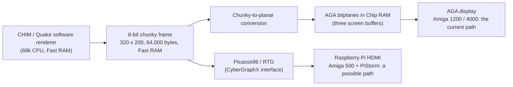

# Study: AmiWind on a PiStorm-equipped Amiga 500 (RTG backend or AGA-STORM)

_Last updated with AmiWind v0.0.66-dev8 (15 November 2026)._

<!-- contents start -->
## Contents

- [Verdict and next experiment](#verdict-and-next-experiment)
- [The two display paths](#the-two-display-paths)
- [The display path today, step by step](#the-display-path-today-step-by-step)
  - [AGA and Chip RAM dependencies, by file and function](#aga-and-chip-ram-dependencies-by-file-and-function)
- [Which assumptions are essential](#which-assumptions-are-essential)
- [A concept for the RTG backend](#a-concept-for-the-rtg-backend)
  - [Prior art](#prior-art)
- [The AGA-STORM route](#the-aga-storm-route)
- [The measurement plan](#the-measurement-plan)
  - [How much of a frame the conversion takes today](#how-much-of-a-frame-the-conversion-takes-today)
- [Outcome labels](#outcome-labels)
- [Risks](#risks)
- [Open questions](#open-questions)
- [References](#references)

<!-- contents end -->

This is a feasibility study, not a plan or a compatibility claim. No AmiWind run on a PiStorm, on any Amiga 500 or
under AGA-STORM has been made or reported yet. Every statement below is marked as one of:

- **Measured**: a recorded measurement, with the page it comes from.
- **From the code**: read on 13 November 2026 in the v0.0.66 source (VERSION 0.0.66-dev2), with file and function; the
  files it cites (the display, chunky-to-planar and start-up check code) are unchanged up to v0.0.66-dev8.
- **Concept** or **estimate**: a design idea or a figure worked out from other numbers. Neither is a result.

There have been comments within the Amiga community that an RTG display path on PiStorm might be feasible and fast, as
it would avoid the Chip RAM bottleneck and would also run on an Amiga 500. This study tests that idea against the code.
It builds on earlier study notes about the same question, whose code observations came from a much older source
snapshot; everything here was checked again in the current tree.

## Verdict and next experiment

| Setup | What the code and the measurements show | Verdict |
| --- | --- | --- |
| Amiga 1200 / 4000 with AGA (the current target) | The tested display path: the frame is converted to bitplanes (chunky-to-planar) into three screen buffers in Chip RAM. | Supported |
| Amiga 500 + PiStorm with its RTG output, today's build | The start-up check stops: no AGA chipset, less than 2 MiB of Chip RAM. The engine itself is not AGA-only: it still carries an inherited CyberGraphX display path that opens an RTG screen when a graphics card library is installed, but it hands each frame over through a slow generic call and has never been tested in AmiWind. | Blocked at the start-up check |
| Amiga 500 + PiStorm + AGA-STORM, today's build | Likely blockers: the start-up check's AGA and Chip RAM rows as seen under AGA-STORM, the AGA screen modes the engine asks for, and the fact that with Picasso96 installed (which AGA-STORM's setup asks for) the engine picks the RTG screen, not the emulated AGA one. | Worth one test |
| Amiga 500 + PiStorm + a CHIM RTG backend | Technically possible and contained: the screen code sits in one engine file; the world, streaming and game code never touch the screen hardware. About three engine files, one builder file and a few tests, six to ten functions. | Feasible with work |

An RTG backend would not be tied to PiStorm. It would use the CyberGraphX programming interface, which Picasso96 also
provides, so the same path would serve any 68k Amiga with an RTG graphics card (an A3000 or A4000 with a card, a
PiStorm on an A500 or A1200, the emulators' virtual card) while the AGA path stays exactly as it is. The announced
[THEA1200](https://plaionreplai.com/en-gb/products/the-a1200) lists RTG support too (announced, interface not yet known; see the [THEA1200 study](THEA1200_STUDY.md)).
AGA remains the default and the project's main display (decided for the project, 16 and 26 October 2026).

**Expected speed effect on today's targets: small** (measured shares below): the gain of an RTG path is above all the
machines it opens, not frames per second on an AGA machine.

**The next experiment**, smallest first:

1. **No code change.** An emulated Amiga with an OCS/ECS chipset (A500 class), a 68040 with FPU, JIT, 32 MB of Fast
   RAM, Kickstart 3.1 and the emulator's virtual graphics card (UAEgfx with Picasso96 installed on the emulated
   Workbench). Attach the AmiWind drives, run the start-up check from a shell to record its report, then start the
   engine directly. Record the outcome label (below), the engine's screen mode line and `aw bench halloween`.
2. **The first code change**, in a test build of its own: the faster frame upload for RTG screens, timed with the same
   counters as the AGA conversion, plus a fallback when no RTG mode is found. Then AGA against RTG, like for like.
3. The same on a real Amiga 500 with a PiStorm and Picasso96, and separately the current build under AGA-STORM.

## The two display paths

What the RTG path removes (from the code): the chunky-to-planar conversion (`aw_c2p` in `engine/aga/src/aw_c2p.c`), the
64,000 bytes of bitplane writes into Chip RAM per full frame, the three Chip RAM screen buffers, and the dependency on
AGA's 8-bitplane screen modes.

What stays (from the code): all of the 3D rendering in software on the CPU; the sky, fog, HUD, menus, map, inventory,
dialogue and video, which all draw into the same chunky buffer; the 256-colour palette; and a copy of the finished frame
into the graphics card's memory (or drawing into the locked card bitmap). Sound stays on Paula, with its buffer in Chip
RAM.

How large the removed part is today must be measured, not assumed: on the measured runs it is well under 1 % of the
frame on the emulator, and an estimated 10 % at most on the Raspberry Pi 4B reference in the heaviest scene (see
[how much of a frame the conversion takes today](#how-much-of-a-frame-the-conversion-takes-today)).

## The display path today, step by step

From the code (`engine/aga/src/vid_amiga.c` unless another file is named):

1. **Start-up check** (`engine/aga/boot/bootcheck.asm`, run by the boot disk's startup-sequence before the engine): Exec
   40 or newer, a 68040-class CPU, the FPU, the AGA chips (graphics.library reports Alice and Lisa after
   `SetChipRev(-1)`), at least 1,984 KiB of Chip RAM with 512 KiB free and 256 KiB in one block, and the Fast RAM rows.
   A failed row stops the boot (`FailAt 10` in the script written by `tools/fpu_support.py` `startup_sequence()`; the
   Workbench icon runs the same steps).
2. **`VID_Init`**: opens `cybergraphics.library` if it exists. With it, the screen mode comes from `BestCModeIDTags`
   (320 x 200, depth 8): an RTG mode. Without it, `BestModeID` asks for a 320 x 200, 8-bitplane PAL mode (no EHB, dual
   playfield or HAM), with a second try without PAL for NTSC machines. It opens a custom screen and a borderless window
   (input comes through that window and an input handler in `sys_amiga.c`), blanks the mouse pointer (a 16-byte sprite
   in Chip RAM) and allocates the chunky frame, the depth buffer and the surface cache in Fast RAM.
3. **Native AGA mode only**: three screen buffers (`AllocScreenBuffer`, 64,000 bytes of Chip RAM each), a check that each
   holds 320 pixels at 8 planes, and one chunky-to-planar set-up per buffer.
4. **Drawing**: the renderer and every AmiWind screen (the HUD, menus, the map, inventory, dialogue, the fog and sky pass,
   torches, hands, videos) write bytes into `vid.buffer`, the chunky frame. No other module touches a bitmap, a
   bitplane, a copper list, a sprite or a chipset register.
5. **Palette**: `VID_SetPalette` and `VID_ShiftPalette` load all 256 colours with one `LoadRGB32` on the screen (called
   from `cl_main.c`, `r_misc.c` and `screen.c`).
6. **`VID_Update`**, AGA: the rows from the top down to the lowest changed area go through `aw_c2p` into the next screen
   buffer's eight bitplanes, then `ChangeScreenBuffer` shows it. The engine does not wait for the vertical blank in play.
7. **`VID_Update`**, RTG screen: each changed rectangle goes through `WritePixelArray8`, a generic graphics.library call
   that works through a one-row, 8-bitplane temporary bitmap. The direct chunky calls (`WritePixelArray` with an 8-bit
   format, `WriteChunkyPixels`) are present but switched off with `#if 0`, and that switched-off call used the rectangle
   width as the row length where the buffer's row length is right. This is ENGINE-RTG-SLOW-PATH-52 in the
   [bug register](BUGS.md) (open).
8. **Counters**: the AGA conversion and the buffer swap are timed every frame (`c2p` and `vbl`, see
   [frame waits](performance/FRAME-WAITS.md)); the RTG upload is not timed at all.

### AGA and Chip RAM dependencies, by file and function

| Dependency | Where (from the code) | AGA only? |
| --- | --- | --- |
| AGA chips test | `bootcheck.asm`, the machine class row | yes, stops the boot |
| 2 MiB Chip RAM rule | `bootcheck.asm`, the Chip RAM row | yes, stops the boot |
| PAL 50 Hz | `bootcheck.asm`, the video timing row | a warning only |
| 8-bitplane PAL screen mode | `vid_amiga.c` `VID_Init` (`BestModeID`) | yes |
| Three screen buffers, 192,000 bytes of Chip RAM | `vid_amiga.c` `VID_Init` (`AllocScreenBuffer`) | yes |
| Chunky-to-planar into eight bitplanes | `aw_c2p.c` `aw_c2p` (default C version), `c2p8.s` (optional) | yes |
| Triple buffering with `ChangeScreenBuffer` | `vid_amiga.c` `VID_Update` | used on AGA only today |
| Blank pointer sprite, 16 bytes Chip RAM | `vid_amiga.c` `VID_Init` | no (an operating system sprite) |
| One-row temporary bitmap, 8 planes | `vid_amiga.c` `VID_Init` | only for `WritePixelArray8` |
| Paula sound through audio.device, 32 KiB stereo buffer in Chip RAM | `snd_amiga.c` `SNDDMA_Init` | no (every Amiga has Paula) |
| Copper lists, hardware sprites, chipset registers, vertical blank waits in play | none found | - |

## Which assumptions are essential

From the code:

- **Essential for every display**: Kickstart 3.1, a 68040-class CPU with an FPU (the engine is compiled for the 68040
  and its FPU, and each build is checked for instructions the 68040 would have to emulate), Fast RAM for the game heap
  and the CHIM cache, and Paula through audio.device (there is no AHI sound path).
- **Essential for AGA, conditional for RTG**: the AGA chips row, the 2 MiB Chip RAM rule and the three Chip RAM screen
  buffers. On an RTG screen the picture leaves Chip RAM; what AmiWind itself still needs there is the 32 KiB sound
  buffer, the pointer sprite and a 320-byte temporary bitmap (an estimate from the allocations; a full session's Chip
  RAM use has never been measured against an Amiga 500's 512 KiB to 1 MiB).
- **Not essential**: PAL (already only a warning).
- The engine has no AGA test of its own: started without the start-up check, it uses whatever screen `VID_Init` finds.

## A concept for the RTG backend

Concept only; nothing of this is built. It follows the design recorded for the project on 26 October 2026 and the
roadmap's [RTG display path](ROADMAP.md#long-term-possibility-an-rtg-display-path).

**Where the boundary sits.** The display interface is the set of `VID_*` functions (`VID_Init`, `VID_SetPalette`,
`VID_ShiftPalette`, `VID_Update`, `VID_LockBuffer`, `VID_UnlockBuffer`, `VID_Shutdown`), the loading-icon pair
`D_BeginDirectRect` / `D_EndDirectRect`, and the `vid` structure the drawers write through (`vid.buffer`,
`vid.rowbytes`). Everything above it, the renderer, CHIM's world streaming, the game and the whole interface, stays
shared and unchanged. The backend boundary is inside `vid_amiga.c`.

**One build, the backend chosen at start.**

- The start-up check shows an "A = AGA, R = RTG" choice only when a graphics card library is installed. With both, the
  player picks during the countdown; with no key, AGA, so nothing changes for AGA players. A machine without AGA gets
  RTG. Start arguments `-aga` and `-rtg`, remembered in the configuration; an in-game option applies at the next start.
- **The start-up check split by backend**: the AGA backend keeps today's rows. The RTG backend replaces the AGA row with
  "a graphics card library and an 8-bit screen mode are present", and its Chip RAM row checks only what sound and the
  system need (the figure to be set from a measured Chip RAM count, not guessed). CPU, FPU and Fast RAM rows stay.
- The choice reaches the engine as a start argument from the startup-sequence and the Workbench icon script.

**Present and palette.**

- RTG upload: one `WritePixelArray` per changed rectangle with the 8-bit lookup-table format and the buffer's own row
  length, from the chunky frame in Fast RAM (the corrected form of the switched-off call). Drawing straight into the
  card's memory (`-directcgx`, already in the code) stays an option to measure, not the default: the fog pass reads and
  rewrites every pixel, and several screens skip drawing while no buffer is locked.
- Palette: the same `LoadRGB32` on an 8-bit RTG screen; its cost on a card is to be measured.
- Mode choice: check that the RTG mode is 8-bit; if none is found, fall back to the AGA search instead of stopping.

**Double buffering on RTG.** First a single buffer (the upload goes into the visible picture; tearing is possible and
is looked at), then the same `AllocScreenBuffer` / `ChangeScreenBuffer` rotation as on AGA where the card's driver
supports it.

**The HUD and the interface.** Nothing changes: they draw into the chunky frame on every backend. On AGA the
conversion covers the rows down to the lowest changed area; on RTG the upload takes the changed rectangles as they are.

**What each part would cost or change** (estimate, in files and functions, not hours):

| Part | Files | Functions | Changes for AGA players |
| --- | --- | --- | --- |
| RTG upload, timed | `vid_amiga.c`, `aw_spike.h`, `aw_spike.c`, `aw_profile.c` | `VID_Update`, the wait report, the frame profile | one more counter field |
| Mode choice and fallback | `vid_amiga.c` | `VID_Init`, `VID_Shutdown` | none (AGA stays the default) |
| RTG double buffering (second step) | `vid_amiga.c` | `VID_Init`, `VID_Update` | none |
| Start-up check split and the A/R choice | `engine/aga/boot/bootcheck.asm` | the machine class and Chip RAM rows | the new line appears only with a card installed |
| Passing the choice to the engine | `tools/fpu_support.py` | `startup_sequence()`, `engine_start()`; the Workbench icon script | none |
| Tests and docs | the boot check, heap and FPU support tests; this page, the bug page | - | none |

No renderer, CHIM, interface or game file changes. Requirements of an RTG build: a 68040 or 68060 class CPU with FPU,
Kickstart 3.1 or newer, 32 MB of Fast RAM (more is used as world cache), Picasso96 or CyberGraphX with an 8-bit
320 x 200 (or larger) screen mode, and Paula.

**What an RTG screen on a PiStorm needs** (from the PiStorm and Emu68 setup guides, references below): Picasso96
installed with Emu68's VideoCore card driver (from the Emu68 tools releases), the board type in the Picasso96 monitor
file set to the VideoCore driver, a display attached to the Raspberry Pi's HDMI port before power-on (the port is set up
once at start), and screen modes created in Picasso96Mode, a resolution first and then its colour modes. For AmiWind
that means a 256-colour mode the player has created; the game cannot create one itself.

**PiStorm and Emu68.** Emu68 is a just-in-time translator on the Raspberry Pi's ARM cores that presents a 68040 with an
FPU, the CPU the standard build targets (its support library sets the flags the start-up check reads; see the
[FAQ](FAQ.md#can-todays-heavily-upgraded-amigas-realistically-run-amiwind)). The engine times itself with the system's
E-clock, so the translator's speed changes nothing in the game logic, and it uses ordinary single and double precision
floating point. The Emu68 release notes list FPU translator fixes in the 1.1 beta (an FPU branch instruction added);
whether the engine's compiled code uses that instruction has not been checked.

### Prior art

AmiQuake, the 68k Quake port whose GCC version this engine descends from, has had separate AGA and RTG builds: the RTG
build draws 256-colour, double-buffered output through the CyberGraphX interface, and its 2026 releases moved to SDL
and added a 32-bit image reconstruction aimed at fast setups such as a PiStorm. That is the same shape as the concept
above: a software renderer drawing an 8-bit frame, handed to an RTG screen on a 68k or PiStorm Amiga. AmiWind's engine
comes from the [GCC port of AmiQuake](https://github.com/terriblefire/amiquake/tree/9c62d905151614af3e788ae3145a0d4ecc8a7bb8)
(GPL v2, based on an earlier Amiga WinQuake port), whose video driver detects CyberGraphX and picks the screen mode with
`BestCModeIDTags`; that is the inherited path in today's `vid_amiga.c`. The RTG builds' own display code is not
published with a stated licence, so they are a reference for the approach only. Sources:
[AmiQuake 1 overview](https://www.amigafrance.com/forums/topic/quake1/),
[AmiQuake RTG 2.01 and the SDL conversion](https://www.generationamiga.com/2026/05/01/new-release-of-amiquake-for-amiga-sdl-conversion-new-features-and-classic-quake-action/),
[the 32-bit reconstruction update](https://www.generationamiga.com/2026/06/19/amiga-quake-ports-get-visual-upgrade-with-improved-32-bit-reconstruction/).

## The AGA-STORM route

[AGA-STORM](https://astair86.itch.io/aga-storm) is an unofficial, experimental fork of Emu68 that emulates the AGA
chips (Alice, Lisa and Paula) on a PiStorm in an OCS/ECS Amiga (A500, A500+, A600, A1000, A2000) and shows the picture
over HDMI. It lists Chip RAM configurations from 256 KB to 2 MB, needs a particular CPLD firmware on a classic PiStorm
with a Raspberry Pi 4, runs WHDLoad titles, and starts other programs with `agaboot RUN <program>` (or its Run program
menu). Its author calls the system-wide mode unstable and asks users to back up their Emu68 SD card first (page read
13 November 2026, version 1.121).

Likely blockers for today's build, from the code (none of them tested):

1. **The start-up check's AGA row** needs graphics.library to report Alice and Lisa at the moment the check runs. What it
   reports under `agaboot RUN` is not known.
2. **The Chip RAM row** needs 1,984 KiB in the system's memory list. Whether AGA-STORM's Chip RAM settings change what
   the system sees is not known. Starting the engine directly skips the check; the engine's own Chip RAM need on AGA is
   about 225 KiB (three screen buffers and the sound buffer; an estimate).
3. **The screen mode**: `VID_Init` asks the display database for an 8-bitplane mode; without AGA modes in it, the engine
   stops with "Can't FindDisplayInfo() for mode ffffffff".
4. **Picasso96 in the system**: AGA-STORM's setup asks for Picasso96 on systems other than its own. With it installed,
   `cybergraphics.library` is present and the engine opens an RTG screen through the slow upload, not the emulated AGA
   screen. To test the AGA emulation, that library has to be absent for the run; and if no 8-bit RTG mode exists, the
   engine stops (there is no fallback yet).
5. **The per-frame Chip RAM writes** (64,000 bytes of bitplanes, plus the sound buffer): how AGA-STORM maps Chip RAM and
   what the writes cost there is not known.
6. Sound over long sessions, input, and the Emu68 FPU translation: probably fine, untested.

First test steps: back up the Emu68 SD card; start one small AGA program with `agaboot RUN` and note what it reports
about the chipset and Chip RAM; run the AmiWind start-up check the same way and keep its report; then start the engine
itself with `agaboot RUN`, with `cybergraphics.library` absent; record the outcome label at each step; then the same
scene on an Amiga 1200 for comparison, keeping compatibility and speed as separate results.

## The measurement plan

The counters exist today (see [frame waits](performance/FRAME-WAITS.md) and
[renderer counters](performance/RENDERER-COUNTERS.md)):

| Counter | What it prices | Where it appears |
| --- | --- | --- |
| `c2p` frame wait | the chunky-to-planar copy into Chip RAM | spike and long-frame lines, `chim spikes report` |
| `vbl` frame wait | the screen buffer swap | the same lines |
| `c2p_ms`, `c2p_rows`, `c2p_calls`, `c2p_full_height_calls` | the conversion's total time and how many rows it handled | the frame profile at session end |
| `free_chip_bytes` | Chip RAM left | the frame profile |
| `dbg rcount` `us` fields | the 3D view and the whole frame | console and state file |
| `aw bench halloween` | 600 fixed frames: average, minimum, 1 % low | the bench result |
| `awbench` `mem test=chipwrite` | Chip RAM write speed in MB/s | the hardware benchmark |

Missing: the RTG upload is not timed (step 7 above). The first code change adds it under the same counter (a
"present" field beside `c2p`), so AGA and RTG read the same way.

Like for like: the same build except the backend, the same 320 x 200 8-bit screen, the same scene and script
(`aw bench halloween`, then a fixed walk with `chim spikes report`), the same CPU setting, Fast RAM and sound. Compare
the frame total, the conversion or upload time, the swap time and the rest of the frame. A gain is real only if the rest
of the frame stays the same and the frame total drops.

### How much of a frame the conversion takes today

Measured (JIT emulator runs; the conversion time against the whole run):

| Run | Frames, total time | Conversion | Share |
| --- | --- | ---: | ---: |
| v0.0.59-dev, Seyda Neen walk ([frame waits](performance/FRAME-WAITS.md)) | 209 frames, 19,957 ms | 14.9 ms | 0.07 % |
| v0.0.59-dev, arrival and standing (same page) | 46 frames, 33,679 ms | 3.2 ms | 0.01 % |
| Early acceptance runs ([optimization history](OPTIMIZATION_HISTORY.md)) | 69 to 143 s | 189 to 431 ms | 0.24 to 0.30 % |

Why these understate real hardware (measured): with JIT the emulator writes Chip RAM at 5,211.7 MB/s; the cycle-exact
24.8 MHz benchmark profile writes it at 6.69 MB/s ([FS-UAE playtesting](FS-UAE-PLAYTESTING.md)).

Estimates worked out from those figures:

- At 6.69 MB/s, writing a full 64,000-byte frame takes about 9 ms, against frames of 0.7 to 1.5 seconds at that profile
  class ([where a slow frame goes](performance/SLOW-FRAME-BREAKDOWN.md)): about 1 % of the frame.
- On the Raspberry Pi 4B reference (Amiberry), DoomAttack's same-size AGA screen copy runs at 47.7 frames a second on
  PAL ([real hardware](REAL_HARDWARE.md#the-pi-4b-boot-stick-as-a-reference-measured)), so the copy takes at most about
  21 ms; AmiWind's bench scene there runs at about 5 frames a second (about 200 ms): an upper bound near 10 %.
- On a real PiStorm Amiga 1200 the conversion goes through the real Chip RAM bus: not measured.

So on today's AGA targets the 3D work sets the frame rate, and an RTG screen would mostly change which machines can run
the game.

## Outcome labels

For any report of a run on these setups:

| Label | Meaning |
| --- | --- |
| `not-tested` | no run on that setup |
| `boots-to-preflight` | starts, but the start-up check refuses the machine (CPU, chipset or memory) |
| `boots-to-menu` | opens its screen and the menus |
| `interactive` | moves and draws a representative world scene |
| `playtest-stable` | repeated travel, loading and saving with no new known problems |
| `performance-measured` | repeated measurements on named hardware, screen mode and emulator or kernel versions |

Today every PiStorm and AGA-STORM setup is `not-tested`.

## Risks

1. **Screen modes**: Picasso96 modes are set up by the user (the setup guides suggest 640 x 480 first). A 320 x 200 or
   320 x 240 8-bit mode has to exist; how a 320 x 200 screen shows on a larger mode is open. The game's video player
   needs the 320 x 200 frame, which stays that size either way.
2. **Tearing** with a single-buffered RTG upload; whether the Raspberry Pi graphics driver supports multi-buffering is
   open.
3. **Palette changes** on an RTG screen: cost and timing unknown.
4. **AGA machines with a card already get the slow path today**: with Picasso96 or CyberGraphX installed, the current
   build opens the RTG screen through the slow upload (ENGINE-RTG-SLOW-PATH-52).
5. **No fallback** when no 8-bit RTG mode is found: the engine stops.
6. **Emu68's FPU translation** differs from a real 68040 in places (see above).
7. **Chip RAM on an Amiga 500** (512 KiB to 1 MiB, shared with the system): never measured for a full session.
8. **Regressions on AGA**: kept away by AGA as the default, a boot test per backend and the existing checks.
9. **A larger test matrix**: two display backends across the CPU builds.
10. **Licences**: only published, GPL-compatible code can be reused; the inherited video driver is GPL v2 or later.

## Open questions

- Does Picasso96's `WritePixelArray8` on an RTG screen become a fast chunky copy, or a planar conversion? That decides
  how slow today's inherited path really is.
- Under `agaboot RUN`: which chip revision and screen modes graphics.library reports, and how much Chip RAM the system
  sees.
- Which 8-bit modes, scaling and multi-buffering the Raspberry Pi graphics driver for Picasso96 offers.
- Whether the engine's compiled code uses the FPU instruction added in the Emu68 1.1 beta.
- The cost of the conversion on a real PiStorm Amiga 1200, and of the sound buffer writes over an Amiga 500's bus.
- The Chip RAM an Amiga 500 session needs with an RTG screen.

## References

Read 13 November 2026; external projects, named for reference:

- [AGA-STORM](https://astair86.itch.io/aga-storm): the unofficial AGA emulation for PiStorm on OCS/ECS Amigas, its
  requirements, `agaboot RUN` and its warnings.
- [PiStorm: Picasso96 with Emu68](https://pistorm.github.io/tutorials/p96setup/): RTG through the Raspberry Pi's
  VideoCore, output over HDMI.
- [PiStorm README](https://github.com/captain-amygdala/pistorm/blob/main/README.md): the original board and its virtual
  RTG card (this README describes the earlier emulator, not Emu68).
- [Emu68 releases](https://github.com/michalsc/Emu68/releases): versions, the VideoCore driver and FPU notes.
- [Emu68: setting up Picasso96](https://github.com/michalsc/Emu68/blob/master/docs/tutorials/P96_Setup.md): the
  VideoCore card driver and screen modes.
- [Picasso96 on Aminet](https://aminet.net/package/driver/video/Picasso96): its change log lists the
  cybergraphics.library emulation (the CyberGraphX interface).

Related pages: [real hardware: PiStorm](REAL_HARDWARE.md#pistorm),
[FAQ: PiStorm32, RTG and MiniGL](FAQ.md#why-not-use-pistorm32-rtg-and-minigl),
[roadmap: an RTG display path](ROADMAP.md#long-term-possibility-an-rtg-display-path),
[comparisons](COMPARISONS.md), [the 68060](68060.md).
