# Earlier README sections

_Last updated with AmiWind v0.0.54 (28 October 2026)._

<!-- contents start -->
## Contents

- [v0.0.51: Let There Be More Inner Light](#v0051-let-there-be-more-inner-light)
- [v0.0.50: The Doors: Riders On The CHIM](#v0050-the-doors-riders-on-the-chim)
- [v0.0.49: Build Turnaround](#v0049-build-turnaround)
- [v0.0.48: Inner CHIM & Actors On Stage](#v0048-inner-chim--actors-on-stage)
- [v0.0.47: CHIM: The More, The Merrier](#v0047-chim-the-more-the-merrier)
- [v0.0.46: Red Mountain Getting Red: A Whole Heap Of Fixes](#v0046-red-mountain-getting-red-a-whole-heap-of-fixes)
- [v0.0.45: CHIM Streaming Improved, Guard Torches Are Back](#v0045-chim-streaming-improved-guard-torches-are-back)
- [v0.0.44: By Azura's Trees!](#v0044-by-azuras-trees)
- [v0.0.43: Let There Be CHIM: Vvardenfell's Outdoors, All of It](#v0043-let-there-be-chim-vvardenfells-outdoors-all-of-it)
- [v0.0.42: Things Are Starting To Look Pretty Khuul](#v0042-things-are-starting-to-look-pretty-khuul)
- [v0.0.41: More Fixes, Fewer Planes (A Telvanni Root Story)](#v0041-more-fixes-fewer-planes-a-telvanni-root-story)
- [v0.0.40: Rings 0, 1 and 2 of Vvardenfell in Full CHIM](#v0040-rings-0-1-and-2-of-vvardenfell-in-full-chim)
  - [Along the coast: ring 2](#along-the-coast-ring-2)
- [v0.0.39 - Cell By Cell, Piece By Piece](#v0039---cell-by-cell-piece-by-piece)
- [Previous public source release: v0.0.38 - Lava Is All You Need (And A Hint Of Tel Uvirith)](#previous-public-source-release-v0038---lava-is-all-you-need-and-a-hint-of-tel-uvirith)
  - [CHIM progress map](#chim-progress-map)
- [v0.0.35 - CHIMporting It All: Gathering Up The Loose Branches From The Seashore](#v0035---chimporting-it-all-gathering-up-the-loose-branches-from-the-seashore)
- [v0.0.34 - CHIM: Tightening the Bolts](#v0034---chim-tightening-the-bolts)
- [v0.0.33 - Towards CHIM: Replacing the Engine Block](#v0033---towards-chim-replacing-the-engine-block)
  - [What is CHIM?](#what-is-chim)
- [v0.0.32 - Last Stop on the Old Line: Window-Shopping in Vivec](#v0032---last-stop-on-the-old-line-window-shopping-in-vivec)
- [v0.0.31 - Lamps, Lanterns and Loading](#v0031---lamps-lanterns-and-loading)
  - [Whoops! Actually...](#whoops-actually)
  - [AmiWind Toolkit](#amiwind-toolkit)
- [v0.0.30 - The Temple](#v0030---the-temple)
- [v0.0.29 - Let There Be (Just a Bit More) Light](#v0029---let-there-be-just-a-bit-more-light)
- [Earlier v0.0.29-rc1 playtest - More Mushrooms! (...and fixes)](#earlier-v0029-rc1-playtest---more-mushrooms-and-fixes)
  - [From the rc1 playtest](#from-the-rc1-playtest)
- [v0.0.29-dev4 — WIP: More Mushrooms! (...and fixes)](#v0029-dev4--wip-more-mushrooms-and-fixes)
  - [The hotlist: changes since v0.0.28](#the-hotlist-changes-since-v0028)
  - [What's cooking next](#whats-cooking-next)
- [v0.0.28 — Trees and Grass, Day and Night](#v0028--trees-and-grass-day-and-night)
- [AmiWind 3D Map Inspector](#amiwind-3d-map-inspector)
  - [v0.0.27 — Rocks, Mushrooms, and Then Some: playtest screenshots](#v0027--rocks-mushrooms-and-then-some-playtest-screenshots)
  - [Explore the growing world](#explore-the-growing-world)
  - [Earlier glimpses of Vvardenfell](#earlier-glimpses-of-vvardenfell)
  - [Finding your way around](#finding-your-way-around)
  - [Making room for Morrowind](#making-room-for-morrowind)
  - [Inspect converted geometry locally](#inspect-converted-geometry-locally)
- [Development (as the front page stated it before 20 October 2026)](#development-as-the-front-page-stated-it-before-20-october-2026)

<!-- contents end -->

## v0.0.51: Let There Be More Inner Light

Akulakhan's Chamber, the game's final room, loads on 32 MB: the engine's first CHIM cache bank needed more memory
than 32 MB leaves, so the room's models did not fit. Every interior is baked again with its cell's "sunlight", the
light the original gives a room from one fixed direction above, which our rooms never had: 322 of the 1,335 interior
cells get at least twice as much of it as their ambient light, so rooms that live on it are no longer dim, and the
interior brightness default goes back to 1.0. The CHIM world's reads feed the music between small slices, and every
load prints how long the music waited. The game's scripts (experimental, off by default) can enable, disable, lock
and unlock objects and show message boxes.

The front page ([README](../README.md)) used to carry these sections. They are dated records of earlier releases and of the work around them, kept as written; where one disagrees with the front page, the front page is newer. The release notes of each version are in `docs/RELEASE-v*.md`.

## v0.0.50: The Doors: Riders On The CHIM

Every door leads where the game says it does. All of the base game's 3,133 load doors and jail markers go through
one door table built from the game's own door records, and the image no longer builds when one does not lead
anywhere. The ways out of the rooms around Vivec and Ebonheart, Pelagiad's houses and the caves, tombs and the
shipwreck near Seyda Neen open now; the opening's prison ship, pier and census office keep the doors the opening
scene gives them. A new version number now rebuilds only the
engine and the image, proven by a build where only the version changed.

## v0.0.49: Build Turnaround

The builder: a new version number no longer rebuilds the CHIM world, only the engine and the image that show it, and
release candidates and finals reuse the caches like development builds. This release's final was built from its
development build's caches (39 of 43 stages reused; one more CHIM world build, repaired for v0.0.50). The docs now describe the current game throughout, with the second real-hardware
figure (an A3000 with a 68060, through RTG on the tester's own modified build). The game is v0.0.48's.

## v0.0.48: Inner CHIM & Actors On Stage

The indoors follow the outdoors onto CHIM: 1,132 of the base game's 1,134 interiors are CHIM rooms, their models and
textures stored once. The people and creatures the game places in them stand where it puts them, grounded when the
game is built ([actor placement](ACTOR_PLACEMENT.md)), with their full set of animations and their own voices,
and the plants in the rooms can be picked. There are a Stats window and a Magic window placeholder, the original
movement speeds, burning campfires and the original's sound markers. CHIM moves to 0.2.2 with a compatibility table,
and the builder rebuilds less and keeps more cores busy.

## v0.0.47: CHIM: The More, The Merrier

The builder in this repository now builds every exterior cell on CHIM by default (since v0.0.36 the cell list the
project's own builds used was not in the repository). Crossing a frame border outdoors is no longer a level change,
creatures and people appear outside the towns, mushrooms can be picked indoors, and the Ghostfence, the Vivec
waterfalls and the ash mire shimmer. The terrain is generated from the game's heights, repeated files and skins are
stored once, and the builder walks no stairs by default, reuses more on a rebuild and keeps its workers at full width
while memory allows. The emulator presets and the
launcher start with 128 MB of Fast RAM; 16 MB, the smallest machine the game runs on, stays a choice.

## v0.0.46: Red Mountain Getting Red: A Whole Heap Of Fixes

Red Mountain is red again: every region chooses its weather the way the original game does, and the mountain
draws its blight sky. The Ebonheart dragon statue is back on its pedestal, the torch shows in third person, the
Vivec dock walkways hold the player up and the Dreamers greet you. The collision of the whole island now keeps only
the surface you walk on exactly, so every frame fits its memory again.

## v0.0.45: CHIM Streaming Improved, Guard Torches Are Back

Crossing from one CHIM cell to the next uses spare Fast RAM now: the frames around the player are read ahead into
memory while you walk, and the engine's heap grows with the RAM the machine has. On a 128 MiB setup a crossing
measured about half as long as before (about 450 ms down to about 230 ms; corrected 20 October 2026: about a third
of the v0.0.44 time over a fixed route, [CROSSING_BASELINE](performance/CROSSING_BASELINE.md)); the 16 MiB
baseline keeps today's sizes.
The guards in the streets carry their torches at night again, and the builder keeps its finished stages when only
its scheduling changes.

More improvements to cell-to-cell streaming are on the way: most of what is left of a crossing is the engine
restarting the game for every new frame, and the next step replaces that with a switch in place.

Running on CHIM Engine v0.2.1. See the [release notes](RELEASE-v0.0.45.md) for what changed and what is
known in this build.

## v0.0.44: By Azura's Trees!

A patch release for v0.0.43. Its fix for the floating tree crowns on Azura's Coast made the Bitter Coast trees too
heavy for memory; they are 16 to 42 % lighter now, and every trunk keeps at least 90 % of its height. The player
body is built again for every race, and the roadmap describes the road after v0.0.44.

What went wrong while building v0.0.44, and how it was fixed:

- **Bitter Coast trees too heavy.** v0.0.43's fix for the floating tree crowns made the Bitter Coast trees about
  60 % larger; two Bitter Coast areas no longer fit in memory and the image could not be built. The trunk shape
  guard now tries lighter copies first: the trees are 16 to 42 % smaller and every trunk keeps at least 90 % of
  its height ([CHIM-BITTERCOAST-HEAP-SHAPEGUARD-43](bugs/CHIM-BITTERCOAST-HEAP-SHAPEGUARD-43.md)).
- **Player bodies and guard torches could not be built.** The new NPC head reducer, which keeps every head's
  outline, left no fitting model for some player bodies and guard torch models. They fall back to the previous
  reducer, and a rebuilt guard model within one rounding step of the original is accepted
  ([NPC-HEAD-DECIMATION-33](bugs/NPC-HEAD-DECIMATION-33.md)).
- **Interior plant sprites missing outside Vivec.** The plant sprites of converted interiors were installed only
  for the Vivec rooms; every room type installs them now
  ([INTERIOR-MORAG-TONG-FPS-43](bugs/INTERIOR-MORAG-TONG-FPS-43.md)).
- **Outdoor guards without torches at night.** The guard torch step looked for guards only in the older map files and
  ran before the CHIM town and region frames were written, so only guards indoors got a torch. It reads both kinds
  of map now and runs after the frames: the guards in the streets carry their torches at night again, 19 guard types
  instead of 13 ([GUARD-TORCH-CHIM-FRAMES-44](bugs/GUARD-TORCH-CHIM-FRAMES-44.md)).

Running on CHIM Engine v0.2.1. See the [release notes](RELEASE-v0.0.44.md) for what changed and what is
known in this build.

## v0.0.43: Let There Be CHIM: Vvardenfell's Outdoors, All of It

Every exterior cell of Vvardenfell is on CHIM now: no classic region maps are left outdoors. The region list holds
1,348 cells (1,132 land, 197 sea floor and 19 open sea), and 46 more are inside the town frames. The last cells
joined after the stair walk learned to replace collision that blocked visible steps, so Ald-ruhn, Maar Gan and
Suran are on CHIM too. The release also brings the fixes from the maintainer's playtest: Red Mountain's summit
without a solid sky, invisible editor markers, Azura's Coast plants on their trunks, interior plants as sprites and
NPC heads that keep their outline, the sea to the horizon at Vivec, and a builder that keeps its cores busy.

Counted in full, that is 1,409 cells on CHIM: the 1,348 one-cell region frames above (where "sea floor" means
empty sea cells) and 61 cells in the town frames of Balmora, Seyda Neen and Vivec, of which 46 were in the
region list. [What these numbers count](chim/CELL_TRACKER.md#what-we-count).

Running on CHIM Engine v0.2.1. See the [release notes](RELEASE-v0.0.43.md) for what changed and what is
known in this build, and the [CHIM Progress Tracker](chim/PROGRESS_TRACKER.md) for every cell.

  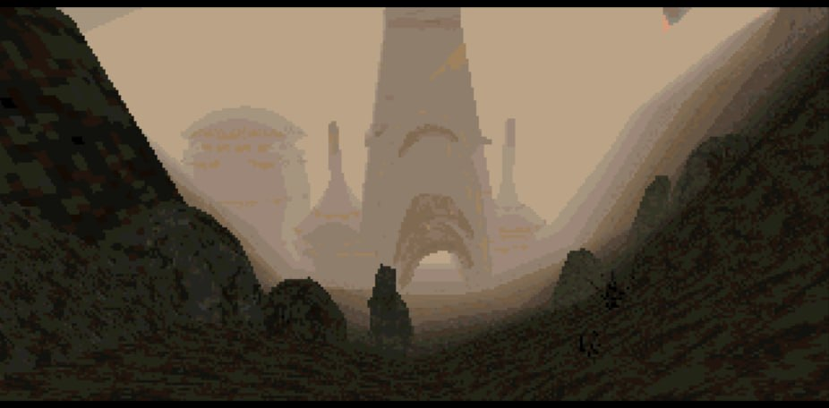

More in the [gallery](GALLERY.md).

## v0.0.42: Things Are Starting To Look Pretty Khuul

More of the island on CHIM, the clouds back in the sky, and the first look of the original interface. 1,168 of
Vvardenfell's 1,395 exterior cells are on CHIM now (776 before), from Molag Mar and Pelagiad to Gnisis, Ghostgate
and the lava fields. The clouds are back after two releases with a flat sky, buildings no longer pop in and out
where memory runs full, and the game uses extra Fast RAM by itself. The HUD and the inventory start to take their
original shape: the original weapon and magic boxes, item icons from the game's own art, and the character as a
still picture in the original pose.

The 1,395 were the exterior cells planned for CHIM at the time; how today's counts are made up is in
[what these numbers count](chim/CELL_TRACKER.md#what-we-count).

Running on CHIM Engine v0.2.1. See the [release notes](RELEASE-v0.0.42.md) for what changed and what is
known in this build, and the [CHIM Progress Tracker](chim/PROGRESS_TRACKER.md) for every cell.

| | |
| --- | --- |
| 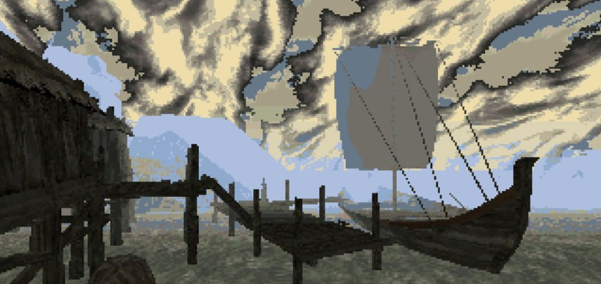 | 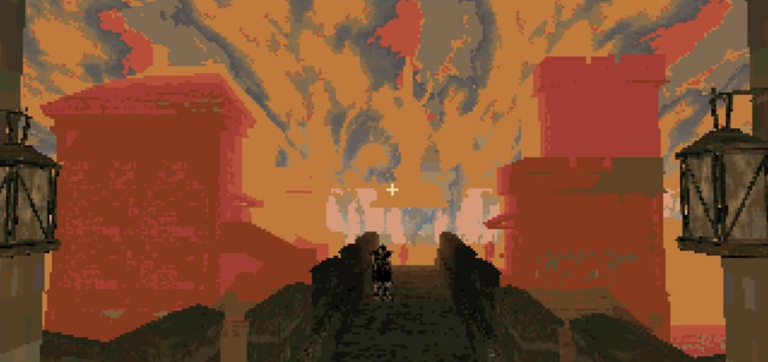 |
| **The Khuul docks**, a ship at the pier. | **Ebonheart at dusk**, lanterns on the bridge. |
| 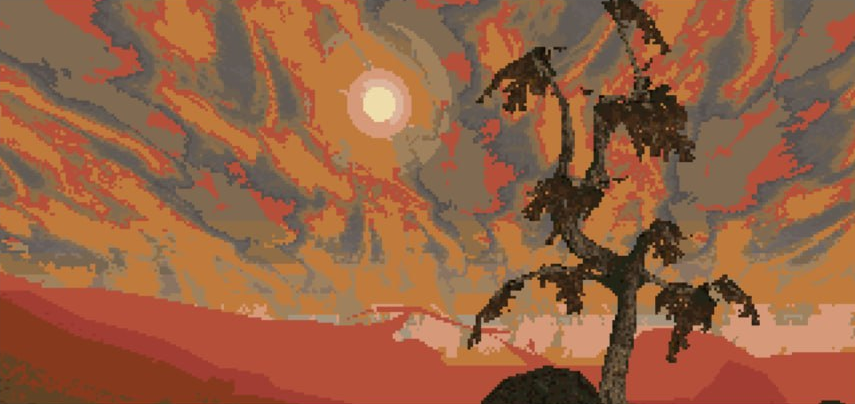 | 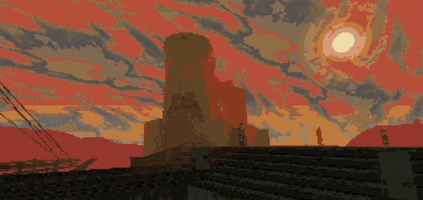 |
| **A tree against the sunset** near Khuul. | **The sun beside a tower.** |
| 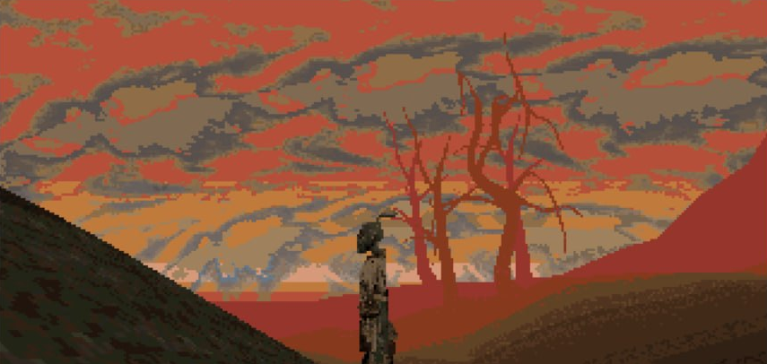 | 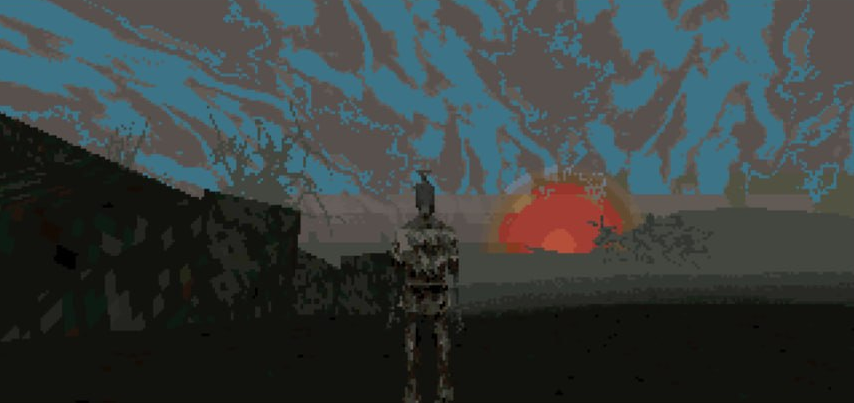 |
| **A dawn valley.** | **A sunset under a clear sky.** |

More in the [gallery](GALLERY.md#v0042-things-are-starting-to-look-pretty-khuul).

## v0.0.41: More Fixes, Fewer Planes (A Telvanni Root Story)

The first regional CHIM release. Rings 0 to 4 of Vvardenfell are on CHIM, and so are two whole Morrowind
regions, the Bitter Coast and Azura's Coast, with Seyda Neen, Balmora, the whole city of Vivec, Hla Oad,
Sadrith Mora and Vos: 723 cells, each converted from your own copy of Morrowind. The collision behind large
irregular meshes (Telvanni roots and towers, Daedric and Dwemer ruins) now compiles into compact hulls instead
of chains of thousands of planes, which is what lets the Telvanni towns fit the memory budget.

Running on CHIM Engine v0.2.1. See the [release notes](RELEASE-v0.0.41.md) for what changed and what is
known in this build, and the [CHIM Progress Tracker](chim/PROGRESS_TRACKER.md) for every cell.

<!-- v0.0.41 gallery: photo-mode captures from the release build go here -->

## v0.0.40: Rings 0, 1 and 2 of Vvardenfell in Full CHIM

The final release targets CHIM rings 0, 1 and 2 around Vvardenfell. Other
exterior areas keep their existing legacy representation, apart from named CHIM
towns; interiors remain separate. Complete candidate, native and package checks
are still required.

Running on CHIM Engine v0.2.0. The current candidate adds inventory layout and
preview corrections, original opening HUD activation, and an offline fix for
limb deformation during animation conversion. Rebuilt models pass serialized checks; package checks remain pending.
Original-spacing terrain diagonals and two local detail repairs are integrated
with source edge checks and a passing complete automated suite (explicit skips
and expected failures). Compiled/native seams and actor contact remain open. Combat, swimming, gait and appearance reports remain open.
See the [release preparation notes](RELEASE-v0.0.40.md) and
[bug register](BUGS.md#fix-index) for the exact scope and remaining gates.

### Along the coast: ring 2

| Grytewake, cell (-7,-6) | Shunned Shipwreck, cell (-10,1) |
| --- | --- |
| 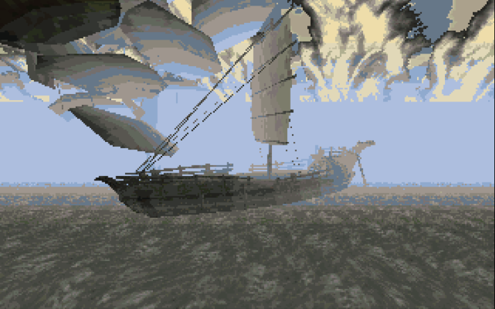 | 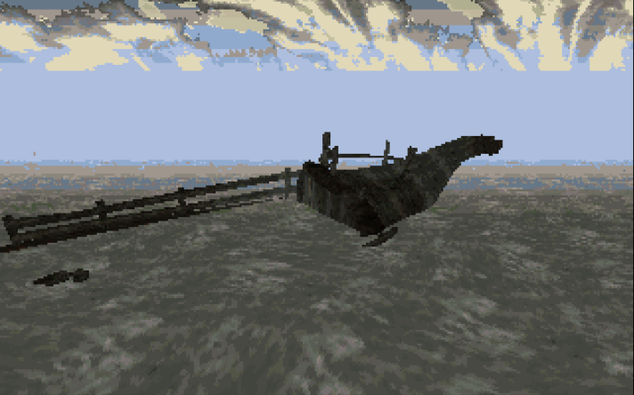 |

Actual AmiWind **v0.0.40-dev1** captures, taken on 15 October 2026. These are
ship exteriors with cabin entrances in ring 2. Photo mode hides the HUD and
uses a free camera; the images preserve the rendered viewport pixels and
normal fog. They show the existing playtest, while the final release checks
above remain pending. Public gameplay screenshots show AmiWind itself.

## v0.0.39 - Cell By Cell, Piece By Piece

Running on CHIM Engine v0.2.0. This release brings together the RC1 changes
and RC2 repairs: safer teleport autosaves, an untinted death menu, third-person
ready/jump/punch and torch poses, swimming and diving, fuller movement pose
sampling, body budget checks, NPC animation registration and guard spear poses.
It also includes current keyboard help, sound cancellation and exterior
ownership checks that exclude redundant BSP conversion and packaging.

The RC2 source passed 4,043 automated tests (four skips and three expected
failures), Amiga compilation, full disk readback and package extraction. Scoped
emulator checks observed punch motion, a carried torch, stable water idle,
pitch-directed diving and visible first-person fists. These are RC2 observations;
they do not establish every appearance, physical LMB hit/damage, leg seams or
fast-gait quality. Memory/streaming warnings and broader gameplay gaps remain open.

CHIM content is unchanged from the inspected RC2: 360 whole regional cells,
with six partial town overlaps excluded from that count. Conversion and audit
progress are separate from packaged or fully playable coverage.

See the [release notes](RELEASE-v0.0.39.md),
[changelog](CHANGELOG.md) and [bug register](BUGS.md#fix-index).
Unfinished work and new features continue in
[v0.0.40](ROADMAP.md#v0040---unfinished-work-and-new-features).

<!-- v0.0.38 preview -->
## Previous public source release: v0.0.38 - Lava Is All You Need (And A Hint Of Tel Uvirith)

See the [v0.0.38 release notes](RELEASE-v0.0.38.md) for changes and remaining verification limits.

Published v0.0.38 brings lava conversion repairs, new CHIM exterior areas,
reduced Tel Uvirith geometry, collision fixes and updated Toolkit inspection
controls. Scoped native checks verified lava contact damage and Tel Uvirith
arrival. Known issues remain in the [bug tracker](BUGS.md); the
candidate source update above continues the repair and coverage work.

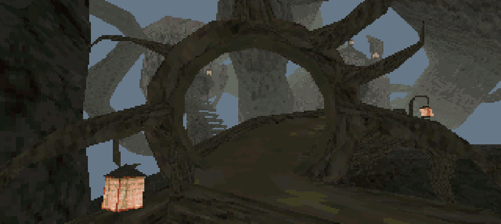

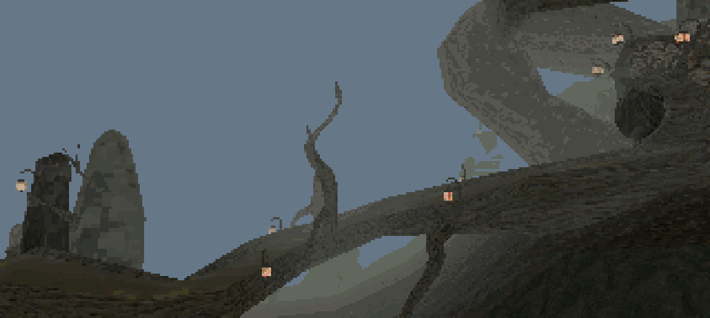

In-game development playtest screenshots, cropped to the rendered viewport.
The stronghold is Tel Uvirith, exterior cell (10,1), in Molag Amur.
Uvirith's Grave is the site on which the stronghold is built, not its alternative name.
This playtest uses the completed stronghold state (internal stage 6);
quest-driven construction transitions are not implemented. Earlier diagnostic
filenames used "Molag"; these screenshots do not show Molag Mar or its temple.

These views show the reduced Tel Uvirith scene; they do not establish full-world
or staircase traversal acceptance. See the [current CHIM cell tracker](chim/CELL_TRACKER.md)
for conversion and audit progress; release plans remain separate from packaged coverage.
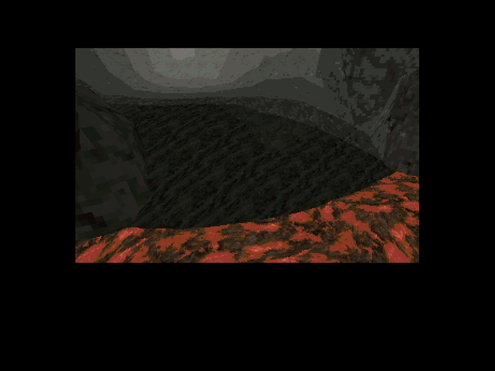

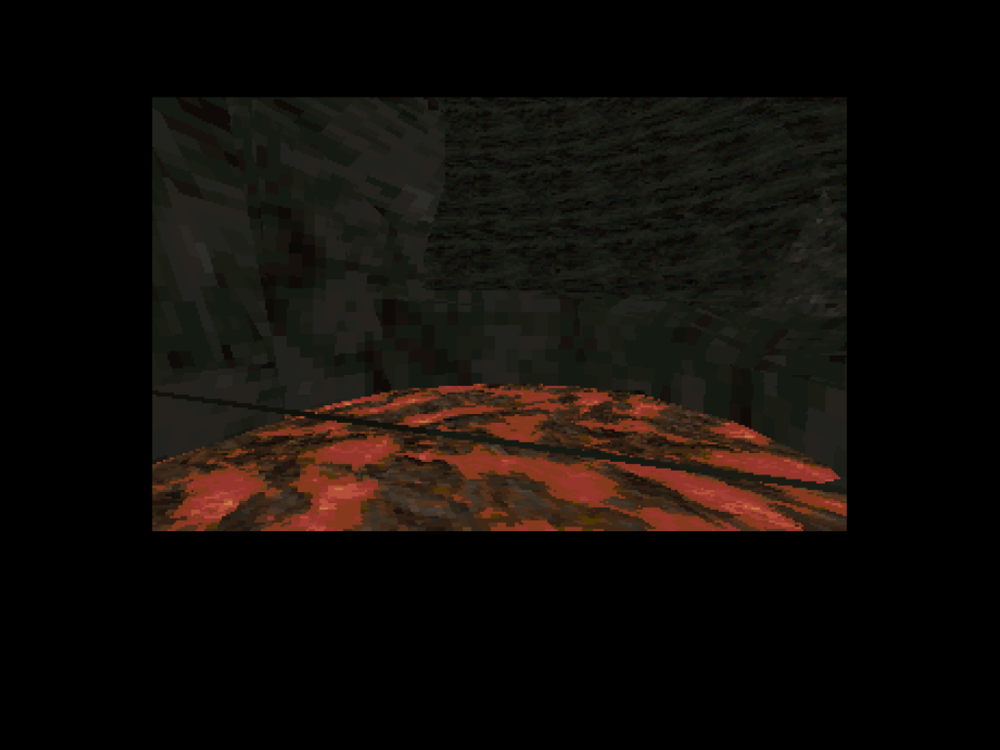

Original in-game captures with photo mode enabled and HUD/crosshair disabled.
A separate normal-movement test verified lava damage with god mode and noclip off.
These views do not establish sound or complete world-traversal acceptance.
<!-- /v0.0.38 preview -->

**v0.0.37 - Proofreading the Cantons:** a small fix release: the v0.0.36 release notes and this page now match the released code, and the logo images are fixed. Release notes: [docs/RELEASE-v0.0.37.md](RELEASE-v0.0.37.md).

**v0.0.36, running on CHIM Engine v0.2.0:** introduced CHIM coverage along the coastline and the next ring inland, all of Vivec is one CHIM map with 130 of its rooms, Seyda Neen and Balmora are CHIM-native, terrain is stored once, and the engine gets wider coordinates, third person, blocking and a death scene. Release notes: [docs/RELEASE-v0.0.36.md](RELEASE-v0.0.36.md).

### CHIM progress map

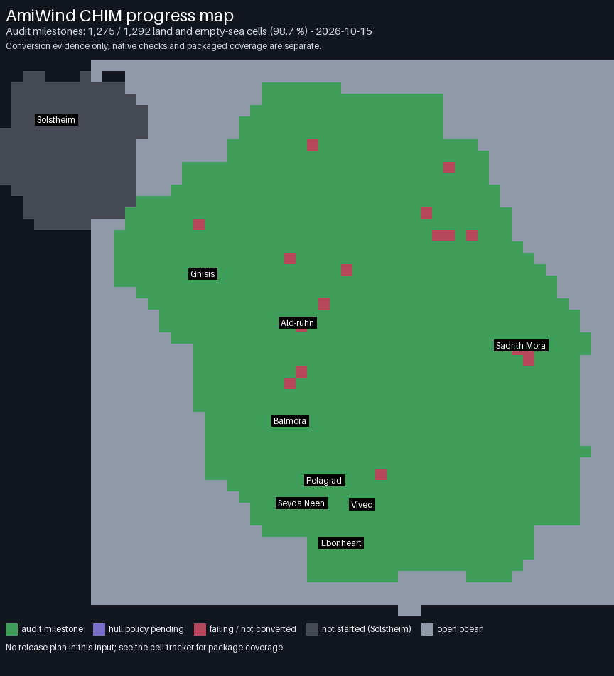

Snapshot: **15 October 2026, 10:50 UTC**, from the
[public cell reference](chim/cell-progress-reference.json). Each square is
one exterior cell, north up. **Green** means a conversion/audit milestone;
lighting, actors and gameplay can still be deferred. **Red** means an audit
failure or an unfinished conversion. **Violet** is a hull-policy hold, **dark
grey** is not started, and **silver** is open ocean. This snapshot has no gold
release-plan overlay.

| Evidence | Recorded coverage |
| --- | --- |
| Converted cells | 1,191, including 15 with failed audits; 99 empty-sea cells are counted separately |
| Conversion/audit milestone | 1,275 of 1,292 land and empty-sea cells (98.7%); 15 failed and 2 not converted |
| Native-checked cells | No complete island-wide count established; scene checks remain scoped |
| Packaged region cells | 360 whole cells in the exact RC2 package, verified 14 October; six partial town overlaps remain outside this count |

What each count means: [what we count](chim/CELL_TRACKER.md#what-we-count).

Update (v0.0.44, 19 October 2026): this snapshot is from 15 October 2026. Since v0.0.43 every exterior cell of
Vvardenfell is on CHIM (1,409 cells), and the [cell tracker](chim/CELL_TRACKER.md) lists all 1,390 cells with
a LAND record as audit-done.

The earlier combined v0.0.40 candidate passed conversion and structural, heap,
zone-walk and stair checks for all 369 frames. Subsequent boundary repairs now
produce zero full-static support-status disagreements across 2,816 samples
(5,632 queries) at southern Seyda; terrain and water controls agree. The corrected
Seyda frame passes structural, heap and zone-walk checks, but its full stair run
ended in memory exhaustion. The later combined attempt failed ownership before
packing because original kelp references were omitted by a legacy dressing filter.
A correction retains the three known original kelp meshes and passes 43 focused
source checks; its compiled, native and package gates remain pending. Other
541 original boundary segments remain unmeasured. Work continues on v0.0.40. See the
[static seam report](bugs/CHIM-FRAME-STATIC-SEAM-40.md) and
[tracker guide](chim/PROGRESS_TRACKER.md#current-mapping-evidence-15-october-2026).

The 865 open-ocean cells are outside the 1,292-cell denominator. Packaged
region coverage is not a total for named town frames or interiors, and green
cells do not establish actor presence or working gameplay. RC2's package
layer was verified on 14 October from full disk readback and independent
extraction. All 9,774 CHIM files retain the verified RC1 bytes; no new cells
were imported into RC2. The later v0.0.40-dev1 Pelagiad (0,-7) conversion passed
its measured offline audits and remains outside that package. Converted and packaged per-type actor/gameplay counts remain
unknown; original reference types are retained. Historical scoped Nord package diagnostics recorded punch, torch, swim and
dive behavior; those observations do not establish current gameplay acceptance.
Playtesting findings for [third-person punching](bugs/PLAYER-PUNCH-THIRDPERSON-39.md), [movement with fists drawn](bugs/PLAYER-READY-MOVEMENT-39.md), [blocking](bugs/COMBAT-BLOCKING-36.md) and [swimming](bugs/WATER-GAMEPLAY-PARITY-38.md) remain open.
RC2 inspection package and matching source artifacts finalized at
2026-10-13T22:15:44Z. Final v0.0.39 private playtest and matching public source
delivery finalized at 2026-10-14T07:15:35Z. Shipment does not close those
gameplay reports or establish gameplay acceptance; independent fresh-download
verification remains separate.

Historical RC1 package/source delivery finalized on 13 October at 18:06 UTC;
its 360 whole-cell check and six partial overlaps remain dated historical
evidence. Later RC1 regression reports stopped final preparation and led to
RC2. See the [cell tracker](chim/CELL_TRACKER.md) and
[map guide](chim/CHIM_PROGRESS_MAP.md) for separate evidence states.
The [11 October v0.0.36 map](images/amiwind-v0.0.36-progress-map.png)
is retained as a historical snapshot.

**Earlier release, v0.0.35:** walk and run for NPCs, combat with weapons and shields, lava, Seyda Neen from your own data, about 30 engine crash fixes and a faster, resumable builder. Details: [docs/RELEASE-v0.0.35.md](RELEASE-v0.0.35.md).

## v0.0.35 - CHIMporting It All: Gathering Up The Loose Branches From The Seashore

**AmiWind v0.0.35, running on CHIM Engine v0.1.0.**

A sync release: finished work that waited on side branches is gathered in. NPCs walk and run, fighters
use weapons and shields, lava glows and burns, Seyda Neen is built from your own game data, about 30
engine crash paths are closed and the builder resumes a failed build from where it stopped. Unfinished
work ships behind switches that are off by default.

- [Release notes](RELEASE-v0.0.35.md)

## v0.0.34 - CHIM: Tightening the Bolts

**AmiWind v0.0.34, running on CHIM Engine v0.1.0.**

A fix release for v0.0.33: the silt strider's hull is closed again (its seams stay put when
the mesh is reduced, and it still fits Balmora's chunk memory), and every placed Bitter
Coast mushroom can be picked (invisible tree collision no longer blocks the pick). Both
fixes come with an island-wide check that runs in every build.

- [Release notes](RELEASE-v0.0.34.md)

## v0.0.33 - Towards CHIM: Replacing the Engine Block

Introducing AmiWind's **CHIM** engine, a.k.a. **[C]hunks and [H]eaps [I]n [M]emory**.

**AmiWind v0.0.33, running on CHIM Engine v0.1.0.**

Balmora and Seyda Neen now run on pure CHIM: the world is cut into chunks, every
mesh, collision hull and texture is stored once and placed by reference instead of
being copied into overlapping region maps, and only the chunks around you are in
memory. It is still the AmiQuake engine underneath; what changed is how the world
reaches it. A far terrain layer draws the distance, and the CHIM builder is now the
default builder.

<!-- v0.0.33 photos -->
<!-- /v0.0.33 photos -->

### What is CHIM?

CHIM is AmiWind's overhauled engine: in many places a rewrite of the original
AmiWind engine, still built on id Software's Quake and the AmiQuake port. Its main
change is how the world is kept:

- **Store once.** Every mesh, collision hull and texture is stored once and placed
  by reference, the way Morrowind places its meshes, instead of being copied into
  every overlapping region map that can see it.
- **Stream chunks.** The land is cut into chunks; a ring of chunks around you is in
  memory and chunks join and leave a little at a time, so there is no "region
  loading" stop at a border.
- **Vis kept.** Chunks and placements are linked to the visibility leaves they
  touch, so Quake's visibility data still culls them.
- **Memory budgets.** The chunk ring lives in one fixed zone inside Quake's own
  heap, and the builder checks every CHIM area against the engine's numbers before
  it ships.

What it gained, measured (bytes and counts are exact; frame times are FS-UAE
emulator figures, relative until a real Amiga has been measured):

- **Disk:** Balmora's exterior 162.1 MB of legacy maps to 21.3 MB (7.6 times
  smaller); Seyda Neen with the intro docks 190.4 MB to 7.8 MB (24.3 times).
- **Loading:** the Balmora door walk reads 40.7 MB instead of 73.5 MB, in small
  steps instead of region loads.
- **Renderer work:** 46-114 brush models sent at the Balmora test cameras instead
  of 512-654, and 9-10 BSP nodes walked per clipped face instead of 27-52.
- **Frames (emulator, relative):** on a slow preset (a cycle-exact 68040 at about
  50 MHz) the median Balmora frame falls from 2.0-4.1 s to 1.1-1.6 s.

CHIM also has costs: it leaves less of the heap free at a town's load peak, spends
more time outside the 3D view and draws slightly more spans. The rest of the open
world is still on the legacy pipeline for now, and the Vivec Arena preview of
v0.0.32 is left out of this release; it comes back on CHIM.

Read more:

- [Release notes](RELEASE-v0.0.33.md), with what is known in this build
- [CHIM engine](chim/README.md)
- [CHIM file format](CHIM_FILE_FORMAT.md): what CHIM stores and why, its files (`.chim` maps and the CHIM world), versions and roadmap
- [CHIM features](chim/FEATURES.md): what is done, measured or still to do
- [Disk space](chim/DISK_SPACE.md): Amiga disk limits and what CHIM saves
- [CHIM build guide](chim/build_guide/README.md)

## v0.0.32 - Last Stop on the Old Line: Window-Shopping in Vivec

A first look at Vivec: the Arena canton as an outside-only preview, with stairs
you can climb and residents standing where Morrowind puts them. The last
release on the AmiQuake-based legacy engine.

<!-- v0.0.32 photos -->
| | |
| --- | --- |
| 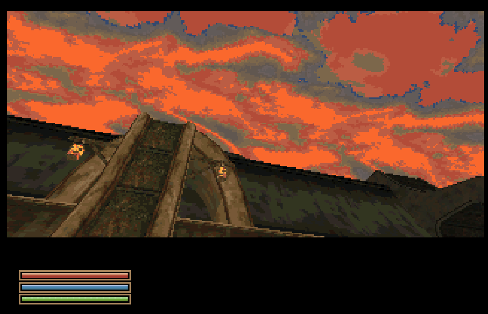 | 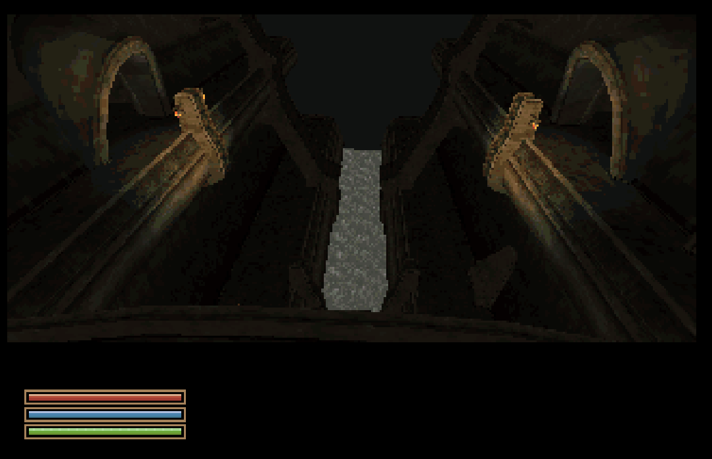 |
| **A lantern-lit bridge pillar** against a blazing sunset. | **A Vivec canal at night**, lanterns on both sides. |

More in the [gallery](GALLERY.md).

<!-- /v0.0.32 photos -->

What's new:

- **Vivec Arena preview:** the Arena canton and the edges of its neighbours,
  outside only (doors say "Interior unavailable"); a separate area, reached with
  `dbg tp vivec_arena`.
- **Stairs and residents in Vivec:** the Arena stairs, bridges and walkways can
  be walked, and every resident stands on the original floor.
- **Horizon:** the default is the v0.0.30 look (`aw_skyline_fill 0`, Horstator
  approved); the skyline fill stays selectable as an experimental mode.
- **Fire:** the flames you can see win the flame budget, so hearths stay lit.
- **Console** edits like a terminal prompt, with history; `dbg daynight off`
  holds midday.
- **68040:** no library sine and cosine per frame; your own FPU support library
  can go on the boot disk (`--amiga-libs`).
- **Map loader** without temporary staging copies; renderer counters and the
  `awbench` hardware benchmark.
- **Builder:** builds the release from scratch from your own data, in parallel,
  with a build profiler and a known-inputs check.
- **New logo** and start-up lines.

Release notes, with what is known in this build:
[v0.0.32](RELEASE-v0.0.32.md).

## v0.0.31 - Lamps, Lanterns and Loading

Balmora and Seyda Neen at night, lit by their own lamps and lanterns; much
faster loading; and the AmiWind Toolkit.

What's new:

- **Night in town:** the original street lamps, lanterns, wall torches and fires
  light Balmora and Seyda Neen at night with warm light; lantern and window
  glass glows; blue lanterns stay blue.
- **Light-space night:** night darkens the light, not the finished picture, so
  torches and glowing materials keep their light after dark.
- **Fire:** fireplaces and braziers burn with flames shaped like the original
  emitters, deep red to a near-white core, with rising embers; torches shed
  embers too. `dbg torchgallery` opens a dark room to look at them.
- **Guard torches** light half as far, so they no longer outshine the lamps.
- **Light hue:** torch, lamp and window light can be any colour
  (`dbg light hue R G B`, or the Hue row in `dbg lightgallery`).
- **Light gallery:** `dbg lightgallery` puts every night-lighting switch in a
  strip below the view, with a time preview.
- **Fog distance slider** (Options > Fog distance, 100-1500), **skyline fill**
  for short fog distances, and optional **location fog** per place.
- **Horizon veil** (`dbg horizon veil`) hazes gaps in distant silhouettes.
- **Faster loading** everywhere, and lighter Seyda Neen sub-cells.
- **Music and opening:** silent start-up until the title music, no stray clips
  while the ship loads, a shorter wait after the intro video, and the ship
  fades in from black.
- **Place names** in the location label, from the original cell names.
- **Time controls:** `dbg time`, `dbg time HHMM`, `dbg 24hrcycle`.
- **Debug headlamp:** `dbg headlamp on` lights dark places without a torch.
- **`dbg lamps`** shows which lamps are lit around you and why.
- **AmiWind Toolkit:** World / Local / 3D Inspector, multi-cell selection,
  scrollbars, keyboard panning.
- **Entity tracker:** the image build counts what the original game places
  against what AmiWind places, and stops if a category goes missing.
- **Builder:** writes the night lamp, glowing glass and location fog tables
  itself, and finishes its last step again.
- **Console:** every `dbg` command sorted and tested; on/off words work for
  every setting.
- **Docs:** a performance page with charts on what the engine is asked to draw,
  and the rule that the repository builds the whole game from scratch.

What we gained (measured):

- **Loading:** game files are read in 16 KiB pieces instead of 1 KiB (a 4.8 MB
  Seyda Neen map took over 4,700 separate disk reads). Seyda Neen region
  crossings: 0.54-0.71 s in v0.0.30, now 0.39-0.48 s on the test route.
- **Seyda Neen maps:** 247.5 MB down to 185.6 MB (-25 %); maps over the modeled
  memory reserve: 43 down to 6.
- **Lamps and lanterns at night:** 694 original street lamps, lanterns, wall
  torches and fires give a torch's worth of warm light from dusk to full day;
  lantern and window glass glows in 79 town maps.
- **Torch light at night:** torches and glowing materials keep their light after
  dark; walls lit by a torch measured about 2.5 times brighter than before.
- **Frame rate control:** Options > Fog distance is now a slider (100-1500); in
  Balmora a fog distance of 250 roughly doubles the frame rate, and the skyline
  stays fogged instead of cut out.
- **Music:** silent start-up until the title music, no stray clips while the
  opening loads, and the prison ship fades in from black.
- **Place names:** the location label reads "Vvardenfell / West Gash Region /
  Balmora" from the original game's cell names.
- **AmiWind Toolkit:** World, Local and 3D Inspector tabs for anyone working on
  AmiWind (below).
- **Console:** 116 `dbg` commands, sorted and tested so every one reaches its
  handler; `dbg time`, `dbg 24hrcycle`, `dbg lightgallery`, `dbg lamps`,
  `dbg headlamp`.
- **Bug tracking:** one register, 186 records, a report page for every bug found
  since v0.0.30.

| | |
| --- | --- |
| 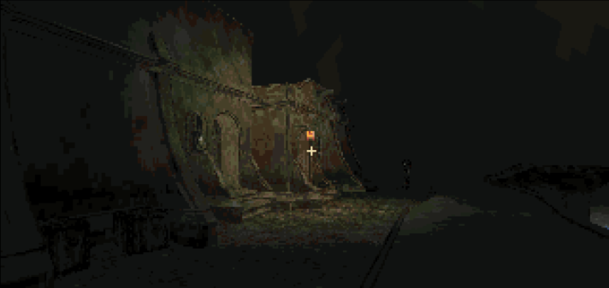 | **01:19, a street lamp.** A torch's worth of warm light on the wall and the street; its glass glows. |
| 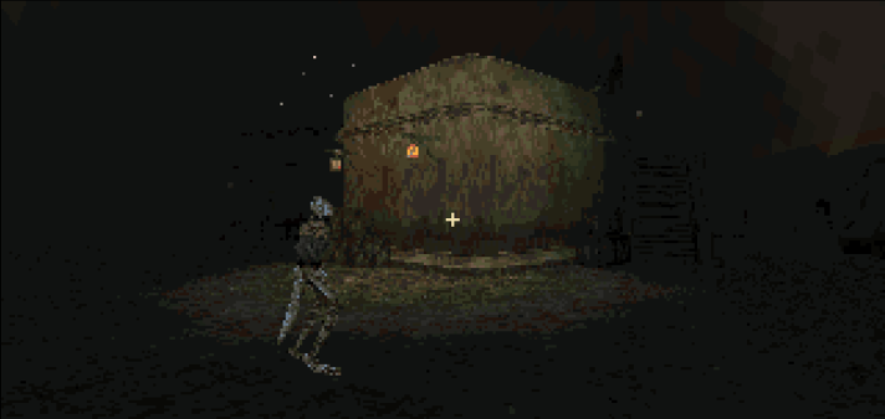 | **02:18, a lamp-lit house.** Pools of light with darker street between, the way a town at night should look. |
| 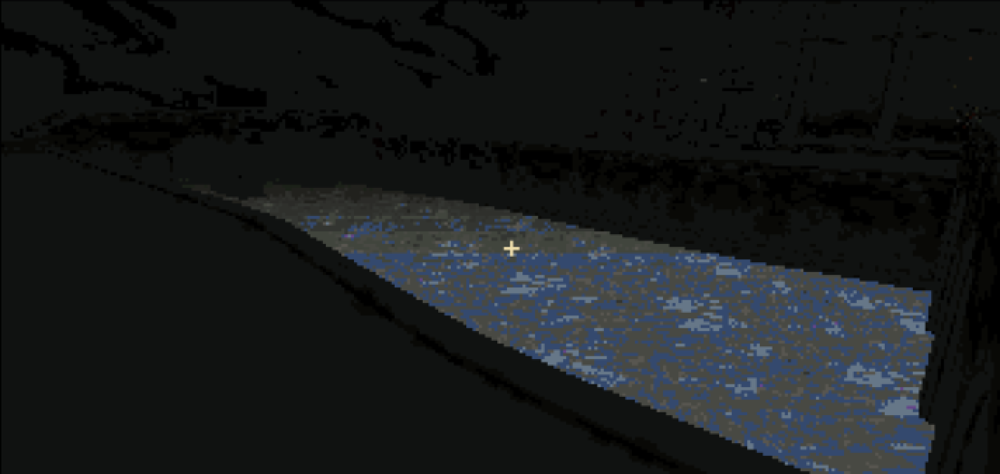 | **22:46, the river.** The water glitters under the night sky. |
| 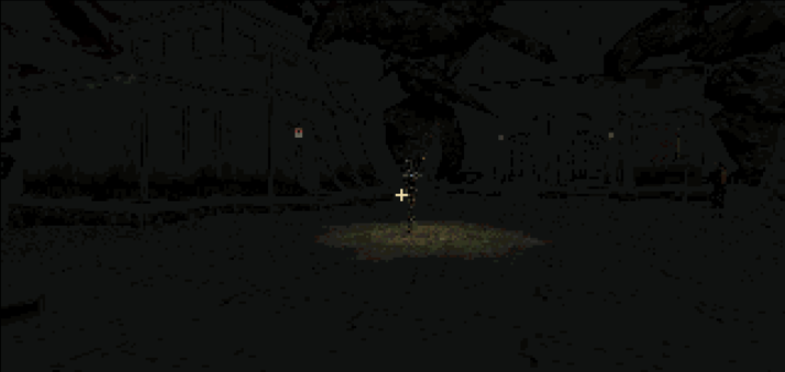 | **21:38, a plaza guard.** Guard torches light half as far as before, so they no longer outshine the lamps. |
| 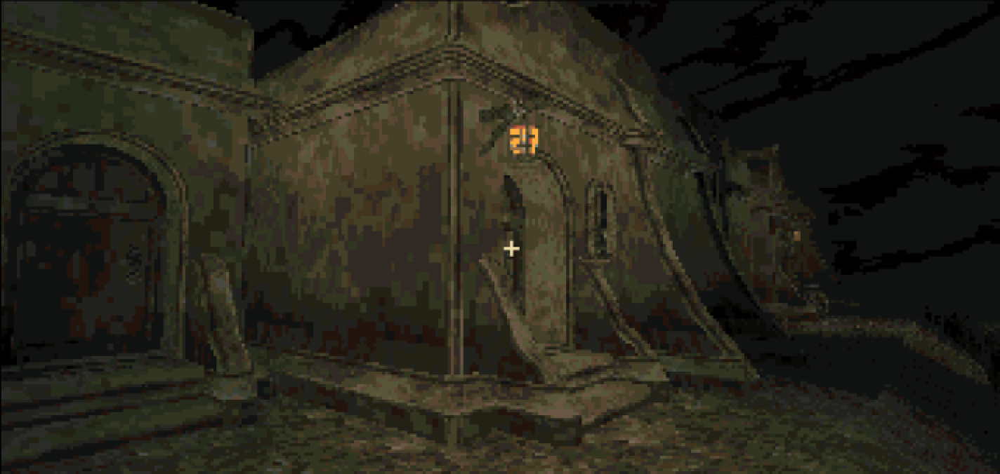 | **22:36, a house corner.** Lamps stay lit while you turn and walk; a lamp that hands its light to a nearer one fades out instead of snapping off. |

Release notes: [v0.0.31](RELEASE-v0.0.31.md) (with the dev1-dev6 notes linked
there) and the [bug register](BUGS.md).

### Whoops! Actually...

Most of what AmiWind draws, Quake never got the chance to skip. Quake's `vis`
tool precomputes what can be seen from where, but only the world's own walls
count, and every converted building, room and rock went in as a `func_wall`
model, which `vis` ignores. Measured on the dev5 and dev6 maps:

| Map type | Visible from an average spot |
| --- | ---: |
| Interiors (Mages Guild, Temple, Census, prison ship) | 100 % |
| Balmora streets | 84-89 % |
| Open world with rocks and trees | 69-85 % |
| Seyda Neen | 59-76 % |

Inside the Mages Guild, all 40,488 faces were processed every frame wherever
you stood, and NPCs behind houses were drawn in full. The fix is the Quake way:
static building faces become part of the world, which Quake culls leaf by leaf,
and invisible solid blocks inside buildings and walls give `vis` the walls to
cut with. (Blocks alone were tried first: buildings left as separate models
stay visible as a whole.) Details: [Town visibility](performance/TOWN-VISIBILITY.md) and
[TOWN-VIS-OCCLUSION-31](bugs/TOWN-VIS-OCCLUSION-31.md).

### AmiWind Toolkit

The browser Toolkit inspects your own converted data: **World** shows cell
coverage and reference counts, **Local** shows a cell's maps, **3D Inspector**
opens BSP maps, CHIM maps and whole CHIM worlds, and **Monitor** follows builds.
It runs locally; game data and inspection exports are not uploaded.

The current [inspection controls](../amiwind-toolkit/README.md#v0038-inspection-controls)
include remembered Names on/off, direct cell links with an optional highlighted
selection, per-panel Copy JSON, textures with a density heatmap, direct scene
and CHIM archive links, a collapsible sidebar and a placed-face budget display.
Stored, placed and preview counts remain distinct from native memory or speed.

World's **Included in build** view is separate from conversion colours and
release plans. It uses verified final-image readback; selected or planned cells
are not included cells. Inclusion alone does not verify lighting, actors,
interactions or traversal. See the [Toolkit guide](AMIWIND_TOOLKIT.md) and
[CHIM coverage guide](chim/CHIM_PROGRESS_MAP.md).

The guide retains historical v0.0.31 and v0.0.36 screenshots. Their headers,
controls and coverage totals describe those snapshots, not the current build.

## v0.0.30 - The Temple

The Balmora Temple is whole again. A scene-converter fault turned some meshes
around their own origin, leaving missing walls, see-through holes and floating
objects in the Temple's lower rooms; the same fix repairs Tharys Ancestral Tomb
and the Nord fireplaces of five Seyda Neen interiors.

| The Balmora Temple lower entrance in v0.0.30 | The Temple lower room: doorway and banner |
| --- | --- |
| 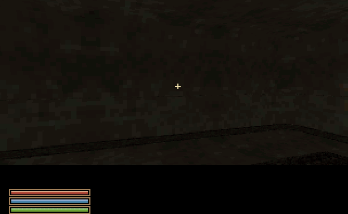 | 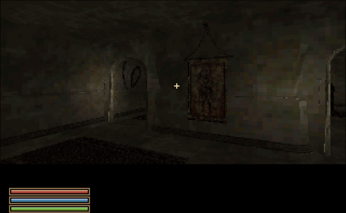 |
| 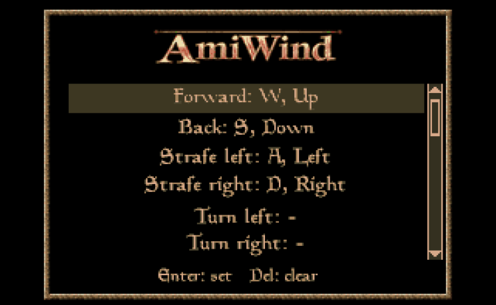 | |

Also new: misplaced Census office objects from dev5 fixed, a crash fix for
Seyda Neen region changes, an Options > Controls page for rebinding keys,
arrow keys that move like W/A/S/D, NPCs lit by the floor they stand on,
glowing lantern glass and flames on placed fires (rebuilt maps only so far),
about 15 % less reading on heavy Seyda Neen crossings, less music crackle in
WinUAE (still heard on some map changes), and an engine that builds without
compiler warnings. Every lighting and loading change has a console switch.

Still open: Seyda Neen crossing pauses (a lighter rebuild of its maps is under
way), a rare load freeze seen in automated runs, and the issues carried over
from v0.0.29. See the [release notes](RELEASE-v0.0.30.md) and the
[tracker](BUGS.md). Development builds:
[dev3](RELEASE-v0.0.30-dev3.md), [dev4](RELEASE-v0.0.30-dev4.md),
[dev5](RELEASE-v0.0.30-dev5.md), [rc1](RELEASE-v0.0.30-rc1.md).

## v0.0.29 - Let There Be (Just a Bit More) Light

Explore with adjustable interior brightness, clearer torchlight and improved
first-person hands. Graphics settings now provide independent saved interior
and exterior controls; the Census door guard and reported Seyda shack lighting
jump have positive RC2 playtest results. Confirmation dialogs use framed buttons.

This remains an experimental project with incomplete world and gameplay coverage.
Balmora Temple geometry holes and WinUAE music crackle/pauses remain known issues,
alongside the hand-animation transition and memory/performance limits. See the
[release notes](RELEASE-v0.0.29.md) and [current tracker](BUGS.md).

## Earlier v0.0.29-rc1 playtest - More Mushrooms! (...and fixes)

The **rc1 candidate is assembled** and has completed a bounded native FS-UAE
playtest: Audio controls, independent dialogue/effects levels and mushroom
pickup with save/reload were verified. Public source publication remains pending.
Final **More Mushrooms** still depends on the world-coverage and regression gates
in [the release plan](PLAN-v0.0.29.md). The dev4 hotlist remains below.

- **Broader mushroom coverage:** the current memory model admits 347 of 390
  exterior maps. Forty-three maps and additional interior routes still need
  work. These are admission results, not a claim that all placements have passed
  in-game testing. See [asset coverage](ASSET_COVERAGE.md).
- **Less temporary and resident RAM:** compact persistent harvest state,
  direct alias-model loading and exact edge/surface layouts preserve source
  geometry while reducing allocations. Native peaks and outdoor transition
  smoothness remain checks of their own.
- **Race-specific first-person hands:** the candidate includes a source-topology
  catalogue and corrected lighting normals, with legacy profiles retained. Bounded
  native motion comparisons show no newly detached skin triangle; the paw-like
  silhouette remains an appearance issue. Transparent sprite conversion is a
  [future investigation](FIRST_PERSON_HANDS.md#investigation-first-person-hands-rendered-as-sprites).
- **Torch repairs:** nearby NPCs respond to local torchlight in bounded native
  off/on tests, and all three tested flame styles are visible. The rc1 run also
  captured held torchlight with a nearby NPC; broader actor coverage remains in
  the [tracker](BUGS.md).
- **Audio work:** smaller, audio-serviced head-preview reads avoid a reproduced
  starvation case under injected disk delay. The rc1 WinUAE playtester reports
  no OST jump when entering appearance selection; a later RC2 WinUAE report
  reopens that issue. A separate
  Audio options screen with Master, Music, Effects and Dialogue sliders now has
  native arrow-key and saved-setting checks, plus independent dialogue/effects
  output checks. Broader listening and event coverage remain open.
- **Faster regression checks:** disk-backed debug help, `dbg shroompicker`
  locations and the `playvideo`, `videoplay`, `playvid` and `vidplay` aliases make
  the playtest easier to exercise.

### From the rc1 playtest

| Aim and pick | Pickup feedback |
| :---: | :---: |
| 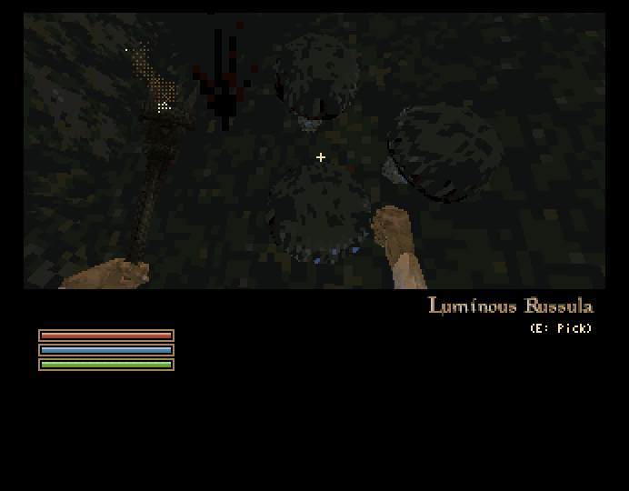 | 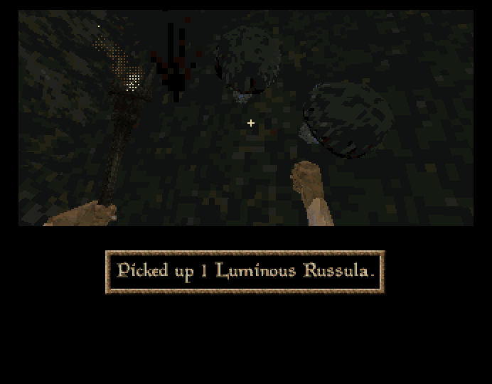 |

| Audio options | Torchlight at night |
| :---: | :---: |
| 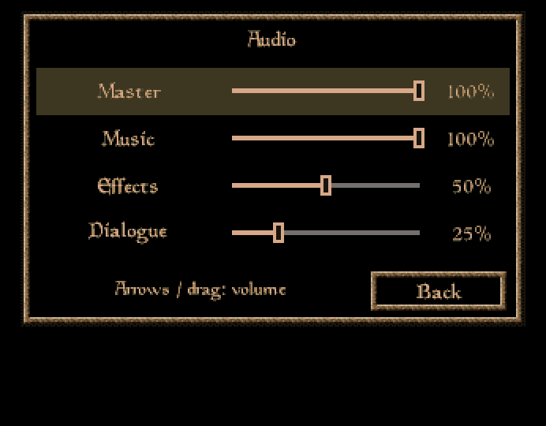 | 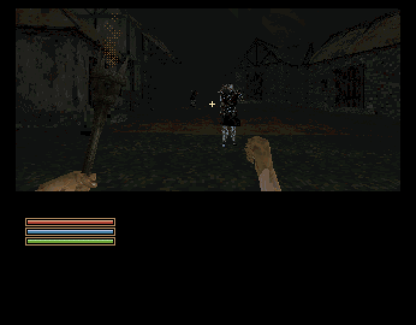 |

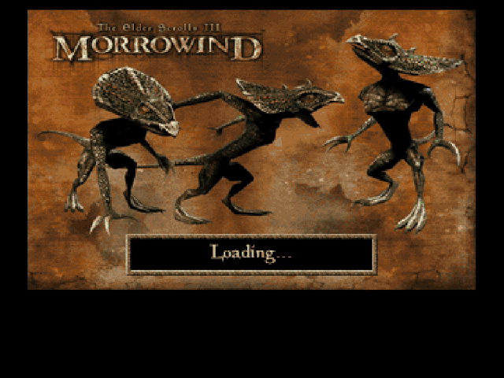

These are actual frames and a six-second clip from the same rc1 run. A debug
destination placed the player by the mushroom; the pickup and save/reload used
ordinary controls. Two distinct plants were collected and remained picked after
reload. See [capture details and earlier galleries](GAMEPLAY_MEDIA.md) for
the test scope and image processing. Broader audio and world checks remain open.

  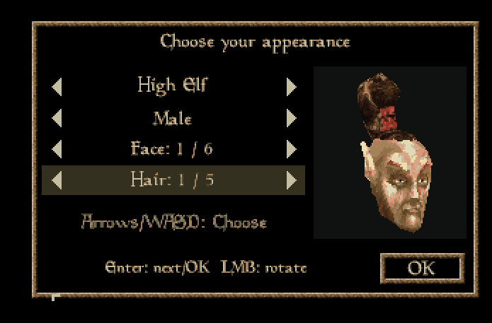

<em>High Elf male appearance selection in WinUAE, v0.0.29-rc1.</em>

This separate playtester-supplied screenshot is unchanged. The playtester
confirms that entering appearance selection caused no OST jump in rc1; this
records that earlier result. The later RC2 WinUAE playtest reopens entry
audio continuity, so it remains in the current known issues.

## v0.0.29-dev4 — WIP: More Mushrooms! (...and fixes)

**More exciting features and bug fixes —** small mushrooms to pick, steadier
free-look, clearer nights and a growing list of repairs across Vvardenfell.
This is a development preview; **v0.0.28 remains the latest stable release**.

### The hotlist: changes since v0.0.28

- **Pick your first small mushrooms.** Six original Luminous Russula placements
  form the dev4 pilot. Aim for the name and **E: Pick**, collect the ingredient,
  and the mushroom disappears. Shared placement identity, hidden inventory and
  sparse saved state keep tested pickups from returning across map changes or
  save/load. `dbg shroomtracker` reports collected mushrooms.
- **Pickup feedback and joined mushroom meshes.** The original item sound and
  rectangular notification accompany successful collection; the notification
  animation is configurable. Conversion preserves shared mesh seams. This
  pilot is the starting point for worldwide picking.
- **Free-look stays where you put it.** Legacy automatic pitch centering while
  walking is disabled by default. `aw_auto_center 1` retains the old behavior;
  explicit centering remains available. Other reported orientation resets are
  still being investigated.
- **Lighter full-screen UI.** Head/race selection and blocking journal, map and
  reading overlays can freeze world work behind a black background while the
  soundtrack and interface keep running. The live background remains selectable;
  the original name-entry scene keeps its existing behavior.
- **Character-menu improvements.** UI mode 2 adds clickable, keyboard-focused
  **OK** buttons. Confirmation and travel choices gain matching framed buttons.
  `dbg tpscene headselection` skips directly to appearance selection for testing.
- **Map and HUD repairs.** Map palette fixes remove unwanted bright dots;
  debug-map selection, teleport aliases, secondary-button panning and tab/input
  handling have been revised. Health, magicka and fatigue use independent values,
  with heading and time available in the debug HUD. Broader mouse checks continue.
- **Hands and carried equipment.** The periodic unarmed idle blink has a corrected
  animation frame range, and repaired world-map metadata restores sampled F/V
  hand/torch controls. Transition view, equipment and voice continuity have new
  preservation paths. Quickload still puts equipment away in dev4; its separate
  save-format fix is coming next.
- **More useful torchlight.** Surface-light interpolation is repaired; player
  and admitted guard lights have a configurable radius, default 192 instead of 144.
  Optional bright-base and spark flame styles are available, and torch depth bob
  is disabled by default. Guard-light cache handling is improved; intermittent
  guard visibility and dim lighting remain on the investigation list.
- **A clearer midnight sky.** The new default clears clouds around 00:00–03:00
  and brings them back toward 04:00, revealing stars and both moons. Legacy cloud
  behavior stays selectable. The improved night appearance has playtest approval.
- **Scenery repairs.** Indrele Rathryon's shack walls are restored. Tree-root
  sampling and distant terrain presentation have improvements, with occasional
  horizon gaps and popping still being worked on. The experimental terrain
  horizon renderer remains opt-in.
- **Movies: 17/17 available source videos converted.** The builder includes the
  discovered movie catalogue. Dev4 retains its higher-resolution intro alongside
  the other new outputs; checking every in-game movie event and soundtrack is
  still in progress.
- **Music: 18/18 available tracks converted.** The complete inspected soundtrack
  set is included in the builder's media output.
- **Voices: 6,447/6,447 available files converted.** Seven additional referenced
  voice sources are missing from the inspected installation and reported as such.
- **Sound effects: 717/717 available files converted.** Two additional referenced
  effects are missing. All four categories have zero failed conversions for
  available inputs; event wiring, listening checks and crackling fixes continue.
  These counts describe conversion from a local game installation; the public
  source archive contains no original game media.
- **Better development tools.** New public guides cover headless FS-UAE and
  OpenMW reference runs in Docker, machine-state inspection and repeatable
  comparisons. Asset coverage, allocation checks and a documented cell-transition
  profiling investigation help track what is present and what still costs time.

### What's cooking next

- **More Mushrooms, worldwide:** compact original-placement data, shared models
  and persistent picking across exterior cells and mushroom-containing interiors.
  Interior rooms and connecting door routes still need integration.
- **More complete saves and hands:** restore equipment intent on quickload,
  improve hand mesh joins/detail and add race-specific first-person hands.
- **Smoother exploration:** measure and improve cell read-ahead/loading pauses,
  close remaining horizon gaps, and continue torch, audio and input fixes.
- **A clearer build report:** distinguish source assets, converted output,
  installed/reachable placements and missing or unsupported content at each build.
- **Later milestones:** Caius Cosades and the Dwemer puzzle box, richer interiors,
  and a combat-testing arena remain on the roadmap.

Dev4 is a **development prerelease**, with a small mushroom pilot rather than
worldwide coverage. See the [dev4 notes](RELEASE-v0.0.29-dev4.md) for tests,
known issues and exact scope, plus the [active plan](PLAN-v0.0.29.md).
There are no new dev4 pictures yet; the gallery below is from v0.0.28.

## v0.0.28 — Trees and Grass, Day and Night

Trees along the road, reeds by the water, grass around the rocks. Vvardenfell's
scenery is filling out beneath red-and-gold sunsets, purple twilight and a cool
blue hour. The new night layer brings back original stars, nebulae, Masser and
Secunda, while guards prepare their torches for the night watch. All of it works
through a shared indexed sky designed for the Amiga renderer.

**The v0.0.28 release build has passed its bounded independent WinUAE playtest.**
Fresh Windows and Linux builds produce the same Amiga executable. The release
adds foliage, a shared sky, tiny background stars, both moons and timed guard
torches. Explore the new skies below and see the
[release notes](RELEASE-v0.0.28.md) for verified scope and known limitations.
Source publication is completed through the separately gated release workflow.

| Sunrise 06:30 | Red sunset 18:00 | Blue hour 20:15 |
| :---: | :---: | :---: |
| 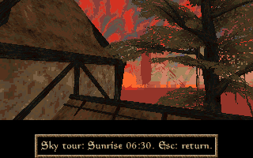 | 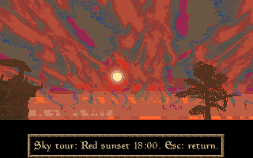 | 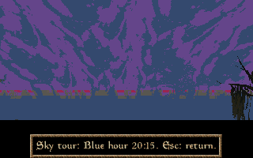 |

| Masser | Secunda | Balmora at 23:00 |
| :---: | :---: | :---: |
| 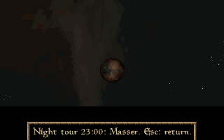 | 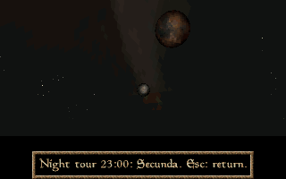 | 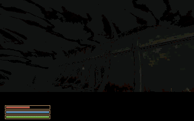 |

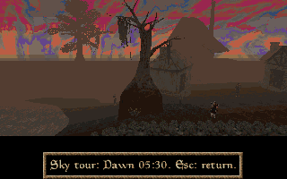

*Real 320×200 Amiga frames captured in WinUAE. The GIF is an eight-stage
montage with edited timing; the screenshots retain their native pixels.
[All day and night stills, plus both GIFs](GAMEPLAY_MEDIA.md#v0028--trees-and-grass-day-and-night).*

- **More of the original scenery.** The prepared world includes **19,984 unique
  foliage placements**: 19,787 sprite placements across 76 shared types and 197
  mesh placements, including 192 in Balmora. The landscape retains **37,960 rock
  placements** and **816 giant mushrooms**, with joined mushroom geometry.
  These count original source placements; neighboring map copies do not add
  unique instances.
- **One sky across exterior cells.** The default V3 presentation brings red and
  gold sunsets, purple twilight and a cool blue hour, with two scrolling cloud
  layers and a moving sun. Sky, distant fog and a subtle exterior world tone
  follow the persistent clock; interiors keep their own lighting.
- **Time you can control.** The cycle starts enabled. Press **T** to wait, use
  `dbg set time sunrise` or `dbg set time 1830` to choose a moment, and
  `dbg daynightcycle off` / `on` to pause or resume automatic time. The new
  `dbg daycycle gallery` tours eight sky stages; `dbg nightgallery` previews
  the night sky, Masser, Secunda and overhead stars. Both preserve player position
  and saved time, with `here` for a fixed view and `off` to return.
- **Torchlight for the night watch.** The new guard-torch runtime equips supported
  Imperial guards in Seyda Neen and Hlaalu guards in Balmora from their original
  equipment and poses. `guards_torch_cycle` follows the saved clock;
  `dbg guardtorch on/off/auto` provides an explicit override. Independent native
  checks confirm cold loading, dawn/dusk switching and subtle animated flame
  particles for both guard types. Heavy-scene memory reserves remain limited.
  [Source rules and current acceptance](TORCH.md).
- **Better tools to see what costs memory.** The 3D Map Inspector and build
  comparisons expose stored geometry, placed geometry and per-map loading
  estimates. The Seyda Neen terrain winding repair restores the missing textured
  ground; broader world geometry and performance work remains ongoing.

Press **F10** for the console, or **Shift+F10** for fullscreen. The separate
`dbg sky off` / `on` control switches the sky/fog effect while time keeps passing.
`dbg sun off` / `on` and `dbg clouds off` / `on` control the two features
independently; both start enabled. These switches also accept `1/0` and
`true/false`. Saved settings can override the shipped defaults.

The pictures above come from the stable V3 default and native night layer.
Historical V1 prototype captures remain in the [capture record](GAMEPLAY_MEDIA.md).
The local converter also converts the original star/nebula textures and both
moons into a compact night layer. Some bright stars twinkle gently in cool blue,
behind the moons and clouds. `dbg starsky` toggles stars/nebula and
`dbg nightsky` toggles that whole layer; both default on and accept the same
boolean forms. `dbg skyspeed` adjusts cloud motion, with a calmer
`0.00333333333` default. Original-source stars are tiny background points behind
the nebula, clouds, scenery and complete moon silhouettes.
The night gallery and Balmora night views have been checked in WinUAE. Regional
weather and full nearby-world lighting remain follow-up work. Read the
[sky and clock guide](DAY_NIGHT_AND_SKY.md) for controls and current scope.

The shared-sky build comparison removed **301,751 local sky faces across
2,664 exterior maps**. Those compared maps plus one shared sky resource saved
**131.324 MiB of disk storage** against their untouched inputs. This measures
the sky conversion alone; subsequent terrain repairs and each loaded map have
separate storage, RAM and frame-cost checks.

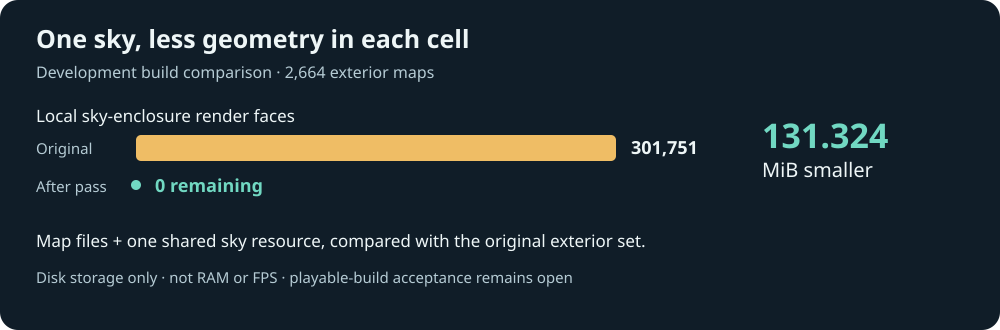

*Project-authored build comparison. [Measurement scope](DAY_NIGHT_AND_SKY.md).*

## AmiWind 3D Map Inspector

**Geometry analysis and optimization planning**

The standalone [AmiWind 3D Map Inspector](POLYCOUNT_INSPECTOR.md) helps
inspect converted BSP geometry and plan optimization work. It is one component
in the aspirational **AmiWind Map Optimization Toolkit** direction, not a claim
that a complete automatic optimizer or runtime profiler is finished. The
bounded hidden-surface pass remains experimental, and verified house examples
currently produce no cuts. Read its [development roadmap](BUILD_TOOLKIT_ROADMAP.md)
and [exterior hidden-surface status](EXTERIOR_HIDDEN_SURFACES.md).
The [Map Optimization Toolkit overview](AMIWIND_MAP_OPTIMIZATION_TOOLKIT.md)
and [measured findings](MAP_OPTIMIZATION_FINDINGS_2026-10-04.md) distinguish
completed representation savings from open geometry and target gates.
See the [memory notes](MEMORY_ALLOCATION.md),
[cell-changing checklist](CELL_CHANGING.md),
[sky and background rendering](DAY_NIGHT_AND_SKY.md#shared-exterior-background-sky-implementation-candidate),
[terrain-culling status](TERRAIN_VISUAL_CULL.md),
[bug journal](BUG_JOURNAL.md) and [roadmap](ROADMAP.md) for the details.
Original-game assets, converted proprietary content and ROMs are not distributed
with AmiWind; you provide your own legally obtained files. Playable builds and
playtest packages containing those assets stay private.

### v0.0.27 — Rocks, Mushrooms, and Then Some: playtest screenshots

These Ascadian Isles screenshots were captured in WinUAE during the rc2
playtest: closed caps, joined rims and textured undersides. They show the mushroom
work that carries into the published v0.0.27 release.

| Closed cap and rim | Giant mushrooms on the hillside |
| --- | --- |
| 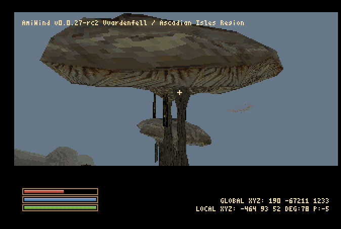 | 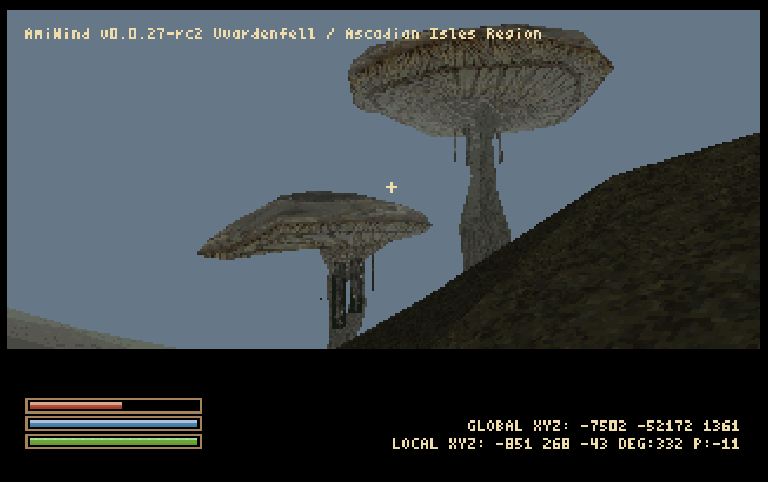 |

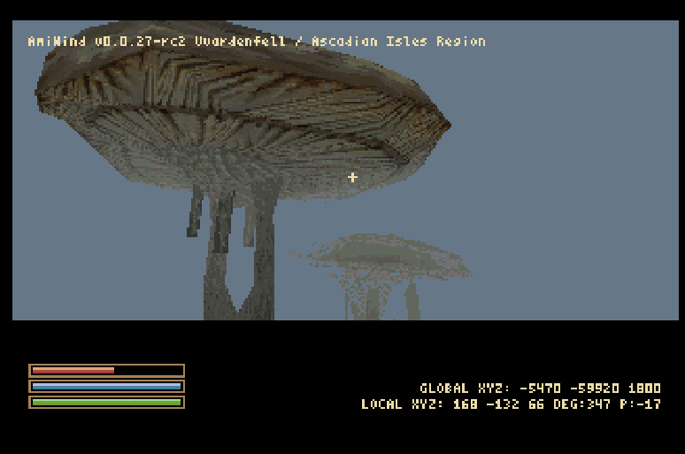

### Explore the growing world

Walk the base-game island's terrain, head into the detailed streets of Seyda
Neen and Balmora, or take a detour through the character gallery. Rocks and
giant mushrooms join terrain and water across the wider world. This release
adds foliage; other settlement scenery and wider-world actors remain
incomplete. Bloodmoon and
Tribunal world content are outside the current playable scope.

Both towns use 64 exterior subdivision cores to keep individual maps bounded.
Balmora includes 43 destination interiors, including Tharys Ancestral Tomb;
Seyda Neen keeps its opening scenes and converted interiors. Aim at doors or
residents and press **E**. NPC interaction currently provides bounded authored
greetings. Full combat, quest simulation, services, schedules and inventory remain
unfinished. See [character-state limitations](CHARACTER_STATES.md).

Character creation follows the opening registration sequence: name, race,
gender, head and hair, class, birthsign and a final review. The appearance
screen has a rotating head preview. Character choices and earned journal history
persist in saves. Start a fresh character when moving from older content.

**J** opens the two-page progression journal; **M** opens the island map. Older
saved configurations regain these keys when unassigned. Journal headings stay
centred on the left page and wrap onto multiple lines. The map marker follows
source coordinates and keeps its zoom on reopen. See
[map and journal](WORLD_MAP_AND_JOURNAL.md).

**F**, then **V** equips a [torch converted from the original game](TORCH.md),
with an animated grip and flame attached to its source emitter. The debug header
shows the region from the game's own records. The earlier torch-crash correction
is included; its target retest and the brief fist-visibility blink remain tracked
in the [bug journal](BUG_JOURNAL.md).

`dbg gallery` opens the inspection plane for **2,935 original NPC/creature
records and all 3,551 converted model assets**. Search by friendly name or source
ID, inspect equipped/base-body variants, and return to the captured game state.
Dagoth Ur's protected mask geometry and original gold texture use an exact-model
allowance, enabled by default with `aw_allow_poly_budget_over true` and
`aw_poly_budget_over_cap auto`. Wheel cycles models; middle-click opens the
browser. [Gallery controls](CHARACTER_MODEL_GALLERY.md).

### Earlier glimpses of Vvardenfell

| Welcome to Balmora | Dagoth Ur, in the character gallery |
| :---: | :---: |
| 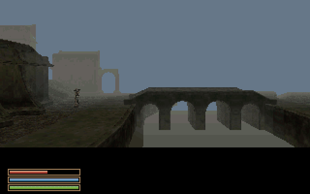 | 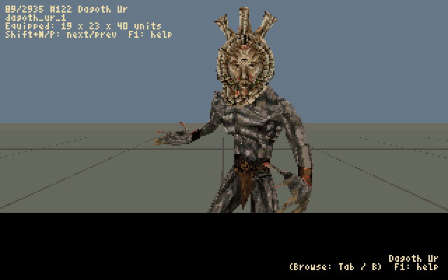 |
| **Vvardenfell world map** | **Two-page progression journal** |
| 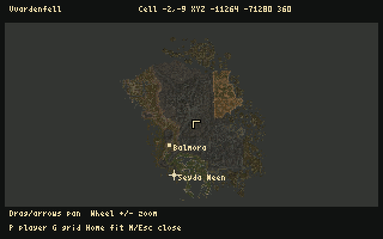 | 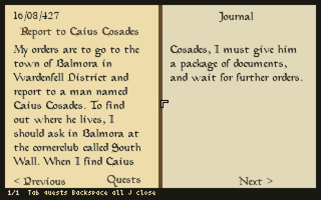 |

*Native FS-UAE captures at integer scale: map from v0.0.25-rc1, journal from
v0.0.25-dev1, town/gallery from v0.0.24. [Capture details](GAMEPLAY_MEDIA.md).*

### Finding your way around

Shift+V cycles view distance. The optional compass is off by default;
`dbg compass on` enables it. GLOBAL/LOCAL XYZ aid navigation, and Ctrl debug
flight runs at twice Shift speed. M/N console typing is protected; debug Alt+M
exposes the desktop. Bindings have their own
[keymap file and reference](KEYMAPS.md).

`dbg aw hors 0` creates the Nord / Barbarian / The Steed test character after
Census; `dbg tp balmora` travels to Balmora and supplies that character if absent.
`dbg tp vivec` (or `dbg tp vivec_arena`) does the same for the Vivec Arena preview,
outside only: its doors do not open yet. `dbg tp` opens the destination picker. `dbg map tp` and `dbg tp map` open the
world-map teleport picker. `dbg daynight off` holds the clock at 12:00 midday
(sky, light, lamps and windows as by day) until `dbg daynight on`. See
[debug controls](DEBUG_OVERLAYS.md).
The animation kit (walk and run by speed, its build switch and `dbg animkit`):
[docs/ANIMKIT.md](ANIMKIT.md).

Automatic cell changes preserve held input and gameplay state in the transition
checks; doors and explicit travel retain their own loading behavior. The default
loader replaces maps synchronously. At automatic crossings, Loading... waits
two seconds by default; startup and explicit travel remain immediate.
Experimental read-ahead does not establish seamless background
streaming. Exact crossing, collision and state checks remain on the
[target playtest checklist](CELL_CHANGING.md).

### Making room for Morrowind

The current world is a baseline for measuring and optimizing content, memory,
loading time and frame cost. Town subdivisions remain necessary; their static
heap estimates do not certify runtime safety or FPS. Future changes must retain
closed mushroom seams, original placement and UVs, collision, and continuous
terrain handoffs. See the [optimization roadmap](ROADMAP_HISTORY.md#assemble-first-then-optimize-the-measured-world).

Large outputs automatically split into simultaneously mounted HDFs, each below
4 GiB with filesystem partitions below 2 GiB. This is not disk swapping, and more
disk capacity does not add runtime memory. Generated emulator configurations
list every required disk; the paths are also recorded in the
[build output](BUILD_OUTPUT.md).

Character conversion uses a [verified persistent host cache](NPC_MODEL_CACHE.md).
The full NPC gallery remains enabled by default; reused models retain the same
Amiga format and quality. [Image recovery](IMAGE_RECOVERY.md) can reuse
compatible, validated conversion output. General stage resume is not available.

The reference target is **A1200 / AGA / PAL, 68040 + FPU + JIT, 2 MiB Chip and
16 MiB Z3 RAM**. Stock A1200 and physical-hardware performance are unproven.
Linux remains the established build foundation. Native Windows is experimental,
with intermittent worker and cancellation failures recorded in the
[Windows guide](WINDOWS_BUILD.md) and [bug journal](BUG_JOURNAL.md).

The [Docker build helper](DOCKER_BUILD.md) takes your own Morrowind
installation as private runtime input. Images contain source and tools; game
data, converted assets and ROMs stay outside image layers and public releases.
While it runs, the Toolkit's [Monitor](DOCKER_BUILD.md#watch-a-build-in-the-monitor) follows it
in a browser: `python tools/toolkit_serve.py --monitor-docker amiwind-docker-builds --open`.
The [v0.0.27 release notes](RELEASE-v0.0.27.md) record the first Docker-built
baseline's build and CI evidence. Earlier full-conversion and game-entry results remain in the dated
[Windows](VALIDATION-WINDOWS-2026-10-02.md) and
[Docker](VALIDATION-DOCKER-2026-10-02.md) records and
[v0.0.26 release notes](RELEASE-v0.0.26.md).

See [world survey](WORLD_SURVEY.md), [project state](PROJECT_STATE.md),
[font options](PAPER_FONT_OPTIONS.md) and
[conversion lessons](BALMORA_CONVERSION_LESSONS.md) for more.

*For years, they thought the Nerevarine would never appear on the Commodore Amiga...*

*Well, those n'wahs were wrong! The prophecy said nothing about the frame rate.*

### Inspect converted geometry locally

The development toolkit now includes a standalone
[Polycount Inspector](POLYCOUNT_INSPECTOR.md). Open
[the local viewer](../amiwind-toolkit/map-inspector.html) to explore polygon edges,
optional local base textures and spatial vertex-density hotspots. Isolate an
object, compare components, or inspect from above and export a private planning
polygon. The built-in synthetic scene demonstrates the tool without game assets.

Viewer counts and display filters help investigate geometry; they do not measure
Amiga memory, change the converter or establish a gameplay fix. Your converted
scenes, textures and captures remain private.

Read [Hidden in Dirt: Seyda Neen's graphics performance bottlenecks](HIDDEN_IN_DIRT.md) for measured geometry experiments and the checks behind the next town optimization.

---

<i>AmiWind is brought to you by <a href="https://github.com/FlyingFathead/">FlyingFathead</a></i>

The 14 October 2026, 22:19 UTC tracker refresh records offline checks for five
ring-0 ocean frames. Their four original leveled-creature spawns remain deferred.
Runtime placement, native seams and package inclusion are pending, so the map
colours and milestone totals are unchanged.

The 14 October 2026, 23:45 UTC refresh records the expanded Vivec conversion
as 36 original core cells and 28 apron-only dependencies. It retains 6,039
owned references, 33 external dependencies and 297 deferred references.
Global converted and packaged counts are unchanged. Native seams and the
combined candidate remain pending.

The 15 October 2026 Seyda update records the completed offline conversion:
16 original core cells, 20 apron cells, 3,724 stair walks with zero blocking
failures and 532 advisory results. The earlier stair failures remain preserved.
The four Seyda and two Vivec ring-2 overlaps now have offline conversion evidence.
The corrected source carrier passes independent resident, voice and reference
checks. Expanded CHIM integration has two
[actor contact findings](bugs/CHIM-SEYDA-ACTOR-CONTACT-33.md) that remain
after the final bounded refit. Original-height comparison identifies coarse
terrain distortion; repair and native checks remain open.
Runtime placement of the five ring-0 ocean frames, matched native seams and
complete package inclusion remain pending; dev2 has not shipped.

Update (v0.0.44, 19 October 2026): the notes above are from 14 and 15 October 2026 and describe states that have
since passed. The current state is in
[Where AmiWind stands](../README.md#where-amiwind-stands-28-october-2026) near the top.

## Development (as the front page stated it before 20 October 2026)

The next work is the rest of the island on CHIM: the open world converted cell by
cell, Vivec back on CHIM and joined to the world, NPC animations and Arena combat.
Build-time profiling and [avoiding unnecessary recompilation](BUILD_TOOLKIT_ROADMAP.md)
remain priorities alongside [the gameplay roadmap](ROADMAP.md) and the
[CHIM features](chim/FEATURES.md) page.

Update (v0.0.44, 19 October 2026): the open world is on CHIM and so is the whole city of Vivec. The next work is
in the [v0.0.45 plan](PLAN-v0.0.45.md): cell crossings, the open playtest bugs and every interior of the
base game.

[FAQ](FAQ.md) · [Gallery](GALLERY.md) · [Project state](PROJECT_STATE.md) · [Asset coverage](ASSET_COVERAGE.md) ·
[Open bug reports](BUGS.md) · [Roadmap](ROADMAP.md) ·
[Repository layout](REPOSITORY_LAYOUT.md) · [Release workflow](RELEASE_WORKFLOW.md) ·
[Changelog](CHANGELOG.md) · [Build dependencies](BUILD_DEPENDENCIES.md) ·
[Build/compiler toolkit roadmap](BUILD_TOOLKIT_ROADMAP.md) ·
[Licensing and credits](LICENSING_AND_CREDITS.md)

Thanks to the Morrowind creators, the Amiga community, and the contributors whose
work made this experiment possible. The earlier A500 track, previous methods,
fonts and hand-rendering alternatives remain available in the source and history.

Development changes must follow the [project rules](PROJECT_RULES.md), including required Linux and Windows compatibility.
