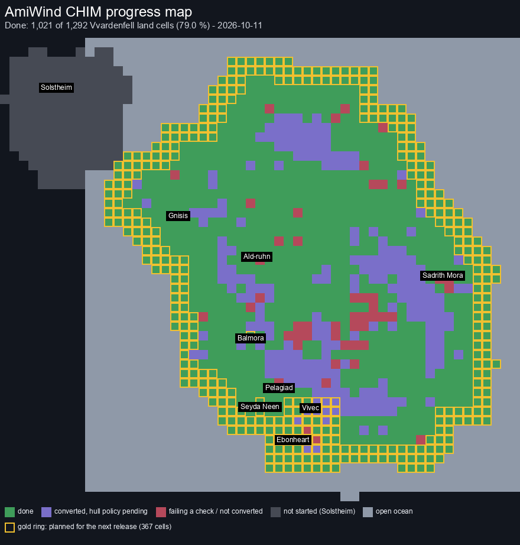

# AmiWind v0.0.36 - 36 Lessons of Vivec's Cantons (And Vvardenfell Shorelines)

## Spiraling into Vvardenfell: Coastal regions are now CHIM

Running on CHIM Engine v0.2.0 (CHIM's first minor step: new features since v0.1.0). The boot checklist says it the short way: "AmiWind v0.0.36 / CHIM v0.2.0".

v0.0.35 started CHIMport from the sea. In v0.0.36 the result is in the game: the whole coastline of
Vvardenfell now runs on CHIM. Every cell that touches the sea, and the next ring of cells inland, is built
from your own game data through the CHIM pipeline and streamed in small pieces from disk; the legacy region
maps are gone from those cells. CHIMport goes around the island like a spiral, from the sea inward, and this
is its first full turn.

And at the end of the shoreline lies Vivec. The whole city is now on CHIM: all of its cantons, the Arena and
the rooms inside them, in one CHIM area.

Previous release: [v0.0.35](RELEASE-v0.0.35.md).

## The coast on CHIM

*CHIM progress, 11 October 2026: 1,021 of 1,292 Vvardenfell land cells done; gold = planned for v0.0.36. What the colours mean: [the CHIM progress map](chim/CHIM_PROGRESS_MAP.md).*

- **The whole coastline:** every cell of the outer ring (171 of 171) and of the second ring (160 of 160) is on
  CHIM: 325 region cells, 222 land and 103 seabed, plus 6 second-ring cells that lie inside the Seyda Neen and
  Vivec city frames. The ring is closed: one connected stretch, no gaps, no legacy pockets. Land cells that the
  legacy builder had split over several maps are on CHIM too.
- **No legacy maps under CHIM land:** the builder decides first which cells are CHIM and builds only what the
  game uses; the old region maps of those cells are no longer made and thrown away.
- **Seamless borders** where the CHIM coast meets the legacy inland, measured edge by edge.
- **Terrain stored once:** CHIM land is built with the compiled terrain hull and terrain references by default: the
  chunks' collision is compiled from their pieces and repeated ground is stored once and placed by reference.
- **Where it stands:** the CHIM Progress Tracker in the Toolkit shows every cell, and now marks the cells
  planned for the next release in gold.

## Vivec on CHIM

- **The whole city:** the cantons, the Foreign Quarter, the waterfront and the Arena, with 130 of its rooms
  built through the CHIM room stage. 14 rooms are left out for now (engine model and memory limits): their
  doors say "Interior unavailable".
- **The Arena Pit** is back in the default build.
- **A bigger world:** the engine's coordinate range was widened so the whole city fits in one CHIM frame.

## Also on CHIM

- **Seyda Neen** and **Balmora** are CHIM-native: built straight from your game data, no legacy town chain.

## Everything else in v0.0.36

So far, on the development line:

- **Version lines in the console:** at start-up, on every map load and with `version`, the console shows
  "AmiWind v0.0.36 / CHIM v0.2.0", then the AmiQuake line ("AmiQuake: VERSION 1.09"), then
  'Type: "dbg help" for help.'
- **Ready-to-run emulator files:** every finished build now leaves the Python launcher, an FS-UAE
  configuration and a WinUAE configuration beside the image. Existing files you edited are kept as `.bak`;
  you fill in your own Kickstart ROM (none is included). Two short guides come with them, one for
  Windows with WinUAE and one for Linux with FS-UAE: what to install, controls, and how to report a bug.
- **All of Vivec, one map:** the whole city is now one CHIM map: the eight cantons, the Temple, the Foreign
  Quarter, the canals and the east edge of Ebonheart, with their residents and 130 of their rooms, so you walk
  from canton to canton without a load. It replaces the Arena-only Vivec of the earlier development builds
  (`vivec_city` is a default CHIM area; the single-canton frames are kept for comparisons only, see
  [Retired flags](EXPERIMENTAL_FLAGS.md#retired-flags)). Stair flights in the Temple, at Ebonheart and in three
  rooms are still blocked (known issues).
- **Wider coordinates, so all of Vivec fits one map:** the engine now sends positions with 24 bits of 1/256 units
  instead of Quake's 16-bit eighths, so a CHIM map can reach +/-32,000 units from its centre instead of about
  +/-4,000. It costs one byte per coordinate in the game's messages (measured on every map of a full build: the
  largest map start message grows from 10,080 to 10,887 bytes of 16,380). `--coord-range narrow` builds the
  earlier engine. See [Experimental flags](EXPERIMENTAL_FLAGS.md).
- **Parallelization never regresses (perf guard):** every build ends with a table of its stage sections (units,
  cores used against the cores it could use, time, the baseline from earlier runs of the same work, verdict, and
  a totals row). A section that ran in parallel before and now runs serial, or takes longer for the same work, or
  runs over a minute on a fraction of the cores, fails the build; known cases are waived by bug ID for a few days,
  visibly. See [Perf guard](BUILD_PROFILE.md#perf-guard).
- **No oversubscribed machine:** builds started together share the machine's threads and memory by priority
  (release builds first, then development, then optional ones) instead of each taking every core; a build that
  does not fit waits its turn, and a build that ends hands its cores to the ones still running. See [Core leases](AW.md#core-leases).
- **Every build cache says where its entries came from:** each stored result records when it was made, by
  which build, from which version and commit, and the hash of its output; reuse and its counts are logged.
  Nothing is rebuilt for it. See [Cache provenance](BUILD_PROFILE.md#cache-provenance).
- **Third person, the vanity camera and a real death scene:** Tab switches between first and third person as in
  the original (held, the mouse turns the camera around you); the wheel zooms the third-person camera; after 30
  seconds without input (the game's own setting) the camera slowly circles your character, full screen with the
  interface hidden as in the original, until you touch a key or the mouse (`aw_vanity_fullview 0` keeps the
  interface). When you die, nothing
  can be talked to or used any more, the camera moves out, your character falls, the death music plays and the
  original question follows: load the most recent save, or the main menu. New in AmiWind: after a lost fight a
  **Retry fight** button puts everyone back where the fight began (`--death-retry off` leaves it out). Your
  character's body is a stand-in for now: your race and sex in the new-game clothes, with walk, run and death
  animations. See [Third person](THIRD_PERSON.md); console `dbg camera` and `dbg vanitycamera` (auto / off / on).
- **Block with the right mouse button:** hold the right mouse button to raise your shield (the new Block
  action; Options > Controls > Blocking: Hold to block, the default, or Automatic, the original game's rule).
  The original has no block button, so this is an AmiWind addition, but each blow is still decided by the
  original formula from your Block skill, Agility, Luck and fatigue. While you guard you cannot swing. In third
  person your character raises the shield (the original block animation); first person shows "Guard" under the
  crosshair and kicks the view on a block. NPCs with a shield and a one-handed weapon block by the original rule,
  with their block animation and the shield's sound. Your new character has no shield yet: the arena loadouts
  with a shield can block. See [Combat](COMBAT.md#blocking); console `dbg combat block hold|auto`.
- **No silent build steps:** every long builder phase prints when it starts and when it ends, with its time and
  cores (`CHIM stair gate: passed (...) - took TIME, N cores`), and the builder prints a heartbeat line for any
  stage that has been silent for 30 seconds, naming its current phase and progress. `--quiet` drops only per-unit
  progress lines. The CHIM statistics no longer validate the whole world a second time at the end of the chim stage.
  See [Phases and the heartbeat](BUILD_PROFILE.md#phases-and-the-heartbeat).
- **Build Timeline:** `python tools/build.py profile timeline RUN [RUN ...] --png OUT.png` draws one picture of
  where a build's wall time went: every stage of one or more runs (reused, failed and still-running stages marked),
  gates and other timed jobs, and the CPU cores in use stacked by job. It reads only the files every build writes
  and works while a build runs. See [Build Timeline](BUILD_PROFILE.md#build-timeline).
- **Perf database:** `python tools/perf_db.py` keeps every build's and gate's numbers (stage times and cores, CHIM
  heap per frame, stair walks, sizes, test counts, CPU samples) in one SQLite database whose rows are never changed,
  each source file recorded with its SHA-256, so one command compares a number across every run, even runs whose
  folders were deleted; the database can be rebuilt from the files it read. See [Perf database](PERF_DATABASE.md).
- **Seyda Neen CHIM-native:** Seyda Neen, its intro docks and the Census courtyard now come straight from
  your game data on CHIM, like Balmora and the Vivec Arena: the builder no longer makes 65 old-style Seyda Neen
  region maps only to throw them away before packing, so builds are faster; the town and its opening scenes are
  unchanged (same people, plants and objects). A MiniWind sandbox of Seyda Neen is new (`--miniwind-seyda-chim`).
  See [World map manifest](BUILD_MANIFEST.md#step-3-seyda-neen-chim-native-done-v0036-dev5).
- **CHIM-native areas by default:** every CHIM area in a build (Balmora and, since dev5, Seyda Neen)
  is now prepared through the CHIM pipeline from your game data, with no legacy town chain
  (`--chim-native-towns on` is the default). The old legacy-chain options `--legacy-area` and
  `--chim-native-towns off`, and `--seyda-recorded` (the recorded v0.0.31 Seyda Neen maps), are retired: a development build refuses them unless they are named with
  `--override`, and every use is printed and recorded in the build receipts. See
  [Retired flags](EXPERIMENTAL_FLAGS.md#retired-flags). The open world outside the CHIM areas is still legacy.
- **The Vivec Arena Pit is back:** a CHIM town's own rooms (the Arena Pit today) are built again, in their own
  build step with the doors into and out of them linked; v0.0.35 had the Pit, the first CHIM-native Arena builds did
  not. The `vivec-arena-pit` MiniWind preset starts inside it.
- **A test build of one area starts you in that area:** a MiniWind build whose start lies in a town builds that town
  (the Vivec Arena preset needs no extra option), a start outside what the build holds is refused before anything is
  built, and the image checks the start map and spot before it is packed. See
  [Start straight in the game](chim/build_guide/DIRECT_START.md#the-player-starts-in-what-the-build-holds).
- **Build recipes:** a build's options can be kept in one small file (`--recipe FILE`): the options by name,
  the input files by SHA-256 and the build that checked it; `--save-recipe FILE` writes the recipe of any build,
  a newer builder lists every option that changed since, and the MiniWind presets are now such recipes. See
  [Build recipes](BUILD_RECIPES.md).
- **A stuck disk read no longer freezes the game:** the music is now read in the background. If the disk does not
  answer a music read, the music goes quiet (the console says so once) and the game keeps running; the music comes
  back when the disk answers, or moves on to the next track (HANG-IDLE-DUSK-35, game side).

- **Lava on the world map:** the map (M) now shows the molten lava pools of Molag Amur, Sheogorad and Red
  Mountain in both map views, with a "LAVA" legend; `dbg map lava 0` hides them. Only the lava you can see is
  drawn: a pool the land covers (the ground is higher than its surface) is left off the map, so the map no longer
  shows lava where you stand on grass (WORLDMAP-LAVA-MISMATCH-36). The pools come from your own
  game data at build time (the new v2 map file; `--world-map v1` keeps the earlier map). See
  [World map](WORLD_MAP_AND_JOURNAL.md#map-file-formats-v1-and-v2-lava-pools).
- **CHIM frame maps are `.chim` files:** the small map the engine loads for a CHIM area (`maps/<town>-chim.chim`,
  and `maps/vfNNNN.chim` for a cell on CHIM inside the legacy open world) is CHIM's own map format, a modified
  BSP that cannot be played without its CHIM world, so it now has its own extension. The engine finds maps through one lookup and stops
  with a clear message instead of loading an empty map when a frame map has no CHIM world to go with it.
  `--chim-frame-ext bsp` keeps the earlier `.bsp` names (the old method). See
  [WORLD_FORMAT.md](chim/WORLD_FORMAT.md#frame-maps-are-chim-files).
- **`dbg music on|off`**: background music on or off (default on, not saved); no argument shows the status. Off
  closes the music stream at once and reads nothing until it is on again ([AUDIO.md](AUDIO.md)).
- **`dbg godmode`** (alias `dbg god`): Quake god mode with the usual `on`/`off`, `true`/`false`, `1`/`0`; no argument
  toggles. It drives Quake's own `god` state (the HUD GOD indicator), prints the new state and is not saved.
- **Border audit for CHIM areas inside the legacy world** (`tools/chim/stitch.py audit`): measures every edge
  of a CHIM area against the legacy land around it (ground height, far terrain, standing height at the
  handover, contents, objects crossing the edge) and writes a report per border cell. See
  [STITCH_AUDIT.md](chim/STITCH_AUDIT.md).
- **Seamless borders between CHIM and legacy land:** CHIM ground now uses the same shoreline detail as the legacy
  maps (`--chim-terrain-shoreline on`, the default), and a CHIM area inside the legacy world carries a terrain-only
  margin past its handover line, so there is ground all the way to the fog. Measured on the Bitter Coast test area:
  no height step and no gap on any edge.
- **Faster rebuilds:** five causes of needless rebuilds fixed (stage keys that counted unused code, records lost
  when an older run was retired, absolute paths and a timestamp in stage outputs, a diagnostics file read as an
  undeclared input). A rebuild after a small code change now reuses nearly every stage.
- **NPC grounding, island-wide:** every NPC placed in the open world is classified by measuring where it stands
  (`tools/actor_grounding_census.py`); the build stops in its preflight, in seconds, if a CHIM area holds an
  NPC that is not classified.
- **CHIMport:** `--retry-failed` now also reruns cells that converted but failed an audit or waited on the
  collision hull rule; the door check leaves out marker doors (such as the jail destination marker).
- **The open sea on CHIM:** every map cell without terrain data (no LAND record: the sea around the island
  and a margin ring for the horizon, 867 cells) is now a reference to one shared ocean chunk, water over the
  flat seabed at the original's default depth, stored once (10.5 KB). The CHIM Progress Tracker shows these
  cells as "open sea" and counts them as done; the land figures stay beside the map figures. The engine
  places the chunk once the open-world frames read it. See
  [CHIMPORT.md](chim/CHIMPORT.md#open-sea-one-shared-ocean-chunk).
- **World bounds: the sea turns you back at the edge of the world** (an AmiWind extension, on by default):
  the original's sea goes on, AmiWind's world used to end in an invisible wall. Now the water near the edge
  carries a current along it, so swimming out you are turned aside and carried along the coast and slowly
  back in; out of the water, outward motion fades before the edge. `dbg worldbounds on/off` switches it while
  playing; the builder's `--world-bounds off` leaves the game as before. See [World bounds](WORLD_BOUNDS.md).
- **CHIM cells inside the open world** (experimental, off by default: `--chim-regions seabed|coast|sea-ring|`
  a region name or a cell file): finished CHIMport cells replace their legacy open-world maps one cell at a
  time, under the same map names, so the engine changes maps between them exactly as before. Denser cells,
  which the legacy world splits into 2 x 2 or 4 x 4 maps, can now go on CHIM too: each is one CHIM cell, so
  more than twice as many finished cells can join (661 instead of 270 with today's tracker). `--chim-regions coast2` takes the whole coastline: all of
  the cells touching the sea and every finished cell of the ring behind them. See
  [CHIM regions](chim/CHIM_REGIONS.md).
- **Builder command line `aw`** ([AW.md](AW.md)): gate numbers and run names handed out from one register,
  the entry check, and gate results read from the actual test counts (a gate with failures always reports
  failed).
- **Builds by request (`aw submit` / `aw request`):** a build is asked for with a small JSON form (kind, commit,
  purpose, reason, build options, input files with their SHA-256) and answered with a JSON result (passed,
  failed or refused, stages reused and rebuilt, failed stage, logs, timings). The build server checks before
  anything slow runs: the commit's version and builder head, retired options, the input file hashes and the
  builder's own reuse preflight; it then builds that exact commit in developer mode through the shared storage
  pool and names the run. See [AW.md](AW.md#build-requests).
- **Builder broadcast (`aw announce` / `inbox` / `reply` / `publish`):** a builder error found by one worker
  becomes a call for fixes to every worker (with an optional build hold); a gated builder head is published to
  every worker with what it contains, and a worker's gates and builds on an older base are refused until it
  merged the new head or replied why and when. See [AW.md](AW.md#broadcast).
- **Shared terrain stored once in CHIM cells** (experimental, off by default: `--chim-terrain-hull compiled
  --chim-terrain-refs on`, world format 0.7): each piece of terrain a CHIM cell needs is built once and referenced
  by every cell that shows it, and the standing hull is compiled the way Seyda Neen's already is. Engines before
  this format refuse 0.7 worlds with a clear message; the default world format stays 0.5 byte for byte. Every
  compiled hull is checked against its ground and falls back to the routed hull where it would leave a gap. See
  [WORLD_FORMAT.md](chim/WORLD_FORMAT.md).
- **Physics review** ([PHYSICS.md](PHYSICS.md)): how AmiWind uses Quake's physics, area by area; movement uses
  the engine's own physics loop, placed-model collision does not yet use compiled hulls, and gravity was never
  scaled to Morrowind (PHYSICS-GRAVITY-SCALE-36). The next steps are on the page.
- **AmiWind Toolkit 0.1.1:**
  - the CHIM Progress Tracker follows CHIMport and builds live by default when the Toolkit is served;
  - cells with nothing placed in the original read "0 / 0 (terrain only)" instead of a bare "0 / 0";
  - coastal land cells that hold only terrain and sea are counted with their island again;
  - the release check keeps the Toolkit's version and its "Last updated with" line current;
  - the 3D Map Inspector opens CHIM maps (`.chim`: the entities and the CHIM frame they belong to) and
    CHIM worlds (a build's `chim-world` folder: a frame's ground and objects, with the memory each player
    position needs against the CHIM zone, the worst positions marked), next to Quake `.bsp` maps
    ([details](POLYCOUNT_INSPECTOR.md#chim-maps-and-chim-worlds));
  - the **Monitor** tab follows a build as it runs, read-only: live log of the running stage, stage progress, ETA,
    cores in use, the Build Timeline and recent builds and gates (`tools/toolkit_serve.py --builds DIR`;
    [Monitor](AMIWIND_TOOLKIT.md#monitor)).
- **CHIM file format overview** ([CHIM_FILE_FORMAT.md](CHIM_FILE_FORMAT.md)): what CHIM stores and why, the file
  types (`.bsp`, `.chim`, the CHIM world), the format versions so far and the roadmap of the format.
- **Test area** `bcoast_x7y2` (a 3 x 3 Bitter Coast block, experimental, not built by default): the first
  CHIMport cells built into the game, for inspecting the CHIM/legacy border.

## More from less

CHIM stores every model, texture and terrain piece once and places it by reference, where the legacy
region maps store each object about 9.8 times across their overlapping maps
([IMAGE_SIZE.md](IMAGE_SIZE.md)). Measured so far on this line:

- The open sea around the island and a margin ring for the horizon, 867 map cells, is one shared ocean
  chunk of 10,528 bytes plus a reference of about 390 bytes per cell. The legacy world never stored
  these cells at all (the water past the coast came only from the overlap of the coastal maps), so this
  is new coverage, not a size cut.
- The seabed where it meets the open sea joins it without a step: the shared floor sits at the
  original's default depth, the same height as the deepest seabed.

- CHIM cells inside the open world, with shared terrain stored once (`--chim-terrain-refs on`): 0.91 and 0.93
  times the bytes of the legacy maps they replace, measured on two test sets (7 coast and seabed cells: 1.91 MB
  against 2.11 MB; 6 coastal land cells: 2.59 MB against 2.77 MB). With every cell carrying its own copy of the
  terrain around it they took about 3.5 times.

The size comparison of the whole converted coast (legacy maps out, CHIM in, bytes on disk) comes with the
v0.0.36-dev3 playtest build.

## Fixed since v0.0.35

- The v0.0.36-dev3 playtest crashed or froze a few seconds after any map load: the asynchronous music reads
  corrupted memory (a DOS packet used at the wrong address), and the engine refused CHIM worlds with more than 4096
  files (the coast world has 7,236). Both fixed; the engine and the world writer now share one limit
  ([CHIM-DEV3-MAPLOAD-CRASH-36](bugs/CHIM-DEV3-MAPLOAD-CRASH-36.md),
  [CHIM-WORLD-INDEX-FILE-LIMIT-36](bugs/CHIM-WORLD-INDEX-FILE-LIMIT-36.md)).
Repaired on this line, each with a regression test (details on the linked pages):

- Third person: switching to third person (Tab) during a fight, or the idle camera, no longer makes the NPC you
  are fighting, and every other character and moving object, disappear; the engine's entity list skipped them
  and could overwrite other memory while the third-person body was drawn
  ([CAMERA-THIRDPERSON-COMBAT-NPC-HIDDEN-36](bugs/CAMERA-THIRDPERSON-COMBAT-NPC-HIDDEN-36.md)). A quick tap of
  Tab that ended between two frames no longer gets lost ([CAMERA-POV-TAP-LOST-36](bugs/CAMERA-POV-TAP-LOST-36.md)).
- The game screen stays put: a click with the Amiga key held, or left latched by a crashed program, no longer
  drags the game down to show the AmigaDOS screen behind it
  ([UI-MAP-CLICK-DRAGS-SCREEN-36](bugs/UI-MAP-CLICK-DRAGS-SCREEN-36.md)).

- Stairs: every flight of stairs in Vivec climbs again. The Velothi stair pieces in 130 rooms no longer stop you
  where one piece meets the next (the 50-degree lip at the foot of each piece is now a plain step), Ebonheart's
  bridges lead through their arches again (the arch walls were solid across the opening), and the palace steps and
  the High Fane quarters' flights are walkable where the original lets you walk
  ([STAIRS-VIVEC-ROOMS-JOINT-36](bugs/STAIRS-VIVEC-ROOMS-JOINT-36.md),
  [STAIRS-EBONHEART-CHIM-36](bugs/STAIRS-EBONHEART-CHIM-36.md), [VIVEC-TEMPLE-STAIRS-33](bugs/VIVEC-TEMPLE-STAIRS-33.md)).
- Builder: the image step's stair walk uses every core: each map's steps are split into small units handed out
  largest first, so one heavy room no longer keeps one core busy for a quarter of an hour; the walk's rows are the
  same, byte for byte ([BUILD-IMAGE-STAIR-WALK-SERIAL-36](bugs/BUILD-IMAGE-STAIR-WALK-SERIAL-36.md)).

- Builder: the CHIM checks that take seconds (the memory fit of every ring) run before the stair walk, and the
  stair walk of an unchanged CHIM frame is reused instead of walked again on every build (only results that a
  passed build of the master builder checked, each named with the run it comes from)
  ([BUILD-CHIM-HEAP-GATE-LATE-36](bugs/BUILD-CHIM-HEAP-GATE-LATE-36.md),
  [BUILD-CHIM-STAIR-WALK-UNCACHED-36](bugs/BUILD-CHIM-STAIR-WALK-UNCACHED-36.md)); compiled collision of CHIM
  terrain and of the exact-collision houses, bridges and ruins is checked against its pieces and patched where
  the compiler lost one: no more sinking into 11 Hlaalu houses and Dwemer ruins in Balmora and on the Bitter Coast
  ([CHIM-COMPILED-HULL-SHORT-36](bugs/CHIM-COMPILED-HULL-SHORT-36.md)); CHIM region frames are prepared side by
  side ([BUILD-CHIM-STAGE-IDLE-START-36](bugs/BUILD-CHIM-STAGE-IDLE-START-36.md)).

- Builder: a CHIM-native town no longer needs any file of the legacy town chain in the image step
  ([BUILD-IMAGE-CHIM-NATIVE-TOWN-36](bugs/BUILD-IMAGE-CHIM-NATIVE-TOWN-36.md),
  [BUILD-IMAGE-NATIVE-BALMORA-CACHE-36](bugs/BUILD-IMAGE-NATIVE-BALMORA-CACHE-36.md),
  [BUILD-HARVEST-NATIVE-TOWN-ORDER-36](bugs/BUILD-HARVEST-NATIVE-TOWN-ORDER-36.md)), and CHIM towns are built
  CHIM-native by default ([BUILD-LEGACY-CHAIN-DEFAULT-36](bugs/BUILD-LEGACY-CHAIN-DEFAULT-36.md)).
- Builder: a CHIM area outside the shipped towns no longer stops at its town stage on NPC grounding
  ([CHIM-ACTOR-GROUNDING-POLICY-36](bugs/CHIM-ACTOR-GROUNDING-POLICY-36.md)).
- Builder: needless rebuilds after small changes
  ([BUILD-REUSE-CASCADE-36](bugs/BUILD-REUSE-CASCADE-36.md) and the five causes it links:
  [BUILD-KEY-FUNCTION-DEFAULTS-TOP-36](bugs/BUILD-KEY-FUNCTION-DEFAULTS-TOP-36.md),
  [BUILD-REUSE-RECORD-RETIRED-36](bugs/BUILD-REUSE-RECORD-RETIRED-36.md),
  [BUILD-DIAGNOSTIC-INPUT-REFUSED-36](bugs/BUILD-DIAGNOSTIC-INPUT-REFUSED-36.md),
  [BUILD-SEYDA-BOUNDED-RUN-PATHS-36](bugs/BUILD-SEYDA-BOUNDED-RUN-PATHS-36.md),
  [BUILD-FLORA-RECEIPT-SECONDS-36](bugs/BUILD-FLORA-RECEIPT-SECONDS-36.md)); the v0.0.36-dev2 build resumed with
  34 of 36 stages reused.
- Builder: a stage reused from a run that had itself reused it came back without the files a later stage had
  replaced there, so that later stage failed when it ran again; the reuse plan now checks the stage's full record by
  SHA-256 and runs it again in that case ([BUILD-REUSE-REDUCED-RECORD-36](bugs/BUILD-REUSE-REDUCED-RECORD-36.md)).
- CHIM: the compiled terrain collision hull could sit up to a few units below the ground in some shoreline cells; each
  compiled hull is now checked against the ground it was built from and falls back to the routed hull where it is short
  ([CHIM-COMPILED-HULL-SHORT-36](bugs/CHIM-COMPILED-HULL-SHORT-36.md)). The ground and seam checks now run on each
  frame as soon as it is built and name the failing frame, so a fault stops the CHIM stage within seconds instead of
  after the whole stage ([BUILD-CHIM-VALIDATE-LATE-36](bugs/BUILD-CHIM-VALIDATE-LATE-36.md)).
- Tests: the `dbg godmode` test was missing from the release file list, so the checks never ran it
  ([TEST-GODMODE-UNLISTED-36](bugs/TEST-GODMODE-UNLISTED-36.md)).
- CHIM borders: height steps at the CHIM/legacy edge and a gap in the far terrain band
  ([CHIM-STITCH-SHORELINE-36](bugs/CHIM-STITCH-SHORELINE-36.md),
  [CHIM-FAR-BAND-GAP-36](bugs/CHIM-FAR-BAND-GAP-36.md)).
- CHIMport and tracker: retries of cells that failed an audit
  ([CHIMPORT-RETRY-AUDIT-FAILED-36](bugs/CHIMPORT-RETRY-AUDIT-FAILED-36.md)), marker doors counted as missing
  doors ([CHIMPORT-DOOR-MARKER-AUDIT-36](bugs/CHIMPORT-DOOR-MARKER-AUDIT-36.md)), coastal cells left out of their
  island's count ([TRACKER-SEA-CELL-SET-36](bugs/TRACKER-SEA-CELL-SET-36.md)).

Cause found, game side repaired, check in a soak run still to do:

- The idle freeze with looping music ([HANG-IDLE-DUSK-35](bugs/HANG-IDLE-DUSK-35.md)): the game waited forever for a
  music stream read that never returned; the same freeze as during Seyda Neen loads in v0.0.30
  ([SEYDA-LOAD-HANG-30](bugs/SEYDA-LOAD-HANG-30.md)). The music now reads in the background, so a lost read only
  silences the music. Other disk reads during play that can still wait are listed in
  [ENGINE-SYNC-IO-MAIN-LOOP-36](bugs/ENGINE-SYNC-IO-MAIN-LOOP-36.md).

## Known in this build

Next, v0.0.37 moves every finished (green) cell on the CHIM progress map onto CHIM ([roadmap](ROADMAP.md)).

- [CHIM-HANDOFF-POPIN-36](bugs/CHIM-HANDOFF-POPIN-36.md): buildings in a CHIM area appear when the player crosses into it; seen from the legacy land the area shows its ground and rocks.

- [CHIM-NATIVE-HARVEST-MISSING-36](bugs/CHIM-NATIVE-HARVEST-MISSING-36.md): harvestable plants in CHIM areas beyond Seyda Neen and Balmora have no harvest catalogue yet.

- [CHIMPORT-RETRY-LAVA-STALE-SOURCE-36](bugs/CHIMPORT-RETRY-LAVA-STALE-SOURCE-36.md): 21 inland lava cells no longer convert (their source stages are older than the lava work); first item of v0.0.37.

- [COLLISION-ROUTE-NO-SPLIT-36](bugs/COLLISION-ROUTE-NO-SPLIT-36.md): some thin underwater plants (kelp, kreshweed) keep a collision chain that cannot be split; the kelp of cell -9,-4 is kept that way by owner decision.

- [ANIMKIT-COVERAGE-35](bugs/ANIMKIT-COVERAGE-35.md): many NPCs that move or fight have no walk, run or attack animation (carried over from v0.0.35).

- [NPC-WANDER-NOT-EXECUTED-35](bugs/NPC-WANDER-NOT-EXECUTED-35.md): residents stand still instead of following their original wander behaviour.

- [PLAYER-DEATH-LIMBO-35](bugs/PLAYER-DEATH-LIMBO-35.md): after the player dies there is no way out, and NPCs still talk.

- [COMBAT-MUSIC-AIR-SWING-35](bugs/COMBAT-MUSIC-AIR-SWING-35.md): swinging at the air can start the combat music.

- [HANG-IDLE-DUSK-35](bugs/HANG-IDLE-DUSK-35.md) and [ENGINE-SYNC-IO-MAIN-LOOP-36](bugs/ENGINE-SYNC-IO-MAIN-LOOP-36.md): the music read that froze the game when idle outdoors no longer waits; other disk reads during play still wait.

- [BUILD-LEGACY-CHAIN-DEFAULT-36](bugs/BUILD-LEGACY-CHAIN-DEFAULT-36.md): the v0.0.36-dev1 playtest images prepared Balmora's CHIM frame through the legacy chain; later builds use the CHIM-native path.

- [BUILD-REUSE-PLAN-ENV-36](bugs/BUILD-REUSE-PLAN-ENV-36.md): the standalone reuse plan can report environment changes the build does not have; the build's own preflight is correct.

The open sea beyond the coast rings is not placed in the game yet: CHIMport has converted it (one shared ocean chunk), but the engine does not read it in this build; the water past the coast rings comes from the coastal maps, as before.

See the [bug register](BUGS.md).
