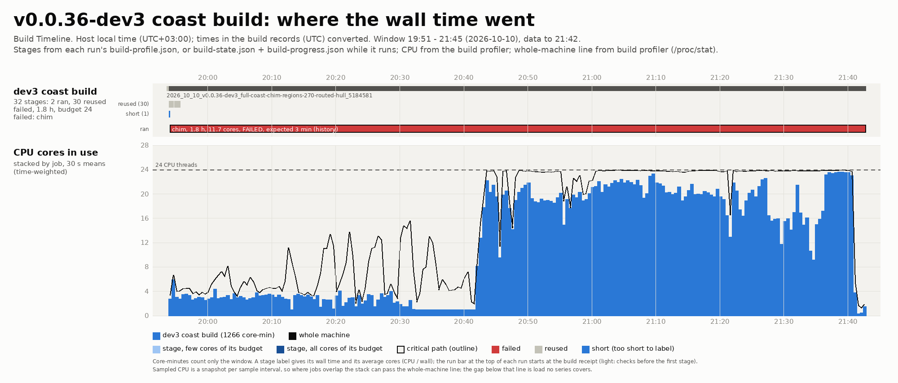

# BUILD-CHIM-STAIR-WALK-UNCACHED-36: CHIM frames are stair-walked again on every build: about 69 minutes for 270 frames

<!-- BEGIN GENERATED PERSISTING: edit the reports list in docs/bugs/bugs.json (bug_register.py report), then run tools/bug_register.py render -->

## PERSISTING: reported 4 times; something has to be done

- Reported with v0.0.36-dev4 at 2026-10-11 06:52 +0300: dev4 full (d050b6f): 0 of 274 frames reused, 274 walked (3 min 57 s, 11.2 cores)
- Reported with v0.0.36-dev5 at 2026-10-11 09:48 +0300: coast divided-cells test (1eb3172): 15 of 275 reused, 260 walked (5 min 50 s, 6.5 cores)
- Reported with v0.0.36-dev5 at 2026-10-11 11:17 +0300: coast2 whole coastline (eaef12e): 0 of 330 reused, 330 walked (13 min 18 s, 3.6 of 24 cores)
- Reported with v0.0.41-dev5 at 2026-10-16 13:17 +0300: 0 of 726 frame walks reused: 604 walker code changed, 122 new frames

<!-- END GENERATED PERSISTING -->

<!-- BEGIN GENERATED FACTS: edit docs/bugs/bugs.json, then run tools/bug_register.py render -->

| Fact | Value |
| --- | --- |
| Reported by | developer |
| First noticed | 10 October 2026, in v0.0.36-dev3 |
| Where | tools/chim/collision.py stair_gate: no reuse of unchanged frames |
| Reproduction | always |
| Duplicate of | no |
| Persists in | fixed in v0.0.36-dev5 |
| Severity | high: About 69 of the 108 minutes of the dev3 chim stage, mostly on 2 of 24 cores, redone on every build |
| Family | CHIM world streamer (`chim-streamer`) |
| CHIM | Builder ([CHIM Engine tracker](CHIM_TRACKER.md)) |
| Playtest version | v0.0.36-dev3 |
| From commit | source 5184581, engine 5184581, CHIM world 5184581 |
| CHIM engine version | CHIM 0.1.0, engine 5184581, world format 0.7 |

<!-- END GENERATED FACTS -->

_Last updated with AmiWind v0.0.44-dev1 (19 October 2026)._

<!-- contents start -->
## Contents

- [PERSISTING: reported 4 times; something has to be done](#persisting-reported-4-times-something-has-to-be-done)
- [Status: 11 October 2026 (persisting)](#status-11-october-2026-persisting)
- [Status: 10 October 2026](#status-10-october-2026)
- [Symptom](#symptom)
- [Evidence](#evidence)
- [Where](#where)
- [How it happened](#how-it-happened)
- [Why it was not caught](#why-it-was-not-caught)
- [Reproduction](#reproduction)
- [Repair](#repair)
- [Verification](#verification)
- [Prevention](#prevention)
- [Bugs in the same category](#bugs-in-the-same-category)

<!-- contents end -->

## Status: 11 October 2026 (persisting)

PERSISTING, FIX IMMEDIATELY. The first repair (records by content, check marks) held between dev4 and dev5
(272 of 274 frames reused), then failed again: the dev5 divided-cells test walked 260 of 275 frames, and the coast2
whole-coastline build (eaef12e) walked all 330 frames in 13 min 18 s on 3.6 of 24 cores. Two causes, both a key
wider than what the walk reads, measured on the runs' own outputs:

- The walker part of the key was the whole import closure of tools/chim/collision.py, which imported the
  known-findings table (config/known-stair-findings.json) at module level for a re-export. Between 1eb3172 and
  eaef12e that table was the only file of the closure that changed (a tracker entry, STAIRS-VIVEC-ROOMS-JOINT-36),
  and every frame was keyed again.
- The frame part hashed whole chunk and model images and whole placement records. Of the 237 frames the dev5 and
  coast2 worlds share, 220 differed only in the textures lump (the world's texture table entries), the world's
  model numbers and placement ids, which change in every frame when frames are added anywhere; their collision
  lumps were byte-identical.

The scheduling also wasted the machine: one task per 1024-unit core (about 21,000 for 330 frames), largest first
across all frames, so a worker read a different frame for nearly every task; most cores have no step at all.

Repair (v0.0.36-chim-stair-gate): key form chim-stair-key-2 holds exactly what the walk reads (the frame grid, the
walk lumps of each chunk's terrain, each owned placement's reference, origin, yaw, box and its model's walk lumps
by content); the walker key is the frame worker stair_task and what it reaches (the known-findings table is
imported where it is used); every walked frame names the input that changed (walk_reason, a per-frame note of the
last stored walk in the pool); the walk runs as units of one frame's cores with steps, sized by the counted steps,
largest first, on the full worker count; cores without steps are skipped. Rows byte for byte as before
(tests/test_chim_stair_key.py). Measured on the coast2 frames: see Verification.

## Status: 10 October 2026

Open; repaired in source. Found in the v0.0.36-dev3 run 2026_10_10_v0.0.36-dev3_full-coast-chim-regions-270-routed-hull_5184581.

## Symptom

The CHIM stair gate walked every flight of every frame again on every build, unchanged frames included: about 69
minutes for the towns and 270 CHIM region frames. Most of that time only 2 of the 24 cores were busy, because a few
large cores of the towns finished last.

## Evidence

Build Timeline (`tools/build.py profile timeline`) of the run, from its own build records. Related:
[BUILD-CHIM-STAGE-IDLE-START-36](BUILD-CHIM-STAGE-IDLE-START-36.md).

## Where

`tools/chim/collision.py` `stair_gate`: every core of every frame is walked; no result is reused.

## How it happened

The v0.0.33 stair-walk speed-up ([BUILD-STAIR-WALK-SLOW-33](BUILD-STAIR-WALK-SLOW-33.md): the per-map pass cache and the
flight-only walk, 29 minutes down to about 2 on legacy maps) was built for the legacy maps in `tools/stair_walk.py`.
The CHIM frames were only Balmora and Seyda Neen then, and their gate (`chim.collision.stair_gate`) was never hooked
into that cache. Confirmed in the source: `stair_gate` has no cache lookup, and the CHIM stage reports no reuse.

## Why it was not caught

With two town frames the CHIM walk took minutes. Nothing reports how much of the walk was reused.

## Reproduction

Always: build the same CHIM world twice; the second build walks every frame again.

## Repair

One mechanism for legacy maps and CHIM frames: the legacy maps' stair-walk pass cache (`tools/pass_cache.py`,
`tools/stair_walk.py`).

- A CHIM frame's walk is kept under the SHA-256 of what it reads (`chim.collision.frame_stair_key`): the frame's
  place and size, every chunk's terrain as placed, its placement records and the image of every placed model.
  The pass cache adds the walk's own code and the stair rule to the key.
- An unchanged frame is not walked again. On every build a seeded sample of the reused maps and frames (two by
  default) is walked again and compared with the stored rows; a difference stops the build, because the key
  missed an input.
- Builder switches for both paths: `--stair-walk-cache cached|full` (default cached; full is for regression and
  beta-test runs, such as the from-scratch reference build) and `--stair-walk-sample N` (0 only for development
  builds). The scope switch `--stair-walk all|flights` still decides what is walked; with the cache, `all` never
  means walking an unchanged frame again.
- Every stored walk is a record (`tools/stair_records.py`): key, rows, counts by result, walker code version,
  AmiWind version, source commit, run name, master builder request, host time and the record's own SHA-256. It is
  a candidate until its run passes every gate as a build of the master builder, which then marks it as checked;
  only checked records are reused, by legacy maps and CHIM frames alike. A record of a failed, dry or local run, a
  damaged one or one written again since its check is walked again. The log and the stair report name each map and
  frame as walked or "reused from RUN (VERSION, COMMIT, TIME)"; the master builder's result counts them.
- The rows stay where the cache kept them before, bound to the record by their SHA-256, so a build of an earlier
  commit sharing the cache still reads them. A one-time migration, `stair_records.py adopt --from-run RUN --request
  ID --aw-result RESULT --old-source TREE`, turns the walks a passed master build stored before the records into
  checked records without walking them again. It recomputes every frame's and map's input key with the current code
  from the run's own outputs and looks the old entry up under the old walker's exact key, computed from the run's
  source tree. It walks a seeded sample again and adopts nothing if any row differs, and refuses a run whose master
  builder result is not a passed build of that request. `--dry-run` only reports what would be adopted.
- The walk's tasks go to the worker pool largest first (placements in the core), so a few large town cores no
  longer finish last on two workers. Every frame prints one line when its walk finishes. The CHIM receipt and the
  stair report record the mode and how many frames were reused, walked and walked again.

## Verification

`tests/test_chim_stair_cache.py`: only records of a passed master build are reused (a candidate is walked again),
a changed frame is walked, a damaged record is not reused, a checked record holding other rows is caught by the
sample, `full` walks everything; `tests/test_stair_records.py`: the record's provenance and SHA-256, the check mark,
a record written again after its check, rows changed under an intact record, a damaged mark, marks from the reuse source's cache, legacy and CHIM
reports; `tests/test_pass_cache.py`: the legacy report is identical cold, warm (after the cold run is checked) and
without the cache, and the sample walks a reused map again; `AdoptEarlierFormTests` in `tests/test_chim_stair_cache.py` and the adopt test in `tests/test_pass_cache.py`: a passed
run's earlier-form walks are adopted and reused without walking, a failed or other request adopts nothing, rows the
current walker does not give adopt nothing, a frame whose inputs changed is not adopted; `tests/test_aw_service.py`: only a passed build's
records are marked, and the result carries the counts.

11 October 2026, key form chim-stair-key-2 and walk units: `tests/test_chim_stair_key.py` (inputs the walk does not
read do not rekey: textures, entities, visibility, lighting and marksurfaces lumps, model numbering, placement ids,
reach records; every input it reads does: each walk lump of a chunk and of a placed model, the frame grid, path and
tile, a placement's reference, origin, yaw and box, another model placed; the walker key is the frame worker without
the known-findings table; units skip empty cores, largest first, rows in core order; the stored rows equal the
per-core walk byte for byte; a warm run walks nothing and writes the same report). Measured on the coast2 build's
330 frames (read-only, cache on a tmpfs, 24 workers, BUSY host: the coast2 and ocean builds and three gates ran at
about 23 cores):

| Run | Frames | Walked | Reused | Sample | Units | Time | Cores |
| --- | ---: | ---: | ---: | ---: | ---: | ---: | ---: |
| coast2 build (eaef12e, old code) | 330 | 330 | 0 | 0 | about 21,000 core tasks | 798 s | 3.6 |
| cold, new code, no records | 330 | 330 | 0 | 0 | 249 | 187.5 s | 5.7 |
| warm, all records | 330 | 0 | 328 | 2 | 2 | 7.6 s | 0.8 |
| dev5 world on the coast2 records | 274 | 37 | 235 | 2 | 88 | 26.5 s | 6.1 |
| Totals (new code) | 934 | 367 | 563 | 4 | 339 | 221.6 s | - |

The cold run's rows equal the coast2 build's own stored rows for all 330 frames (SHA-256 of the rows); the warm
report equals the cold one except its reuse counts; the dev5 world reuses every frame it shares with coast2 (237,
of which 220 had been keyed differently before), and the 37 it walks are the frames coast2 does not have
("no earlier walk of this frame in the pool"). Only 1,243 of the 5,361 cores have a step or ramp to check.

## Prevention

The tests above; the receipts' reuse counts and the per-map and per-frame provenance. Related: [BUILD-CHIM-HEAP-GATE-LATE-36](BUILD-CHIM-HEAP-GATE-LATE-36.md).

<!-- BEGIN GENERATED CATEGORY: edit docs/bugs/bugs.json, then run tools/bug_register.py render -->

## Bugs in the same category

Family: CHIM world streamer (`chim-streamer`). The CHIM streamer keeps Quake's visibility effective and its renderer counters must not get worse. See [families](README.md#families).

- [BUILD-CHIM-HEAP-GATE-LATE-36](BUILD-CHIM-HEAP-GATE-LATE-36.md): The CHIM heap gate runs after the stair walk: a ring over the zone is found 69 minutes late
- [BUILD-CHIM-VALIDATE-LATE-36](BUILD-CHIM-VALIDATE-LATE-36.md): The CHIM world is validated only after the whole chim stage: a bad chunk is found 45 minutes in
- [BUILD-IMAGE-CHIM-NATIVE-TOWN-36](BUILD-IMAGE-CHIM-NATIVE-TOWN-36.md): The image step of a CHIM-native town read legacy region maps that are never built: the Bitter Coast test build failed at the end of its image step on maps/bc000.bsp
- [BUILD-LEGACY-CHAIN-DEFAULT-36](BUILD-LEGACY-CHAIN-DEFAULT-36.md): Builds still prepared CHIM towns through the legacy region-map chain by default, and a retired flag (--legacy-area) was accepted with only a warning
- [CHIM-ACTOR-RING-33](CHIM-ACTOR-RING-33.md): A scripted actor step could move the CHIM chunk ring to the actor
- [CHIM-ACTOR-TABLE-OFF-IN-GAME-47](CHIM-ACTOR-TABLE-OFF-IN-GAME-47.md): The actor table ships in v0.0.47-dev2, but the engine does not read it by default
- [CHIM-ACTORS-OUTSIDE-RING-33](CHIM-ACTORS-OUTSIDE-RING-33.md): Actors outside the CHIM ring have no terrain collision
- [CHIM-ACTORS-TOWN-RETURN-EMPTY-47](CHIM-ACTORS-TOWN-RETURN-EMPTY-47.md): With the type 1 window and the actor table, a town is empty after the player comes back into it from the region frames
- [CHIM-ALIAS-STATIC-HUNK-35](CHIM-ALIAS-STATIC-HUNK-35.md): Streamed alias statics load into the cache mid-map without being counted in the map's Hunk rest
- [CHIM-ANIM-TEXTURES-33](CHIM-ANIM-TEXTURES-33.md): Animated shared textures in CHIM show only their first frame
- [CHIM-ARENA-MEMORY-33](CHIM-ARENA-MEMORY-33.md): The Vivec Arena does not fit the CHIM zone: canton bodies are single models of 1.4-2.5 MB
- [CHIM-BALMORA-INSET-SLIVERS-43](CHIM-BALMORA-INSET-SLIVERS-43.md): Balmora's town frame hands over 96 units inside its cells: the 8 cells around the town keep classic strips, built as 15 legacy maps (11.5 MB) with every object of those cells
- [CHIM-BALMORA-LIGHT-ROOM-33](CHIM-BALMORA-LIGHT-ROOM-33.md): Balmora's CHIM active ring has 2,528 bytes of headroom: no stored lighting fits
- [CHIM-BORDER-COLLISION-33](CHIM-BORDER-COLLISION-33.md): Collision near CHIM chunk borders ignores the neighbour chunk's ground
- [CHIM-BRUSH-BAD-DATA-35](CHIM-BRUSH-BAD-DATA-35.md): A damaged or truncated CHIM model or terrain image ends the game (Sys_Error) instead of failing that load
- [CHIM-CHUNK-LOAD-FAIL-33](CHIM-CHUNK-LOAD-FAIL-33.md): Balmora chunks fail to load on CHIM, never recover, and leave holes without ground
- [CHIM-COMPILED-HULL-OVERFILL-46](CHIM-COMPILED-HULL-OVERFILL-46.md): CHIM model standing hulls without edge bevels are solid where their own collision pieces leave room: up to 82 units, mostly in open air
- [CHIM-COMPILED-HULL-SHORT-36](CHIM-COMPILED-HULL-SHORT-36.md): Compiled standing hulls lose pieces: terrain up to 3 units below the ground, Hlaalu houses up to 139 units
- [CHIM-CROSSING-SLUGGISH-43](CHIM-CROSSING-SLUGGISH-43.md): Crossing between CHIM cells is sluggish, worst at cell corners
- [CHIM-DETAIL-BUDGET-SEAM-UNAUDITED-36](CHIM-DETAIL-BUDGET-SEAM-UNAUDITED-36.md): The seam-tear audit does not measure the CHIM detail budgets: the Vivec statues at 900 of 5,451 triangles are not checked for opened seams
- [CHIM-DEV3-MAPLOAD-CRASH-36](CHIM-DEV3-MAPLOAD-CRASH-36.md): v0.0.36-dev3 image: the emulator exits about 2 s after a map load (JIT preset); the game stops advancing on the cycle-exact preset
- [CHIM-EFRAG-UNCAPPED-35](CHIM-EFRAG-UNCAPPED-35.md): CHIM placements link efrags without a cap: a large ring can reach the efrag pool limit and end the map (Host_Error)
- [CHIM-EMPTY-POINT-HULL-36](CHIM-EMPTY-POINT-HULL-36.md): A CHIM model without collision has no point-hull node: the engine reads it as solid, or refuses it on load
- [CHIM-EXTERIOR-ACTORS-MISSING-46](CHIM-EXTERIOR-ACTORS-MISSING-46.md): Most outdoor NPCs and every outdoor creature are missing: region frames place no actors (93 of 566 exterior NPC references, 0 of 5,415 creature references)
- [CHIM-FAR-BAND-GAP-36](CHIM-FAR-BAND-GAP-36.md): From a CHIM area's border the ground ends at the frame edge: up to 476 units with no land before the fog plane
- [CHIM-FAR-OBJECTS-33](CHIM-FAR-OBJECTS-33.md): Houses between the CHIM ring and the legacy overlap depth are missing from the fogged horizon
- [CHIM-FAR-TERRAIN-33](CHIM-FAR-TERRAIN-33.md): A CHIM frame has no distant ground: beyond the active ring the land is missing (empty valleys, Vivec not visible from the world)
- [CHIM-FERN-NCO-SOLID-38](CHIM-FERN-NCO-SOLID-38.md): Fire ferns marked NCO become solid in CHIM mesh conversion
- CHIM-FRAME-16MB-REFUSAL-48 (no report page): Five CHIM region frames are over or within 64 KiB of the 16 MB heap budget: on 16 MB of Fast RAM (or with Extra RAM off) their rings may not fit the zone
- [CHIM-FRAME-COORD-RANGE-33](CHIM-FRAME-COORD-RANGE-33.md): One Vivec city frame does not fit Quake's coordinate range (network coordinates are 1/8-unit shorts)
- [CHIM-FRAME-EDGE-EFRAG-CRASH-36](CHIM-FRAME-EDGE-EFRAG-CRASH-36.md): R_StoreEfrags: Bad entity type 270440 ends the game: a leaf link to an entity whose model is NULL (normal play in Seyda Neen; noclip past the Vivec frame edge)
- [CHIM-FRAME-GROUND-TRACE-38](CHIM-FRAME-GROUND-TRACE-38.md): CHIM image assembly exceeds collision traversal guard in cell 6,-5
- [CHIM-FRAME-WORLD-BOUNDS-33](CHIM-FRAME-WORLD-BOUNDS-33.md): A CHIM frame map must carry an empty world whose bounds cover the frame
- [CHIM-FROZEN-ACTORS-33](CHIM-FROZEN-ACTORS-33.md): Frozen CHIM actors: projectiles stop mid-air and timers stop
- [CHIM-GRAFT-FAIL-NO-FLOOR-35](CHIM-GRAFT-FAIL-NO-FLOOR-35.md): A CHIM map whose frame world cannot start loses its far terrain too: the player may spawn over void
- [CHIM-GRAFT-REPACK-EMPTY-33](CHIM-GRAFT-REPACK-EMPTY-33.md): A frame world repack without room for the whole ring drops every chunk: the world vanishes and the player falls under Seyda Neen
- [CHIM-HANDOFF-POPIN-36](CHIM-HANDOFF-POPIN-36.md): Most of a CHIM area's objects are not drawn from the legacy side and appear at the handover (Gnaar Mok, a Dwemer ruin)
- [CHIM-HARVEST-NAMING-33](CHIM-HARVEST-NAMING-33.md): A town-wide CHIM harvest catalogue does not fit the name and size limits
- [CHIM-HARVEST-REMOVED-MAPS-33](CHIM-HARVEST-REMOVED-MAPS-33.md): A pure CHIM image stops at the save fingerprint: harvest catalogues of the removed town region maps have no matching map
- [CHIM-HEAP-INT-MATMUL-36](CHIM-HEAP-INT-MATMUL-36.md): The CHIM heap scan multiplies 0/1 tables as int32: numpy's plain loop, 6 of 24 cores, about 60 s per check
- [CHIM-HIDDEN-FACES-33](CHIM-HIDDEN-FACES-33.md): CHIM draws placed-model faces under the terrain that the recorded Seyda Neen region maps cull
- [CHIM-HULL-CHAIN-COST-33](CHIM-HULL-CHAIN-COST-33.md): Large placed models collide through one long chain of convex pieces: a trace near the Arena canton walks about 6,600 planes
- [CHIM-HULL-ROUTE-NO-CUT-43](CHIM-HULL-ROUTE-NO-CUT-43.md): Two flora meshes keep a standing hull that is one chain over the depth limit although routed: 14 cells fail the hull audit (hull policy pending)
- [CHIM-HULL2-33](CHIM-HULL2-33.md): CHIM terrain uses the player hull for large entities
- [CHIM-LAVA-RECOVER-38](CHIM-LAVA-RECOVER-38.md): Debug recovery fails to find a clear spawn after lava contact
- [CHIM-LAVA-TERRAIN-AUDIT-37](CHIM-LAVA-TERRAIN-AUDIT-37.md): Terrain validation omits lava beds, surfaces and contents
- [CHIM-LEAF-SPAN-33](CHIM-LEAF-SPAN-33.md): 160 of 1,488 Balmora placements span more than 16 leaves
- [CHIM-LIGHT-CONTENTS-33](CHIM-LIGHT-CONTENTS-33.md): Actor lighting and water contents ignore CHIM chunks
- [CHIM-MEASURE-EMPTY-FRAME-33](CHIM-MEASURE-EMPTY-FRAME-33.md): CHIM world measurement stops on a frame without models (every empty sea cell)
- [CHIM-MESH-PROFILE-SPLIT-36](CHIM-MESH-PROFILE-SPLIT-36.md): Seyda Neen converts the same meshes with other profiles than the other CHIM areas (texture size 64 against 32, no surface collision rule), so they are stored twice
- [CHIM-MIPTEX-OFFSET-UNCHECKED-35](CHIM-MIPTEX-OFFSET-UNCHECKED-35.md): CHIM texture mip offsets are taken from disk unchecked: a wrong offset makes the rasterizer read past its block
- [CHIM-MODEL-ARENA-RESERVE-41](CHIM-MODEL-ARENA-RESERVE-41.md): Placed CHIM models reserve renderer nodes that their point-hull loader never allocates
- [CHIM-MOLAG-MEMORY-38](CHIM-MOLAG-MEMORY-38.md): Tel Uvirith exterior cell (10,1) exceeds the CHIM active-ring memory budget
- [CHIM-OCEAN-CELL-RECORD-CLASSIC-43](CHIM-OCEAN-CELL-RECORD-CLASSIC-43.md): 14 open-sea cells with a CELL record and no LAND stay classic: the build keeps a legacy map for each, the tracker counts them as open ocean and no cell list selects them
- [CHIM-OCEAN-CELL-RECORD-ROUTING-43](CHIM-OCEAN-CELL-RECORD-ROUTING-43.md): The dev3 full build stops 30 minutes in, in world terrain: the 14 open-sea cells with a CELL record are routed as map-less ocean cells although each has an open-world map
- [CHIM-PACK-DIRS-33](CHIM-PACK-DIRS-33.md): CHIM pack directories are fully resident and would grow to about 400 KB for the island
- [CHIM-PACK-LRU-STREAM-35](CHIM-PACK-LRU-STREAM-35.md): A streamed model keeps a sector file handle the four-file cache may close: the next stream step reads a closed file
- [CHIM-PAYLOAD-PARITY-33](CHIM-PAYLOAD-PARITY-33.md): The CHIM world misses the image step's edits to Balmora (harvest mushrooms, town flora)
- [CHIM-PLACEMENT-MARGIN-COPIES-46](CHIM-PLACEMENT-MARGIN-COPIES-46.md): Every object placement is stored in about 3.5 frames (the region frame margins) plus 619,074 reach copies: 52 MB of placement records for 132,369 objects
- [CHIM-PLANE-TYPE-ALL-SLANTED-46](CHIM-PLANE-TYPE-ALL-SLANTED-46.md): Every CHIM plane is stored as slanted (type 3), so axial planes never take Quake's fast paths in collision and drawing
- [CHIM-PREDICT-VIVEC-LOW-36](CHIM-PREDICT-VIVEC-LOW-36.md): The CHIM memory predictor under-predicts every Vivec district frame by 28-54 %: Vivec architecture decodes to 1.3-2.3 times the bytes per triangle it was fitted on
- [CHIM-PVS-HOLLOW-33](CHIM-PVS-HOLLOW-33.md): Chunk visibility culls almost nothing in Balmora: houses have hollow collision shells
- [CHIM-READ-BUDGET-33](CHIM-READ-BUDGET-33.md): CHIM per-frame read budget can be exceeded by a whole lump
- [CHIM-REBUILD-COST-33](CHIM-REBUILD-COST-33.md): Each CHIM crossing rebuilds the whole frame world; the cost is not measured
- [CHIM-RECEIPT-COMMIT-33](CHIM-RECEIPT-COMMIT-33.md): CHIM world receipts do not record the commit the world was built from
- [CHIM-RECIPE-APRON-SCOPE-41](CHIM-RECIPE-APRON-SCOPE-41.md): Regional aprons lose original-cell visual recipes and regress the memory gate
- [CHIM-RED-MOUNTAIN-SOLID-SKY-43](CHIM-RED-MOUNTAIN-SOLID-SKY-43.md): On the Red Mountain summit (cell 2,9) the player ends up inside solid and only the sky is drawn, no terrain
- [CHIM-REGION-DIVIDED-CELLS-36](CHIM-REGION-DIVIDED-CELLS-36.md): Most converted land cells cannot switch to CHIM inside the open world: the legacy builder split them over several maps and a region frame replaces exactly one
- [CHIM-REGION-MARGIN-STORAGE-36](CHIM-REGION-MARGIN-STORAGE-36.md): One-cell CHIM region frames store about 3.5 times their cell's terrain (the terrain-only margin)
- [CHIM-REGION-POCKET-TOWN-CELLS-42](CHIM-REGION-POCKET-TOWN-CELLS-42.md): The legacy-pocket rule counts cells wholly inside a town frame as legacy: CHIM region cells around a town are left out for nothing
- [CHIM-REGION-SEABED-NO-HEIGHTS-42](CHIM-REGION-SEABED-NO-HEIGHTS-42.md): The full build refuses the 98 heightless seabed cells as region cells (no original LAND), without naming the cell, although CHIMport converts them
- CHIM-ROOM-16MB-REFUSAL-48 (no report page): On 16 MB of Fast RAM (or with Extra RAM off) a CHIM room larger than the zone ended the game with a host error at its door
- [CHIM-ROOM-EFRAG-LIMIT-48](CHIM-ROOM-EFRAG-LIMIT-48.md): The efrag pool limit can leave CHIM room placements undrawn in large rooms
- [CHIM-ROOM-ESTIMATE-48](CHIM-ROOM-ESTIMATE-48.md): 27 rooms set aside as too large for a CHIM room by a wrong estimate
- [CHIM-ROOM-HARVEST-DOUBLE-48](CHIM-ROOM-HARVEST-DOUBLE-48.md): CHIM rooms kept harvestable mushrooms in their room records: the image stopped on addamasartus (8 record placements not in the room map), and batch rooms had unpickable mushrooms
- [CHIM-ROOM-STORE-SWITCH-DROPS-MODELS-48](CHIM-ROOM-STORE-SWITCH-DROPS-MODELS-48.md): Switching CHIM room stores drops the kept models
- [CHIM-ROOM-SURFCACHE-LIGHT-48](CHIM-ROOM-SURFCACHE-LIGHT-48.md): The surface cache must rebuild when the same model is drawn at different room light levels
- [CHIM-ROOMS-WATER-LAVA-48](CHIM-ROOMS-WATER-LAVA-48.md): Rooms with water or lava are not converted to CHIM rooms yet
- [CHIM-SEYDA-ACTOR-CONTACT-33](CHIM-SEYDA-ACTOR-CONTACT-33.md): rc1 image step refuses Seyda Neen's CHIM frame map: six actors stand 0.8-3.3 units off the CHIM ground
- [CHIM-SEYDA-BALMORA-LOAD-HANG-43](CHIM-SEYDA-BALMORA-LOAD-HANG-43.md): Travelling from Seyda Neen to Balmora sometimes hangs on the Loading screen (boot smoke, 2 of about 5 runs)
- [CHIM-STAIR-PLATE-BEVELS-PER-PIECE-43](CHIM-STAIR-PLATE-BEVELS-PER-PIECE-43.md): CHIM model variants take only the mesh-wide exact-bevel flag: stair plates marked for exact standing bevels get the approximate axial hull
- [CHIM-STAIR-STEPS-SOLID-43](CHIM-STAIR-STEPS-SOLID-43.md): Three stair meshes fail the CHIM stair walk: Redoran steps start in solid (Ald-ruhn, Maar Gan), Hlaalu steps blocked (Suran), a rope bridge starts in solid (0,8)
- [CHIM-STATIC-PLACE-HOST-ERROR-35](CHIM-STATIC-PLACE-HOST-ERROR-35.md): Bad flora data at CHIM chunk activation ended the session with zone locks held; the next map then stopped the program
- [CHIM-STATICS-FALLBACK-41](CHIM-STATICS-FALLBACK-41.md): A frame map with more than 512 streamed statics crashes when its CHIM world cannot load, instead of running without its chunks
- [CHIM-STITCH-SHORELINE-36](CHIM-STITCH-SHORELINE-36.md): A CHIM area in the legacy world has no shoreline refinement: steps of up to 28 units at its border
- [CHIM-TERRAIN-GRAFT-33](CHIM-TERRAIN-GRAFT-33.md): CHIM chunk terrain is a brush entity, not part of the world tree, so it does not occlude
- [CHIM-TERRAIN-HULL-BEVELS-33](CHIM-TERRAIN-HULL-BEVELS-33.md): A standing box rests above the ground at convex CHIM terrain edges
- [CHIM-TEXTURE-SPECKS-33](CHIM-TEXTURE-SPECKS-33.md): CHIM-drawn surfaces show bright single-texel specks that legacy frames do not
- [CHIM-TILT-VARIANTS-SPLIT-33](CHIM-TILT-VARIANTS-SPLIT-33.md): Tilted placements each get their own model variant: 39,103 extra model variants on the base island, breaking store-once
- [CHIM-TOWN-HEAP-ROUTED-HULL-36](CHIM-TOWN-HEAP-ROUTED-HULL-36.md): With the routed terrain hull for every chunk, Balmora and Seyda Neen rings no longer fit the CHIM zone
- [CHIM-UNIT-CACHE-RACE-33](CHIM-UNIT-CACHE-RACE-33.md): Two processes storing the same CHIM unit at once: the second rename fails
- [CHIM-UNIT-FP-SOURCE-LAYOUT-33](CHIM-UNIT-FP-SOURCE-LAYOUT-33.md): The same mesh is converted again for every source stage: CHIM mesh unit fingerprints include archive offsets and texture list positions
- [CHIM-VALIDATOR-ORDER-33](CHIM-VALIDATOR-ORDER-33.md): The CHIM validator walk depended on Python string hashing
- [CHIM-VARIANT-YAW-DUPLICATES-36](CHIM-VARIANT-YAW-DUPLICATES-36.md): One CHIM model variant is stored several times: each frame builds it at the yaw of its own first placement
- [CHIM-VIEW-FACES-33](CHIM-VIEW-FACES-33.md): Model faces dominate each Balmora view: the streamer alone does not fix frame rate
- [CHIM-VIEW-LEAF-NO-PVS-35](CHIM-VIEW-LEAF-NO-PVS-35.md): A view leaf without a visibility row draws everything, with no counter saying so
- [CHIM-WINDOW-MOUNT-CROSS-CELL-33](CHIM-WINDOW-MOUNT-CROSS-CELL-33.md): A one-cell CHIM frame stops when a window placed in it mounts on a facade placed in the next cell
- [CHIM-WORLD-AUDIT-SCALING-33](CHIM-WORLD-AUDIT-SCALING-33.md): The CHIM world audits grow much faster than the world: the heap gate took 3.6 s for 171 frames, 473 s for 331, and over an hour for 844
- [CHIM-WORLD-INDEX-FILE-LIMIT-36](CHIM-WORLD-INDEX-FILE-LIMIT-36.md): The engine refuses a CHIM world index with more than 4096 file rows; the dev3 coast world has 7,236, so every CHIM frame map fails
- [CHIM-YAW-PLAYER-BOX-TURNS-46](CHIM-YAW-PLAYER-BOX-TURNS-46.md): The player collision box turns with a yawed CHIM model (OpenMW keeps it world-aligned)
- [CHIM-ZONE-RELEASE-FLICKER-42](CHIM-ZONE-RELEASE-FLICKER-42.md): Full CHIM zone: distant buildings pop in and out while standing still, and the retry costs frames
- [CHIM-ZONE-RING-THRASH-33](CHIM-ZONE-RING-THRASH-33.md): Balmora's chunk ring does not fit the default 6 MiB CHIM zone, so the cache thrashes
- [CHIM-ZONE-TMP-NOEXEC-33](CHIM-ZONE-TMP-NOEXEC-33.md): The CHIM zone walk gate cannot load its host library when /tmp is mounted noexec
- [CHIM-ZONE-UNSATISFIABLE-EVICT-35](CHIM-ZONE-UNSATISFIABLE-EVICT-35.md): The CHIM zone evicts every unlocked block for a request no free run can hold
- [CHIMPORT-OCEAN-LAND-41](CHIMPORT-OCEAN-LAND-41.md): 98 seabed cells (land records entirely under water) are marked open ocean: CHIMport never plans them and the ocean admission refuses them
- [CHIMPORT-RETRY-LAVA-STALE-SOURCE-36](CHIMPORT-RETRY-LAVA-STALE-SOURCE-36.md): CHIMport --retry-failed cannot rerun a lava cell of the island run: its stored source stage predates the lava conversion
- [CHIMPORT-SEABED-NO-ISLAND-42](CHIMPORT-SEABED-NO-ISLAND-42.md): Seabed cells measured as empty sea lose their island in the tracker: they drop out of the published reference and the build calls them unknown
- [COMBAT-PURSUIT-SLOPE-STALL-46](COMBAT-PURSUIT-SLOPE-STALL-46.md): A pursuer stops on a walkable slope: an actor step was refused when it moved more than a stair height along the slope
- IMAGE-FORMATS-CHIM-ROOMS-48 (no report page): The payload preflight stops a CHIM rooms build: the image step does not know the room store and room record formats
- IMAGE-ROOM-MAPS-ENGINE-REFUSED-48 (no report page): Every CHIM room is refused at its door and the game hangs on Loading: the engine accepts a .chim map only with a CHIM frame key
- IMAGE-ROOM-MAPS-FINGERPRINT-48 (no report page): A CHIM rooms build stops at the content fingerprint: it requires maps/<room>.bsp after the room became maps/<room>.chim
- [IMAGE-ROOM-MAPS-LATE-PASSES-48](IMAGE-ROOM-MAPS-LATE-PASSES-48.md): Image checks after the CHIM rooms install skip CHIM rooms: entity tracker 47 cells against 52, dressing 81 pieces against 99, actor contact 0 placements against 93
- IMAGE-ROOM-MAPS-OPTIMIZER-RECEIPT-48 (no report page): A CHIM rooms build stops at the map optimizer check: the room maps are staged but not in the optimizer receipt
- IMAGE-ROOM-MAPS-SKIP-PASSES-48 (no report page): CHIM rooms were installed before the image passes that write a room worldspawn, so CHIM room maps would miss interior sky, hand metadata and cell numbers

Related bugs in other categories:

- [BUILD-STAIR-PASS-NOT-KEPT-41](BUILD-STAIR-PASS-NOT-KEPT-41.md): A frame's passed stair walk is not reused when the build it ran in failed, and the walker key changes with converter code
- [BUILD-STAIR-WALK-SCOPE-KEY-46](BUILD-STAIR-WALK-SCOPE-KEY-46.md): Development builds walk every step of the island again after any collision change: the CHIM gate ignored the walk scope and keyed each frame by all of its collision
- [BUILD-STAIR-WALK-SLOW-33](BUILD-STAIR-WALK-SLOW-33.md): The image step's stair walk spent most of its time in interpreted collision traces and brute-force headroom tests (1,751 s of the rc1c image step)

<!-- END GENERATED CATEGORY -->
